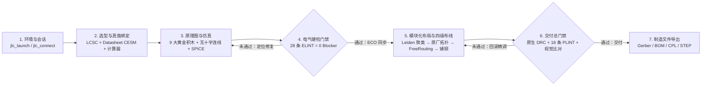

<div align="center">

# ⚡ JLCEDA Pro MCP (`jlceda-mcp`)

**让 AI 在嘉立创EDA 专业版中真正画出“能打板、不炸机、零幻觉”的硬件电路**

[](https://modelcontextprotocol.io)
[](https://nodejs.org)
[](#快速上手)
[](#mcp-工具清单6-层共-43-个)
[](#cli-与开发验证)

[为什么用它](#为什么选择-jlceda-mcp) · [快速上手](#快速上手) · [使用示例](#你可以这样对-ai-说) · [闭环架构](#设计闭环架构) · [43 个工具清单](#mcp-工具清单6-层共-43-个)

</div>

---

## 为什么选择 `jlceda-mcp`

普通 AI 画电路最大的问题不是“画不出来”，而是**编造引脚号、靠猜连线、不管热环路与封装间距，最后板子根本没法贴片打样**。`jlceda-mcp` 通过原生 CDP 协议直连本地嘉立创EDA 专业版，用一套确定性工程护栏把 AI 的自由发挥锁进硬件工程边界内：

| 常见痛点 | 普通 AI / 脚本方案 | `jlceda-mcp` |
| --- | --- | --- |
| **引脚与封装幻觉** | 凭记忆写引脚编号，极易接反烧芯片 | 强制 `jlc_datasheet_extract` 绑定真实库引脚与 CESM 真值模型 |
| **网表误判** | 读取导线二维坐标硬算连通，经常漏连或误连 | 100% 唯一采信官方编译器 `eda.sch_Netlist` 权威网表 |
| **原理图带病转 PCB** | 缺少硬门禁，电源反接/悬空直接带进板子 | 内置 **28 条 `ELINT` 电气硬检**，0 Blocker 方可解锁同步 |
| **布局布线不可用** | 器件乱堆、铜皮孤岛、FB 紧贴 SW 干扰节点 | Leiden 聚类 + 原厂 `Layout Example` 优先 + 四级布线 + **18 条 2.5D `PLINT`** |
| **客户端配置繁琐** | 每个 AI 客户端都要复制一大坨路径 `env` | **环境与挂载解耦**：`setup` 一次托管至 `~/.jlceda-mcp/config.json`，客户端**零 `env`** |

---

## 快速上手

### 前置条件

- **Windows** + 已安装 **嘉立创EDA 专业版（EasyEDA Pro）**
- **Node.js `>= 26.0.0`**（原生启用 `node:sqlite` 与 FTS5，无需本地 C++ 编译工具链）

### 第 1 步：安装依赖并初始化本机环境（只需一次）

```bash
npm install
npm run build
npm run setup
```

`npm run setup` 会自动完成三件事，且**默认不修改任何 AI 客户端配置文件**：
1. 自动探测本机嘉立创EDA 专业版路径（默认目录 / Windows 注册表），未检测到时交互提示输入并校验 `lceda-pro.exe`；
2. 构建无伪源码全量 API 索引（`~/.jlceda-mcp/catalog/api_catalog.sqlite`）；
3. 将环境配置持久化到 `~/.jlceda-mcp/config.json`，并打印各客户端的极简注册方式。

> 非交互式环境可直接指定客户端目录：`node dist/cli.js setup --client-dir "D:\Path\To\lceda-pro"`。

### 第 2 步：注册到你的 AI 客户端（零 `env` 配置）

因为客户端路径与索引位置已统一托管在 `~/.jlceda-mcp/config.json`，挂载片段**不需要填写任何 `env`**：

- **Claude Code**
  ```bash
  claude mcp add jlceda-pro -- node "<项目绝对路径>/dist/index.js"
  ```
- **Codex**
  ```bash
  codex mcp add jlceda-pro -- node "<项目绝对路径>/dist/index.js"
  ```
- **Antigravity / Cursor / 其他 MCP 客户端**（合并进 `mcp_config.json`）
  ```json
  {
    "mcpServers": {
      "jlceda-pro": {
        "command": "node",
        "args": ["<项目绝对路径>/dist/index.js"]
      }
    }
  }
  ```
  > Antigravity 用户也可以显式执行 `node dist/cli.js setup --write-antigravity` 自动无损合并（卸载：`node dist/cli.js uninstall --antigravity`）；随时可用 `npm run print-config` 重新打印上述片段。

---

## 你可以这样对 AI 说

挂载完成后，直接用自然语言驱动完整硬件设计流程：

> **1. 从零设计一块可打样板卡**  
> “打开嘉立创EDA，新建一个 24V 转 5V/3.3V 的工业 RS485 采集板工程：先在立创基础库选型并解析 Datasheet，完成原理图绘制与 28 条电气审计，再按模块聚类布局、优先布好功率环路和差分线、铺铜加防立碑焊盘，最后跑总门禁并导出 Gerber、BOM 和 CPL。”

> **2. 接手老工程做硬核体检**  
> “连接我当前打开的嘉立创工程，读取权威网表跑一遍 `jlc_elec_lint` 和 `jlc_pcb_drc_and_lint`，把所有 Blocker 问题高亮出来，并用 `jlc_view_capture` 截图对照原厂 Datasheet `Layout Example` 给我整改建议。”

> **3. 精准计算并复用标准子电路**  
> “帮我算一下 12V 转 3.3V/2A 同步 Buck 的电感电容和分压反馈电阻（吸附到 E96 标准值），然后直接实例化一个标准 Type-C 5V UFP 供电积木和 PMOS 防反接积木。”

---

## 设计闭环架构



### 核心工程原则与安全边界

- **零伪源码落盘**：REA 逆向索引全程在内存中解析 `.d.ts` 与 AST 特征指纹，严格保证 **0 字节反编译源码写入磁盘**，并内置 `verify-zero-source` 审计门禁。
- **零侵入原软件**：不修改嘉立创EDA 安装目录内任何原始文件（保护 `innerSign` 签名完整），不绕过官方登录/激活机制，不强杀用户已打开的编辑窗口。
- **双引擎确定性护栏**：用确定性数学计算器 + 官方编译态网表 + 28 条 `ELINT` + 18 条 2.5D `PLINT` + 四合一 `jlc_validate` 兜底，消除大模型数值与几何幻觉。
- **事务原子保护**：支持跨多步工具调用的 Undo 事务边界（`jlc_transaction`）与交付前自动释放文件锁（`releaseProcess=true`）。

---

## MCP 工具清单（6 层共 43 个）

<details open>
<summary><strong>第 1 层：环境配置、会话连接、文档与句柄管理（16 个）</strong></summary>

| 工具名 | 核心用处 | 典型使用场景 |
| --- | --- | --- |
| `jlc_configure` | 自动扫描或手动配置嘉立创EDA 专业版路径，校验后持久化至 `~/.jlceda-mcp/config.json` 并热更新当前会话 | 首次运行未检测到客户端、客户端换目录迁移，或修改 CDP 端口/求解器路径 |
| `jlc_launch` | 按合规白名单 CDP 参数启动本机嘉立创EDA 专业版，不强杀已有用户窗口 | 尚未打开嘉立创EDA，需由 MCP 拉起客户端并准备调试连接 |
| `jlc_connect` | 智能扫描进程与窗口 Z-Order，过滤欢迎页/DevTools，直连正在编辑的原理图或 PCB 实例 | 开始协同改图或建立 CDP 会话（`launch=false` 用于只读安全探测） |
| `jlc_session_status` | 独立于主 RPC 队列只读诊断所有 `lceda-pro.exe` 进程、CDP 连通性与阻塞弹窗状态 | 排查客户端卡顿、未激活登录态或超时无响应原因 |
| `jlc_capabilities` | 查询安装路径、REA 接口库分级统计（L1~L4）、L3 适配器健康度及外部求解器状态 | 会话初始化核验环境能力、确认 FreeRouting/ngspice 或索引是否就绪 |
| `jlc_documents` | 列出当前已打开工程及所有原理图页、PCB、符号/封装文档状态、脏标记与选中数量 | 查看当前工程结构、确认未保存改动或定位目标文档句柄 |
| `jlc_document_new` | 新建离线 `.epro` 工程，或在当前工程内新增原理图图纸 / PCB 文件 | 从零新建硬件工程或拆分多页原理图 |
| `jlc_document_open` | 打开本地 `.epro` / `.epro2` 工程，自动检测跨实例文件占用冲突 | 接手已有本地工程进行修改、审计或批量导出 |
| `jlc_document_activate` | 切换并激活指定原理图页或 PCB 标签页，同步切换底层 CDP 执行上下文 | 在多页原理图与 PCB 之间来回切换操作目标 |
| `jlc_document_save` | 原地保存工程，或静默导出 Gerber / BOM / CPL / PDF / SVG / STEP / DSN 及回导 SES | 阶段性存盘、导出嘉立创打样/SMT 生产包，或对接外部布线器 |
| `jlc_document_close` | 关闭指定文档或工程并释放文件锁；传 `releaseProcess=true` 可同步退出空闲后台进程 | 离线改图交付给用户前释放独占锁，确保双击可正常打开工程 |
| `jlc_select` | 只读提取用户界面当前鼠标选中的图元（不清空高亮），或按句柄/网络设置选择集 | 读取用户刚框选的器件/走线，或在画布上高亮定位问题图元 |
| `jlc_reference_create` | 为器件、引脚、焊盘或图元生成带 CRC32 校验的 Base64 跨会话持久引用令牌 | 跨多轮对话或重启会话稳定追踪同一关键实体 |
| `jlc_reference_resolve` | 将持久引用令牌解析回当前会话句柄；实体失效或删除时返回 `ERR_REF_STALE` | 恢复上一轮保存的关键器件/焊盘引用并校验拓扑是否变更 |
| `jlc_array_read` | 对超过 200 项的图元、引脚、焊盘、网表或 DRC 违例数组游标（`jlc_arr:*`）分页读取 | 处理大型工程全量对象或大网表，避免单次响应超长截断 |
| `jlc_transaction` | 显式控制跨多步工具调用的组合 Undo 事务边界（`begin` / `commit` / `rollback` / `list_history`） | 批量布局、批量改线或重构子电路前开启事务，出错一键原子回滚 |

</details>

<details>
<summary><strong>第 2 层：REA 动态接口反射（3 个）</strong></summary>

| 工具名 | 核心用处 | 典型使用场景 |
| --- | --- | --- |
| `jlc_api_search` | 在无伪源码 SQLite FTS5 索引中按中英文关键词、领域与等级（L1~L4）执行 BM25 检索 | 现有高层工具未覆盖某项冷门原生操作时，查找对应的嘉立创底层接口 |
| `jlc_api_describe` | 读取目标接口的完整机器签名、参数类型、物理量单位契约、前置条件与置信度 | 调用 `jlc_api_invoke` 前核实参数格式与单位，避免盲调报错 |
| `jlc_api_invoke` | 动态执行经检索确认的 L1 官方 `eda.*`、L2 命令、L3 引擎能力或 L4 白名单 IPC（拦截 `BLOCKED`） | 调用高级/冷门原生功能，自动处理 mm/mil 换算、`$ref`/`$enum` 与事务回滚 |

</details>

<details>
<summary><strong>第 3 层：器件库、数据手册解析与确定性计算（5 个）</strong></summary>

| 工具名 | 核心用处 | 典型使用场景 |
| --- | --- | --- |
| `jlc_lib_search` | 联合检索嘉立创系统库、本地库与立创商城（LCSC）目录，支持 C 编号、封装与 SMT 基础库筛选 | 选型阶段查找现货、立创 SMT 基础库/扩展库料号与对应封装 |
| `jlc_lib_device_inspect` | 提取选定器件符号与封装的 100% 真实引脚定义、焊盘公制坐标、孔径、极性与 3D 高度 | 接线或画封装前核实真实引脚编号与焊盘尺寸，杜绝编造引脚 |
| `jlc_datasheet_extract` | 解析 PDF Datasheet 并对齐官方库引脚，生成并绑定标准器件电气模型（CESM）与原厂 `Layout Example` | **放置器件前必调**：建立绝对最大额定值、热阻、推荐外围与布局约束真值 |
| `jlc_lib_custom_create` | 按 IPC-7351 标准参数化生成冷门器件的公制封装与原理图符号，并绑定已验证 CESM | 立创库中缺失冷门芯片/连接器，需要按规格书尺寸自动建库 |
| `jlc_elec_calc` | 内置 9 大确定性电气计算器（分压、LDO 热耗、DC-DC 电感电容、晶振负载电容、I2C 上拉、RC 滤波、LED/光耦、MOS 损耗、线宽温升压降），自动吸附 E24/E96 序列 | 计算阻容感选值、校验热功耗和载流能力，用确定性数学公式替代心算估算 |

</details>

<details>
<summary><strong>第 4 层：原理图绘制、标准积木与 SPICE 仿真（7 个）</strong></summary>

| 工具名 | 核心用处 | 典型使用场景 |
| --- | --- | --- |
| `jlc_sch_sheet_manage` | 创建/重排原理图分页、配置 A4/A3 图框标题栏，并在图纸上绘制功能模块分区虚线框与注释 | 搭建多页原理图骨架、按电源/主控/接口清晰划分图纸功能区 |
| `jlc_sch_component_place` | 在原理图放置真实库器件（硬门禁校验 CESM 绑定），写入位号、参数值、坐标与 `clusterGroup` 分组标签 | 放置已完成选型与 Datasheet 真值绑定的芯片及外围阻容 |
| `jlc_sch_block_instantiate` | 一键实例化 9 大工程验证黄金子电路积木（Type-C UFP、PMOS 防反接、同步 Buck、低噪 LDO、MCU 最小系统、无源晶振、继电器驱动、RS485/CAN、RJ45 Bob-Smith） | 快速复用成熟标准电路，自动完成内部器件排布与无十字交叉连线 |
| `jlc_sch_wire_connect` | 执行引脚正交自动连线、放置网络标签/电源地符号与非连接标记，禁止四向十字交叉（强制错开 `>=2.54mm` 为双 T 节点） | 原理图模块内与跨模块电气互联，保持图纸规范可读 |
| `jlc_sch_netlist_query` | 100% 唯一调用官方编译器 `eda.sch_Netlist` 导出权威编译态结构化网表 | 核对真实电气连通关系、排查悬空/短接网络，或向审计/聚类提供真值网表 |
| `jlc_spice_run` | 驱动嘉立创内置仿真引擎或本地无头 ngspice / MNA 求解器运行 OP/TRAN/AC/DC 仿真并校验定量断言 | 投板前验证分压、滤波频响、电源上电瞬态或偏置工作点是否达标 |
| `jlc_sch_sync_to_pcb` | 将原理图正向同步（ECO）到目标 PCB（硬门禁：必须先通过 `jlc_elec_lint` 0 Blocker） | 原理图审校清零后，安全导入封装与网表进入 PCB 布局布线阶段 |

</details>

<details>
<summary><strong>第 5 层：PCB 模块化布局与四级自动布线（8 个）</strong></summary>

| 工具名 | 核心用处 | 典型使用场景 |
| --- | --- | --- |
| `jlc_pcb_board_setup` | 定义板框、铣槽/隔热槽、层叠结构、安装孔、分层 2.5D Keep-out，并双向同步工程原生 DRC 与 NetClass | PCB 开板初始化，设定 2/4/6 层板叠层、工艺线宽线距与机械禁布区 |
| `jlc_pcb_cluster_netlist` | 基于权威网表剥离全局电源/地，执行去耦电容重绑定与加权 Leiden 图聚类，切分为功能子模块 | 布局前自动识别电源、时钟、高速接口等紧密关联器件组，为模块化分区打底 |
| `jlc_pcb_layout_apply` | 按“原厂 `Layout Example` > 工程 DRC > 四维最小间距矩阵”执行宏观分区求解或显式微调，确保 Courtyard 零重叠 | 一键完成无碰撞模块化布局，或在审查后对单个器件做毫米级精调 |
| `jlc_pcb_route_critical` | 第 1 级关键网络参数化先布并加锁（原厂铜区/过孔阵、去耦微回路、DC-DC 热环路、TVS 穿焊盘零残桩、晶振包地、采样电阻开尔文引出、差分对） | 自动布线前优先锁定电源功率回路与敏感高速/模拟信号的高质量走线 |
| `jlc_pcb_via_place` | 放置单颗过孔、大电流换层并联过孔阵、射频屏蔽过孔墙或芯片底部 GND EPAD 散热过孔阵 | 处理大电流换层载流、QFN/PowerPAD 散热，或射频/敏感区域屏蔽隔离 |
| `jlc_pcb_autoroute` | 第 2 级常规信号自动布线闭环，支持无头 FreeRouting（DSN→多趟推挤重布→SES）及内置 45° A* 路由器 | 关键线锁定后，自动完成剩余大量常规控制/低速信号线的连通与避让 |
| `jlc_pcb_pour_and_stitch` | 第 3 级多边形铺铜、死铜孤岛清除、0603/0402/0201 强制 4 辐条防立碑隔热焊盘与网格/板边 GND 缝合过孔阵 | 布线完成后铺设完整地/电源铜皮，降低回流阻抗并满足 SMT 回流焊工艺 |
| `jlc_pcb_silkscreen_tidy` | 统一丝印 0°/90° 正交朝向，自动避让裸铜焊盘与开窗过孔，强化外部可见极性防呆标识 | 交付打样前清理压焊盘/重叠丝印，提升贴片检验与人工焊接可读性 |

</details>

<details>
<summary><strong>第 6 层：电气/几何双引擎审计与视觉核验（4 个）</strong></summary>

| 工具名 | 核心用处 | 典型使用场景 |
| --- | --- | --- |
| `jlc_elec_lint` | 基于官方编译态网表执行 28 条原理图确定性电气硬检（`ELINT-001~028`），0 Blocker 方可解锁转 PCB | 原理图画完后查漏补缺（电源反接、悬空引脚、上拉缺失、耐压/电平不匹配等） |
| `jlc_pcb_drc_and_lint` | 工程原生 DRC 动态驱动 + 18 条 2.5D 计算几何与电磁拓扑硬检（`PLINT-01~18`），先求图层交集消除多层误报 | 布局布线与铺铜后检查间距、孤岛、热环路、FB 靠近 SW 干扰、立碑风险等 |
| `jlc_validate` | 交付前四合一总门禁：SCH-PCB 同步 + 28 条电气 Linter + 原生 DRC & 18 条 2.5D 几何 Linter + SMT BOM/CPL 可制造性 | 导出 Gerber/BOM/CPL 投板前的最终一票否决总验收 |
| `jlc_view_capture` | 输出带公制标尺网格与违例高亮的 PNG 视口图，支持与原厂 Datasheet `Layout Example` 左右双图并排比对 | 人工/多模态视觉复核布局美感、走线整洁度及开关电源/芯片原厂布局还原度 |

</details>

---

## CLI 与开发验证

```bash
# 编译与全量回归测试（98 项单测 + 黄金板卡 E2E）
npm run build
npm test

# 交互式全局环境配置 / 打印零 env 注册片段
npm run setup
npm run print-config

# 环境自检、重建 REA 无伪源码索引与零源码审计
node dist/cli.js doctor
node dist/cli.js index --verify-zero-source

# 校验 L3 指纹重绑定状态 / 离线网表审计
node dist/cli.js calibrate-l3
node dist/cli.js lint path/to/netlist.json
```
