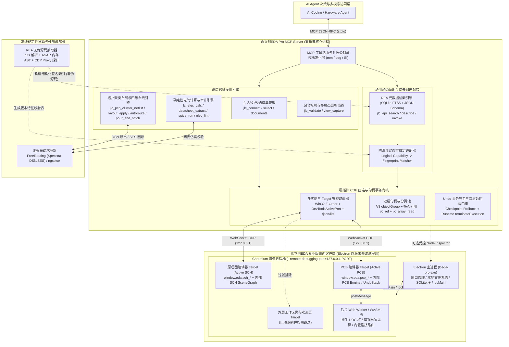
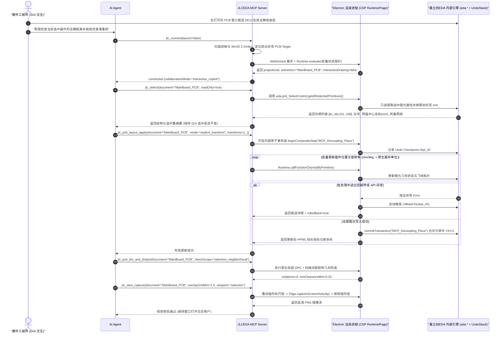
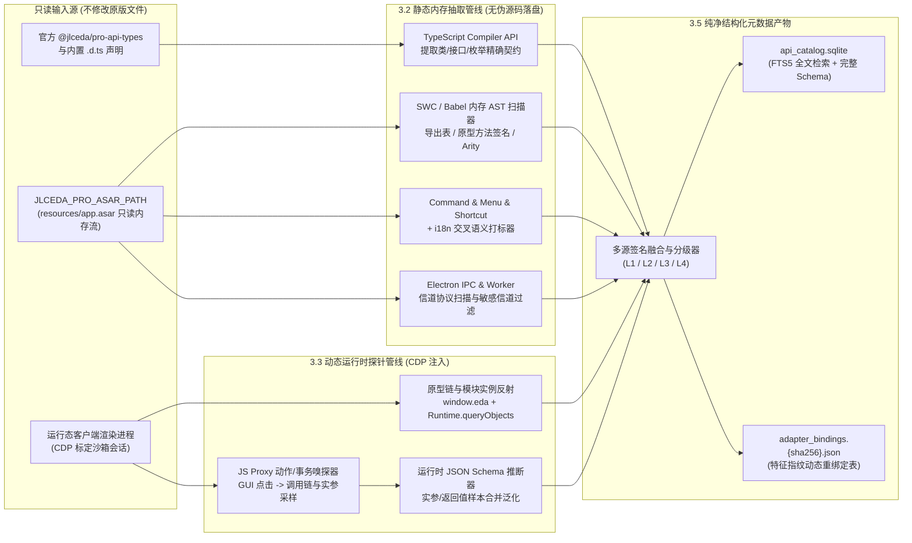
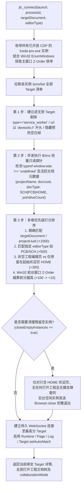
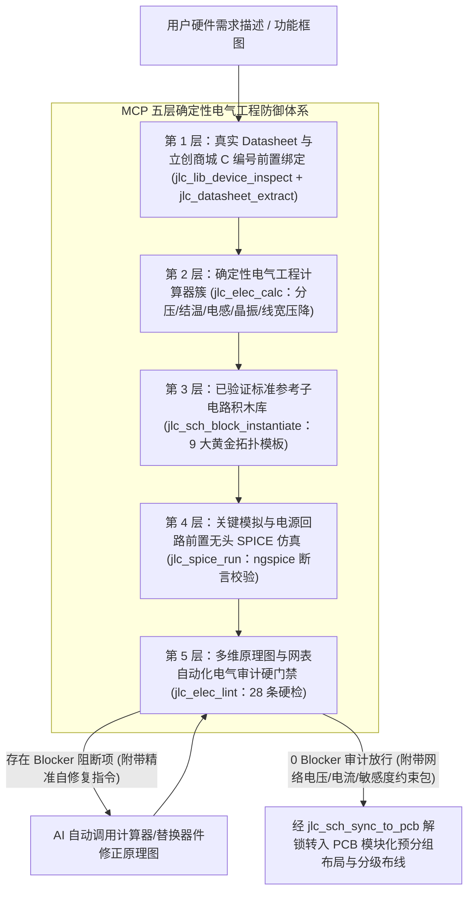
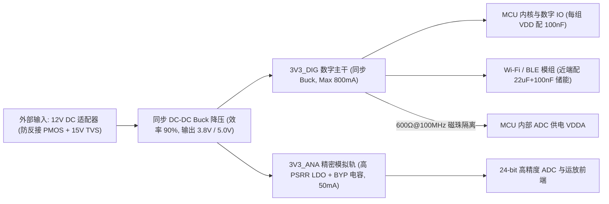
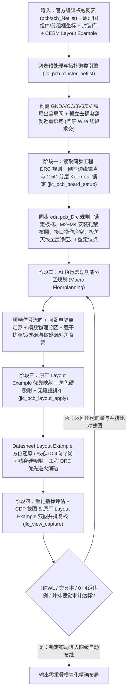
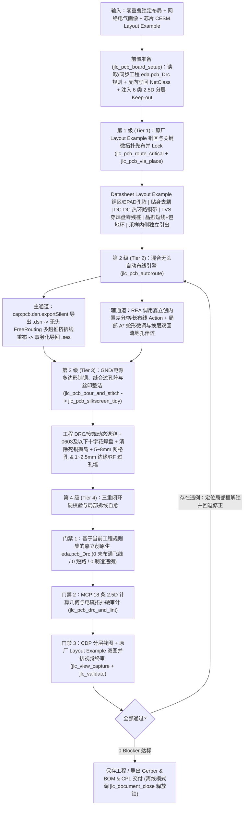

# 嘉立创EDA 专业版全量接口逆向（REA）、零桥接 CDP 直连与确定性工程闭环 MCP 技术方案

> [!IMPORTANT]
> **方案定位与核心工程目标**：本方案面向**嘉立创EDA 专业版（EasyEDA Pro 桌面客户端，Electron 架构）**，全面对标生产级 SolidWorks MCP Server 的跨进程协同秩序，打造一套集**“无伪源码全量接口逆向（REA） + 零插件/零桥接远程调试协议（CDP）原生直连 + 五层确定性电气工程护栏 + 网表拓扑预分组布局与四级自动布线闭环”**于一体的工业级硬件设计模型上下文协议（Model Context Protocol, MCP）服务端技术体系。旨在彻底解决大语言模型（Large Language Model, LLM）自动画原理图与 PCB 时的**接口视野受限、引脚/参数幻觉烧板、同类型元件机械排队以及复杂避障绕线无能为力**四大核心痛点，直接输出符合嘉立创 SMT 量产制造标准的可靠硬件工程。

---

## 目录

- [第 1 章 方案总览与端到端闭环工作流](#第-1-章-方案总览与端到端闭环工作流)
  - [1.1 立项背景与 AI 自动化硬件设计的四大工程鸿沟](#11-立项背景与-ai-自动化硬件设计的四大工程鸿沟)
  - [1.2 技术方案四大核心支柱](#12-技术方案四大核心支柱)
  - [1.3 端到端 AI 硬件设计全流程闭环工作流](#13-端到端-ai-硬件设计全流程闭环工作流)
- [第 2 章 跨进程控制底座对标与客户端环境探测规范](#第-2-章-跨进程控制底座对标与客户端环境探测规范)
  - [2.1 总体架构对标（SolidWorks COM/ROT vs 嘉立创EDA Electron/CDP）](#21-总体架构对标solidworks-comrot-vs-嘉立创eda-electroncdp)
  - [2.2 客户端环境探测与未安装态路径后补规范](#22-客户端环境探测与未安装态路径后补规范)
- [第 3 章 REA 全量接口逆向抽取工程流水线（无伪源码模式）](#第-3-章-rea-全量接口逆向抽取工程流水线无伪源码模式)
  - [3.1 REA 核心边界与“零伪源码落盘”铁律](#31-rea-核心边界与零伪源码落盘铁律)
  - [3.2 静态抽取管线（Static Extraction Pipeline）](#32-静态抽取管线static-extraction-pipeline)
  - [3.3 动态运行时探针管线（CDP Runtime Probe Pipeline）](#33-动态运行时探针管线cdp-runtime-probe-pipeline)
  - [3.4 接口分级（Tiering）与防版本失效隔离层](#34-接口分级tiering与防版本失效隔离层)
  - [3.5 全量接口元数据索引 Schema 规范与实战实例](#35-全量接口元数据索引-schema-规范与实战实例)
- [第 4 章 零桥接、零插件的 CDP 直连引擎设计](#第-4-章-零桥接零插件的-cdp-直连引擎设计)
  - [4.1 为什么彻底摒弃 `.eext` 桥接扩展与外部中转进程？](#41-为什么彻底摒弃-eext-桥接扩展与外部中转进程)
  - [4.2 多实例与多标签页智能寻址（深度对标 `sw_connect` & `sw_session_status`）](#42-多实例与多标签页智能寻址深度对标-sw_connect--sw_session_status)
  - [4.3 RPC 执行引擎、远端对象句柄池与原子事务回滚机制](#43-rpc-执行引擎远端对象句柄池与原子事务回滚机制)
  - [4.4 多模态视口截图与人机实时协同协议](#44-多模态视口截图与人机实时协同协议)
- [第 5 章 MCP 工具集全景契约定义（6 大层 41 个工具）](#第-5-章-mcp-工具集全景契约定义6-大层-41-个工具)
  - [5.1 全局设计准则、公制单位契约与统一响应信封](#51-全局设计准则公制单位契约与统一响应信封)
  - [5.2 第 1 层：会话、文档、选择集与句柄管理层（14 个底座工具）](#52-第-1-层会话文档选择集与句柄管理层14-个底座工具)
  - [5.3 第 2 层：通用动态反射层（3 个全量兜底工具）](#53-第-2-层通用动态反射层3-个全量兜底工具)
  - [5.4 第 3 层：立创商城、器件库、Datasheet 解析与确定性电气计算层（5 个工具）](#54-第-3-层立创商城器件库datasheet-解析与确定性电气计算层5-个工具)
  - [5.5 第 4 层：原理图操作、标准参考积木与 SPICE 仿真层（7 个工具）](#55-第-4-层原理图操作标准参考积木与-spice-仿真层7-个工具)
  - [5.6 第 5 层：PCB 模块化预分组布局与四级自动布线操作层（8 个工具）](#56-第-5-层pcb-模块化预分组布局与四级自动布线操作层8-个工具)
  - [5.7 第 6 层：电气/几何双引擎审计与多模态视觉核验层（4 个硬门禁工具）](#57-第-6-层电气几何双引擎审计与多模态视觉核验层4-个硬门禁工具)
  - [5.8 核心反射/校验工具完整 JSON Schema 与 `instructions.md` 协同指令范本](#58-核心反射校验工具完整-json-schema-与-instructionsmd-协同指令范本)
- [第 6 章 电路电气属性全景总结（面向开发者的结构化硬件工程指南）](#第-6-章-电路电气属性全景总结面向开发者的结构化硬件工程指南)
  - [6.1 为什么 AI 画电路容易在电气属性上翻车 & 五层确定性防御架构](#61-为什么-ai-画电路容易在电气属性上翻车--五层确定性防御架构)
  - [6.2 电源树（Power Tree）规划、稳压拓扑边界与热预算死算](#62-电源树power-tree规划稳压拓扑边界与热预算死算)
  - [6.3 芯片引脚电气属性（Pin Electrical Types）与信号互联底层规则](#63-芯片引脚电气属性pin-electrical-types与信号互联底层规则)
  - [6.4 全品类电子元件电气选型、降额、极性防呆与保护设计大全](#64-全品类电子元件电气选型降额极性防呆与保护设计大全)
- [第 7 章 确定性电气工具链与原理图网表自动化审计引擎（Electrical Linter）](#第-7-章-确定性电气工具链与原理图网表自动化审计引擎electrical-linter)
  - [7.1 器件库与 Datasheet 强制结构化解析协议](#71-器件库与-datasheet-强制结构化解析协议)
  - [7.2 内置确定性电气计算器工具集（`jlc_elec_calc`）](#72-内置确定性电气计算器工具集jlc_elec_calc)
  - [7.3 标准参考子电路黄金积木库与前置无头 SPICE 仿真接口](#73-标准参考子电路黄金积木库与前置无头-spice-仿真接口)
  - [7.4 原理图与网表自动化电气审计引擎（Electrical Linter）规范](#74-原理图与网表自动化电气审计引擎electrical-linter规范)
- [第 8 章 模块化预分组布局引擎、四维最小间距矩阵与三维净空规范](#第-8-章-模块化预分组布局引擎四维最小间距矩阵与三维净空规范)
  - [8.1 根治“同类型元件排队”——基于网表拓扑预分组的模块化布局引擎设计](#81-根治同类型元件排队基于网表拓扑预分组的模块化布局引擎设计)
  - [8.2 四维最小间距体系与全品类量化间距速查矩阵](#82-四维最小间距体系与全品类量化间距速查矩阵)
  - [8.3 关键子系统布局与三维层叠净空（3D Keep-out）死命令](#83-关键子系统布局与三维层叠净空3d-keep-out死命令)
- [第 9 章 安规线距、载流线宽/过孔/压降全量规范与四级自动布线闭环](#第-9-章-安规线距载流线宽过孔压降全量规范与四级自动布线闭环)
  - [9.1 功率、安规、线宽、过孔与直流压降全套工程速查规范](#91-功率安规线宽过孔与直流压降全套工程速查规范)
  - [9.2 特殊工艺与高速/敏感信号精细布线准则](#92-特殊工艺与高速敏感信号精细布线准则)
  - [9.3 MCP 四级自动布线引擎与几何/视觉闭环校验架构](#93-mcp-四级自动布线引擎与几何视觉闭环校验架构)
- [第 10 章 工程仓库目录结构蓝图与分阶段实施路线图（Roadmap）](#第-10-章-工程仓库目录结构蓝图与分阶段实施路线图roadmap)
  - [10.1 推荐工程仓库目录树蓝图](#101-推荐工程仓库目录树蓝图)
  - [10.2 客户端安装后的路径回填与环境初始化清单](#102-客户端安装后的路径回填与环境初始化清单)
  - [10.3 Phase 1 ～ Phase 5 分阶段实施与量化验收里程碑](#103-phase-1--phase-5-分阶段实施与量化验收里程碑)

---

## 第 1 章 方案总览与端到端闭环工作流

### 1.1 立项背景与 AI 自动化硬件设计的四大工程鸿沟

将大语言模型（LLM）引入电子设计自动化（Electronic Design Automation, EDA）领域实现“自然语言对话生成原理图与量产级 PCB”，在落地层面长期受困于四道本质性的工程鸿沟：

1. **宿主软件控制鸿沟（插件沙箱受限与桥接脆弱）**：社区常见的嘉立创EDA 自动化脚本普遍依赖手动安装 `.eext` 扩展插件并建立外部 WebSocket 中转桥接。这不仅迫使用户每次换机、重装都得手工配置插件，而且扩展沙箱只能触达官方开放的浅层 `eda.*` API 子集，对内部无弹窗 Specctra DSN/SES 导出回导、Undo 历史事务合并回滚、原生铺铜布尔重灌以及 Chromium 合成器像素截图等核心能力束手无策，多标签切换时还极易断链。
2. **软件接口视野鸿沟（暗面引擎未公开与升级混淆漂移）**：嘉立创EDA 专业版作为大型桌面级 Electron 软件，大量高阶生产力特性隐藏在未公开的内部命令分发器（Command Dispatcher）、渲染进程引擎单例与主渲染进程间通信（IPC）信道中。若采用传统逆向落盘数万行反编译伪源码，不仅检索低效、磁盘臃肿，而且客户端一旦小版本升级重新混淆打包，硬编码符号即全线失效。
3. **硬件电气物理鸿沟（概率 Token 续写引发烧板与瘫痪）**：与纯数字逻辑的软件代码不同，真实硬件受欧姆定律、热力学与电磁场方程刚性支配。大模型凭模糊语料续写原理图时，极易发生**编造芯片引脚编号、跨电平域直连击穿 IO、漏算 LDO 压差发热导致热关断、忽视钽电容/MLCC 耐压降额与极性反接炸裂、在 USB Type-C 受电口共用单颗 `5.1 kΩ` 下拉电阻导致 C-to-C 线不通电、以及漏加开漏上拉或继电器反向续流二极管**等致命工程事故。
4. **二维几何布局与绕线鸿沟（“仓库理货式排队”与手算折线短路）**：原始 BOM 与网表按位号字典序（`C1..Cn`、`R1..Rn`、`U1..Un`）排列，且全局 `GND`/`3V3` 网络将全板 90% 的器件粘连在一起。直接让大模型报坐标，几乎必现**把所有电阻排成一列、所有电容排成一列**的反工程恶习，导致高频去耦失效、开关热环路暴涨；同时大模型不具备连续二维欧氏空间障碍物拓扑感知能力，手算走线折点必引发海量短路与间距违例。

---

### 1.2 技术方案四大核心支柱

针对上述四大鸿沟，本方案确立**“算法与编译器管确定性物理边界，大模型管架构意图与多模态审美决策”**的核心工程哲学，构建四大技术支柱：

1. **支柱一：基于 REA（Reverse Engineering Anything）的无伪源码全量接口逆向底座**
   - 针对 `<JLCEDA_PRO_ASAR_PATH>` 与运行态渲染进程，构建**“内存虚拟文件系统（VFS）直读 `.d.ts` + Webpack/Vite Bundle 内存抽象语法树（AST）五遍扫描 + CDP 原型链枚举与 JS `Proxy` 交互嗅探”**双轨逆向管线，100% 抽取 `L1_PUBLIC`（官方 `window.eda.*`）、`L2_COMMAND`（内部命令注册表）、`L3_ENGINE`（内部场景图/事务栈/无弹窗 DSN 序列化引擎单例）与 `L4_IPC`（Worker 与受控主进程信道）全量接口。
   - 严格贯彻**零伪源码落盘（Zero Pseudo-source Persistence）**铁律，全部逆向产物收敛为 SQLite FTS5 全文检索库与 JSON Schema Draft 2020-12 强类型契约，并配套**三锚点特征指纹动态重绑定适配器（Adapter Layer）**抵御客户端升级混淆；在当前电脑未安装客户端阶段，全链路支持标准化路径占位符与安装后五级瀑布自动寻址。
2. **支柱二：零桥接、零插件的 CDP（Chrome DevTools Protocol）原生直连架构（1:1 对标 SolidWorks MCP）**
   - 彻底抛弃 `.eext` 插件与外部中转服务，由 MCP Server 直接通过本地安全回环 WebSocket 连接 Electron 渲染进程的 `--remote-debugging-port`。
   - 完整复刻并升华生产级 SolidWorks MCP 的协同控制体验：联合 Win32 窗口 Z-Order、`DevToolsActivePort` 与 `/json/list` 智能跳过欢迎页直连前台活跃工程（`jlc_connect`）；独立旁路弹窗与进度诊断（`jlc_session_status`）；高层公制（`mm`/`deg`）与底层原生（`mil`）双轨单位自动隔离；200 项分页游标（`jlc_array_read`）与跨会话 Base64 持久引用（`jlc_reference_*`）；只读提取人工鼠标框选集（`jlc_select(readOnly=true)`）；所有写画布操作自动包裹内部 Undo 事务组，支持异常一键原子回滚与单步 `Ctrl+Z`；严格区分**人机实时协同保活**与**离线批处理交付释放文件/进程锁（`releaseProcess=true`）**。
3. **支柱三：五层确定性电气工程护栏（根治 AI 电气属性盲区与交叉线误判）**
   - 系统化梳理面向软件开发者的硬件电气底层逻辑与 **7 大类 30+ 细分电子元件** 的降额、极性、瞬态保护及抗干扰红线，并将其固化为五道不可绕过的机器防线：① 放置器件前强制经立创商城 `C` 编号拉取官方符号焊盘，并通过 `jlc_datasheet_extract` 解析 PDF 数据手册构建标准化器件电气模型（CESM，同步提取引脚极限耐压与手册末尾的 **`Layout Guidelines & Layout Example` 原厂参考 PCB 布局图及铜皮/过孔拓扑**）；② 阻容配比、LDO 结温 $T_J$、电感饱和电流 $I_{\text{sat}}$、晶振匹配电容、线宽载流与压降一律交由确定性数学计算器（`jlc_elec_calc`）求解；③ 高频翻车拓扑强制调用 9 大标准参考子电路积木（`jlc_sch_block_instantiate`）整块实例化；④ 模拟调理与磁珠滤波回路前置调用无头 `ngspice`（`jlc_spice_run`）校验稳定性；⑤ 转入 PCB 前强制通过 **100% 唯一采信官方编译器权威网表（`eda.sch_Netlist`，严禁读取二维 `sch_PrimitiveWire` 几何线段求交以彻底根绝十字跨线误判）** 的 **28 条原理图电气审计硬门禁（`jlc_elec_lint`）**，0 Blocker 方可解锁网表移交。
4. **支柱四：原厂 `Layout Example` 领衔的网表预分组布局 + 工程 DRC 优先 + 四级自动布线闭环**
   - **布局阶段**：前置运行基于权威编译网表的预处理引擎（`jlc_pcb_cluster_netlist`），自动剥离 `GND`/`VCC`/`3V3`/`5V` 全局高扇出网络并将孤立去耦电容一对一就近重绑定至宿主芯片电源脚，通过加权 Leiden 聚类切分为 8 类高内聚功能模块；严格遵循 **“芯片原厂 Datasheet `Layout Example` 专属拓扑 > 当前工程自定义 DRC 设计规则（`eda.pcb_Drc`） > 通用四维最小间距矩阵与分层掩码感知 2.5D Keep-out”** 的优先级体系，由“刚性边缘结构先行锁定 → AI 宏观分区（Floorplanning） → 块内核心 IC 原厂参考拓扑还原/四向寻优与外围阻容贴身硬吸附 + 力导向/模拟退火无碰撞排布”彻底消灭“同类型元件排队”与“顶层禁布误报全层净空”。
   - **布线与终审阶段**：执行“第 1 级关键微拓扑（原厂 `Layout Example` 功率铜皮与散热孔阵、去耦顺序、DC-DC 热环路铜带、TVS 穿焊盘零残桩、晶振无孔包地、采样电阻焊盘内侧独立取样出线）参数化先布并加锁 → 第 2 级零弹窗导出 Specctra `.dsn` 驱动无头 FreeRouting 多趟推挤拆线重布 + REA 内置差分等长路由 → 第 3 级动态安规退避多边形铺铜（`0603` 及以下强制十字花焊盘防立碑）与网格缝合过孔阵 → 第 4 级读取当前工程 DRC 规则驱动原生制造 DRC + **18 条计算几何拓扑 Linter（`jlc_pcb_drc_and_lint`）** + 带公制标尺网格及**原厂 Datasheet `Layout Example` 双图并排多模态合规比对（`jlc_view_capture`）**终审”全闭环。

---

### 1.3 端到端 AI 硬件设计全流程闭环工作流

```mermaid
flowchart TD
    Start["用户输入硬件需求 / 或在已打开嘉立创EDA窗口框选局部电路"] --> Connect["会话寻址与模式判定 (jlc_connect / jlc_session_status)\n跳过欢迎页直连活跃工程 | 识别实时协同 vs 离线交付模式"]

    subgraph Stage1["阶段一：器件真值绑定与确定性原理图设计"]
        direction TB
        LibBind["商城选型与 Datasheet 真值绑定\njlc_lib_search -> jlc_lib_device_inspect -> jlc_datasheet_extract (生成含 Layout Example 的 CESM)"]
        ElecCalc["确定性参数死算与标准积木实例化\njlc_elec_calc (分压/热阻/电感/晶振/压降) + jlc_sch_block_instantiate"]
        SchDraw["原理图模块化绘制与正交连线 (禁四向十字交点)\njlc_sch_sheet_manage -> jlc_sch_component_place -> jlc_sch_wire_connect"]
        SpiceSim["动态敏感回路无头 SPICE 校验\njlc_spice_run (ngspice .op / .ac / .tran 断言核验)"]
        ElecLint{"权威 sch_Netlist 28 条电气硬门禁\njlc_elec_lint == 0 Blocker?"}

        LibBind --> ElecCalc --> SchDraw --> SpiceSim --> ElecLint
        ElecLint -- "存在 Blocker (附数学证据与自修复处方)" --> ElecCalc
    end

    Connect --> LibBind
    ElecLint -- "0 Blocker 放行：生成网络电压/电流/EMI/亲和约束包" --> SyncPCB["正向变更无弹窗同步至 PCB\njlc_sch_sync_to_pcb"]

    subgraph Stage2["阶段二：网表拓扑预分组与四阶段无碰撞模块化布局"]
        direction TB
        BoardSetup["读取/同步工程原生 DRC 规则 + 板框/层叠/2.5D 分层 Keep-out/NetClass 注入\njlc_pcb_board_setup"]
        Cluster["基于权威编译网表剥离全局电源/GND + 去耦重绑定 + Leiden 图聚类\njlc_pcb_cluster_netlist (输出含原厂布局指引的功能块 JSON)"]
        Floorplan["刚性边缘锚点锁定 + AI 宏观分区 + 原厂 Layout Example 优先吸附 & 退火消碰\njlc_pcb_layout_apply (工程 DRC 动态覆盖 + 四维最小间距矩阵)"]
        LayoutCheck{"HPWL / 飞线交叉率 / 同簇离散度\n+ jlc_view_capture 布局初审达标?"}

        BoardSetup --> Cluster --> Floorplan --> LayoutCheck
        LayoutCheck -- "存在重叠或飞线拧麻花" --> Floorplan
    end

    SyncPCB --> BoardSetup

    subgraph Stage3["阶段三：四级混合自动布线与动态铺铜缝合"]
        direction TB
        Tier1["第 1 级：原厂 Layout Example 铜区与关键微拓扑先布并加锁 (primitiveLock=true)\njlc_pcb_route_critical + jlc_pcb_via_place"]
        Tier2["第 2 级：静默导出 DSN -> 无头 FreeRouting 多趟推挤 + 内置差分路由\njlc_pcb_autoroute (事务化回导 SES)"]
        Tier3["第 3 级：多边形覆铜 (0603及以下十字花焊盘/去孤岛) + GND 缝合过孔阵 + 丝印整洁\njlc_pcb_pour_and_stitch -> jlc_pcb_silkscreen_tidy"]

        Tier1 --> Tier2 --> Tier3
    end

    LayoutCheck -- "布局锁定" --> Tier1

    subgraph Stage4["阶段四：双引擎几何 DRC + 多模态视觉终审与无锁交付"]
        direction TB
        GeoLint["第 4 级：工程原生 PCB_Drc (0 飞线/0 短路) + 18 条 2.5D 计算几何 Linter\njlc_pcb_drc_and_lint"]
        FinalVal{"四合一交付总门禁 + 原厂 Layout Example 双图并排比对\njlc_validate + jlc_view_capture (2D/3D/Side-by-Side) 通过?"}
        Deliver["按协同模式安全交付：\n• 实时协同：jlc_document_save 保持窗口激活且支持单步 Ctrl+Z\n• 离线批处理：导出 Gerber/BOM/CPL/STEP 后调 jlc_document_close(releaseProcess=true)"]

        GeoLint --> FinalVal
        FinalVal -- "检出几何/安规/丝印违例：局部解锁自愈" --> Tier2
        FinalVal -- "100% 达标放行" --> Deliver
    end

    Tier3 --> GeoLint
```



---

## 第 2 章 跨进程控制底座对标与客户端环境探测规范

### 2.1 总体架构对标（SolidWorks COM/ROT vs 嘉立创EDA Electron/CDP）

#### 2.1.1 跨进程控制底座的范式迁移

现有 SolidWorks MCP Server 之所以在复杂机械计算机辅助设计（Computer-Aided Design, CAD）协同中具备极高可靠性，核心在于其建立了一套完整的工业软件控制秩序：**多实例防空窗智能寻址 → 上下文与人工选择集无损感知 → 高层语义工具与底层动态反射双轨并行 → 跨会话持久引用句柄 → 确定性几何校验加多模态截图闭环 → 实时协同保活与离线交付锁释放分离**。

将这一成熟范式迁移至嘉立创EDA 专业版时，宿主软件的底层运行时从 **Windows 原生 C++/COM 单线程套间（Single-Threaded Apartment, STA）进程** 转变为 **Electron 多进程架构（Node.js 主进程 + 多 Chromium 渲染进程 + Web Worker / WebAssembly 计算核）**。两者的核心控制机制存在严密的同构映射关系：

1. **进程间通信（Inter-Process Communication, IPC）通道迁移**：SolidWorks 依赖 Windows 运行对象表（Running Object Table, ROT）获取 `ISldWorks` 进程外组件对象模型（Component Object Model, COM）代理指针，通过 `IDispatch` / vtable 跨进程封送调用；嘉立创EDA 专业版则直接复用 Chromium 内核原生内置的远程调试协议（Chrome DevTools Protocol, CDP），由 MCP Server 通过本地回环地址 `ws://127.0.0.1:<port>/devtools/page/<targetId>` 建立持久全双工 WebSocket 连接，无需在客户端内安装任何 `.eext` 桥接扩展，也无需篡改客户端安装包。
2. **多窗口与活动文档拓扑迁移**：SolidWorks 单进程可打开多个零件/装配/工程图子窗口，通过 ROT + Win32 Z-Order 跳过空壳进程；嘉立创EDA 专业版不仅可能存在多个客户端进程，单个 Electron 实例内部还会同时派生主框架壳窗口、起始欢迎页、原理图编辑 Target、PCB 编辑 Target、3D 预览 Target、器件库编辑 Target 以及 `devtools://` 调试页。因此 `jlc_connect` 需执行**“操作系统级进程枚举 + Win32 窗口 Z-Order 排序 + CDP `/json/list` Target 树过滤 + 渲染帧活跃文档探针”**四级联合寻址。
3. **API 全量反射底座迁移**：SolidWorks 借助 COM 类型库（Type Library, `.tlb`）与主互操作程序集（Primary Interop Assembly, PIA）构建离线接口库；嘉立创EDA 专业版则通过 **REA 双轨无伪源码流水线**——静态侧解析 `@jlceda/pro-api-types` 官方 `.d.ts` 与 `app.asar` 内 Webpack/Vite Bundle 的抽象语法树（Abstract Syntax Tree, AST）导出表，动态侧通过 CDP 原型链枚举与交互动作 `Proxy` 嗅探——将官方公开的 `window.eda.*`（L1）与未公开的命令分发器（L2）、画布图元/路由/历史栈内部单例（L3）及受控主渲染 IPC 信道（L4）统一收敛进结构化元数据索引。

#### 2.1.2 表 2-1：SolidWorks MCP 与嘉立创EDA Pro MCP 十二维工程对标矩阵

| 架构维度 | SolidWorks MCP（现有标杆基线） | 嘉立创EDA 专业版 MCP（本方案设计） | 核心工程增益与适配要点 |
| :--- | :--- | :--- | :--- |
| **跨进程控制协议** | Windows COM Out-of-Process（`IDispatch` / Early-bound PIA） | 本地回环 CDP WebSocket（`Runtime` / `Page` / `Target` / `DOM` / `Input` 域）+ 可选主进程 Node Inspector（`--inspect`） | 零插件免安装、不改动原版 `app.asar` 签名，原生支持异步 Promise 等待与异常堆栈捕获 |
| **多实例发现与防空窗** | `sw_connect` 枚举 ROT `SolidWorks_PID_<pid>` + Win32 可见窗口 Z-Order，自动跳过空白 SW 实例 | `jlc_connect` 扫描进程组与 `DevToolsActivePort` + Win32 Z-Order + `/json/list` 剔除欢迎页/`devtools://`，直连前台非空原理图/PCB Target | 彻底解决“连上欢迎页壳窗口拿不到画布上下文”与多工程并开混淆问题 |
| **旁路会话健康探测** | `sw_session_status` 独立于 COM STA 队列检测进程存活、窗口标题与阻塞模态对话框 | `jlc_session_status` 通过 Win32 窗口扫描 + Browser 级 CDP Target 通道独立轮询，实时识别原生文件框与前端 DOM 模态遮罩弹窗 | 即使渲染主线程正在执行全板铺铜重灌或重型 DRC，仍能秒级返回状态不死锁 |
| **双轨单位制隔离** | 高层建模工具统一 `mm` / `deg`；`sw_api_invoke` 原生 COM 接口使用 `m` / `rad` / `kg` | 高层专用工具统一公制 `mm` / `deg` 及标准国际电气单位；`jlc_api_invoke` 支持底层原生画布单位（`mil` / `10mil` / `ESYS_Unit`）并内置双向换算器 | 消除大模型在 `mil`（$1\text{ mil} = 0.0254\text{ mm}$）与 `mm` 混算时的数量级幻觉 |
| **全量接口检索与反射** | 基于 COM TypeLib 索引提供 `sw_api_search`、`sw_api_describe`、`sw_api_invoke` | 基于 REA 无伪源码元数据索引（SQLite FTS5 + JSON Schema）提供 `jlc_api_search`、`jlc_api_describe`、`jlc_api_invoke` | 100% 覆盖 L1 官方 `eda.*` 与 L2~L4 内部未公开引擎接口，抗客户端版本更新混淆 |
| **瞬态句柄与大数组分页** | COM 对象句柄 `sw:<id>` + 超过 200 项通过 `sw_array_read(handle, offset, limit)` 分页读取 | V8 `RemoteObjectId` 归组句柄 `jlc_obj:<id>`（支持 `releaseObjectGroup` 防内存泄漏）+ 超 200 项图元/飞线游标 `jlc_array_read` | 防止万级焊盘/过孔/走线网表一次性序列化撑爆大模型上下文窗口 |
| **跨会话持久实体引用** | `sw_reference_create` / `sw_reference_resolve` 基于实体持久字节流（PersistReference）恢复面/边 | `jlc_reference_create` / `jlc_reference_resolve` 基于 `{projectUuid, docUuid, primitiveId, designator, topologyHash}` 签名令牌恢复图元 | 页面重载或工程重开后精准找回目标器件/焊盘/网络，拓扑失效时明确报 `ERR_REF_STALE` |
| **人工选中集协同读取** | `sw_select(readOnly=true)` 读取用户鼠标选中的面/边/草图段句柄与 `clickPointMm`，不清空选择集 | `jlc_select(readOnly=true)` 调用 `sch_SelectControl` / `pcb_SelectControl` 与画布光标钩子，只读提取选中图元句柄、位号、网络与 `mm` 坐标 | 支持用户“框选某芯片外围说帮我排齐/查错”，实现真正的人机指哪打哪 |
| **写操作事务与回滚** | 单步特征失败检查状态码，复杂草图/特征依赖特征树回退 | 所有写工具自动包裹编辑器内部 Undo/Redo 历史事务组（Checkpoint），批处理中途抛错或超时自动触发一键原子回滚 | 杜绝批量放置或自动布线中途报错在画布上遗留半拉子残缺走线与飞散器件 |
| **多模态视口采集** | `sw_view_capture` 导出标准正交/等轴测视图返回 PNG | `jlc_view_capture` 支持 CDP 原生截图（带公制坐标标尺网格与违例高亮框叠加）、指定图层组合渲染导出及 3D PCB 预览截图 | 赋予多模态大模型精确到毫米网格的视觉空间感知与丝印/布局审美复核能力 |
| **工程确定性校验** | `sw_validate` 强制重建、体积积分验算与干涉/拔模/壁厚检查 | `jlc_validate` 串联原理图 ERC + 28 条确定性电气 Linter + 网表同步一致性 + 原生 `PCB_Drc` + 18 条几何/抗干扰 Linter | 从概率生成走向硬工程门禁，拦截烧板、短路、间距违规与制造缺陷 |
| **双工作模式与锁释放** | 实时协同保持窗口打开；离线改图交付前调 `sw_document_close(releaseProcess=true)` 释放独占锁 | 实时协同保持工程标签激活且每次修改合并为单步 Undo；离线批处理保存并导出制造文件后调 `jlc_document_close(releaseProcess=true)` 释放 `.epro`/数据库锁并退出空闲进程 | 严格遵循交付无锁规范，避免后台残留 `lceda-pro.exe` 锁定本地库或工程文件 |

#### 2.1.3 端到端分层系统架构图



#### 2.1.4 人机实时协同与原子事务写操作全链路时序图



---

### 2.2 客户端环境探测与未安装态路径后补规范

由于当前目标主机尚未安装嘉立创EDA 专业版，MCP Server 与 REA 逆向工具链在工程实现上严禁写死任何绝对磁盘路径，必须采用**“标准化占位符契约 + 环境变量注入 + 五级瀑布式自动探测 + 安装后一键自检回填”**机制。

#### 2.2.1 表 2-2：标准化路径占位符与环境变量清单

嘉立创EDA 专业版在 Windows 下采用**“程序本体目录（App Binary）+ 工程与元件库数据目录（Workspace/Libraries Data）+ Chromium 运行配置目录（AppData UserData）”**三分离存储结构。全系统统一定义如下 12 个路径占位符与对应环境变量：

| 占位符标识 | 对应环境变量名 | 默认典型路径规则（Windows 安装后参考形态） | 职责说明 |
| :--- | :--- | :--- | :--- |
| `<JLCEDA_PRO_INSTALL_DIR>` | `JLCEDA_PRO_INSTALL_DIR` | `%LOCALAPPDATA%\Programs\lceda-pro` 或自定义盘符如 `D:\lceda-pro` | 客户端安装根目录 |
| `<JLCEDA_PRO_EXE_PATH>` | `JLCEDA_PRO_EXE_PATH` | `<JLCEDA_PRO_INSTALL_DIR>\lceda-pro.exe` | Electron 主程序可执行文件，用于带调试参数拉起实例及提取二进制版本签名 |
| `<JLCEDA_PRO_ASAR_PATH>` | `JLCEDA_PRO_ASAR_PATH` | `<JLCEDA_PRO_INSTALL_DIR>\resources\app.asar` | 客户端核心前端与主进程归档包，REA 静态抽取管线的唯一只读输入源 |
| `<JLCEDA_PRO_UNPACKED_DIR>` | `JLCEDA_PRO_UNPACKED_DIR` | `<JLCEDA_PRO_INSTALL_DIR>\resources\app.asar.unpacked` | 原生 Node C++ 插件（`.node`）、内置命令行工具与二进制求解器解包目录 |
| `<JLCEDA_PRO_BUILTIN_EXT_DIR>` | `JLCEDA_PRO_BUILTIN_EXT_DIR` | `<JLCEDA_PRO_INSTALL_DIR>\resources\extensions`（或 `app.asar` 内嵌扩展目录） | 官方随包分发的内置扩展与类型定义资源路径 |
| `<JLCEDA_PRO_DATA_DIR>` | `JLCEDA_PRO_DATA_DIR` | `%USERPROFILE%\Documents\LCEDA-Pro` | 用户核心业务数据根目录（首次启动时激活配置及离线数据存放处） |
| `<JLCEDA_PRO_LIB_DIR>` | `JLCEDA_PRO_LIB_DIR` | `<JLCEDA_PRO_DATA_DIR>\libraries` | 本地系统元件库、用户自定义符号库与封装库（`.elib` / `.eli`）存储目录 |
| `<JLCEDA_PRO_PROJECTS_DIR>` | `JLCEDA_PRO_PROJECTS_DIR` | `<JLCEDA_PRO_DATA_DIR>\projects` | 本地离线工程文件（`.epro` / `.epro2`）默认工作区目录 |
| `<JLCEDA_PRO_USER_DATA_DIR>` | `JLCEDA_PRO_USER_DATA_DIR` | `%APPDATA%\lceda-pro` | Electron / Chromium 默认用户配置与登录态目录（内含 `Preferences`、`Local Storage`、`DevToolsActivePort`） |
| `<JLCEDA_PRO_HEADLESS_PROFILE_DIR>` | `JLCEDA_PRO_HEADLESS_PROFILE_DIR` | `D:\Data\.temp\jlceda-mcp-headless-profile`（不可用时退回 `%TEMP%\jlceda-mcp-profile`） | 离线批处理模式专用隔离 `--user-data-dir`，避免与用户前台打开的主实例争抢 Profile 独占锁 |
| `<JLCEDA_PRO_CDP_PORT>` | `JLCEDA_PRO_CDP_PORT` | `19222`（协同主端口），`19223~19229`（多实例动态端口池） | 本地回环 `127.0.0.1` CDP 调试监听端口 |
| `<JLCEDA_MCP_INDEX_DIR>` | `JLCEDA_MCP_INDEX_DIR` | `C:\Users\lyufeng\.gemini\antigravity\mcp\jlceda-pro\catalog` | REA 抽取生成的结构化 API 签名索引库（`api_catalog.sqlite`、`adapter_bindings.<hash>.json`）落盘目录 |

#### 2.2.2 MCP Server 配置文件与 `~/information.json` 对接模板

遵循全局系统配置规范，路径与外部可选工具配置优先从 `%USERPROFILE%\information.json` 的 `jlceda_pro` 节点或环境变量读取；未安装阶段所有路径字段保持空字符串 `""` 或标准占位符，严禁伪造不存在的本地路径：

```json
{
  "mcpServers": {
    "jlceda-pro": {
      "command": "node",
      "args": [
        "<MCP_WORKSPACE_ROOT>/dist/index.js"
      ],
      "env": {
        "JLCEDA_PRO_INSTALL_DIR": "<JLCEDA_PRO_INSTALL_DIR>",
        "JLCEDA_PRO_EXE_PATH": "<JLCEDA_PRO_EXE_PATH>",
        "JLCEDA_PRO_ASAR_PATH": "<JLCEDA_PRO_ASAR_PATH>",
        "JLCEDA_PRO_DATA_DIR": "<JLCEDA_PRO_DATA_DIR>",
        "JLCEDA_PRO_USER_DATA_DIR": "<JLCEDA_PRO_USER_DATA_DIR>",
        "JLCEDA_PRO_CDP_PORT": "19222",
        "JLCEDA_MCP_INDEX_DIR": "<JLCEDA_MCP_INDEX_DIR>",
        "JLCEDA_MCP_TEMP_DIR": "D:\\Data\\.temp\\jlceda-mcp",
        "FREEROUTING_JAR_PATH": "<OPTIONAL_FREEROUTING_JAR_PATH>",
        "NGSPICE_EXE_PATH": "<OPTIONAL_NGSPICE_EXE_PATH>"
      }
    }
  }
}
```

> [!NOTE]
> **未安装状态优雅降级机制**：当 `PathResolver` 判定 `<JLCEDA_PRO_EXE_PATH>` 未就绪时，MCP Server 仍可正常启动并通过离线能力子集服务 AI Agent：包括 `jlc_elec_calc`（确定性电气参数计算器）、基于公开 `@jlceda/pro-api-types` npm 包预构建的 L1 接口检索（`jlc_api_search` / `jlc_api_describe`）以及离线网表审计；同时在调用 `jlc_connect` 时返回结构化诊断码 `ERR_CLIENT_NOT_INSTALLED` 与一键安装配置指引，绝不因路径缺失导致 MCP 进程崩溃退出。

#### 2.2.3 五级瀑布式自动寻址探测器（Path Resolver）

客户端安装完成后，即使不手动填写环境变量，MCP Server 内置的 `PathResolver` 模块也会按 **L0 → L4 优先级瀑布** 在 `150 ms` 内自动定位真实安装目录与数据目录：

1. **L0 显式配置读取**：读取进程环境变量 `JLCEDA_PRO_EXE_PATH` / `JLCEDA_PRO_INSTALL_DIR` 及 `%USERPROFILE%\information.json`；若非空且不是 `<...>` 占位符，验证目标文件存在且同级存在 `resources\app.asar` 即命中返回。
2. **L1 运行态进程反查（零开销最准路径）**：若用户已手动启动嘉立创EDA 专业版，通过 Windows 通用信息模型（Common Information Model, CIM）接口查询主进程（过滤掉 `--type=renderer` 等子进程）直接获取真实 `ExecutablePath` 与 `CommandLine`：
   ```powershell
   Get-CimInstance Win32_Process -Filter "Name = 'lceda-pro.exe'" |
     Where-Object { $_.CommandLine -notmatch '--type=' } |
     Select-Object ProcessId, ExecutablePath, CommandLine
   ```
3. **L2 Windows 注册表双路检索**：
   - **卸载注册表项扫描**：遍历 `HKCU\Software\Microsoft\Windows\CurrentVersion\Uninstall\*`、`HKLM\SOFTWARE\Microsoft\Windows\CurrentVersion\Uninstall\*` 与 `HKLM\SOFTWARE\WOW6432Node\Microsoft\Windows\CurrentVersion\Uninstall\*`，匹配 `DisplayName` 包含 `嘉立创EDA`、`LCEDA-Pro` 或 `EasyEDA Pro` 的键，提取 `InstallLocation` 或解析 `DisplayIcon` / `UninstallString` 所在目录。
   - **自定义 URL Scheme 协议处理器反查**：嘉立创EDA 专业版桌面端会向系统注册协议唤起句柄（如 `HKCR\lceda-pro\shell\open\command` 或 `HKCU\Software\Classes\lceda-pro\shell\open\command`），解析其默认值字符串首个引号内的 `.exe` 绝对路径。
4. **L3 开始菜单与桌面快捷方式（`.lnk`）解析**：扫描 `%APPDATA%\Microsoft\Windows\Start Menu\Programs`、`%ProgramData%\Microsoft\Windows\Start Menu\Programs`、`%USERPROFILE%\Desktop` 与 `%PUBLIC%\Desktop` 下文件名匹配 `*嘉立创EDA*专业版*.lnk` 或 `*LCEDA*Pro*.lnk` 的快捷方式，通过 Shell Link 二进制头或 `WScript.Shell` COM 对象读取 `TargetPath`。
5. **L4 常见路径与盘符浅层特征校验**：按序探测 `%LOCALAPPDATA%\Programs\lceda-pro\lceda-pro.exe`，随后枚举本机固定磁盘盘符（`C:`、`D:`、`E:`、`F:`）下的固定候选目录（`<Drive>:\lceda-pro`、`<Drive>:\Program Files\lceda-pro`、`<Drive>:\Software\lceda-pro`），要求同时满足 `Test-Path "<Dir>\lceda-pro.exe"` 与 `Test-Path "<Dir>\resources\app.asar"` 双重特征断言才予以采信。
6. **用户数据目录联动发现**：读取 `<JLCEDA_PRO_USER_DATA_DIR>\Preferences` 或客户端本地配置文件中的 `dataDir` / `workspacePath` 字段自动定位自定义迁移过的 `<JLCEDA_PRO_DATA_DIR>`（若用户未修改默认位置则回落至 `%USERPROFILE%\Documents\LCEDA-Pro`）。

#### 2.2.4 安装后路径补齐与首次初始化标准流程（SOP）

后续在电脑上安装好嘉立创EDA 专业版后，仅需执行两条初始化自检命令即可完成全链路就绪：

```powershell
# 1. 自动探测客户端路径、校验版本哈希并写回本地运行缓存配置（带 60s 超时保护）
node "<MCP_WORKSPACE_ROOT>/dist/cli.js" doctor --auto-configure --patch-shortcut-cdp

# 2. 执行无伪源码全量静态接口抽取，构建当前客户端版本的 SQLite FTS5 元数据索引与防混淆适配表
node "<MCP_WORKSPACE_ROOT>/dist/cli.js" index --source "<JLCEDA_PRO_ASAR_PATH>" --verify-zero-source
```

其中 `--patch-shortcut-cdp`（需经用户确认后执行）会自动为桌面/开始菜单的嘉立创EDA 专业版快捷方式追加安全回环调试参数 `--remote-debugging-port=19222 --remote-debugging-address=127.0.0.1 --remote-allow-origins=http://127.0.0.1:19222`，使用户日常正常双击图标打开软件时天然具备零感协同能力。

---

## 第 3 章 REA 全量接口逆向抽取工程流水线（无伪源码模式）

### 3.1 REA 核心边界与“零伪源码落盘”铁律

传统软件逆向往往先将打包产物解包、反混淆（Deobfuscation）并美化输出成数万行伪源码文件供人工阅读——这种做法不仅磁盘冗余巨大、检索效率低下、容易引入合规风险，而且每次客户端小版本升级都会导致伪源码行号与混淆符号全面漂移。

本方案确立 **REA（Reverse Engineering Anything）无伪源码落盘（Zero Pseudo-source Persistence）硬性工程铁律**：

1. **100% 能力面覆盖**：抽取范围涵盖 **L1 官方开放扩展接口**（`window.eda.*` 下的 `SYS_*`、`DMT_*`、`LIB_*`、`SCH_*`、`PCB_*` 全命名空间）、**L2 内部命令与动作分发器（Command / Action Registry）**、**L3 编辑器内部引擎单例**（画布场景图 SceneGraph、历史栈 Undo/Redo Manager、内置自动布线与推挤控制器、铺铜多边形引擎、原生 DRC 控制器、无弹窗 Specctra DSN/SES 序列化器）以及 **L4 受控跨进程/多线程通信信道**（Web Worker 消息协议与 Electron `ipcRenderer`/`ipcMain` 非敏感业务信道）。
2. **全程内存流式即焚（In-Memory AST Parse & Burn）**：静态分析器直接读取 `<JLCEDA_PRO_ASAR_PATH>` 内存字节流构建语法树，仅提取接口签名、参数/返回值类型结构、命令映射与特征指纹锚点；一旦当前 Chunk 符号提取完毕，立即销毁内存中的源码 Buffer 与原始 AST 节点，**严禁向磁盘任何位置（含临时目录）写入 `.js`、`.ts` 反编译代码片段或函数体文本**。构建管线末尾内置 `--verify-zero-source` 审计器，扫描索引库确保不存在任何可执行代码体字段。
3. **安全与合规边界门禁**：对涉及用户云端账号登录凭证、Session Cookie、加密签名及支付鉴权的内部信道与模块，在静态扫描阶段自动识别并打上 `securityPolicy: "BLOCKED"` 标签，从 MCP `jlc_api_invoke` 可调用白名单中物理剔除。



---

### 3.2 静态抽取管线（Static Extraction Pipeline）

#### 3.2.1 `app.asar` 头部虚拟文件系统直读（免落盘解包）

Electron 的 `app.asar` 本质上是由头部 Pickle 编码的 JSON 目录树索引（记录每个虚拟文件的相对路径、`offset` 字节偏移量、`size` 长度与 `integrity` SHA-256 块校验值）与紧随其后的连续文件数据区组成。静态抽取器直接解析 `<JLCEDA_PRO_ASAR_PATH>` 前置 Header JSON，在内存中建立只读虚拟文件系统（Read-Only Virtual File System, VFS）：

- 定位 `package.json` 获取客户端精确版本号（`clientVersion`）、Electron 内核版本与主进程入口文件；
- 按需将目标文件区间（主进程 Bundle、`preload.js`、原理图/PCB 渲染器 Bundle、Worker Bundle、`locales/zh-CN.json`、`locales/en.json`、快捷键默认配置 JSON 及内嵌 `.d.ts`）以 `Buffer` 切片读入内存，无需执行 `asar extract` 污染磁盘。

#### 3.2.2 官方 `.d.ts` 类型体系全量解析（构建 L1 黄金契约）

使用 TypeScript Compiler API（`ts.createProgram` 配合内存虚拟 `CompilerHost`）解析官方 `@jlceda/pro-api-types` 包及客户端内置声明（兼容客户端自带 `lceda-pro doc api` 导出的层级树）：

- **命名空间映射规则解析**：提取全局根接口 `EDA`（挂载于 `window.eda`）下的全部实例属性（采用首前缀三字母小写加下划线规范，如 `eda.sys_Unit` 对应类 `SYS_Unit`、`eda.pcb_PrimitiveLine` 对应类 `PCB_PrimitiveLine`、`eda.dmt_SelectControl` 对应类 `DMT_SelectControl`、`eda.lib_Device` 对应类 `LIB_Device`）。
- **全量域分类提取**：
  - `SYS_*`：系统环境、单位换算（`SYS_Unit`）、文件系统（`SYS_FileSystem`）、消息弹窗（`SYS_Dialog` / `SYS_ToastMessage`）、快捷键（`SYS_ShortcutKey`）、面板控制（`SYS_PanelControl`）、加载进度条（`SYS_LoadingAndProgressBar`）、存储与日志；
  - `DMT_*`：工程（`DMT_Project`）、电路板（`DMT_Board` / `DMT_Pcb`）、原理图（`DMT_Schematic`）、工作区与编辑器选择控制（`DMT_EditorControl` / `DMT_SelectControl`）；
  - `LIB_*`：器件搜索（`LIB_Device`）、符号、封装、3D 模型与分类库操作；
  - `SCH_*`：原理图文档（`SCH_Document`）、选择控制（`SCH_SelectControl`）、图元增删改查（`SCH_PrimitiveComponent` / `Pin` / `Wire` / `Junction` / `Bus` / `NetFlag` / `Text` 等及对应 `ISCH_*` 状态接口）、官方编译器权威网表（`SCH_Netlist` / `SCH_ManufactureData`）、电气检查（`SCH_Drc`）与仿真引擎（`SCH_SimulationEngine`）；
  - `PCB_*`：PCB 文档（`PCB_Document`）、选择控制（`PCB_SelectControl`）、全部物理图元控制器（`PCB_PrimitiveComponent` / `Pad` / `Line` / `Track` / `Via` / `Arc` / `Pour` / `Region` / `Dimension` 等及对应 `IPCB_*` 接口）、网络与编译网表管理（`PCB_Net` / `PCB_Netlist`）、设计规则配置与检查（`PCB_Drc`，含工程默认规则与 `NetClass` 网络类规则读写）以及制造数据导出（`PCB_ManufactureData`：Gerber、BOM、CPL、3D STEP/OBJ）；
  - `ESYS_*` / `ESCH_*` / `EPCB_*`：提取全部枚举类型及底层常量字面量映射表，供 `jlc_api_invoke` 的 `$enum` 语法直接做运行前类型校验。

#### 3.2.3 Webpack / Vite Bundle 内存 AST 语法树扫描（挖掘 L2~L4 暗面接口）

对编辑器核心渲染 Bundle 与主进程 Bundle，调用高性能解析器（`@swc/core` 或 `@babel/parser`）在内存中生成 AST，执行五遍只读遍历 Pass（不保留源码字符串）：

1. **Pass 1 — 模块导出符号表与类原型结构提取**：
   - 识别 Webpack 模块工厂表（`__webpack_modules__` 中的 `(module, exports, __webpack_require__) => {...}`）及 `__webpack_require__.d(exports, { SymbolName: () => ... })` 导出绑定，或 Vite Rollup ESM 导出结构。
   - 遍历所有 `ClassDeclaration` / `ClassExpression` 与原型链赋值，记录每个内部类的方法名列表、参数个数（`arity`）、默认参数字面量、是否为 `async` 函数，以及方法体内访问的对象属性键名集合（如同时读写 `primitiveId`、`layerId`、`net`、`locked`、`startX`）——该集合直接构成后续抗混淆匹配的**结构同构指纹（Structural Fingerprint）**。
2. **Pass 2 — 内部 Command / Action ID 注册表与菜单/快捷键交叉语义打标**：
   - 桌面级 EDA 编辑器无论前端代码如何压缩混淆，顶部菜单栏、右键上下文菜单、工具栏按钮以及用户可配置快捷键系统（如 `'W'` 开始走线、`'V'` 放置过孔、`'K'` 适应窗口、导出 Specctra DSN、导入自动布线 SES、重建全部铺铜、添加泪滴、差分对布线）都必须通过**稳定的字符串命令标识符（Command ID / Action Key）**与 **`i18n` 多语言词条键**进行注册绑定！
   - 扫描器定位所有命令注册调用模式（如 `commandRegistry.register(cmdId, handler, options)`、菜单配置树 JSON/AST 节点 `{ id, labelKey, shortcut, action }`），将 `labelKey` 与内存加载的 `zh-CN.json` / `en.json` 语言包做关联 Join，自动为数千个内部 Action 生成精准的中英文功能描述、所属编辑器上下文（`SCH` / `PCB` / `3D` / `FOOTPRINT`）以及默认触发参数结构。
3. **Pass 3 — 内部状态存取器、工程 DRC 规则配置树与枚举错误码提取**：
   - 提取所有形如 `getState_*` / `setState_*` 的状态访问器、工程设计规则配置树键名（Rule Keys，映射为逻辑能力 `cap:pcb.drc.readWriteRuleTree`：完整涵盖全局默认线宽/安全间距、网络类 `NetClass` 专属线宽/安全间距、焊盘/过孔间距、铺铜退避间距、器件碰撞间距 `Component Clearance` 及板边净距 `Board Outline Clearance`）与内部抛错常量（`ERR_*`），补齐 `.d.ts` 中标记为 `unknown` 或 `object` 的深层配置字典字段。
4. **Pass 4 — Web Worker 计算核协议提取**：
   - 扫描 Worker 入口脚本中的 `self.onmessage` / `switch (e.data.type)` 分支结构，提取原生 DRC 计算核、铺铜多边形裁剪（Clipper/WASM）核、内置推挤与自动布线核的请求消息 `type` 与响应 `payload` 字段定义。
5. **Pass 5 — Electron `ipcMain` / `ipcRenderer` 跨进程信道清单提取**：
   - 在主进程 Bundle 中扫描 `ipcMain.handle(channel, ...)`、`ipcMain.on(channel, ...)`，在 `preload.js` 与渲染 Bundle 中扫描 `ipcRenderer.invoke(channel, ...)`、`ipcRenderer.send(channel, ...)` 与 `contextBridge.exposeInMainWorld(...)`。
   - 建立完整的跨进程信道表（信道名、调用方向、入参位置结构、是否触发原生系统文件对话框、是否访问本地 SQLite 库），并自动对含 `auth`、`login`、`token`、`cookie`、`passport`、`payment` 特征的敏感信道标记 `securityPolicy: "BLOCKED"`。

---

### 3.3 动态运行时探针管线（CDP Runtime Probe Pipeline）

静态 AST 能拿到 100% 的符号骨架，但 JavaScript 存在运行时动态混入（Mixin）、懒加载异步分包（Lazy Chunk）以及无静态类型的配置字典参数。为此设计仅在**索引构建/版本标定期**按需运行的 CDP 动态探针管线：

#### 3.3.1 运行态原型链与堆实例池反射枚举

在隔离标定会话中打开一份包含完整原理图与四层 PCB 的标准测试工程（触发全部编辑器懒加载分包就绪），通过 CDP 执行两阶段非破坏性反射：

1. **全局命名空间深度遍历**：递归遍历 `window.eda` 及 `contextBridge` 暴露对象，通过 `Object.getOwnPropertyNames(obj)` 与 `Object.getOwnPropertyDescriptors(Object.getPrototypeOf(obj))` 验证静态 `.d.ts` 中每一个类与方法在当前客户端版本中的真实存在性（识别文档已声明但运行时未实现，或运行时已新增但 `.d.ts` 尚未收录的隐藏 API）。
2. **V8 堆原型实例反查（`Runtime.queryObjects`）**：利用 V8 调试器原生接口 `Runtime.queryObjects` 配合模块缓存枚举，在堆内存中定位核心内部单例（如 `SceneManager`、`SelectionManager`、`UndoRedoManager`、`CommandDispatcher`、`RouterController`、`DrcController`），提取其运行态真实方法签名与当前挂载状态树结构（仅采集键名与 `typeof` / 构造函数类型标签，严禁调用 `fn.toString()` 落盘源码）。

#### 3.3.2 基于 JS `Proxy` 与 Undo 栈钩子的“界面交互 → 未公开 API 自动捕获”嗅探器

针对那些没有公开 `eda.*` API 对应物的进阶功能（例如：静默导出 Specctra `.dsn`、静默导入 `.ses`、一键添加/移除全板泪滴、过孔盖油/塞孔批量设置、局部差分对蛇形等长绕线、内置自动布线器参数化启动），采用**面向切面编程（Aspect-Oriented Programming, AOP）`Proxy` 交互标定法**：

```typescript
// 注入至标定会话渲染进程的轻量级无源码嗅探探针（仅输出结构化调用元数据）
interface CapturedCallTrace {
  traceId: string;
  uiTrigger: { commandId?: string; menuLabel?: string; timestamp: number };
  targetLogicalRole: string;       // Fingerprinted singleton role
  methodKey: string;
  argSchemas: JsonSchemaNode[];    // Runtime-inferred JSON Schema of arguments (NO raw user secrets/code)
  returnSchema: JsonSchemaNode;
  undoStackDelta: number;          // +1 indicates undoable canvas mutation
  ipcChannelsTriggered: string[];
}
```

- **工作机制**：探针通过 `Proxy` 的 `apply` 拦截器包裹内部 `CommandDispatcher.execute`、核心引擎控制器原型方法以及 `UndoRedoManager.pushTransaction`。当工程师（或自动化脚本）在界面上点击一次“导出 → 自动布线（DSN）”时，探针在毫秒级捕获完整调用链：`MenuCommand("pcb.file.export.dsn") -> DsnExporterSingleton.generateDsnContent(boardModel, { includeUnrouted: true, unit: "mil" }) -> SYS_FileSystem.saveFile(...)`！
- **自动绕过阻塞文件弹窗**：通过上述调用链发现，UI 菜单命令之所以弹出原生“另存为”文件对话框，是因为外层 Action 包装了 `showSaveDialog`；而其下一层引擎方法 `generateDsnContent(options)` 直接在内存中纯函数返回 `.dsn` 文本字符串！将该内部纯数据层接口注册为 L3 逻辑能力 `cap:pcb.dsn.exportSilent`，MCP Server 即可实现**零弹窗、毫秒级无头导出 Specctra DSN 与回导 SES**！

---

### 3.4 接口分级（Tiering）与防版本失效隔离层

#### 3.4.1 表 3-1：四级接口治理体系

| 接口等级 | 层级代号 | 覆盖对象范围 | 跨版本稳定性 | MCP 调用优先级与治理策略 |
| :--- | :--- | :--- | :--- | :--- |
| **第 1 级** | `L1_PUBLIC` | `window.eda.*` 官方公开扩展 API（`sys_*`/`dmt_*`/`lib_*`/`sch_*`/`pcb_*`） | 极高（语义契约保证） | **首选通道**：只要 L1 能完成的操作（图元 CRUD、选择集、DRC、常规导出），100% 优先走 L1 |
| **第 2 级** | `L2_COMMAND` | 内部 `CommandDispatcher` 注册的语义化命令字符串 ID | 高（与菜单/快捷键配置绑定，不随混淆改变） | **次选通道**：用于触发视图居中、图层切换、对齐分布等无阻塞交互命令 |
| **第 3 级** | `L3_ENGINE` | 编辑器内部引擎单例方法（Undo 事务组包裹、无弹窗 DSN/SES 内存读写、泪滴/蛇形线/内置推挤路由、批量高频场景图读写） | 中（客户端重打包后模块 ID 或压缩方法名可能漂移） | **隔离适配通道**：业务层严禁直呼混淆符号，强制通过 `Logical Capability ID` 经防失效适配器动态寻址调用 |
| **第 4 级** | `L4_IPC` | Web Worker 计算核直调与受控 `ipcRenderer.invoke` 非敏感信道 | 中低（内部协议演进可能微调字段） | **兜底特权通道**：仅用于大批量离线库解析或原生高性能计算，强制过安全白名单校验 |

#### 3.4.2 抗混淆特征指纹动态重绑定适配器（Behavioral & Structural Fingerprint Adapter）

为彻底消除“客户端自动升级一个小版本，Webpack 模块编号和压缩方法名从 `e.t()` 变成 `n.r()` 导致逆向接口全线崩溃”的行业顽疾，设计**三锚点联合重绑定算法**：

1. **锚点一：不可混淆常量与数据属性键（Invariant Literal Anchors）**：即使类名和局部变量名被压缩，方法内部构造的协议头（如 Specctra DSN 文件头字符串 `"(pcb "`、`"(parser"`、`"(network"`）、国际化键名、内部事件名、图元 JSON 序列化字段名（`primitiveId`、`padNumber`、`solderMaskExpansion`）在打包后保持原样。
2. **锚点二：类原型结构同构向量（Class Duck-Typing Signature）**：以 `UndoRedoManager` 单例为例，其在内存中必然同时拥有一组特征状态属性（如双栈数组 `undoStack` / `redoStack` 或游标指针 `pointer`、`maxHistorySize`）及固定参数个数的事务开启/提交/撤销方法群。
3. **锚点三：L2 命令调用图反向追踪（Command-to-Engine Call-Graph Anchor）**：由于 L2 命令 ID（如导出 DSN 的菜单命令 ID `pcb.file.export.dsn`）跨版本恒定不变，重绑定器从该稳定命令入口顺着 AST 调用边向下走 1~2 跳，即可 100% 锁定跳过 UI 弹窗的内部核心引擎方法！

每次 MCP Server 启动连接时，先校验 `<JLCEDA_PRO_ASAR_PATH>` 的文件头 SHA-256：
- 若命中本地缓存 `adapter_bindings.<asar_sha256>.json`，直接零开销加载绑定表；
- 若检测到客户端刚刚升级（SHA-256 变更），自动触发后台增量重绑定器（耗时 `< 2.5 s`），计算每个 `Logical Capability ID` 的多锚点匹配置信度 $\text{confidenceScore} \in [0, 1]$：
  - $\text{confidenceScore} \ge 0.92$：自动激活新版本绑定并持久化缓存；
  - $\text{confidenceScore} < 0.92$：自动熔断该 L3 接口（绝不盲调未知混淆方法破坏用户工程！），将其标记为 `degraded` 并自动降级至 L1/L2 备选方案或外部求解器通道，同时在 `jlc_capabilities` 中透明上报。

---

### 3.5 全量接口元数据索引 Schema 规范与实战实例

#### 3.5.1 双层索引存储架构

REA 抽取产物落盘于 `<JLCEDA_MCP_INDEX_DIR>`，采用双引擎协同结构：
- `api_catalog.sqlite`：建立 SQLite **倒排全文索引（Full-Text Search, FTS5，启用 `porter unicode61` 分词器与 BM25 权重排序）**，对 `apiId`、`namespace`、`memberName`、`capabilityId`、`summaryZh`、`keywordsEn`、`paramNames`、`returnTypeName` 建索引，支撑 `jlc_api_search` 在 5,000+ 条全量接口中实现 `< 3 ms` 的多关键词精准召回。
- `schemas/*.schema.json` 与 `adapter_bindings.<asar_sha256>.json`：存储严格符合 JSON Schema Draft 2020-12 的参数/返回值完整类型树与动态寻址配方，供 `jlc_api_describe` 展示及 `jlc_api_invoke` 运行前做入参强校验与单位自动转换。

#### 3.5.2 全量接口元数据条目 JSON Schema 定义（Draft 2020-12）

```json
{
  "$schema": "https://json-schema.org/draft/2020-12/schema",
  "$id": "https://jlceda-mcp.local/schemas/rea-api-entry.schema.json",
  "title": "JLCEDA_Pro_REA_API_Catalog_Entry",
  "type": "object",
  "required": [
    "apiId",
    "tier",
    "domain",
    "kind",
    "summaryZh",
    "keywordsEn",
    "invocation",
    "unitContract",
    "parameters",
    "returns",
    "preconditions",
    "sideEffects",
    "securityPolicy"
  ],
  "properties": {
    "apiId": {
      "type": "string",
      "description": "全局唯一接口标识符，L1 格式为 eda.<ns>.<member>，L2~L4 格式为 cap:<domain>.<module>.<action>"
    },
    "tier": {
      "type": "string",
      "enum": ["L1_PUBLIC", "L2_COMMAND", "L3_ENGINE", "L4_IPC"]
    },
    "domain": {
      "type": "string",
      "enum": ["SYS", "DMT", "LIB", "SCH", "PCB", "DRC", "SIM", "VIEW", "IPC"]
    },
    "kind": {
      "type": "string",
      "enum": ["method", "property", "command", "ipc_channel", "worker_rpc", "enum"]
    },
    "namespace": { "type": "string" },
    "memberName": { "type": "string" },
    "summaryZh": { "type": "string" },
    "keywordsEn": {
      "type": "array",
      "items": { "type": "string" }
    },
    "invocation": {
      "type": "object",
      "required": ["targetContext", "asyncMode", "bindingStrategy"],
      "properties": {
        "targetContext": {
          "type": "string",
          "enum": ["any_editor_renderer", "sch_renderer", "pcb_renderer", "footprint_renderer", "main_process"]
        },
        "asyncMode": {
          "type": "string",
          "enum": ["sync", "promise", "callback", "event_stream"]
        },
        "bindingStrategy": {
          "type": "string",
          "enum": ["direct_global_path", "command_dispatcher", "fingerprint_singleton", "ipc_invoke"]
        },
        "globalPath": { "type": ["string", "null"] },
        "commandKey": { "type": ["string", "null"] },
        "fingerprintAnchor": {
          "type": ["object", "null"],
          "properties": {
            "invariantStrings": { "type": "array", "items": { "type": "string" } },
            "requiredPeerProperties": { "type": "array", "items": { "type": "string" } },
            "arity": { "type": "integer" },
            "parentCommandAnchor": { "type": ["string", "null"] },
            "fallbackCapabilityId": { "type": ["string", "null"] }
          }
        }
      }
    },
    "unitContract": {
      "type": "object",
      "required": ["nativeLengthUnit", "nativeAngleUnit", "autoConvertFromMmDeg"],
      "properties": {
        "nativeLengthUnit": { "type": "string", "enum": ["none", "mm", "mil", "10mil", "explicit_unit_param"] },
        "nativeAngleUnit": { "type": "string", "enum": ["none", "deg", "rad"] },
        "autoConvertFromMmDeg": { "type": "boolean" }
      }
    },
    "parameters": {
      "type": "array",
      "items": {
        "type": "object",
        "required": ["name", "required", "schema"],
        "properties": {
          "name": { "type": "string" },
          "required": { "type": "boolean" },
          "physicalDimension": {
            "type": ["string", "null"],
            "enum": [null, "length", "angle", "voltage", "current", "resistance", "capacitance"]
          },
          "descriptionZh": { "type": "string" },
          "schema": { "type": "object" }
        }
      }
    },
    "returns": {
      "type": "object",
      "required": ["descriptionZh", "schema", "wrapAsHandleIfComplex"],
      "properties": {
        "descriptionZh": { "type": "string" },
        "wrapAsHandleIfComplex": { "type": "boolean" },
        "paginatedArray": { "type": "boolean" },
        "schema": { "type": "object" }
      }
    },
    "preconditions": {
      "type": "object",
      "required": ["requiresOpenProject", "requiredActiveDocumentType", "disallowDuringInteractiveDraw"],
      "properties": {
        "requiresOpenProject": { "type": "boolean" },
        "requiredActiveDocumentType": {
          "type": "array",
          "items": { "type": "string", "enum": ["ANY", "SCH", "PCB", "SYMBOL", "FOOTPRINT", "PANEL"] }
        },
        "requiresBoardOutline": { "type": "boolean" },
        "disallowDuringInteractiveDraw": { "type": "boolean" }
      }
    },
    "sideEffects": {
      "type": "object",
      "required": ["mutatesCanvas", "pushesUndoStep", "writesLocalDisk", "triggersModalDialog", "networkRequest"],
      "properties": {
        "mutatesCanvas": { "type": "boolean" },
        "pushesUndoStep": { "type": "boolean" },
        "writesLocalDisk": { "type": "boolean" },
        "triggersModalDialog": { "type": "boolean" },
        "networkRequest": { "type": "boolean" },
        "mustWrapInTransaction": { "type": "boolean" }
      }
    },
    "securityPolicy": {
      "type": "string",
      "enum": ["ALLOW", "READ_ONLY_SAFE", "CONFIRM_REQUIRED", "BLOCKED"]
    }
  }
}
```

#### 3.5.3 全量接口元数据条目实战示例（L1 公开接口 vs L3 私有引擎接口 vs L4 受控 IPC）

**示例 1：L1 官方公开接口条目（`eda.pcb_PrimitiveLine.create`）**

```json
{
  "apiId": "eda.pcb_PrimitiveLine.create",
  "tier": "L1_PUBLIC",
  "domain": "PCB",
  "kind": "method",
  "namespace": "PCB_PrimitiveLine",
  "memberName": "create",
  "summaryZh": "在当前活动 PCB 画布指定图层创建一段电气导线（Track/Line）图元，支持绑定电气网络、线宽与安全锁定属性。",
  "keywordsEn": ["pcb", "track", "trace", "line", "wire", "route", "create", "PCB_PrimitiveLine"],
  "invocation": {
    "targetContext": "pcb_renderer",
    "asyncMode": "promise",
    "bindingStrategy": "direct_global_path",
    "globalPath": "window.eda.pcb_PrimitiveLine.create",
    "commandKey": null,
    "fingerprintAnchor": null
  },
  "unitContract": {
    "nativeLengthUnit": "mil",
    "nativeAngleUnit": "deg",
    "autoConvertFromMmDeg": true
  },
  "parameters": [
    {
      "name": "net",
      "required": true,
      "physicalDimension": null,
      "descriptionZh": "所属电气网络名称（如 'GND', '+3V3', 'USB_DP'），无网络辅助线传空字符串 ''",
      "schema": { "type": "string" }
    },
    {
      "name": "layer",
      "required": true,
      "physicalDimension": null,
      "descriptionZh": "PCB 图层枚举，支持 {$enum: 'EPCB_LayerId.TOP'} 或图层数值 ID",
      "schema": { "oneOf": [{ "type": "integer" }, { "type": "object", "properties": { "$enum": { "type": "string" } } }] }
    },
    {
      "name": "startX",
      "required": true,
      "physicalDimension": "length",
      "descriptionZh": "起点 X 坐标（原生单位 mil；高层工具传入 mm 后由单位转换层按 1mm = 39.3700787mil 精确换算）",
      "schema": { "type": "number" }
    },
    {
      "name": "startY",
      "required": true,
      "physicalDimension": "length",
      "descriptionZh": "起点 Y 坐标",
      "schema": { "type": "number" }
    },
    {
      "name": "endX",
      "required": true,
      "physicalDimension": "length",
      "descriptionZh": "终点 X 坐标",
      "schema": { "type": "number" }
    },
    {
      "name": "endY",
      "required": true,
      "physicalDimension": "length",
      "descriptionZh": "终点 Y 坐标",
      "schema": { "type": "number" }
    },
    {
      "name": "lineWidth",
      "required": false,
      "physicalDimension": "length",
      "descriptionZh": "导线线宽（默认使用当前网络设计规则推荐线宽）",
      "schema": { "type": "number", "exclusiveMinimum": 0 }
    },
    {
      "name": "primitiveLock",
      "required": false,
      "physicalDimension": null,
      "descriptionZh": "是否锁定该段走线（第 1 级关键走线布完后应设为 true 防止后续自动布线器推挤破坏）",
      "schema": { "type": "boolean", "default": false }
    }
  ],
  "returns": {
    "descriptionZh": "创建的导线图元对象实例 IPCB_PrimitiveLine（自动封装为 jlc_obj 句柄并提取 primitiveId）",
    "wrapAsHandleIfComplex": true,
    "paginatedArray": false,
    "schema": { "$ref": "#/$defs/IPCB_PrimitiveLine" }
  },
  "preconditions": {
    "requiresOpenProject": true,
    "requiredActiveDocumentType": ["PCB"],
    "requiresBoardOutline": false,
    "disallowDuringInteractiveDraw": true
  },
  "sideEffects": {
    "mutatesCanvas": true,
    "pushesUndoStep": true,
    "writesLocalDisk": false,
    "triggersModalDialog": false,
    "networkRequest": false,
    "mustWrapInTransaction": true
  },
  "securityPolicy": "ALLOW"
}
```

**示例 2：L3 逆向私有引擎接口条目（无弹窗静默生成 Specctra DSN 数据流 `cap:pcb.dsn.exportSilent`）**

```json
{
  "apiId": "cap:pcb.dsn.exportSilent",
  "tier": "L3_ENGINE",
  "domain": "PCB",
  "kind": "method",
  "namespace": "InternalDsnSerializer",
  "memberName": "<dynamic_bound_by_fingerprint>",
  "summaryZh": "跳过原生另存为文件选择弹窗，直接从当前活动 PCB 场景内存模型序列化生成标准 Specctra DSN 字符串供无头 FreeRouting 求解。",
  "keywordsEn": ["dsn", "specctra", "autoroute", "freerouting", "export", "silent", "headless"],
  "invocation": {
    "targetContext": "pcb_renderer",
    "asyncMode": "promise",
    "bindingStrategy": "fingerprint_singleton",
    "globalPath": null,
    "commandKey": null,
    "fingerprintAnchor": {
      "invariantStrings": ["(pcb ", "(parser", "(resolution mil", "(structure", "(placement", "(wiring"],
      "requiredPeerProperties": ["serializeStructure", "serializeNetwork"],
      "arity": 2,
      "parentCommandAnchor": "pcb.file.export.dsn",
      "fallbackCapabilityId": "cap:pcb.command.exportDsnWithDialogIntercept"
    }
  },
  "unitContract": {
    "nativeLengthUnit": "mil",
    "nativeAngleUnit": "deg",
    "autoConvertFromMmDeg": false
  },
  "parameters": [
    {
      "name": "preserveLockedTracks",
      "required": false,
      "physicalDimension": null,
      "descriptionZh": "是否将已加锁的关键网络走线作为固定障碍物与预布线（FIXED wiring）写入 DSN",
      "schema": { "type": "boolean", "default": true }
    },
    {
      "name": "excludeNets",
      "required": false,
      "physicalDimension": null,
      "descriptionZh": "暂不交由自动布线器连接、留待第 3 级铜皮内电层直连的网络列表（如铺铜平面 GND）",
      "schema": { "type": "array", "items": { "type": "string" }, "default": [] }
    }
  ],
  "returns": {
    "descriptionZh": "完整的 Specctra DSN 文本内容及导出的网络/焊盘统计摘要",
    "wrapAsHandleIfComplex": false,
    "paginatedArray": false,
    "schema": {
      "type": "object",
      "required": ["dsnContent", "netCount", "componentCount", "fixedWireCount"],
      "properties": {
        "dsnContent": { "type": "string" },
        "netCount": { "type": "integer" },
        "componentCount": { "type": "integer" },
        "fixedWireCount": { "type": "integer" }
      }
    }
  },
  "preconditions": {
    "requiresOpenProject": true,
    "requiredActiveDocumentType": ["PCB"],
    "requiresBoardOutline": true,
    "disallowDuringInteractiveDraw": true
  },
  "sideEffects": {
    "mutatesCanvas": false,
    "pushesUndoStep": false,
    "writesLocalDisk": false,
    "triggersModalDialog": false,
    "networkRequest": false,
    "mustWrapInTransaction": false
  },
  "securityPolicy": "READ_ONLY_SAFE"
}
```

**示例 3：L4 受控跨进程本地离线库索引检索信道（`cap:ipc.localLib.querySqliteCatalog`）**

```json
{
  "apiId": "cap:ipc.localLib.querySqliteCatalog",
  "tier": "L4_IPC",
  "domain": "IPC",
  "kind": "ipc_channel",
  "namespace": "ElectronIpcBridge",
  "memberName": "local-db:query-device-catalog",
  "summaryZh": "通过预加载桥接受控只读查询本地离线库 SQLite 索引（<JLCEDA_PRO_DATA_DIR>/database），毫秒级批量获取已缓存 LCSC 器件封装与引脚元数据。",
  "keywordsEn": ["ipc", "sqlite", "local", "library", "offline", "lcsc", "footprint", "device"],
  "invocation": {
    "targetContext": "any_editor_renderer",
    "asyncMode": "promise",
    "bindingStrategy": "ipc_invoke",
    "globalPath": null,
    "commandKey": "local-db:query-device-catalog",
    "fingerprintAnchor": {
      "invariantStrings": ["local-db:query-device-catalog", "libraries"],
      "requiredPeerProperties": ["invoke"],
      "arity": 1,
      "parentCommandAnchor": null,
      "fallbackCapabilityId": "eda.lib_Device.search"
    }
  },
  "unitContract": {
    "nativeLengthUnit": "mm",
    "nativeAngleUnit": "deg",
    "autoConvertFromMmDeg": false
  },
  "parameters": [
    {
      "name": "lcscCodes",
      "required": true,
      "physicalDimension": null,
      "descriptionZh": "立创商城器件 C 编号列表（如 ['C2040', 'C14663']），单次最多 100 项",
      "schema": { "type": "array", "items": { "type": "string", "pattern": "^C[0-9]+$" }, "maxItems": 100 }
    }
  ],
  "returns": {
    "descriptionZh": "命中的本地缓存器件元数据字典，未命中项返回在 missingCodes 数组中",
    "wrapAsHandleIfComplex": false,
    "paginatedArray": false,
    "schema": {
      "type": "object",
      "properties": {
        "devices": { "type": "object" },
        "missingCodes": { "type": "array", "items": { "type": "string" } }
      }
    }
  },
  "preconditions": {
    "requiresOpenProject": false,
    "requiredActiveDocumentType": ["ANY"],
    "requiresBoardOutline": false,
    "disallowDuringInteractiveDraw": false
  },
  "sideEffects": {
    "mutatesCanvas": false,
    "pushesUndoStep": false,
    "writesLocalDisk": false,
    "triggersModalDialog": false,
    "networkRequest": false,
    "mustWrapInTransaction": false
  },
  "securityPolicy": "READ_ONLY_SAFE"
}
```

---

## 第 4 章 零桥接、零插件的 CDP 直连引擎设计

### 4.1 为什么彻底摒弃 `.eext` 桥接扩展与外部中转进程？

目前社区常见的嘉立创EDA 外部自动化方案普遍采用**“扩展插件桥接模式”**：先打包一个 `.eext` 扩展，要求用户手动在嘉立创EDA 顶部菜单导入并勾选启用，再由插件内部启动 `SYS_WebSocket` 客户端去反向连接外部本地服务端。该模式在生产级 AI 硬件工程中存在四大结构性硬伤：

1. **沙箱视野受限**：`.eext` 运行在受限扩展上下文中，只能访问 L1 官方暴露的 `eda.*` 子集，无法访问 L2~L4 内部命令分发器、无弹窗 Specctra DSN/SES 序列化器、历史事务栈 Checkpoint 以及底层场景图批量接口。
2. **多标签切换断链**：嘉立创EDA 每切换或新开一个原理图/PCB 编辑页，插件生命周期与上下文绑定极易脱钩或重复注册，多工程并行时消息路由混乱。
3. **丧失原生浏览器级多模态能力**：插件内部无法调用 Chromium 合成器级的 `Page.captureScreenshot`（高帧率裁剪截图）、`Runtime.terminateExecution`（死循环强行熔断）与原生 DOM 模态弹窗检测。
4. **部署摩擦高**：用户重装或切换电脑后必须重新手动安装插件并点击启动按钮，无法做到像 `sw_connect` 一样全自动静默感知与无头批处理。

**本方案采用的 Zero-Bridge Direct CDP 直连架构**：由 MCP Server 内置原生 WebSocket CDP 客户端，直接连接嘉立创EDA Electron 进程的 `--remote-debugging-port` 监听端点。既保持 `<JLCEDA_PRO_ASAR_PATH>` 100% 原版只读未篡改（不影响数字签名与官方在线升级），又一步到位拿到 V8 渲染主上下文、Worker 调试附着、合成器像素截图与进程级生命周期控制权。

---

### 4.2 多实例与多标签页智能寻址（深度对标 `sw_connect` & `sw_session_status`）

#### 4.2.1 进程发现、调试端口探测与安全冷启动参数规范

调用 `jlc_connect` 时，寻址引擎按如下确定性状态机执行：

1. **枚举运行态主进程与端口提取**：
   - 枚举本机所有 `lceda-pro.exe` 进程，筛选命令行不含 `--type=` 的 Electron 主进程列表 `mainProcesses`。
   - 对每个主进程提取 CDP 监听端口（双通道互备）：
     - **通道 A（命令行提取）**：正则解析主进程 `CommandLine` 中的 `--remote-debugging-port=(\d+)` 参数；
     - **通道 B（`DevToolsActivePort` 活性文件解析）**：读取该实例对应 `--user-data-dir`（默认 `<JLCEDA_PRO_USER_DATA_DIR>`）下的 `DevToolsActivePort` 文本文件——Chromium 在开启远程调试（含 `--remote-debugging-port=0` 随机端口模式）时会自动写入两行内容：第 1 行为真实监听端口号，第 2 行为 Browser 级 WebSocket 端点路径（如 `/devtools/browser/8f4c...`）。
2. **未开启 CDP 端口的已运行实例无损处理**：
   - 若检测到本机已有用户手动打开但未带 `--remote-debugging-port` 的 `lceda-pro.exe` 实例：
     - 当 `launch=false` 时：**严禁强杀用户进程**！立即返回结构化状态 `{ connected: false, errorCode: "ERR_INSTANCE_WITHOUT_CDP", runningInstances: [...], remediation: "..." }`，告知当前窗口标题（如正在编辑的工程名），提示用户保存后允许 MCP 带参重启恢复会话，或传 `isolatedHeadless=true` 用独立 Profile 启动并行实例。
3. **带参安全冷启动规范（`launch=true`）**：
   - 当无可用实例（或明确要求开启隔离批处理实例）时，MCP Server 使用如下标准参数拉起 `<JLCEDA_PRO_EXE_PATH>`：
   ```text
   "<JLCEDA_PRO_EXE_PATH>"
     --remote-debugging-port=19222
     --remote-debugging-address=127.0.0.1
     --remote-allow-origins=http://127.0.0.1:19222
     --disable-background-timer-throttling
     --disable-renderer-backgrounding
     [--inspect=127.0.0.1:19229]                  # 仅当需调试主进程时按需开启
     [--user-data-dir="<JLCEDA_PRO_HEADLESS_PROFILE_DIR>"]  # 离线批处理隔离模式启用
   ```
   - **安全与防节流要点**：
     - 强制绑定 `--remote-debugging-address=127.0.0.1` 且限定 `--remote-allow-origins`，确保局域网其他主机或普通网页无法通过跨源 WebSocket 探测调试端口；
     - 附加 `--disable-background-timer-throttling` 与 `--disable-renderer-backgrounding`，防止嘉立创EDA 窗口最小化或切到后台时 Chromium 冻结 `requestAnimationFrame` 与定时器导致铺铜/DRC Promise 挂起超时！

#### 4.2.2 `/json/list` Target 树过滤与“跳过欢迎页直连前台非空工程”算法

连上 `http://127.0.0.1:<port>/json/list`（及 Browser 级 `Target.getTargets`）后，单个嘉立创EDA 实例通常会返回多个渲染 Target。路由器执行四步评分筛选算法，精准复刻 `sw_connect`“跳过空窗口直连非空活跃文档”的体验：



- **同窗口多标签秒级热切换**：嘉立创EDA 同一工程下打开原理图 Tab 与 PCB Tab 时，既可能是同一外层 WebContents 下的子 `iframe`/视图容器，也可能是独立 WebContents Target。Target 路由器维护 `documentUuid -> { targetId, executionContextId }` 实时映射表；当 Agent 先调 `jlc_sch_sync_to_pcb` 紧接着调 `jlc_pcb_cluster_netlist(document="MainBoard_PCB")` 时，底层自动切到对应的 `executionContextId` 或 `sessionId`（基于 CDP Flat Session 模式 `Target.attachToTarget({ targetId, flatten: true })` 在单条 WebSocket 连接上多路复用所有标签页！）。

#### 4.2.3 独立旁路健康监控与阻塞弹窗检测（`jlc_session_status`）

对标 `sw_session_status`，`jlc_session_status` **完全绕开业务远程过程调用（Remote Procedure Call, RPC）串行队列**，通过独立通道执行毫秒级只读诊断：

1. **Win32 原生弹窗扫描**：利用 `EnumThreadWindows` 检查当前 `lceda-pro.exe` 进程名下是否存在 `#32770`（Windows 原生打开/保存文件对话框或崩溃提示框）可见顶层模态窗口，提取弹窗标题与按钮文本；
2. **前端 DOM 模态框轻量嗅探**：在壳窗口或目标 Target 执行无副作用 DOM 选择器查询（扫描 `.ant-modal-wrap:visible` / `.el-dialog__wrapper` / 内部弹窗容器及进度条组件 `SYS_LoadingAndProgressBar` 状态），即时报告如“当前正弹出『原理图转 PCB 变更确认』模态框”或“正在执行全板 DRC（进度 68%）”，只读汇报绝不擅自乱点确认。

---

### 4.3 RPC 执行引擎、远端对象句柄池与原子事务回滚机制

#### 4.3.1 `Runtime.evaluate` / `Runtime.callFunctionOn` 封装与双层超时防死锁

所有发往渲染进程的 API 调用统一收敛至 `CdpRpcExecutor`：

- **安全参数注入**：严禁通过字符串拼接构造 JS 代码（防止包含引号或特殊字符的网络名/丝印文本引发语法注入错误）！一律采用 `Runtime.callFunctionOn`，将固定分发桩函数作为 `functionDeclaration`，将结构化参数通过 `arguments: [{ value: serializedPayload }, { objectId: resolvedRefId }]` 原生传递，并统一设置 `awaitPromise: true`、`userGesture: true`。
- **双层防死锁看门狗（Dual-Layer Watchdog）**：
  - **第 1 层（异步挂起软超时，默认 `15 s`，重型铺铜/DRC 可配置至 `60 s`）**：在渲染端执行包装器内包裹 `AbortController` 与 `Promise.race`，若内部异步回调迟迟不 resolve，干净拒绝 Promise 并清理监听，返回 `ERR_RPC_ASYNC_TIMEOUT`；
  - **第 2 层（V8 主线程同步死循环硬熔断，软超时后 `+3 s` 触发）**：若某内部计算阻塞了 V8 事件循环导致第 1 层 Timer 无法触发，MCP Server 端看门狗立即向该 Target 发送 CDP 原生指令 `Runtime.terminateExecution`，强制终止当前正在同步执行的 JS 调用栈而不杀死整个 Electron 渲染页面，随后自动触发事务回滚恢复画布状态！

#### 4.3.2 双层对象引用与大数组零截断分页（对标 `sw_reference_*` 与 `sw_array_read`）

1. **会话内瞬态句柄池（`jlc_obj:<seq>`）与内存防泄漏**：
   - 当底层 API 返回复杂图元实例（如 `IPCB_PrimitiveComponent`、`ISCH_PrimitiveComponent`）时，全部归入专用的 CDP `objectGroup: "jlc-mcp-ephemeral"`，在服务端映射为短句柄 `jlc_obj:104`（附带常用标量摘要 `{ primitiveId: "e48", designator: "U1", xMm: 25.4, yMm: 18.0 }`）。
   - 采用最近最少使用（Least Recently Used, LRU）容量上限（默认保留最近 `2,000` 个活跃句柄），会话断开或调用 `jlc_document_close` 时调用 `Runtime.releaseObjectGroup({ objectGroup: "jlc-mcp-ephemeral" })` 一次性释放 V8 堆引用。
2. **大数组分页读取游标（`jlc_array_read`，严格遵循 200 项阈值）**：
   - 块级 PCB 动辄包含数千个焊盘（Pads）、数千段走线（Tracks）或上万个缝合过孔。任何查询或 `jlc_api_invoke` 返回数组长度 `> 200` 时，执行器在渲染端内存缓存快照切片，仅向大模型返回前 `50` 项预览、`totalCount` 以及分页句柄 `jlc_arr:<cursorId>`；Agent 按需调用 `jlc_array_read(handle="jlc_arr:<cursorId>", offset=50, limit=100)` 逐页拉取，彻底杜绝响应包截断。
3. **跨会话持久实体引用（`jlc_reference_create` / `jlc_reference_resolve`）**：
   - 当保存工程并在未来新会话重开时，V8 `RemoteObjectId` 必然重置。`jlc_reference_create` 提取目标图元的多重拓扑身份特征并做 HMAC/CRC32 完整性编码生成 Base64 持久令牌：
   ```json
   {
     "v": 1,
     "projUuid": "7b9e41a0...",
     "docUuid": "c3120f88...",
     "docType": "PCB",
     "primType": "Component",
     "primId": "e1024",
     "naturalKey": { "designator": "U3", "lcsc": "C2040", "padNumber": null },
     "geomAnchorMm": [42.50, 31.20],
     "crc": "9a4f120c"
   }
   ```
   - 调用 `jlc_reference_resolve(document, base64)` 恢复时：首先校验 `docUuid` 匹配，其次按唯一 `primId` 查找并核验 `primType` 与 `naturalKey` 是否一致；若因原理图重新同步导致 `primId` 重分配，则在 `naturalKey`（如唯一位号 `U3` 的特定焊盘 `Pin 14`）100% 唯一匹配时安全重绑定；若器件已被删除或出现歧义，立即报错 `ERR_REF_STALE` 并附失效原因，**严禁猜测邻近实体替代**。

#### 4.3.3 写操作 Undo 事务组包裹与异常一键原子回滚

硬件画布批量修改最忌讳“执行到一半报错停机，留下一地鸡毛”。MCP Server 内置 `CanvasTransactionGuard`：

- **自动事务包裹**：所有声明 `sideEffects.mutatesCanvas = true` 的高层工具及 `jlc_api_invoke(transactional=true)` 调用，在执行前自动调用 L3 历史栈能力 `cap:core.history.beginCompositeStep(label)` 记录当前历史栈深度 `depthBefore` 与状态快照 ID `checkpointId`。
- **正常提交**：批处理内包含的数十次创建器件、连线、打孔操作被自动折叠（Coalesce）为嘉立创EDA 界面历史记录中的**单条命名记录**（例如 `[MCP] 放置 Buck 电源模块 (14 图元)`）。如果用户对 AI 的操作不满意，在软件界面里按**一次 `Ctrl+Z`** 就能干净撤回整套动作！
- **异常原子回滚**：一旦批处理内任一步骤抛错、触发前置条件违例或超时中断，`catch` 块立即在渲染端同步执行 `cap:core.history.rollbackTo(checkpointId)`，将画布图元树、网络飞线与选择集 100% 还原至调用前状态，并在返回结果中明确标记 `rolledBack: true`。

---

### 4.4 多模态视口截图与人机实时协同协议

#### 4.4.1 带工程公制标尺网格与违例框叠加的视口截图（`jlc_view_capture`）

普通无标尺截图直接喂给多模态大模型时，大模型只能看清相对上下左右，极难目测出“这两颗电容到底相距 `0.3 mm` 还是 `2.5 mm`”。为此 `jlc_view_capture` 设计了**无侵入临时平视显示器（Heads-Up Display, HUD）叠加渲染管线**：

1. **视野自动对焦**：支持捕捉当前用户视口（`viewport="current"`）、自动缩放居中全板（`viewport="fit_board"`）、聚焦当前选中集外扩边距（`viewport="selection"`）或精确指定公制世界坐标矩形窗口 `regionMm: [minX, minY, maxX, maxY]`。
2. **分层可视性瞬态控制**：可在截图瞬间临时开关指定图层（例如：审查顶层走线与丝印干涉时，临时隐藏底层铜皮与内电层飞线，截图完成后 `5 ms` 内无感恢复用户原有图层开关状态）。
3. **公制坐标网格与标注框注入**：在顶层 DOM 覆盖一层 `pointer-events: none` 的透明 SVG 标尺层，自动根据当前画布缩放倍率绘制带真实物理坐标刻度（单位 `mm`）的十字网格线、原点 `(0,0)` 轴向箭头，以及可选的 DRC 违例高亮圆圈编号 `#V1, #V2`；随后调用 CDP `Page.captureScreenshot({ format: "png", captureBeyondViewport: false })` 获取高清字节流，立即销毁临时 SVG 层并返回 MCP `image/png` 内容块。
4. **3D 视图支持**：当 `mode="3d_model"` 时，驱动 3D PCB 预览视图切换至标准视角（`view3d`: `1` 前 / `2` 后 / `3` 左 / `4` 右 / `5` 顶 / `6` 底 / `7` 45° 等轴测 Isometric，完全对标 `sw_view_capture` 的 `view=1..7` 枚举！）检查高大插件、接插件朝向与外壳干涉。
5. **原厂 Datasheet `Layout Example` 双图并排多模态合规比对（Side-by-Side Datasheet Layout Audit）**：当指定 `compareWithDatasheetLcsc`（例如某颗开关电源 IC、射频芯片或精密运放的立创 `C` 编号）并截取该功能块局部 PCB 视图时，HUD 管线自动调取本地 CESM 知识库缓存的芯片官方 Datasheet `Layout Example` 高清参考截图，生成**左实拍（带公制坐标标尺的嘉立创 PCB 局部铜皮/过孔/器件视图）+ 右原厂范例（Datasheet `Layout Example`）的双图并排对比图像**，供多模态大模型逐项核验热环路铜皮轮廓、`Topside Ground Area` 汇聚、`Thermal VIA` 阵列及敏感反馈线走向是否严格复刻原厂规范。

#### 4.4.2 人工选中集只读协同与交互绘制礼让锁（对标 `sw_select`）

1. **交互绘制礼让锁（Interactive Drawing Yield）**：在人机共用同一窗口时，如果用户正握着鼠标处于拖拽拉线（Routing in progress）或悬空移动封装状态（`activeInteractiveTool !== null`），MCP 写操作工具拒绝强行打断，立即返回 `ERR_USER_INTERACTIVE_BUSY`，提示用户按右键/`ESC` 落定当前交互或待空闲后再写入。
2. **无损读取人工选中集（`jlc_select(document, readOnly=true)`）**：
   - 底层只读调用 `eda.sch_SelectControl.getAllSelectedPrimitives()` 或 `eda.pcb_SelectControl.getAllSelectedPrimitives()`，并结合轻量画布鼠标追踪器记录的最后一次点击世界坐标 `lastClickPointMm`；
   - 返回每个选中实体的瞬态句柄 `jlc_obj:<id>`、持久引用令牌预摘要、图元类别（`Component`/`Pad`/`Track`/`Via`/`Pour`/`Wire`）、位号（`U1`/`C12`）、电气网络名、所在图层以及公制包围盒 `bboxMm`；
   - **铁律**：`readOnly=true` 全程不调用任何 `clearSelected` 或 `selectPrimitives`，界面上的蓝色选中高亮框纹丝不动。

#### 4.4.3 表 4-1：人机实时协同模式 vs 离线批处理交付释放锁规范

| 运行场景 | 触发判定条件 | 交付阶段保存与窗口/进程处置规范（强制执行） |
| :--- | :--- | :--- |
| **人机实时协同模式**（`interactive_copilot`） | `jlc_connect(launch=false)` 复用用户前台已打开的嘉立创EDA 窗口 | 完成设计并经 `jlc_validate` + `jlc_view_capture` 核验后，按需调用 `jlc_document_save` 原地保存；**严禁关闭用户文档或退出客户端进程**，保持当前图纸/PCB 处于激活可编辑状态交还用户。 |
| **离线改图 / 无头批处理交付模式**（`offline_delivery`） | MCP 通过 `launch=true` 自拉起客户端，或从磁盘静默打开外部 `.epro` / `.epro2` 工程执行生成与导出 | 完成原生工程保存、制造文件（Gerber/BOM/CPL/PDF/STEP）导出与截图核验后，向用户交付文件前**必须调用 `jlc_document_close(document="<doc>", releaseProcess=true)`**：关闭目标工程文档以释放 `.epro` 及本地 SQLite/LevelDB 独占文件锁；若该实例内无其他打开的用户文档，同步优雅退出后台空闲 `lceda-pro.exe` 进程树。严禁强关任务范围外的未保存用户工程。 |

---

## 第 5 章 MCP 工具集全景契约定义（6 大层 41 个工具）

### 5.1 全局设计准则、公制单位契约与统一响应信封

1. **正交分层**：全套 MCP Server 共计定义 **41 个工具**，划分为 6 大职责层：高层专用工具覆盖 95% 的标准化原理图/PCB/选型/计算/校验流水线；剩余 5% 的长尾定制操作（如特殊异形板槽、自定义制造标记、冷门编辑器设置）通过 `jlc_api_search` → `jlc_api_describe` → `jlc_api_invoke` 动态反射三剑客 100% 兜底。
2. **统一公制与国际单位制**：除底层 `jlc_api_invoke` 支持显式指定 `unitMode="native"` 外，**所有 MCP 工具的几何长度、线宽、间距、孔径、坐标一律采用毫米（`mm`），角度一律采用逆时针角度（`deg`，$0^\circ \sim 360^\circ$）**，电气量一律采用标准单位（`V`、`A`、`W`、`Ohm`、`F`、`H`、`Hz`、`Celsius`）。内部单位桥接层基于 $1\text{ mil} = 0.0254\text{ mm}$ 与 `eda.sys_Unit` 做双精度无损换算。
3. **统一响应信封**：所有工具统一返回 `{ ok: boolean, errorCode?: string, message?: string, rolledBack?: boolean, data: ... }`，杜绝模糊自然语言报错。

---

### 5.2 第 1 层：会话、文档、选择集与句柄管理层（14 个底座工具）

#### 表 5-1：第 1 层底座管理工具契约表（1:1 对标 SolidWorks MCP）

| 工具名称 | 核心职责定位 | 核心入参结构（Parameters） | 核心出参结构（Returns） |
| :--- | :--- | :--- | :--- |
| `jlc_connect` | 连接本机嘉立创EDA 专业版实例（支持多实例防空窗寻址、按工程/编辑器类型定位、清理空实例及带参冷启动） | `{ launch?: boolean=false, processId?: int\|null, cdpPort?: int\|null, targetDocument?: string\|null, editorType?: "any"\|"sch"\|"pcb"="any", closeEmptyInstances?: boolean=false, isolatedHeadless?: boolean=false, visible?: boolean=true }` | `{ connected: boolean, collaborationMode: "interactive_copilot"\|"offline_delivery", boundInstance: { pid, cdpPort, clientVersion, projectUuid, activeDocHandle, activeDocType }, instances: [...], closedEmptyPids: int[] }` |
| `jlc_session_status` | 独立于主 RPC 队列只读诊断所有 `lceda-pro.exe` 进程、窗口 Z-Order、CDP 连通性及可见阻塞弹窗/进度条 | `{}` | `{ connectedPid: int\|null, rpcQueueDepth: int, activeModalDialogs: [{ source: "win32"\|"dom", title, textSummary }], activeProgressBar: { visible, percent, label }\|null, allProcesses: [{ pid, hasCdp, cdpPort, windowTitle, zOrder, isForeground }] }` |
| `jlc_capabilities` | 查询当前本机客户端安装路径状态、REA 接口库分级覆盖统计、防混淆适配器绑定健康度与外部求解器状态 | `{}` | `{ clientInstalled: boolean, paths: {...}, catalogStats: { totalApis, l1Count, l2Count, l3Count, l4Count, degradedCapabilities: string[] }, solvers: { freeroutingReady: boolean, ngspiceReady: boolean }, unitSystem: { highLevel: "mm/deg", nativePcb: "mil" } }` |
| `jlc_documents` | 列出当前工作区已打开工程及所有原理图页、PCB 板、符号/封装文档状态、修改脏标记、选中数量与交互绘制状态 | `{ projectUuid?: string\|null }` | `{ projects: [{ projectUuid, name, path }], documents: [{ handle, uuid, title, type: "SCH"\|"PCB"\|"SYMBOL"\|"FOOTPRINT", isActive, isDirty, readOnly, selectionCount, activeInteractiveTool: string\|null }] }` |
| `jlc_document_new` | 新建离线工程（`.epro`）或在现有工程内新增原理图图纸 / PCB 文件 | `{ kind: "project"\|"schematic_sheet"\|"pcb", name: string, saveDir?: string, parentProjectUuid?: string }` | `{ projectUuid: string, documentHandle: string, path: string }` |
| `jlc_document_open` | 从磁盘打开本地 `.epro` / `.epro2` 工程（或导入 Altium/KiCad/Eagle 工程），自动检测跨实例已打开冲突 | `{ path: string, readOnly?: boolean=false, activateDocument?: string\|null }` | `{ projectUuid: string, documents: [...], activeDocumentHandle: string, reusedExistingInstance: boolean }` |
| `jlc_document_activate` | 精确激活切换到指定的原理图页或 PCB 标签页，同步切换底层 CDP Target 执行上下文 | `{ document: string }` | `{ activeDocumentHandle: string, type: "SCH"\|"PCB", targetContextId: string }` |
| `jlc_document_save` | 原地保存工程文档，或无弹窗静默导出制造与交换文件（`.epro` / `gerber` / `bom` / `cpl` / `pdf` / `svg` / `step` / `dsn`）及导入 `.ses` | `{ document: string, format?: "native"\|"epro"\|"gerber"\|"bom"\|"cpl"\|"pdf"\|"svg"\|"step"\|"dsn"\|"import_ses"="native", path?: string="", overwrite?: boolean=false, options?: object }` | `{ saved: boolean, format: string, outputPath: string, fileSizeByte: int, summary?: object }` |
| `jlc_document_close` | 关闭指定文档或工程并释放文件/数据库锁；离线改图交付前须传 `releaseProcess=true` 同步退出空闲进程 | `{ document: string, discardChanges?: boolean=false, releaseProcess?: boolean=false }` | `{ closed: boolean, lockReleased: boolean, processExited: boolean }` |
| `jlc_select` | 读取或设置当前画布选中集；`readOnly=true` 只读提取用户鼠标当前选中的器件/焊盘/导线/网络及 `mm` 坐标，不清空选择集 | `{ document: string, readOnly?: boolean=true, entities?: string[]\|null, filterTypes?: string[], byNet?: string\|null, append?: boolean=false }` | `{ document: string, selectionCount: int, lastClickPointMm: [number, number]\|null, items: [{ handle, primitiveId, type, designator, net, layer, centerMm: [number, number], bboxMm: [number, number, number, number] }] }` |
| `jlc_reference_create` | 为器件、引脚、焊盘、关键走线或板框边创建 Base64 跨会话持久引用令牌 | `{ document: string, handle: string }` | `{ base64: string, naturalKeySummary: string }` |
| `jlc_reference_resolve` | 在目标工程文档中恢复 Base64 持久引用为当前会话可用句柄；拓扑失效时明确报错不瞎猜 | `{ document: string, base64: string }` | `{ resolved: boolean, handle: string, primitiveId: string, reboundByNaturalKey: boolean }` |
| `jlc_array_read` | 分页读取超过 200 项的图元、引脚、焊盘、网表或 DRC 违例数组游标，防止响应截断 | `{ handle: string, offset?: int=0, limit?: int=100 }` | `{ handle: string, totalCount: int, offset: int, limit: int, hasMore: boolean, items: array }` |
| `jlc_transaction` | 显式控制跨多步工具调用的组合 Undo 事务边界（开始检查点、合并提交、一键原子回滚、查看最近历史栈） | `{ document: string, action: "begin"\|"commit"\|"rollback"\|"list_history", label?: string, checkpointId?: string }` | `{ checkpointId: string, historyDepth: int, status: string, recentSteps?: [{ id, label, timestamp }] }` |

#### 关键底座工具 Schema 精要定义（`jlc_connect` 与 `jlc_select`）

```json
{
  "jlc_connect": {
    "name": "jlc_connect",
    "description": "连接本机嘉立创EDA专业版（支持多实例与多标签页智能寻址）。默认扫描已开启 CDP 的进程、DevToolsActivePort 与前台窗口 Z-order，自动过滤欢迎页与 DevTools，直连用户正在编辑的非空原理图/PCB 实例。可用 processId/cdpPort 指定实例，用 targetDocument 匹配工程或板卡名，设 closeEmptyInstances=true 优雅关闭无打开工程的空白实例。launch=true 允许带安全回环调试参数拉起客户端；返回 instances 与 collaborationMode。",
    "parameters": {
      "type": "object",
      "properties": {
        "launch": { "type": "boolean", "default": false },
        "processId": { "type": ["integer", "null"], "default": null },
        "cdpPort": { "type": ["integer", "null"], "default": null },
        "targetDocument": { "type": ["string", "null"], "default": null },
        "editorType": { "type": "string", "enum": ["any", "sch", "pcb"], "default": "any" },
        "closeEmptyInstances": { "type": "boolean", "default": false },
        "isolatedHeadless": { "type": "boolean", "default": false },
        "visible": { "type": "boolean", "default": true }
      }
    }
  },
  "jlc_select": {
    "name": "jlc_select",
    "description": "读取或设置原理图/PCB 选择集。readOnly=true 时只读获取用户当前在嘉立创EDA界面鼠标选中的图元（器件/引脚/焊盘/导线/过孔/铺铜等），返回可直接用于后续工具的图元句柄 handle、公制坐标 centerMm/bboxMm、位号与所属网络（绝不清空或重选界面高亮）；readOnly=false 时按句柄列表或网络精确设置/清空选择集。",
    "parameters": {
      "type": "object",
      "required": ["document"],
      "properties": {
        "document": { "type": "string" },
        "readOnly": { "type": "boolean", "default": true },
        "entities": { "type": ["array", "null"], "items": { "type": "string" }, "default": null },
        "filterTypes": { "type": "array", "items": { "type": "string" }, "default": [] },
        "byNet": { "type": ["string", "null"], "default": null },
        "append": { "type": "boolean", "default": false }
      }
    }
  }
}
```

---

### 5.3 第 2 层：通用动态反射层（3 个全量兜底工具）

#### 表 5-2：第 2 层动态反射工具契约表

| 工具名称 | 核心职责定位 | 核心入参结构（Parameters） | 核心出参结构（Returns） |
| :--- | :--- | :--- | :--- |
| `jlc_api_search` | 在 REA 构建的无伪源码全量接口索引（SQLite FTS5）中按英文/中文关键词、领域及接口等级（`L1`~`L4`）执行 BM25 分页检索 | `{ query: string, domain?: "ALL"\|"SYS"\|"DMT"\|"LIB"\|"SCH"\|"PCB"\|"DRC"\|"SIM"\|"IPC"="ALL", tiers?: string[]=["L1_PUBLIC","L2_COMMAND","L3_ENGINE"], offset?: int=0, limit?: int=25 }` | `{ totalMatches: int, items: [{ apiId, tier, domain, kind, summaryZh, adapterHealthy: boolean }] }` |
| `jlc_api_describe` | 读取指定接口、逻辑能力或枚举的完整机器签名（参数类型、物理量单位契约、前置文档状态要求、画布/磁盘副作用及当前客户端版本适配器置信度）。**调用 `jlc_api_invoke` 前必须先读取** | `{ apiId: string }` | `{ apiId, tier, invocation, unitContract, parameters: [...], returns: {...}, preconditions: {...}, sideEffects: {...}, adapterBindingStatus: { bound: boolean, confidence: number } }` |
| `jlc_api_invoke` | 受控动态反射执行入口：调用 `L1` `eda.*` 方法/属性读写、`L2` 命令分发、`L3` 防混淆适配引擎能力或 `L4` 白名单 IPC。支持 `$ref` 对象句柄、`$enum` 枚举解析、自动公制单位转换与 Undo 事务包裹 | `{ apiId: string, operation?: "call"\|"get"\|"set"="call", targetHandle?: string\|null, arguments?: object={}, expectedDocument?: string\|null, unitMode?: "mm_deg"\|"native"="mm_deg", transactional?: boolean=true, timeoutMs?: int=15000 }` | `{ executedTier: string, durationMs: number, rolledBack: boolean, result: any, handle?: string, arrayCursor?: string }` |

---

### 5.4 第 3 层：立创商城、器件库、Datasheet 解析与确定性电气计算层（5 个工具）

> 本层与**第 6、7 章（确定性电气工程保障体系）**深度咬合，从源头杜绝大模型凭记忆编造引脚号、用错封装或漏算热耗散与耐压降额。

#### 表 5-3：第 3 层器件真值与确定性计算工具契约表

| 工具名称 | 核心职责定位 | 核心入参结构（Parameters） | 核心出参结构（Returns） |
| :--- | :--- | :--- | :--- |
| `jlc_lib_search` | 联合检索嘉立创系统库、本地离线 `.elib` 库与立创商城（LCSC）实时目录；支持按立创 `C` 编号、型号、封装及 SMT 基础库/扩展库筛选 | `{ query: string, lcscCode?: string\|null, packageFilter?: string\|null, smtBasicPreferred?: boolean=true, inStockOnly?: boolean=true, limit?: int=20 }` | `{ items: [{ deviceUuid, symbolUuid, footprintUuid, model3dUuid, lcscCode, mpn, manufacturer, package, libraryClass: "basic"\|"extended", stock: int, unitPriceRmb: number, attributes: object }] }` |
| `jlc_lib_device_inspect` | 提取选定器件符号与封装的 100% 真实物理几何与引脚定义（严禁大模型脑补引脚编号！）：含 Pin 号、Pin 名、焊盘公制坐标、孔径、极性标记与 3D 高度 | `{ deviceUuidOrLcsc: string }` | `{ lcscCode, mpn, symbolPins: [{ pinNumber, pinName, elecType, relPosMm }], footprintPads: [{ padNumber, shape, centerMm, sizeMm, drillMm, layer }], courtyardBboxMm: [number, number, number, number], heightMm: number, polarityMarker: object }` |
| `jlc_datasheet_extract` | 自动获取并结构化解析器件 PDF Datasheet，对齐 `eda.lib_Device` 官方库引脚映射，输出并向当前会话绑定**标准化器件电气模型（CESM）**（不仅提取引脚电气表、极限耐压 `AbsMax`、`5V` 耐压 `FT` 标记、热阻 $R_{\theta JA}$ 与典型应用原理图，还**自动检索提取手册末尾的 `Layout Guidelines` 布局指南条款与 `Layout Example` 官方参考 PCB 布局矢量图/位图及铜皮/过孔拓扑**） | `{ lcscCode: string, pdfPathOrUrl?: string, bindCesmToSession?: boolean=true, focusSections?: string[]=["pinout","abs_max","thermal","typical_app","layout_guidelines","layout_example"] }` | `{ verified: boolean, cesm: { lcsc_id, mpn, category, package, verified, polarity_spec, pins: [...], ratings: {...}, typical_application_constraints: string[], layout_guidelines?: string[], layoutExample?: object } }` |
| `jlc_lib_custom_create` | 当冷门器件无现成库时，按 IPC-7351 标准参数化生成精确公制封装（QFN/SOP/BGA/异形连接器）与原理图符号并存入本地 `<JLCEDA_PRO_LIB_DIR>` | `{ name: string, packageType: string, dimensionsMm: object, pins: array, saveToLibrary?: string="MCP_Custom.elib" }` | `{ deviceUuid: string, symbolUuid: string, footprintUuid: string, previewCaptureAvailable: boolean }` |
| `jlc_elec_calc` | 内置零幻觉确定性电气工程计算器（覆盖 9 大核心子工具：反馈/采样分压与串联均压、LDO 功耗结温 $T_J$、Buck/Boost 电感饱和与电容偏置、无源晶振匹配电容、I2C 上拉窗口、RC 滤波与磁珠谐振阻尼、LED/光耦限流、MOSFET 损耗与栅极双电阻、IPC-2221/2152 载流线宽/过孔数/方块电阻压降联合死算） | `{ calculator: "voltage_divider"\|"ldo_thermal"\|"dcdc_inductor_cap"\|"crystal_load_cap"\|"i2c_pullup"\|"rc_filter_damping"\|"led_optocoupler"\|"mosfet_loss_gate"\|"trace_current_irdrop", inputs: object }` | `{ calculator: string, formulaUsed: string, results: object, recommendedStandardValues: array, deratingPass: boolean, warnings: string[] }` |

---

### 5.5 第 4 层：原理图操作、标准参考积木与 SPICE 仿真层（7 个工具）

#### 表 5-4：第 4 层原理图与仿真工具契约表

| 工具名称 | 核心职责定位 | 核心入参结构（Parameters） | 核心出参结构（Returns） |
| :--- | :--- | :--- | :--- |
| `jlc_sch_sheet_manage` | 创建/重排原理图分页、设置图框（A4/A3）标题栏元数据，并在图纸上绘制可视化的功能模块分区虚线框与说明文字 | `{ document: string, action: "setup_frame"\|"draw_module_box"\|"list_sheets", blocks?: [{ id, title, rectMm: [number,number,number,number] }], titleBlock?: object }` | `{ sheetUuid: string, blocksCreated: int }` |
| `jlc_sch_component_place` | 批量或单颗在原理图放置真实库器件（硬性守卫：强制校验已完成 `jlc_datasheet_extract` CESM 真值绑定），绑定功能模块归属标签 `clusterGroup`、位号、容阻值与旋转镜像状态 | `{ document: string, components: [{ deviceUuidOrLcsc: string, designator?: string, value?: string, posMm: [number, number], rotationDeg?: number=0, mirror?: boolean=false, clusterGroup?: string, extraProps?: object }] }` | `{ placedCount: int, items: [{ handle, primitiveId, designator, pinLocationsMm: object }] }` |
| `jlc_sch_block_instantiate` | 一键实例化经工程验证的 **9 大标准参考子电路积木块**（如 `BLK_USB_TYPEC_UFP_5V` 双独立 `5.1kΩ` CC 下拉受电口、`BLK_PWR_REVERSE_PMOS`、`BLK_DCDC_BUCK_SYNC`、`BLK_IND_RELAY_DRIVE`、`BLK_ETH_RJ45_BOBSMITH` 等），自动完成内部器件摆位与正确连线 | `{ document: string, blockTemplateId: string, originMm: [number, number], parameters: object, netBindings?: object }` | `{ blockInstanceId: string, placedComponents: array, exposedPortsMm: object, calcReport: object }` |
| `jlc_sch_wire_connect` | 执行原理图引脚间正交避障自动连线、放置网络标签（NetLabel）、全局电源/地符号（`VCC`/`+3V3`/`GND`/`AGND`/`PGND`）、差分对标识以及未用引脚非连接标记（`NC` / `NoERC`）。**强制防歧义规范**：严禁生成带 `Junction` 的四向十字交叉连接（Four-way Cross Junction），多线汇合自动错开（`≥ 2.54 mm`）拆分为两个清晰的 T 型三向连接点（`eda.sch_PrimitiveJunction`）；正交跨线绝缘处严禁误放连接点 | `{ document: string, connections?: [{ fromPin: string, toPin: string, netName?: string }], netLabels?: [{ posMm: [number,number], netName: string, kind: "label"\|"power"\|"gnd" }], noConnectPins?: string[], staggerCrossJunctions?: boolean=true }` | `{ wiresCreated: int, staggeredTeeJunctions: int, netLabelsPlaced: int, ncFlagsPlaced: int, shortCircuitWarnings: string[] }` |
| `jlc_sch_netlist_query` | **100% 唯一调用嘉立创EDA 官方编译器 `eda.sch_Netlist`** 导出当前工程原理图的权威编译态结构化连接网表（引脚电气矩阵、网络扇出度、跨页连接关系与未连接悬空引脚列表；**严禁通过读取 `eda.sch_PrimitiveWire` 几何线段求交推导连通性**） | `{ document: string, format?: "structured_json"\|"spice"\|"protel"\|"pads"="structured_json" }` | `{ netlistSource: "eda.sch_Netlist", componentCount: int, netCount: int, nets: array, unconnectedPins: array, arrayCursor?: string }` |
| `jlc_spice_run` | 驱动嘉立创内置 `SCH_SimulationEngine` 或本地无头 `ngspice` 对关键模拟/电源/磁珠滤波子电路运行工作点（`OP`）、瞬态（`TRAN`）或交流小信号（`AC`）仿真，支持定量判据断言（`assertions`）自动校验谐振峰、纹波与阶跃跌落 | `{ document?: string, spiceNetlist?: string, subcircuitNets?: string[], components?: string[], analysisSuite: [{ type: "OP"\|"TRAN"\|"AC"\|"DC", params: object, assertions?: string[] }], probeNodes?: string[] }` | `{ converged: boolean, simulationPassed: boolean, metrics: object, failedAssertions: array, waveformDataCursor?: string }` |
| `jlc_sch_sync_to_pcb` | 执行原理图至目标 PCB 的正向工程变更同步（Update PCB / Forward Annotation；前置守卫：要求 `jlc_elec_lint` 0 Blocker），支持 `dryRun=true` 预览新增/移除器件、网络变更与封装报错，确认后无弹窗一键同步至 PCB | `{ schDocument: string, pcbDocument: string, dryRun?: boolean=false, removeExtraComponents?: boolean=false }` | `{ synced: boolean, addedComponents: string[], updatedNets: string[], footprintErrors: array }` |

> [!CAUTION]
> **原理图网表提取与自动连线防误判铁律（Cross-over without Junction Immunity）**：
> 1. 在原理图二维平面坐标系中，两条 `eda.sch_PrimitiveWire` 导线几何十字相交但交点处**不存在显式电气连接点图元（`eda.sch_PrimitiveJunction`）且非端点 T 型交汇**时，二者在电气上**绝对绝缘（Cross-over without Junction）**！
> 2. MCP 全链路（包括 `jlc_sch_netlist_query`、`jlc_elec_lint` 与 `jlc_pcb_cluster_netlist`）**100% 唯一采信嘉立创EDA 官方编译器输出的权威网表（`eda.sch_Netlist` / `eda.pcb_Netlist` 或引脚编译态 `net` 属性），绝对禁止在 MCP 或大模型侧读取 `eda.sch_PrimitiveWire` 几何坐标做二维线段求交来推导电气连通性**，从架构根源杜绝把正交跨线误判为短接的假阳性 Bug。
> 3. `jlc_sch_wire_connect` 自动连线器严禁生成带圆点的“四向十字交叉连接（Four-way Cross Junction）”，凡遇四路同网汇合一律自动错开 `≥ 2.54 mm (100 mil)` 拆解为两个无歧义的 **T 型三向连接点**。

---

### 5.6 第 5 层：PCB 模块化预分组布局与四级自动布线操作层（8 个工具）

> 本层与**第 8、9 章（原厂 `Layout Example` 优先、工程原生 DRC 动态覆盖、模块化预分组布局与四级自动布线闭环规范）**无缝衔接，从算法机制上彻底根治大模型“把所有电阻排一排、所有电容排一排”、“顶层禁布误报全层净空”以及“电流采样乱包地/电源线乱打散热过孔”等反工程顽疾。

#### 表 5-5：第 5 层 PCB 模块化布局与自动布线工具契约表

| 工具名称 | 核心职责定位 | 核心入参结构（Parameters） | 核心出参结构（Returns） |
| :--- | :--- | :--- | :--- |
| `jlc_pcb_board_setup` | 定义 PCB 板框外轮廓、内部铣槽（Cutout/Slot）、层叠结构（2/4/6/8 层及铜厚 `1oz`/`2oz`）、安装螺丝孔禁布环、光学定位点（Fiducial）、**分层掩码与对象掩码感知的 6 类 2.5D Keep-out 禁布区**，并通过 CDP **双向读写当前工程原生 DRC 设计规则（`eda.pcb_Drc` 与 L3 规则树：含默认规则、`NetClass` 专属线宽/安全间距、焊盘/过孔间距、铺铜间距、器件碰撞间距 `Component Clearance`、板边净距）**，支持读取用户既有工程规则优先及反向写入电压/电流计算所得 `NetClass` | `{ document: string, outlineMm?: object, cutoutsMm?: array, layerStackup?: object, mountingHoles?: array, keepoutZones?: [{ polygonMm: array, layerSet: string[], disallowMask: string[], allowedNets?: string[], mountSide?: "TOP"\|"BOTTOM" }], ruleSyncMode?: "read_only"\|"merge_project_first"\|"write_computed_netclasses"="merge_project_first", edaDesignRules?: object }` | `{ boardAreaMm2: number, bboxMm: [number,number,number,number], projectDesignRules: object, rulesApplied: int, keepoutsCreated: int }` |
| `jlc_pcb_cluster_netlist` | **模块化布局前置引擎**：**100% 唯一采信官方编译态权威网表（`eda.pcb_Netlist` / `eda.sch_Netlist`）**并仅从原理图辅助读取 `sch_PrimitiveComponent` 与非电气分组框（彻底剔除 `sch_PrimitiveWire`）；剥离全局电源/地网络，执行孤立去耦电容三源就近重绑定与加权 Leiden 聚类，切分为 8 类功能子模块并自动关联主芯片 CESM 中的原厂 Datasheet `layoutExample` | `{ document: string, powerGndNetsOverride?: string[], minClusterSize?: int=2 }` | `{ functional_clusters: [...], inter_cluster_edges: [...], rigid_edge_anchors: string[] }` |
| `jlc_pcb_layout_apply` | 执行四阶段混合布局：严格遵循 **“原厂 Datasheet `Layout Example` 专属拓扑 > 当前工程 `eda.pcb_Drc` 自定义设计规则 > 通用四维最小间距矩阵”** 优先级；支持 ① 锁定刚性边缘结构件；② 接收 AI 宏观分区框并在块内优先按原厂 `layoutExample` 方位角还原或运行核心 IC 四向寻优 + 贴身硬吸附 + 力导向/模拟退火消碰；③ 显式微调坐标/旋转/翻面并加锁 | `{ document: string, mode: "macro_floorplan_solve"\|"explicit_transform", floorplanZones?: [{ clusterId, zoneRectMm, preferredSide: "TOP"\|"BOTTOM" }], transforms?: [{ designator, xMm, yMm, rotationDeg, side?: "TOP"\|"BOTTOM", locked?: boolean }], applyDatasheetLayoutExample?: boolean=true, useProjectDesignRulesFirst?: boolean=true, enforceSpacingMatrix?: boolean=true }` | `{ placedCount: int, datasheetLayoutAppliedClusters: string[], overlapCount: int, spacingViolations: array, metrics: { totalHpwlMm: number, ratlineCrossingRatio: number, intraClusterDispersionMm: object } }` |
| `jlc_pcb_route_critical` | **第 1 级参数化关键网络先布并加锁**：优先按主芯片 CESM `layoutExample` 映射还原原厂推荐铜皮区（`VIN`/`VOUT`/`PH(SW)`/`Topside Ground Area`）与过孔拓扑，并对贴身去耦微回路、DC-DC 热环路多边形铜带、TVS 穿焊盘零残桩连线、无源晶振无孔短走线与闭合包地环、高速差分对以及**采样电阻焊盘内侧独立取样引出（自动适配低边单端单线引出或高边双端靠近并行走线，不强制包地，严禁在电源/高频功率线上乱打散热过孔）**执行确定性布线并置 `primitiveLock=true` | `{ document: string, tasks: [{ kind: "datasheet_layout_copper"\|"decap_loop"\|"dcdc_hot_loop"\|"inline_esd"\|"guard_ring_clock"\|"kelvin_sense"\|"diff_pair"\|"power_trunk", nets: string[], widthMm: number, clearanceMm?: number, gapMm?: number, layer: string, waypointsMm?: array, lockAfterRoute?: boolean=true }] }` | `{ routedTasks: int, lockedPrimitivesCount: int, lengthMatchReportMm: object }` |
| `jlc_pcb_via_place` | 放置单颗过孔、大电流换层并联过孔矩阵（按载流表 C 核定最少孔数）、射频微带线双侧屏蔽过孔墙（Via Fence）或**严格遵照芯片 Datasheet `Layout Example` 规格的底部静态 `GND` 散热焊盘（EPAD）过孔阵列** | `{ document: string, mode: "single"\|"parallel_cluster"\|"via_fence"\|"epad_grid", net: string, drillMm: number, outerDiameterMm: number, pointsMm?: array, pathMm?: array, pitchMm?: number, tentingSolderMask?: boolean=true }` | `{ viasPlaced: int, estimatedCurrentCapacityA: number }` |
| `jlc_pcb_autoroute` | **第 2 级常规信号网络自动布线闭环**：支持双后端引擎——① `engine="freerouting_headless"`（调用 `cap:pcb.dsn.exportSilent` 零弹窗导出携带工程原生 DRC 规则与 2.5D 分层 Keep-out 的 `.dsn` → 后台子进程带超时运行无头 FreeRouting 多趟推挤拆线重布 → 事务化回导 `.ses`）；② `engine="jlc_internal"`（通过 REA 适配器驱动嘉立创内置差分/等长/局部推挤引擎） | `{ document: string, engine?: "freerouting_headless"\|"jlc_internal"="freerouting_headless", excludeNets?: string[]=["GND","AGND","PGND"], maxPasses?: int=40, timeoutSec?: int=180, autoAddTeardrops?: boolean=true }` | `{ completed: boolean, engineUsed: string, routedNetCount: int, remainingUnroutedRatlines: int, viaCountAdded: int, totalTrackLengthMm: number }` |
| `jlc_pcb_pour_and_stitch` | **第 3 级多边形铺铜与地平面过孔缝合**：在顶/底/内电层创建或更新铜皮边界（`IPCB_PrimitivePour`），**对 `0603` 及以下封装（`0603 / 0402 / 0201`）双端贴片元件连接大面积铜皮时强制设为十字花隔热焊盘（Thermal Relief 防立碑）**，区分大电流全连接（Direct Connect），自动清除死铜孤岛、触发全板铺铜重灌，并在空白区按网格步进自动排布双面 GND 缝合过孔阵列与板边屏蔽环 | `{ document: string, pours: [{ net: string, layer: string, polygonMm?: "board_outline_inset"\|array, insetMm?: number=0.4, clearanceMm?: number, spokeStyle?: "thermal_4"\|"direct", removeIslands?: boolean=true, priority?: int=1 }], autoStitchGndVias?: { enabled: boolean, gridPitchMm: number, drillMm: number, clearanceToTracksMm: number } }` | `{ poursRebuilt: int, islandsRemoved: int, stitchingViasPlaced: int, unpouredNetsWarning: string[] }` |
| `jlc_pcb_silkscreen_tidy` | 丝印层自动化整洁与极性防呆加固：统一全板位号字体字高与阅读朝向（仅允许 $0^\circ$ / $90^\circ$ 两个正交正向方向）、自动外移覆盖在裸铜焊盘或开窗过孔上的丝印文字、校验二极管/钽电容/电解电容/芯片 `Pin 1` 外部可见强极性标识完整性 | `{ document: string, textHeightMm?: number=1.0, strokeWidthMm?: number=0.15, autoAvoidPadsClearanceMm?: number=0.15, enforcePolarityMarksOutsideBody?: boolean=true, boardMarkings?: [{ text: string, posMm: [number,number], layer: string }] }` | `{ adjustedDesignators: int, padOverlapCleared: int, polarityWarningsFixed: int }` |

---

### 5.7 第 6 层：电气/几何双引擎审计与多模态视觉核验层（4 个硬门禁工具）

#### 表 5-6：第 6 层工程审计与视觉核验工具契约表

| 工具名称 | 核心职责定位 | 核心入参结构（Parameters） | 核心出参结构（Returns） |
| :--- | :--- | :--- | :--- |
| `jlc_elec_lint` | **原理图与权威网表确定性电气审计引擎（Electrical Linter）**：**100% 唯一基于 `eda.sch_Netlist` 编译态权威网表**（杜绝二维跨线误判）执行第 7 章全部 **28 条机器硬检规则（`ELINT-001`~`ELINT-028`）**，拦截跨电平混接、开漏缺上拉、LDO 热崩、阻容耐压/功率降额不足、钽电容/电解极性反接、Type-C 共用单颗 CC 电阻、感性负载缺续流管、隔离两侧共地等错误；`blockerCount == 0` 时自动输出 PCB 物理约束移交包 | `{ schDocument: string, strictness?: "production"\|"prototype"="production" }` | `{ pass: boolean, gateStatus: "READY_FOR_PCB"\|"BLOCKED_FOR_PCB", blockerCount: int, warningCount: int, diagnostics: [...], constraintHandoffPackage?: object }` |
| `jlc_pcb_drc_and_lint` | **工程原生 DRC 规则动态驱动 + 18 条 2.5D 计算几何与电磁拓扑 Linter**：通过 CDP 实时读取当前嘉立创工程 `eda.pcb_Drc` 与 L3 设计规则树作为第一优先级基准（内置经验表兜底增强），先调用原生 `eda.pcb_Drc` 检查线距、孔距、短路与未布通飞线（`unroutedRatlineCount == 0` 硬红线），再执行 **18 条计算几何 Linter（`PLINT-01`~`PLINT-18`）**（含分层掩码感知的 2.5D Keep-out 求交、`0603` 及以下防立碑、采样内侧出线与电源线禁乱打散热过孔等） | `{ pcbDocument: string, checkScope?: "full_board"\|"selection_neighborhood"="full_board", useProjectDesignRulesFirst?: boolean=true, fabCapability?: "jlc_standard_multi"\|"jlc_2layer_basic"="jlc_standard_multi" }` | `{ pass: boolean, activeDesignRuleSource: string, effectiveDesignRules: object, unroutedRatlineCount: int, nativeDrcErrors: array, customGeoLintFindings: [{ ruleId, severity, locationMm: [number,number], layer: string, involvedPrimitives, measuredValue, threshold, autoFixAction, prescription }], arrayCursor?: string }` |
| `jlc_validate` | **工程交付前四合一综合一票否决总门禁（深度对标 `sw_validate`）**：一键串联 ① 原理图与 PCB 权威网表 100% 同步一致性核验 → ② `jlc_elec_lint` 零 Blocker 核验 → ③ `jlc_pcb_drc_and_lint` 零飞线零 DRC/2.5D 几何 Blocker 核验 → ④ 嘉立创 SMT 可制造性核验（BOM 绑定 LCSC `C` 编号检查、CPL 坐标原点与极性旋转角对齐预览检查）。任一核心项不达标则 `pass=false` | `{ projectUuid?: string, schDocument: string, pcbDocument: string, verifyManufacturability?: boolean=true }` | `{ pass: boolean, summaryScore: number, netlistInSync: boolean, electricalAuditPass: boolean, pcbDrcPass: boolean, unroutedNets: int, dfmSmtReady: boolean, blockers: array, warnings: array }` |
| `jlc_view_capture` | **多模态工程视口截图与原厂 Datasheet `Layout Example` 并排比对工具（对标 `sw_view_capture`）**：通过 CDP 合成器输出带公制毫米标尺网格与违例坐标高亮框的高清 PNG 图像，支持原理图、PCB 自定义图层过滤、3D 模型 7 向标准视角，以及传入 `compareWithDatasheetLcsc` 生成**当前芯片局部真实 PCB 与缓存的原厂 Datasheet `Layout Example` 双图并排多模态合规比对视图** | `{ document: string, mode?: "2d_canvas"\|"3d_model"="2d_canvas", viewport?: "fit_board"\|"current"\|"selection"\|"custom_region"="fit_board", regionMm?: [number,number,number,number]\|null, view3d?: int=7, visibleLayers?: string[]\|null, overlayGridMm?: number\|null=5.0, highlightPointsMm?: [{ posMm: [number,number], label: string }], compareWithDatasheetLcsc?: string\|null=null, width?: int=1600, height?: int=1200, savePath?: string\|null }` | `MCP ImageContent (image/png) + { capturedBboxMm: [number,number,number,number], pixelPerMm: number, sideBySideComparedLcsc?: string\|null, savedPath: string\|null }` |

---

### 5.8 核心反射/校验工具完整 JSON Schema 与 `instructions.md` 协同指令范本

#### 5.8.1 `jlc_api_invoke`、`jlc_validate` 与 `jlc_view_capture` 完整工具 Schema

```json
{
  "jlc_api_invoke": {
    "name": "jlc_api_invoke",
    "description": "高级动态反射入口：调用经 jlc_api_search / jlc_api_describe 检索确认的 L1 官方 eda.* 接口、L2 内部命令、L3 防混淆适配引擎能力或 L4 受控白名单 IPC。operation=call/get/set；对象句柄传 {$ref:'jlc_obj:104'}，枚举传 {$enum:'EPCB_LayerId.TOP'}；unitMode='mm_deg'（默认）自动将公制参数按接口契约换算为底层 mil，传 'native' 则使用原生单位。写画布操作必须提供 expectedDocument 且默认开启 transactional=true 自动包裹内部 Undo 事务组，异常时一键原子回滚。",
    "parameters": {
      "type": "object",
      "required": ["apiId"],
      "properties": {
        "apiId": { "type": "string" },
        "operation": { "type": "string", "enum": ["call", "get", "set"], "default": "call" },
        "targetHandle": { "type": ["string", "null"], "default": null },
        "arguments": { "type": "object", "default": {} },
        "expectedDocument": { "type": ["string", "null"], "default": null },
        "unitMode": { "type": "string", "enum": ["mm_deg", "native"], "default": "mm_deg" },
        "transactional": { "type": "boolean", "default": true },
        "timeoutMs": { "type": "integer", "default": 15000 }
      }
    }
  },
  "jlc_validate": {
    "name": "jlc_validate",
    "description": "强制执行工程交付前四合一硬门禁校验：1) 原理图与 PCB 正向权威网表 100% 同步核验；2) 确定性电气规则审计（jlc_elec_lint 28 条规则零 Blocker）；3) 工程原生 PCB DRC 零违例且未布通飞线数 unroutedNets == 0 + 18 条 2.5D 计算几何/净空 Linter；4) 嘉立创 SMT 制造完备性（BOM 绑定 LCSC C 编号、CPL 极性与原点校验）。任一红线未过则 pass=false。",
    "parameters": {
      "type": "object",
      "required": ["schDocument", "pcbDocument"],
      "properties": {
        "projectUuid": { "type": ["string", "null"], "default": null },
        "schDocument": { "type": "string" },
        "pcbDocument": { "type": "string" },
        "verifyManufacturability": { "type": "boolean", "default": true }
      }
    }
  },
  "jlc_view_capture": {
    "name": "jlc_view_capture",
    "description": "通过 CDP 合成器或画布分层渲染器输出高清 PNG 视图供 Agent 视觉复核。2D 模式支持自动叠加公制毫米坐标标尺网格（overlayGridMm）与违例点高亮标注，支持临时过滤可见图层而不破坏用户界面设置，并支持传入 compareWithDatasheetLcsc 与本地缓存的芯片原厂 Datasheet Layout Example 截图生成双图并排多模态合规比对视图；3D 模式支持 view3d=1前/2后/3左/4右/5顶/6底/7等轴测。",
    "parameters": {
      "type": "object",
      "required": ["document"],
      "properties": {
        "document": { "type": "string" },
        "mode": { "type": "string", "enum": ["2d_canvas", "3d_model"], "default": "2d_canvas" },
        "viewport": { "type": "string", "enum": ["fit_board", "current", "selection", "custom_region"], "default": "fit_board" },
        "regionMm": { "type": ["array", "null"], "items": { "type": "number" }, "minItems": 4, "maxItems": 4, "default": null },
        "view3d": { "type": "integer", "enum": [1, 2, 3, 4, 5, 6, 7], "default": 7 },
        "visibleLayers": { "type": ["array", "null"], "items": { "type": "string" }, "default": null },
        "overlayGridMm": { "type": ["number", "null"], "default": 5.0 },
        "highlightPointsMm": { "type": "array", "items": { "type": "object" }, "default": [] },
        "compareWithDatasheetLcsc": { "type": ["string", "null"], "default": null },
        "width": { "type": "integer", "default": 1600 },
        "height": { "type": "integer", "default": 1200 },
        "savePath": { "type": ["string", "null"], "default": null }
      }
    }
  }
}
```

#### 5.8.2 随包部署的 `instructions.md` 协同指令范本（对标 `mcp/solidworks/instructions.md`）

````markdown
# 嘉立创EDA 专业版 MCP 调用、多实例寻址与人机协同规范

1. **单位、真值网表与设计规则前置铁律**：
   - 高层工具统一采用公制 `mm` / `deg` 与国际标准电气单位；`jlc_api_invoke` 在 `unitMode="native"` 下使用嘉立创底层 `mil` 单位。
   - 严禁凭记忆编造芯片引脚编号或阻容参数：放置器件前必须经 `jlc_lib_device_inspect` 与 `jlc_datasheet_extract` 核实引脚、封装并提取原厂 `Layout Guidelines & Layout Example` 绑定至 CESM 模型；关键电气参数必须经 `jlc_elec_calc` 计算。
   - 电气连通性分析 100% 唯一采信 `eda.sch_Netlist` / `eda.pcb_Netlist` 编译态权威网表，严禁读取 `sch_PrimitiveWire` 二维坐标求交；PCB 布局与 DRC 校验严格遵循“芯片原厂 Datasheet `Layout Example` > 当前工程原生 `eda.pcb_Drc` 规则 > 内置物理经验矩阵”优先级，2.5D Keep-out 必须先求 `layerSet` 图层交集，严禁误报全层净空。
2. **多实例与多标签页自动寻址（跳过欢迎页与空实例）**：
   - 先调用 `jlc_connect(launch=false)`。服务端联合扫描 `DevToolsActivePort`、Win32 前台窗口 Z-order 与 CDP `/json/list`，自动过滤 `devtools://` 与起始欢迎页，直连用户正在编辑的非空原理图或 PCB 标签页。
   - 多工程并开时，先查看 `jlc_connect` 返回的 `instances` 或 `jlc_documents`，再用 `jlc_connect(targetDocument="<名称>", editorType="pcb")` 或 `jlc_document_activate` 精准切换。
   - 确认无需保留残留空白欢迎页实例时，可传 `closeEmptyInstances=true` 优雅退出其他无打开工程的空进程。
3. **人机实时协同模式（与用户共用同一个打开的嘉立创EDA窗口）**：
   - 连接后检查 `jlc_documents` 的 `activeInteractiveTool`：若用户正在鼠标拖拽走线或悬空移动器件，等待空闲后再写入。
   - 用户说“选中了这颗芯片/这组电容/这段网络”时，**直接调用 `jlc_select(document="<doc>", readOnly=true)`** 只读获取图元句柄 `handle`、位号与公制坐标，**严禁清空用户选择集**。
   - PCB 布局前必须先调 `jlc_pcb_cluster_netlist` 按功能子电路分组排布，**严禁按位号把同类型电阻或电容集中排成一排**。
   - 经 `jlc_validate` 与 `jlc_view_capture` 双重核验通过后，按需原地保存；**交付阶段保持用户的工程标签页与客户端窗口处于打开状态**，且每次批量改动折叠为单步 Undo 供用户随时 `Ctrl+Z`。
4. **离线改图/批处理交付模式（MCP 自拉起客户端或从磁盘打开 `.epro` 修改交付）**：
   - 完成工程保存、制造文件（Gerber/BOM/CPL/PDF/STEP）导出并经 `jlc_validate` + `jlc_view_capture` 核验后，向用户交付前**必须**调用 `jlc_document_close(document="<handle>", releaseProcess=true)`。
   - 该操作释放 `.epro` 及本地库 SQLite/LevelDB 文件锁，并在该实例无其他打开工程时同步退出空闲 `lceda-pro.exe` 进程，确保用户可直接双击打开工程文件。
````

---

## 第 6 章 电路电气属性全景总结（面向开发者的结构化硬件工程指南）

> [!IMPORTANT]
> 本章与第 7 章共同针对软件背景开发者与大语言模型（LLM）在自动化硬件设计中最棘手的痛点——**“逻辑上看似连得通，一上电却不通电、通信乱码甚至冒烟起火”**，从第一性物理原理出发，系统拆解硬件电路的电气属性底层逻辑，完整融合 **7 大类 30+ 细分电子元件** 的选型降额、极性防呆、瞬态保护与抗干扰工程阈值，并将其固化为嘉立创EDA 专业版 MCP Server 中的五层确定性电气工程硬门禁体系。

---

### 6.1 为什么 AI 画电路容易在电气属性上翻车 & 五层确定性防御架构

#### 6.1.1 概率生成模型在硬件工程中的五大典型硬伤

在软件开发里，代码运行在高度抽象的数字逻辑层：一个布尔变量 `true` 永远等于 `1`，调用函数不会因为“调用太频繁把 CPU 某根引脚烧穿”，写错一行代码最多抛异常崩溃，改完重跑只需几秒钟。但在真实物理电路中，每一根导线都流淌着受欧姆定律、热力学和麦克斯韦方程组支配的连续电压与电流。直接让大模型凭预训练语料“概率续写”原理图网表，极易在以下五个电气维度集中翻车：

1. **凭模糊记忆幻觉编造芯片引脚号与封装映射（Pinout Hallucination）**
   - **翻车机理**：同一款芯片家族的不同后缀封装，物理引脚排布往往截然不同。例如经典的 USB 转串口芯片 `CH340G`（SOP-16，需外接 `12 MHz` 晶振）、`CH340C`（SOP-16，内置晶振）与 `CH340N`（SOP-8，无晶振脚且引脚重排）；又如 `STM32F103C8T6`（LQFP-48）与同系列 QFN/BGA 封装。大模型按 Token 概率生成连线时，经常把 QFP 的引脚编号张冠李戴套到 QFN 封装上，轻则把串口发到普通 GPIO 上，重则直接把正电源 `VDD` 连到芯片接地脚 `VSS` 造成电源死短路。
2. **跨电压域盲目直连击穿 IO 或突破逻辑阈值失灵（Voltage Domain Mismatch）**
   - **翻车机理**：AI 习惯只看功能引脚名（例如看到两颗芯片都有 `TX`、`RX` 或 `SPI_MOSI` 就直接连起来），忽略了两端芯片所处的供电电压域。若将 `5 V` 传感器或 `5 V` 单片机的推挽输出脚直接连到非 `5 V` 耐压（Non-5V-Tolerant）的 `3.3 V` 或 `1.8 V` 主控引脚上，`5 V` 高电平会强行顶开接收端芯片内部的静电保护钳位二极管向 `3.3 V` 电源轨倒灌大电流，抬升整板电压甚至烧穿栅极氧化层；反过来，拿 `1.8 V` 或 `3.3 V` 信号直接驱动要求输入高电平阈值 $V_{\text{IH}} \ge 0.7 \times V_{\text{CC}} = 3.5\text{ V}$ 的 `5 V` CMOS 器件（如 `WS2812B` 幻彩灯珠或 `74HC` 逻辑门），接收端永远识别不出高电平。
3. **只看逻辑拓扑连通，漏算功率耗散与结温热崩（Thermal & Power Blindness）**
   - **翻车机理**：原理图符号上看不出“发热量”。AI 知道 `AMS1117-3.3` 能把输入电压稳到 `3.3 V`，于是在 `12 V` 甚至 `24 V` 工业供电输入端直接挂一颗 `AMS1117-3.3` 给峰值电流 `400 mA` 的 `ESP32` Wi-Fi 模组供电。它漏算了线性稳压器本质是靠“烧掉多余压差”来降压的：$(12\text{ V} - 3.3\text{ V}) \times 0.4\text{ A} = 3.48\text{ W}$ 的热量集中在指甲盖大小的 SOT-223 封装上，通电 3 秒芯片结温突破 `160 °C` 触发过热保护关断，表现为设备无限重启；同理，在高压差回路中随手放一颗 `0402` 电阻（额定功率仅 `1/16 W = 62.5 mW`），通电即冒烟烧断。
4. **忽略器件额定耐压降额、封装耐压上限与直流偏置缩水（Derating & DC Bias Ignorance）**
   - **翻车机理**：软件参数里上限写 `16` 就可以安全存 `12`，但电子元器件在临界值附近工作等于埋雷。AI 常在 `12 V` 电源入口选 `16 V` 二氧化锰钽电容（耐浪涌极差，不足 `2~3 倍` 降额，上电浪涌瞬间击穿起火）；在 `5 V` 主电源放一颗 `10 μF / 6.3 V` 的 `0402` X5R 陶瓷电容（直流偏置效应使实际有效容量缩水超 `80%`，只剩不到 `2 μF` 导致电源振荡）；在 `220 V AC` 整流后的 `310 V DC` 母线上用单颗 `0603` 电阻做分压采样（忽略了 `0603` 贴片电阻封装最高耐压仅 `50 V`～`75 V`，直接沿电阻表面拉弧击穿）；更有甚者，把贴片钽电容（横杠侧是**正极 `+`**）与贴片铝电解电容（阴影切角侧是**负极 `-`**）极性搞混接反，上电瞬间直接炸裂。
5. **遗漏隐式必需外围电路与瞬态反电动势保护（Missing Supporting Passives）**
   - **翻车机理**：用户在提示词里只会说“帮我加个继电器控制水泵、加个 I2C 温湿度传感器、用 Type-C 口供电”，绝不会逐颗交代阻容小件。AI 极易遗漏芯片正常工作的刚性外围契约：漏掉 I2C `SDA/SCL` 开漏总线的上拉电阻导致总线永远躺平在 `0 V`；漏掉继电器线圈两端的反向续流二极管，关断瞬间线圈感应出 `-200 V` 反电动势当场击穿驱动三极管；漏掉功率 MOSFET 栅源极间的 `10 kΩ` 泄放电阻，导致单片机复位高阻态期间 MOS 管半导通炸管；或者在 USB Type-C 受电口偷懒让 `CC1` 和 `CC2` 共用单颗 `5.1 kΩ` 下拉电阻，导致插上苹果/笔记本原装 C-to-C 数据线彻底不通电。

---

#### 6.1.2 五层确定性电气工程防御架构

要根治上述顽疾，核心设计哲学只有一句话：**绝不让大模型靠记忆背诵芯片引脚，绝不让大模型靠心算凑阻容参数，绝不让未经确定性物理规则审计的网表流入 PCB 画布。**

为此，本方案在 AI Agent 与嘉立创EDA 专业版（CDP 直连层）之间构建了 **“五层确定性电气防御架构”**：



1. **第 1 层（数据源防幻觉）：真实 Datasheet 与立创商城（LCSC）器件前置绑定**。放置任何元器件前，强制通过立创商城 `C` 编号调用 `jlc_lib_device_inspect` 与 `jlc_datasheet_extract` 拉取嘉立创EDA 官方符号焊盘映射表并解析 PDF 数据手册，生成标准化器件电气模型（CESM），锁死真实引脚号、引脚电气类型与绝对耐压红线。
2. **第 2 层（参数防瞎算）：内置确定性电气计算器（`jlc_elec_calc`）**。所有涉及公式推导与器件选型边界的参数（反馈分压、LDO 温升、电感峰值与饱和电流、晶振匹配电容、I2C 上拉窗口、走线宽度与压降）一律交由确定性代码引擎求解，并自动吸附到立创商城在库的 E24/E96 标准阻容序列。
3. **第 3 层（拓扑防漏件）：标准参考子电路积木库（`jlc_sch_block_instantiate`）**。将高频翻车的经典电路（如 Type-C UFP 受电、PMOS 防反接、同步 Buck 转换、RS-485/CAN 防护、以太网 Bob-Smith、继电器续流驱动）封装为参数化黄金积木，整块复用，从源头消灭漏画上拉、下拉或续流管。
4. **第 4 层（动态特性防振荡）：前置无头 SPICE（`ngspice`）电路仿真（`jlc_spice_run`）**。针对非标运放调理、有源滤波、磁珠+MLCC 电源滤波网络及分立开关回路，后台自动导出局部 SPICE 网表运行直流工作点（`.op`）、交流频域（`.ac`）和瞬态时域（`.tran`）分析，提前拦截运放饱和、LC 谐振峰放大纹波与开关过冲。
5. **第 5 层（交付前硬门禁）：多维网表自动化电气审计引擎（`jlc_elec_lint`）**。超越传统 EDA 简陋的引脚单向电气规则检查（Electrical Rule Check, ERC），基于有向超图与各节点电压/电流传播模型执行 28 项深度电气工程硬检；任何触发 `BLOCKER` 级别的隐患直接锁定 `jlc_sch_sync_to_pcb` 接口，并向 AI 返回带数学依据的结构化修复处方。

---

### 6.2 电源树（Power Tree）规划、稳压拓扑边界与热预算死算

#### 6.2.1 什么是电源树（Power Tree）？

如果把一块电路板比作一套分布式微服务系统，**电源树（Power Tree）**就是整套系统的“电力连接池与配电拓扑”。画任何原理图的第一步不是摆主控芯片，而是先列出一张自顶向下的电源树清单：

- **输入源是什么？**（例如 USB Type-C `5 V`、适配器 `12 V`、工业总线 `24 V` 还是单节锂电池 `3.0 V`～`4.2 V`？）
- **板上有哪几个电压域（Voltage Domains）？各自需要多大持续电流与瞬态峰值电流？**（例如数字主控与外设用 `3.3 V / 300 mA`，Wi-Fi 射频发射瞬间有 `500 mA` 脉冲，高精度模数转换器（Analog-to-Digital Converter, ADC）模拟前端需要超低纹波的独立 `3.3 V_ANA / 30 mA`，RS-485 隔离侧需要独立的 `5 V_ISO / 50 mA`）。



#### 6.2.2 线性稳压器（LDO）与开关稳压器（DC-DC）的物理本质与选型边界

电源降压芯片主要分两大流派，两者的物理工作机制决定了截然不同的应用场景：

- **低压差线性稳压器（Low-Dropout Regulator, LDO）**：物理本质相当于一个**受反馈环路实时调节阻值的智能可变串联电阻**。输入电流几乎等于输出电流（$I_{\text{in}} \approx I_{\text{out}}$），多余的电压差 $(V_{\text{in}} - V_{\text{out}})$ 百分之百转化成芯片本体的焦耳热散发掉，转换效率上限仅为 $\eta \approx \frac{V_{\text{out}}}{V_{\text{in}}}$。
- **开关稳压器（Switching Regulator, DC-DC Buck / Boost / Buck-Boost）**：物理本质是**高速脉冲宽度调制（Pulse-Width Modulation, PWM）开关斩波 + 电感磁场与电容电场的周期性能量搬运工**。开关管要么完全导通（压降极小），要么完全关断（电流为零），理想状态下不消耗有功功率，实际转换效率高达 **`85%`～`96%`**；但代价是每秒数十万至数百万次的高频电流跳变（高 $di/dt$）使其成为**全板头号电磁干扰源（Top #1 EMI Aggressor）**。

##### 表 6-1：线性稳压器（LDO）与开关电源（DC-DC）工程选型决策表

| 决策维度 | 线性稳压器（LDO） | 开关电源（DC-DC Buck / Boost） | 工程选型铁律 |
| :--- | :--- | :--- | :--- |
| **能量转换机理** | 串联线性调整管耗散压差发热 | 高频开关斩波 + 电感储能释能 | 升压（如 `3.7 V` 锂电升 `5 V`）或反压必须用 DC-DC（或小电流电荷泵） |
| **转换效率 $\eta$** | 取决于压差比 $\frac{V_{\text{out}}}{V_{\text{in}}}$（`12 V→3.3 V` 仅 **`27.5%`**！） | **`85%` ～ `95%`**（几乎不受输入输出大压差影响） | 大压差（$V_{\text{in}} - V_{\text{out}} > 2\text{ V}$）且中大电流（`> 150 mA`）禁单用 LDO |
| **持续热耗散边界** | 单颗贴片封装安全上限 **`≤ 0.5 W` ～ `0.8 W`** | 损耗极低，`2 A`～`3 A` 负载仍可保持温热 | 一旦算出 $P_D > 0.5\text{ W}$，优先改用 DC-DC Buck |
| **输出纹波与噪声** | **极度干净**（微伏级 `10 μV`～`50 μV`，无开关尖峰） | 存在开关频率基波纹波（`10 mV`～`50 mV`）与高频毛刺 | 高精度运放、ADC、锁相环（PLL）、RF 射频、硅麦供电必用高电源抑制比（Power Supply Rejection Ratio, PSRR）LDO |
| **外围复杂度与抗扰** | 极简（仅输入/输出各 1 颗陶瓷电容），属于安静器件 | 需功率电感、自举电容、反馈分压，严苛遵循热环路布局 | 兼顾效率与低噪的黄金组合：**前级 DC-DC 降到 `3.8 V`，后级接 LDO 稳到 `3.3 V`** |

#### 6.2.3 LDO 热耗散与结温死算模型（AI 漏算头号重灾区）

每次在原理图中选用 LDO，必须强制执行以下两步热力学死算：

1. **热耗散功率计算**：
   $$P_D = (V_{\text{in}} - V_{\text{out}}) \times I_{\text{load}} + V_{\text{in}} \times I_q \approx (V_{\text{in}} - V_{\text{out}}) \times I_{\text{load}}$$
   *（其中静态电流 $I_q$ 通常为微安至毫安级，主负载较大时可忽略后项）*
2. **硅片内部结温（Junction Temperature, $T_J$）核算**：
   $$T_J = T_A + P_D \times R_{\theta JA}$$
   - $T_A$：机壳内部实际环境温度（工程稳健设计严禁按空调房 `25 °C` 算，封闭外壳内应按 **`45 °C`～`60 °C`** 核算！）。
   - $R_{\theta JA}$：结到环境的热阻（单位：`°C/W`，代表每耗散 `1 W` 功率芯片内部升温多少度）。常见贴片封装在常规 PCB 铜皮下的真实工程热阻为：
     - `SOT-23-5`：**`180` ～ `220 °C/W`**（耗散 `0.35 W` 就会升温 `70 °C`！）
     - `SOT-89`：**`100` ～ `130 °C/W`**
     - `SOT-223`（如常见 1117 封装）：常规铜皮约 **`60` ～ `80 °C/W`**
     - `DFN-6 / QFN`（带底部裸露散热焊盘且打满接地过孔）：**`35` ～ `50 °C/W`**
     - `TO-252 (DPAK)`：**`40` ～ `55 °C/W`**

> [!CAUTION]
> **经典炸板反面算例**：用 `12 V` 电源经 `AMS1117-3.3`（SOT-223）降压到 `3.3 V`，驱动峰值/持续平均电流 `0.3 A` 的负载：
> $$P_D = (12\text{ V} - 3.3\text{ V}) \times 0.3\text{ A} = 2.61\text{ W}$$
> 按常规铜皮热阻 $R_{\theta JA} = 60\text{ °C/W}$、环境温度 $T_A = 40\text{ °C}$ 估算：
> $$T_J = 40\text{ °C} + 2.61\text{ W} \times 60\text{ °C/W} = 196.6\text{ °C} \gg T_{J(\max)} (125\text{ °C}\sim 150\text{ °C})$$
> **后果**：芯片内部温升超过 `150 °C`，上电数秒必触发过热关断保护（Thermal Shutdown），冷却后又重启，周而复始直至焊盘脱落或击穿直通把 `12 V` 直接灌进后级 `3.3 V` 单片机全板报废！
> **工程硬红线**：原则上单颗贴片 LDO 持续功耗超过 **`0.5 W`～`0.8 W`**（工程结温告警线 $T_J \le 105\text{ °C}\sim 110\text{ °C}$，留足安全裕量），必须强制改用 **DC-DC Buck 降压**；若受限于超低噪声要求确需在 `0.5 W`～`0.8 W` 区间使用线性稳压，必须选用带底部静态 `GND` 散热焊盘封装，**针对芯片静态 `GND` 散热焊盘参照原厂 Datasheet 铺设 `≥ 300 mm²` 散热覆铜并规范打散热过孔阵列（切忌在普通电源走线或高频脉冲路径上盲目打穿层孔割裂地平面）**，且功耗 `> 0.3 W` 的 LDO 必须远离温湿度传感器、电压基准源、无源晶振与液态铝电解电容（间距 **`≥ 5.0 mm`～`8.0 mm`**）。

#### 6.2.4 经典 LDO 输出电容等效串联电阻（ESR）自激振荡陷阱

许多开源老图纸喜欢无脑画 `AMS1117-3.3`，再在输出端随手配一颗 `10 μF` 或 `22 μF` 的贴片多层陶瓷电容（Multi-Layer Ceramic Capacitor, MLCC），这是极度隐蔽的稳定性大坑：

- **物理原因**：早期双极型/准 LDO 架构（以经典 **1117 系列** 为代表）的内部负反馈环路存在两个低频极点，必须依赖输出电容自带的一定 **等效串联电阻（Equivalent Series Resistance, ESR，通常要求在 `0.1 Ω`～`2.0 Ω` 隧道窗口内，恰好对应早年的钽电容或铝电解电容）** 产生一个左半平面零点（Left-Half-Plane Zero, LHP Zero）来托住相位裕度。如果你直接挂上现代超低 ESR（仅 `2 mΩ`～`10 mΩ`）的大容量 MLCC 陶瓷电容，补偿零点飘向高频失效，环路相位裕度跌破 $0^\circ$，LDO 就会在几十至几百 kHz 发生**持续自激振荡**，万用表量直流看似 `3.3 V`，示波器一看全是几百毫伏的正弦/三角波振荡，导致微控制器（MCU）莫名其妙死机或 ADC 读数乱跳！
- **选型铁律**：新设计**一律淘汰老旧 1117，优先选用数据手册首页明确标注 “Stable with Low-ESR Ceramic Capacitors (MLCC)” 的现代 CMOS LDO**（如 `RT9013`、`ME6211`、`XC6206`、`TLV755P`、`LP5907`、`TPS7A20`、高压输入 `HT7533`/`TPS7A16` 等）；高 PSRR 低噪声 LDO 若带有旁路降噪脚（`BYP` / `NR`），必须紧贴该脚挂一颗 `10 nF`～`100 nF` C0G/X7R 电容直连安静模拟地。若维护旧项目被锁死在传统 1117 上，必须在输出 MLCC 支路上人为串联一颗 `0.22 Ω`～`0.47 Ω` 贴片电阻充当人工 ESR，或改并钽电容/固态电容。

#### 6.2.5 多轨上电时序（Power Sequencing）与链路压降预算（IR Drop Budget）

- **上电时序控制**：对于带有独立内核电压（如现场可编程门阵列 FPGA / 高端片上系统 SoC 的 `1.2 V` 内核、`1.8 V` 辅电、`3.3 V` IO）的复杂主控，若上电顺序违反手册要求，可能引发互补金属氧化物半导体（CMOS）寄生可控硅**闩锁效应（Latch-up）**大电流烧毁芯片。标准做法是利用前级稳压器的开漏输出 `PG`（Power Good，电源就绪脚，经上拉电阻）串联连接至后级稳压器的 `EN`（使能脚），实现硬件级确定性顺序上电。
- **直流压降红线**：核心数字电源轨（`1.2 V` / `1.8 V` / `3.3 V`）从稳压器输出端经过铜皮走线、采样电阻、磁珠到达芯片引脚的全链路直流掉压（IR Drop）必须控制在标称电压的 **`≤ 2%`～`3%`** 以内（例如 `3.3 V` 总掉压不得超过 `66 mV`～`100 mV`）。

---

### 6.3 芯片引脚电气属性（Pin Electrical Types）与信号互联底层规则

软件里的接口类型系统防止把字符串传给整型参数；硬件里的**引脚电气属性（Pin Electrical Type）**就是物理电路的强类型契约。

#### 6.3.1 表 6-2：六大核心引脚电气类型底层机理与连接契约

| 引脚电气类型 | 内部等效电路结构 | 核心行为特征与工程连接死规矩 | 严禁出现的错误接法（Linter 阻断项） |
| :--- | :--- | :--- | :--- |
| **`Power Input`**<br>（电源与地输入：`VDD`, `VCC`, `VIN`, `VDDA`, `VSS`, `GND`） | 连接芯片内部供电母线与衬底 | 只吸收功率；芯片有几对 `VDD/VSS` 就必须**一对一紧贴引脚（`≤ 2.0 mm`）配几颗 `100 nF` 去耦电容**（电源先过电容焊盘再进引脚，严禁把多颗电容堆在芯片角落排成一排） | 漏接任意一根同名 `VDD`/`VSS` 引脚；漏配贴身去耦电容；`VDDA` 未隔离直连强噪开关轨 |
| **`Power Output`**<br>（稳压/基准输出：`VOUT`, `VCAP`, `VREF_OUT`, `LDO_OUT`） | 低内阻电压源驱动级 | 对外提供恒压功率，或仅供芯片内部核稳压外挂滤波电容（如 STM32 的 `VCAP` 脚只准按手册挂 `2.2 μF`/`4.7 μF` 低 ESR 陶瓷电容到地，不可对外带载！） | **两个 `Power Output` 引脚直接短接并联**（毫伏级基准偏差就会产生巨大环流互灌烧片，双电源合路必须经肖特基或理想二极管 OR-ing） |
| **`Push-Pull`**<br>（推挽输出：标准数字 `GPIO_OUT`, `SPI_SCK`, `UART_TX`） | 上管 PMOS（接 `VDD`）+ 下管 NMOS（接 `GND`）互补图腾柱 | 输出 `1` 时上管导通强拉至 `VDD`（拉电流 Source），输出 `0` 时下管导通强拉至 `GND`（灌电流 Sink）；驱动强、边沿陡峭，无需上拉电阻 | **两个 `Push-Pull` 输出脚直接连在同一网络上**（一旦一高一低，形成 `VDD → PMOS → NMOS → GND` 低阻直通短路，瞬间烧毁 IO 口！） |
| **`Open-Drain` / `Open-Collector`**<br>（开漏/集电极开路：`I2C_SDA/SCL`, `PG`, 共享 `INT#`, `RESET#`） | **无上管！** 仅有下管 NMOS（接 `GND`） | 输出 `0` 时下管导通拉低至 `GND`；输出 `1` 时下管关断呈**高阻态（本身完全输出不了高电平！）**；天然支持多芯片“线与（Wired-AND）”挂载与跨电压上拉 | **整条开漏网络上没有外接上拉电阻（Pull-up Resistor）到正电源轨**（后果：信号永远躺在低电平或受干扰浮空，通信 100% 瘫痪） |
| **`Input` / `Hi-Z`**<br>（数字高阻输入：`GPIO_IN`, `EN`, `BOOT0`, `UART_RX`, `CS#`） | CMOS 绝缘栅极输入缓冲器（直流输入阻抗 `> 1 GΩ`） | 几乎不吸取直流电流，但**悬空时极易感应空间杂散电场**，使引脚电位停留在半高半低的线性阈值区（$\approx 0.5 V_{\text{DD}}$），诱发输入缓冲器上下管同时半导通产生数毫安异常静态漏电与逻辑乱跳 | 关键控制输入脚（`EN`, `BOOT`, `CS#`, `OE#`, 未用运放/逻辑门输入端）**无上下拉直接悬空（Floating）** |
| **`Analog`**<br>（模拟高敏端：`ADC_IN`, `OP_IN±`, `OSC_IN/OUT`, `FB`, `VREF+`） | 高阻抗差分输入级、采样开关阵列或微瓦级振荡放大器 | 对毫伏级电源纹波、皮法级对地寄生电容及微安级器件漏电流极度敏感 | 高阻模拟端并联大漏电肖特基管或大电容；`FB`/`IN-` 下方铺铜或靠近开关动点 `SW` |

#### 6.3.2 跨电平域互联数学判据与四大电平转换方案

当驱动端芯片（供电电压 $V_{\text{CCA}}$）连接至接收端芯片（供电电压 $V_{\text{CCB}}$）时，必须同时满足以下 **三条数学不等式** 才能既安全又可靠地通信：

1. **防过压击穿保命判据（Absolute Safety Criterion）**：
   $$V_{\text{OH}(\max),\text{driver}} \le V_{\text{IH}(\text{abs\_max}),\text{receiver}}$$
   - **工程红线**：绝大多数非耐压 CMOS 芯片引脚的绝对最大耐压上限为 $V_{\text{IH}(\text{abs\_max})} = V_{\text{DD}} + 0.3\text{ V}$（原因在于引脚内部接有一颗指向 `VDD` 的静电保护二极管，超过 $0.3\text{ V}\sim 0.5\text{ V}$ 二极管正向导通）。若拿 `5 V` 器件（$V_{\text{OH}(\max)} = 5.0\text{ V}$）直驱普通 `3.3 V` 引脚（$V_{\text{abs\_max}} = 3.6\text{ V}$），必定发生过压倒灌！
   - **“5V 耐压（Five-Volt Tolerant, FT）”引脚的隐藏前提**：部分 MCU（如 STM32 引脚表中标注 `FT` 的引脚）去掉了直指 `VDD` 的上钳位管，可承受 `5 V` 数字输入；但必须核查两条铁律：**① 一旦该引脚复用为模拟功能（如 `ADC_IN`），内部模拟开关接通，立刻丧失 `5 V` 耐压能力！② 当 MCU 自身掉电（$V_{\text{DD}} = 0\text{ V}$）而外部 `5 V` 外设仍带电输出高电平时，许多芯片允许的最大电压也会回落到 `< 4.0 V`，产生断电倒灌（Back-Powering）让 MCU 处于半死不活的诡异微亮状态！**
2. **高电平噪声容限判据（High-Level Noise Margin）**：
   $$NM_H = V_{\text{OH}(\min),\text{driver}} - V_{\text{IH}(\min),\text{receiver}} \ge 0.3\text{ V}\sim 0.4\text{ V}$$
   - **经典翻车陷阱（`3.3 V` 直推 `5 V` 器件）**：标准 `5 V` CMOS 器件（如 `74HC` 系列、`WS2812B` 灯带、部分 `5 V` 继电器光耦驱动芯片）规定 $V_{\text{IH}(\min)} = 0.7 \times V_{\text{CC}} = 3.5\text{ V}$。拿 `3.3 V` MCU（$V_{\text{OH}} \le 3.3\text{ V}$）直接去推，$NM_H = 3.3 - 3.5 = -0.2\text{ V} < 0$，处于未定义灰色地带，必须加 `74HCT1G125`（晶体管-晶体管逻辑 TTL 兼容输入阈值 $V_{\text{IH}(\min)} = 2.0\text{ V}$）做升压缓冲！
3. **低电平噪声容限判据（Low-Level Noise Margin）**：
   $$NM_L = V_{\text{IL}(\max),\text{receiver}} - V_{\text{OL}(\max),\text{driver}} \ge 0.3\text{ V}\sim 0.4\text{ V}$$

##### 表 6-3：常用跨电压域电平转换标准电路选型表

| 转换方案 | 方向性 | 适用速率上限 | 典型应用场景与选型要点 |
| :--- | :---: | :---: | :--- |
| **双电阻分压网络**<br>（如 `4.7 kΩ` 串 + `10 kΩ` 下拉） | 仅单向（高压 → 低压） | `< 500 kHz` ～ `1 MHz` | 低成本将 `5 V` 状态信号或慢速 `UART_TX` 降至 `3.3 V`；高阻与引脚电容构成 RC 低通，严禁用于高速 SPI |
| **分立 NMOS + 双侧上拉**<br>（如 `BSS138` / `2N7002` + 两颗 `4.7 kΩ`） | 双向自动（开漏） | `< 400 kHz` ～ `1 MHz` | **I2C（`3.3 V ↔ 5 V`）与低速双向开漏信号黄金标配**；注意 NMOS 源极 `S` 与栅极 `G` 必须接**低压侧**（如 `3.3 V`），漏极 `D` 接高压侧（`5 V`），且选低开启电压管（如 `1.8 V ↔ 3.3 V` 需选 $V_{\text{GS(th)}} < 1.0\text{ V}$ 的 `NTS4001N` 而非普通 `2N7002`！） |
| **专用双电源推挽电平转换 IC**<br>（如 `SN74LVC1T45` / `SN74LVC2T45` / `74HCT1G125`） | 单向或 `DIR` 引脚控向 | `100 Mbps` ～ `200 Mbps+` | **高速 SPI、QSPI、UART、SDIO、WS2812 驱动首选**；驱动能力强、边沿干净；慎用自动感应方向型芯片（如 `TXB0108`/`TXS0108E`）接长排线或带上下拉负载，极易发生方向误判高频振荡！ |
| **双电源数字隔离器**<br>（如 `ISO7741` / `NSi8241`，两侧分别接 `3.3 V` 与 `5 V`） | 按通道固定方向 | `1 Mbps` ～ `150 Mbps` | 工业接口跨地电位隔离**同时顺带完成电平转换**，一石二鸟 |

#### 6.3.3 串行总线交叉/直连规则与控制脚黄金配置

- **常用总线引脚方向对接防反铁律**：
  - **UART（通用异步收发器）**：点对点通信**必须收发交叉**——`Host_TX (Output) → Device_RX (Input)`，`Host_RX (Input) ← Device_TX (Output)`；若启用硬件流控，同样交叉：`RTS (Output) → CTS (Input)`，`CTS (Input) ← RTS (Output)`。*（注：务必以器件 CESM 模型中的真实 `Output/Input` 电气方向为准，警惕个别模块丝印将“接主控 TX 的脚”反标为 `TXD` 的文字陷阱！）*
  - **SPI（串行外设接口）**：标准四线命名下**同名直连**——`SCK → SCK`、`MOSI → MOSI`、`MISO ← MISO`、`CS# → CS#`（若从芯片引脚标为 `SDI`/`SDO`，则必须交叉为 `MCU_MOSI → Slave_SDI`、`MCU_MISO ← Slave_SDO`！）；一主多从总线每个从设备独占一根 `CS#`，且关键存储/射频从机的 `CS#` 推荐接 `10 kΩ`～`47 kΩ` 上拉电阻到 `VDD`，防止 MCU 复位期间多个从机同时误响应把 `MISO` 推挽冲突锁死。
  - **I2C / SMBus**：全总线所有主从节点**同名并联**（`SDA ↔ SDA`，`SCL ↔ SCL`），整条网络只配一组等效计算合规的上拉电阻（警惕同时挂载多个现成传感器小模块时，模块自带的 `4.7 kΩ` 多颗并联后总上拉跌至 `< 800 Ω`，超出芯片 `3 mA` 灌电流极限导致低电平抬高通信失败）。
  - **RS-485 / CAN 差分现场总线**：收发器芯片的数字侧对 MCU 按逻辑方向连接，而面向外部连接器的差分总线侧为**同名直连**（`CAN_H ↔ CAN_H`，`CAN_L ↔ CAN_L`；`RS485_A ↔ A`，`RS485_B ↔ B`）。
- **MCU 与功能芯片关键控制引脚防呆准则**：
  - **复位脚 `NRST` / `RESET#`**：紧贴芯片引脚（`≤ 3.0 mm`）放置一颗 **`100 nF` 滤波陶瓷电容到 `GND`** 搭配 **`10 kΩ` 上拉电阻到 `VDD`**；复位走线绝不可靠近继电器、电机驱动或开关电源电感；若引出到板边轻触按键，按键旁必须加静电放电（Electrostatic Discharge, ESD）保护管，且在电容与按键之间串接 `100 Ω`～`1 kΩ` 限流电阻（防止满电的 `100 nF` 电容在按键闭合瞬间产生安培级火花电流烧蚀微动触点或引起地弹）。
  - **启动模式配置脚 `BOOT0` / `STRAPPING`**：如 STM32 的 `BOOT0`、ESP32 系列的 `GPIO0`/`GPIO2`/`GPIO8`/`GPIO9`/`MTDI`，**绝对禁止悬空**！必须通过 `10 kΩ` 电阻明确上拉至 `VDD` 或下拉至 `GND`（严禁不串电阻直接把启动脚焊死在 `VDD` 或 `GND` 铜皮上，否则无法通过外部跳线或调试治具翻转启动模式救砖）。
  - **芯片使能脚 `EN` / `CE` / `SHDN#`**：严禁未查手册盲目悬空；若需上电常开，需上拉至合规电压——**特别核查高压芯片 `EN` 引脚的最高耐压上限**（许多 `24 V`/`36 V` 输入 Buck 芯片内部的 `EN` 脚属于低压控制门，绝对耐压仅 `6.0 V`！直接把 `EN` 短接到 `24 V VIN` 上电即炸，必须查手册确认是否支持高压直连，或用分压电阻降到 `3.3 V`～`5 V` 驱动）。
- **模数混合供电隔离与数字边沿消毛刺原理**：
  - **MCU `VDDA` 模拟电源隔离**：`VDDA` 不可与嘈杂的数字 `VDD` 简单短接了事，中间应串接铁氧体磁珠（如 `600 Ω @ 100 MHz`，额定电流 `≥ 200 mA`）或 `10 Ω` 贴片电阻组成低通隔离，紧贴 `VDDA`/`VSSA` 引脚放置 `100 nF` + `1 μF`（或 `4.7 μF`）陶瓷电容。（注：部分 MCU 如 STM32 内部在 `VDD` 与 `VDDA` 间有反并联保护二极管，要求上电全程 $|V_{\text{DD}} - V_{\text{DDA}}| \le 0.3\text{ V}$，因此宜从同一路 `3.3 V` 经磁珠分支，不宜用上电时间差很大的两颗独立稳压器分别供 `VDD` 和 `VDDA`）。
  - **高精度 ADC/DAC 数字接口串阻（`33 Ω`～`100 Ω`）消毛刺**：在 MCU 与独立高精度 ADC/DAC 之间的 `SPI_SCK`、`MOSI`、`MISO`、`CS#`（或有源晶振输出线）源端串接 **`33 Ω`～`100 Ω` 贴片电阻**。该电阻与走线寄生电感、接收端输入电容 $C_{\text{in}}$（`3 pF`～`8 pF`）构成临界阻尼低通环节，吞掉高速数字翻转边沿的纳秒级高频谐波过冲，阻止瞬态充电尖峰电流通过芯片衬底耦合污染微伏级模拟采样基准。

---

### 6.4 全品类电子元件电气选型、降额、极性防呆与保护设计大全

以下将硬件工程中最核心的 **无源阻容感、分立半导体与隔离保护、时钟与外部接口** 的全部选型降额系数、电压/电流/电容硬上限及极性防呆死命令完整归档，作为第 7 章确定性计算器与 Linter 规则库的基准数据源。

#### 6.4.1 无源阻容感与磁性元件（Passives & Magnetics）电气规范详解

##### （1）贴片电阻与电流采样分流电阻（Chip Resistors & Shunt Resistors）

- **额定功率 `≤ 50%` 降额与封装最高工作电压红线（极易漏查！）**：
  贴片电阻同时受**热功率上限**和**端间介质击穿耐压上限**双重制约。即使选用兆欧级大阻值使发热功率接近 `0 W`，一旦电阻两端电压超过封装物理长度决定的最高工作电压（Max Working Voltage），电阻膜层或空气表面就会直接拉弧闪络击穿！

###### 表 6-4：贴片电阻功率降额与单颗最高工作电压对照表

| 英制封装（公制） | 常规额定功率 $P_{\text{rated}}$ (`70 °C`) | **工程 `50%` 降额安全功率上限** | **单颗最高工作电压上限 $V_{\max}$** | 典型高压/功率使用禁忌 |
| :---: | :---: | :---: | :---: | :--- |
| **`0201`** (0603) | `1/20 W` (`50 mW`) | **`≤ 25 mW`** | **`25 V` ～ `30 V`** | 仅限低压高密数字信号，禁上 `24 V` 电源轨 |
| **`0402`** (1005) | `1/16 W` (`62.5 mW`) | **`≤ 31 mW`** | **`50 V`** | `24 V`/`48 V` 工业板慎用，严禁跨接高压母线 |
| **`0603`** (1608) | `1/10 W` (`100 mW`) | **`≤ 50 mW`** | **`50 V` ～ `75 V`** | `48 V` 以太网供电（PoE）/ 电池管理系统（BMS）以上电压禁止单颗跨接 |
| **`0805`** (2012) | `1/8 W` (`125 mW`) | **`≤ 62.5 mW`** | **`150 V`** | RS-485/CAN `120 Ω` 终端匹配起步尺寸（推荐升 `1/4 W` 增强型或 `1206`） |
| **`1206`** (3216) | `1/4 W` (`250 mW`) | **`≤ 125 mW`** | **`200 V`** | **`220 V AC` 整流后 `310 V DC`（或 `380 V AC` / `500~1000 V DC`）母线采样/泄放严禁单颗直跨！必须用 `2`～`4` 颗及以上 `1206` 串联均压** |
| **`2512`** (6432) | `1 W` ～ `3 W`（合金） | **`≤ 0.5 W` ～ `1.5 W`** | `200 V` ～ `250 V` | 合金采样电阻，依靠同层主电流铜皮自然横向导热（严禁在电源/高频功率线上盲目乱打散热过孔到底层），满载 `> 0.5 W` 距热敏件 `≥ 5~10 mm` |

- **`0603 及以下封装（0603 / 0402 / 0201）` 防立碑（Tombstoning）焊接热对称红线**：`0603`、`0402` 与 `0201` 双端贴片阻容体积小、质量轻，回流焊时若一端焊盘实心直连大面积铜皮散热过快、另一端仅连细信号线升温过快，先融化一侧的液态锡膏表面张力会将元件单侧竖直拉起造成开路（立碑效应）。因此 **`0603 及以下封装` 均须严格保持焊盘两端对称出线，且连接大面积覆铜时强制采用十字花隔热焊盘（Thermal Relief）**。
- **高阻分压网络（`≥ 100 kΩ`）的噪声敏感属性**：阻值 `≤ 10 kΩ` 的低阻网络热噪声低且不易受寄生电容干扰；而阻值 **`≥ 100 kΩ`** 的高阻网络（如电池微安级低功耗电压监测、DC-DC 的 `FB` 反馈分压、运放高阻偏置）属于**高阻抗强敏感节点（High-Impedance Victim）**，不仅极易通过几飞法（`fF`）空间杂散电容耦合进开关电源噪声，而且当直接馈入 MCU 内部逐次逼近型（SAR）ADC 时，若分压输出阻抗超过 ADC 允许的最大信号源内阻（常为 `10 kΩ`～`50 kΩ`），会导致采样保持电容在采样周期内充不满电造成显著线性误差——此时必须在 MCU ADC 引脚处并联一颗 **`10 nF`～`100 nF` 电荷池陶瓷电容**提供瞬态充电电流（或加运放电压跟随器缓冲）！
- **电流采样分流电阻（Shunt Resistor）的实事求是内侧取样与电源线禁乱打散热过孔准则**：采样毫欧级（如 `5 mΩ`～`50 mΩ`）电阻时，满量程有效压降常仅为 **`20 mV`～`100 mV`**，而主大电流焊盘铜皮及锡膏接触电阻压降就可达数毫伏。工程设计必须遵循两条物理准则：
  1. **按拓扑实事求是引出取样线（不搞过度差分与画蛇添足包地）**：在大量**低边单端电流采样（Low-side Single-ended Sensing）**场景中，采样电阻一端直接接 `GND`/`PGND`，仅需从另一端焊盘内侧单独引出一根取样线经 RC 滤波送入运放或 ADC，根本不存在差分对；即便是**高边或双端开尔文取样（Differential Kelvin Sense）**，其物理本质也只是避开主电流焊盘外侧铜皮压降误差的低频/模拟电压测量，**核心只需从两焊盘内侧（非主电流路径侧）单独引出取样线、两根细线自然靠近并行走线即可，绝非高速阻抗受控差分对，完全不需要强制在两侧做 `GND` 包地伴随（强行包地毫无实际抗干扰收益，反而白白增大对地杂散电容并造成芯片周边布线拥塞）**！
  2. **严禁在电源/高频主功率走线上盲目打“散热过孔”到底层**：常规毫欧级采样电阻自身直流功耗极低，依靠同层相连的主电流铜皮自然导热即可满足散热需求。**在电源走线（特别是开关电源高频脉冲路径、高速电源馈线）或采样电阻两端主功率铜皮上盲目乱打散热过孔穿到底层，不仅毫无必要，反而会引入过孔寄生电感与残桩（Stub）阻抗不连续导致高频反射与开关振铃（Ringing），同时把底层完整 `GND` 参考平面打碎成筛孔、并将表层高频开关噪声直接耦合至电路板背面**！（散热过孔阵列严格限定用于芯片底部静态 `GND` 裸露散热焊盘 `EPAD` 并遵照芯片 Datasheet `Layout Example` 排布，或经热死算确认必须双面散热的纯直流静态大功率发热焊盘）。

##### （2）多层陶瓷电容（MLCC）的耐压降额、直流偏置缩水与材质铁律

- **额定耐压降额**：MLCC 额定电压必须至少按所在网络最高工作电压的 **`1.5 倍`～`2.0 倍`** 选型（如 `5 V` 选 `≥ 10 V`/`16 V`，`12 V` 选 `≥ 25 V`，`24 V` 选 `≥ 50 V`）。
- **X5R / X7R 直流偏置容量剧烈缩水陷阱（DC Bias Derating）**：II 类高介电常数陶瓷电容的真实容量并非恒定常数，而是随所加**直流偏置电压**和**封装体积减小**而断崖式暴跌！例如一颗标称 `10 μF / 6.3 V` 的 `0402` X5R 电容，当挂在 `5.0 V` 电源轨上时，受强电场极化饱和影响，**实际剩余有效容量往往不足 `1.5 μF`～`2.0 μF`（缩水超过 `80%`！）**。若 DC-DC 输出端要求真实有效电容 `≥ 20 μF` 才能稳住环路，只放两颗 `10 μF / 6.3 V` `0402` 必引发纹波超标甚至环路失稳，必须换用 `0805` `25 V` 或按偏置衰减曲线乘以 `2x`～`3x` 余量并联。
- **陶瓷介质分类选型铁律**：
  - **`C0G / NP0`（I 类超稳定介质）**：温度系数 `0 ± 30 ppm/°C`，**零直流偏置衰减，零压电效应**。但单颗容值较小（常见 `0.5 pF`～`10 nF`）。**死命令：无源晶振匹配电容、RF 射频匹配与滤波、PLL 锁相环滤波、精密 RC 定时/积分、运放反馈相位补偿电容必须 100% 强制指定 `C0G / NP0` 材质！**
  - **`X7R`（`-55 °C ~ +125 °C`，容量变化 `±15%`）/ `X5R`（`-55 °C ~ +85 °C`，`±15%`）**：主力电源去耦与储能材质（优先选耐温更高的 `X7R`）。注意其具有显著的**逆压电/正压电微音效应（Piezoelectric Microphonics）**：**模拟音频信号耦合与高增益前置放大通道严禁使用普通 X5R/X7R**，否则手指敲击电路板会转化成电噪声（拾音器效应），而 PWM 调光等大幅值音频段交流电压加在电容上又会让电容带动 PCB 振动发出刺耳高频啸叫（Singing Capacitor）！
  - **`Y5V` / `Z5U`**：温度略升或加偏压后容量狂跌 `70%`～`85%`，**工程设计全面禁用**。

##### （3）铝电解电容与钽电容：寿命、严苛降额与“生死相反”的极性红线

- **液态铝电解电容高温折寿与高频旁路缺陷**：液态电解液遵循“温度每升高 `10 °C`，工作寿命减半”的物理定律，且自身等效串联电感（Equivalent Series Inductance, ESL）与 ESR 大，对数兆赫兹以上的高频开关噪声形同开路，因此原理图上每颗铝电解电容旁**必须并联一颗 `100 nF` MLCC** 负责高频旁路。
- **二氧化锰（$\text{MnO}_2$）钽电容的严苛降额与起火风险**：传统黄色/黑色外壳的普通二氧化锰贴片钽电容耐瞬态浪涌电流能力极弱，一旦介质存在微裂纹被上电浪涌击穿，高发热会促使阴极 $\text{MnO}_2$ 热分解剧烈释放纯氧，直接点燃金属钽芯引发**明火燃烧爆炸**！
  - **死规矩**：普通二氧化锰钽电容额定耐压必须按 **`≥ 2.0 倍` 最高工作电压降额**；在热插拔适配器入口、电池直连端或低内阻大电流电源主干等**高浪涌位置，强制要求 `≥ 3.0 倍` 耐压降额**（例如 `12 V` 电源入口必须选 **`≥ 25 V`（限流后）或 `35 V`** 钽电容，绝不可用 `16 V`！）。现代高可靠设计强烈建议直接替换为**导电聚合物钽电容（Polymer Tantalum / POSCAP）**或**固态铝电解电容**（失效模式温和不助燃，ESR 更低，耐压按 `≥ 1.25x`～`1.5x` 降额即可）。

> [!WARNING]
> **铝电解电容 vs 钽电容：180° 完全相反的极性丝印致命红线！**
> - **贴片/插件铝电解电容**：外壳顶部**涂黑半圆阴影侧（及底座塑料切角侧）代表 负极（`-`）**！
> - **贴片钽电容**：外壳顶部**印有一道深色横杠（Bar）及斜面切角的一侧代表 正极（`+`）**！（而普通贴片二极管/TVS 丝印横杠侧代表**阴极 `-`**！）
>
> 这三类器件在丝印视觉上极易混淆。MCP 器件绑定与网表 Linter 必须严格锁定引脚 `Pin 1 / Anode (+)` 与 `Pin 2 / Cathode (-)` 的直流电位关系：任何有极性电容的正极接到 `GND` 或电位低于负极网络，必须 100% 触发最高等级 `BLOCKER` 阻断！

##### （4）功率电感与铁氧体磁珠（Power Inductors & Ferrite Beads）

- **功率电感双电流指标核查铁律**：
  - **温升电流 $I_{\text{rms}}$（Heating Current）**：由绕组直流铜损 $I^2 R_{\text{DC}}$ 决定，要求 $I_{\text{rms}} \ge I_{\text{load\_rms}}$。
  - **饱和电流 $I_{\text{sat}}$（Saturation Current）**：由磁芯材料磁通密度上限决定！一旦瞬态电感电流超过 $I_{\text{sat}}$，磁导率骤降，电感瞬间退化成一截只有几十毫欧电阻的直通铜丝，电流斜率失控暴涨，微秒级内直接炸毁 DC-DC 开关管！**强制选型判据**：
    $$I_{\text{sat}} \ge 1.3 \times I_{\text{peak}}, \quad \text{其中 } I_{\text{peak}} = I_{\text{dc\_max}} + \frac{\Delta I_L}{2}$$
    *（稳健工程设计还需校验 $I_{\text{sat}}$ 高于电源芯片内置逐周期过流保护阈值 $I_{\text{OCP\_limit}}$，确保故障短路时芯片来得及关断保护而不先磁饱和）*。封装优先选用**一体成型全屏蔽合金粉芯电感**（漏磁最小且具备软饱和缓冲特性），紧凑混合信号板严禁选用非屏蔽开口工字电感。
- **铁氧体磁珠直流偏置饱和与 LC 谐振放大陷阱**：
  - 磁珠手册标称的 `600 Ω @ 100 MHz` 是在 **零直流偏置电流（`0 mA`）** 下测得的！当磁珠流过较大直流负载电流（接近其额定电流的 `70%` 以上）时，铁氧体磁芯严重饱和，高频阻抗可暴跌 `80%`～`90%` 彻底丧失滤波效果。因此电源轨串磁珠必须满足 **额定电流 $I_{\text{rated}} \ge 1.5 \times I_{\text{load\_max}}$**，且核算直流内阻压降 $I_{\text{load}} \times R_{\text{DC}}$。
  - **警惕无阻尼 LC 谐振峰**：磁珠在自谐振频率以下等效为电感 $L_{\text{bead}}$，当它直接串联后级超低 ESR 的大容量陶瓷电容 $C_{\text{mlcc}}$ 时，若回路总串联电阻极小导致品质因数 $Q = \frac{1}{R_{\text{total}}}\sqrt{\frac{L_{\text{bead}}}{C_{\text{mlcc}}}} > 1$，会在特征谐振频率 $f_0 = \frac{1}{2\pi\sqrt{L_{\text{bead}}C_{\text{mlcc}}}}$（常落在 `50 kHz`～`500 kHz`，恰好撞上前端 DC-DC 的开关频率！）形成正增益尖峰，不仅没滤掉噪声，反而把开关纹波放大 `3`～`10` 倍！必要时须并联带 `0.5 Ω`～`2 Ω` 串联阻尼电阻的阻尼电容支路并通过 SPICE `.ac` 扫描确认无大于 `+1 dB` 的增益隆起。

---

#### 6.4.2 分立半导体、瞬态保护与安全隔离器件详解

##### （1）TVS 瞬态抑制二极管与 ESD 静电阵列：三级电压门槛与结电容生死线

- **电压参数链式不等式**：选型任何接口或电源轨的瞬态电压抑制器（Transient Voltage Suppressor, TVS）/ ESD 管，必须满足：
  $$V_{\text{work\_max}} < V_{\text{RWM}} < V_{\text{BR}} < V_C (\text{@ } I_{\text{PP}}) < V_{\text{IC\_abs\_max}}$$
  - $V_{\text{RWM}}$（反向截止电压）：略高于线路最高正常工作电压（如 `3.3 V` 数字线选 `3.3 V`～`3.6 V`；`5 V` USB 选 `5.0 V`～`5.5 V`；`12 V` 适配器输入考虑波动选 `13 V`～`15 V`；`24 V` 工业电源考虑浪涌波动选 `26 V`～`30 V`）。
  - $V_C$（峰值脉冲钳位电压）：在标准浪涌电流下 TVS 两端的最高残压，**必须低于后级芯片引脚的极限耐压**。
- **单向（Uni-directional）vs 双向（Bi-directional）选型**：纯正电压直流电源与 `0 V ~ VDD` 单端数字信号优先选**单向 TVS**（负向静电脉冲直接由正向二极管钳在 `-0.7 V` 附近，保护更彻底）；正负摆幅交流信号、音频差分输出、RS-485（`-7 V ~ +12 V` 共模范围，专用非对称管 `SM712`）及 CAN 总线必须选**双向或专用非对称 TVS**。

###### 表 6-5：高速信号接口 ESD 结电容 $C_J$ 硬上限对照表（误用高电容管直接瘫痪通信！）

| 接口与信号速率等级 | 信号最高基频 / 波特率 | **ESD 管单脚对地结电容 $C_J$ 硬上限** | 经典合规器件型号参考 |
| :--- | :---: | :---: | :--- |
| 电源母线 / 普通机械按键 / 慢速 GPIO | DC ～ `< 100 kHz` | 不限（数百至数千 `pF` 大功率 TVS 均可） | `SMBJ5.0A`, `SMF15A`, `PESD5V0S1BL` |
| UART / I2C / CAN / RS-485 / USB 1.1 (`12 Mbps`) | `≤ 12 MHz` | **`< 15 pF` ～ `30 pF`** | RS-485 专用 `SM712`；CAN 专用 `PESD1CAN` |
| **USB 2.0 High-Speed (`480 Mbps`) / 百兆网 / 高速 SPI** | `240 MHz` 基频 | **`< 3.0 pF`**（工程优选 **`< 1.0 pF`**） | `USBLC6-2SC6` (`~0.8 pF`), `SRV05-4` |
| **USB 3.x (`5~20 Gbps`) / HDMI / PCIe / 千兆网 / RF 天线** | `> 1 GHz` ～ `10 GHz` | **`< 0.3 pF` ～ `0.5 pF`** | `TPD4E05U06` (`0.4 pF`), `RCLAMP0524P`, RF 专用 `< 0.15 pF` |

##### （2）肖特基二极管的高温漏电陷阱与 Snubber 预留

- **高温反向漏电流（Reverse Leakage Current）禁忌**：肖特基二极管利用金属-半导体势垒导电，虽然正向压降低（`0.25 V`～`0.45 V`），但反向漏电流比普通硅 PN 结二极管大 `3`～`4` 个数量级，且随结温呈指数级飙升——一颗 `SS34` 在 `25 °C` 漏电约几十微安，升至 `100 °C` 时反向漏电流可高达 **`5 mA`～`20 mA`**！
  - **禁忌 1（禁止做高阻模拟采样钳位）**：在分压电阻为 `10 kΩ`～`100 kΩ` 的 ADC 模拟采样引脚上，若用肖特基二极管（如 `BAT54S` 在高温环境下）做对 `3.3 V`/`GND` 的过压钳位，几十微安的反向漏电流流过采样电阻就会拉偏几十至几百毫伏的读数误差！高阻精密模拟钳位应选用**皮安/纳安级超低漏电硅开关二极管（如 `BAV99` / `BAS416`）**。
  - **禁忌 2（防高温高反压热失控）**：肖特基反向耐压 $V_{\text{RRM}}$ 必须按 **`≥ 1.5 倍`～`2.0 倍` 实际峰值反向电压**（含开关振铃尖峰）选型；在 `> 60 V`～`100 V` 或高温环境下优先改用超快恢复硅二极管（Ultra-Fast Recovery Diode，如 `ES1J`/`US1M`）或碳化硅肖特基。
- **开关节点 RC 吸收（Snubber）预留**：在非同步 Buck/Boost 续流管或反激变压器次级整流管两端，针对高 $di/dt$ 反向恢复振荡，推荐并联预留 `R_snub`（如 `10 Ω` 0805）串联 `C_snub`（如 `1 nF / 100 V` C0G）焊盘位置（首版可贴 `NC` 空焊，一旦电磁兼容 EMC 测试超标无需改板直接贴件救急）。

##### （3）功率 MOSFET / IGBT 栅极驱动双电阻死命令与逻辑电平核查

- **逻辑电平导通陷阱（$V_{\text{GS(th)}}$ 不是工作电压！）**：数据手册里的开启阈值电压 $V_{\text{GS(th)}}$（如 `2.0 V`）仅代表漏极刚开始流过 `250 μA` 涓流！要让金属氧化物半导体场效应管（MOSFET）真正进入毫欧级完全导通饱和区，栅源驱动电压 $V_{\text{GS\_drive}}$ 必须远高于米勒平台电压（通常为 $V_{\text{GS(th)}}$ 的 `2.5`～`3` 倍）。
  - 用 **`3.3 V` MCU GPIO 直推**时：必须选用数据手册电气表里明确列出 **`@ V_GS = 2.5 V`（或 `@ V_GS = 3.3 V`）条件下的 $R_{\text{DS(on)}}$ 指标** 的低压逻辑电平管（如 `AO3400A`、`SI2302`、`CJ3400`）；
  - 驱动高压/大功率管（常见标准管要求 `V_GS = 10 V` 才完全导通）：严禁 `3.3 V` IO 直推，必须加专用栅极驱动 IC（Gate Driver，如 `UCC27517`、`EG2104`、`IR2104`，供电 `10 V`～`12 V`）！
- **栅极双电阻铁律（缺一不可）**：
  1. **栅极串联阻尼电阻 $R_g$（典型值 `2.2 Ω`～`22 Ω`，低频继电器/LED 开关可取 `22 Ω`～`100 Ω`）**：抑制驱动引线电感与栅极输入电容 $C_{\text{iss}}$ 的串联 LC 高频振铃，防止栅极过冲刺穿脆弱的栅氧层（多数低压 MOS 栅源极限耐压 $V_{\text{GS\_max}}$ 仅 `±12 V` 或 `±20 V`），同时控制开关 $dv/dt$ 抑制辐射干扰。
  2. **栅源极泄放电阻 $R_{\text{gs}}$（死命令：`10 kΩ`～`47 kΩ`）**：紧靠 MOSFET 的 `G` 与 `S` 引脚跨接！确保在 MCU 上电复位前、烧录固件期间、看门狗重启或连接器脱落导致的控制端高阻态（Hi-Z）窗口内，强制将 $V_{\text{GS}}$ 死死摁在 `0 V` 关断态，杜绝栅极悬空拾取静电或被漏极上电瞬间通过米勒电容 $C_{\text{gd}}$ 分压抬升引发半导通线性区炸管。

##### （4）光耦、数字隔离器与机电感性负载（继电器 / 蜂鸣器）

- **安全隔离器件双侧彻底断地红线**：光耦（如 `PC817`、`6N137`）与数字隔离器（如 `ISO77xx`、`NSi82xx`）的核心使命是阻断数千伏共模浪涌或市电强电。原理图网表中，初级侧（`VCC_PRI` / `GND_PRI`）与隔离次级侧（`VCC_ISO` / `GND_ISO`，必须由隔离 DC-DC 模块如 `B0505S-1WR3` 或反激独立绕组供电）**绝对禁止存在任何跨接网络或同名共地**！同时数字隔离器选型必须核对后缀：**串口通信选默认高电平型（后缀 `H` / 无 `F`），电机/加热管/继电器驱动必须选故障安全默认低电平型（Fail-Safe Low，后缀 `F` 或 `L`）**，防止主控侧掉电瞬间隔离器输出全变成高电平把外部大功率执行器全部误打开酿成安全事故！
- **感性负载反向续流保护死命令**：继电器线圈、电磁阀、电磁式蜂鸣器内部均为大电感绕组。开关管切断电流瞬间，电感为维持磁通产生极高的反向自感电动势 $V = -L \frac{di}{dt}$（`5 V`/`12 V` 小继电器关断反峰即可飙至 **`-150 V`～`-300 V`**），一击必穿驱动三极管/MOSFET！
  - **强制拓扑**：每只直流感性线圈两端必须**反向并联续流二极管（Flyback / Freewheeling Diode）**——二极管**阴极（横杠端 `-`）接正电源轨，阳极（`+`）接开关管漏极/集电极**（方向一旦画反即成电源对开关管直通短路炸管！）。小电流信号继电器/蜂鸣器用高速开关管 `1N4148`，中大线圈用 `1N4007`（`1000 V / 1 A`）或 `SS14`；若采用 `ULN2003A`/`ULN2803A` 达林顿阵列驱动，**其 `COM` 公共续流引脚必须显式连接到继电器线圈正电源轨**（悬空则内部续流二极管彻底不工作！）。
  - **交流触点灭弧**：继电器触点控制 `220 V AC` 感性负载（交流电机、水泵、电磁阀）时，触点弹开瞬间的拉弧宽频干扰极易耦合进板内使单片机死机，须在触点两端跨接金属氧化物压敏电阻（MOV，如 `10D471K` / `14D471K`）或 X2 安规电容串联灭弧电阻回路。

---

#### 6.4.3 时钟振荡与高频外部接口电气防错专题

##### （1）无源晶振匹配电容精确计算与有源晶振源端端接

- **无源晶振负载电容公式（严禁无脑照抄 `22 pF`）**：
  无源石英晶振两脚外接的对地电容 $C_1$ 和 $C_2$ 在高频交流通路中是**通过地平面串联**后再与晶振并联的，再加上 MCU 芯片引脚内部输入电容与走线寄生杂散电容 $C_{\text{stray}}$（经验典型值 **`3 pF`～`5 pF`**），总有效负载电容必须等于晶振数据手册指定的标称负载电容 $C_L$：
  $$C_L = \frac{C_1 \cdot C_2}{C_1 + C_2} + C_{\text{stray}} \implies \text{对称取 } C_1 = C_2 \text{ 时：}\quad C_1 = C_2 = 2 \times (C_L - C_{\text{stray}})$$
  - **标准计算对照示例**（材质 100% 限定 **`C0G / NP0`**）：
    - 晶振标称 $C_L = 8\text{ pF}$（现代低功耗贴片晶振主流规格），取 $C_{\text{stray}} = 3.5\text{ pF}$ $\implies C_1 = C_2 = 2 \times (8 - 3.5) = 9\text{ pF}$（选用标准值 **`8.2 pF` 或 `9 pF` / `10 pF`**，绝不能贴 `22 pF`！）；
    - 晶振标称 $C_L = 12\text{ pF}$，取 $C_{\text{stray}} = 4\text{ pF}$ $\implies C_1 = C_2 = 2 \times (12 - 4) = 16\text{ pF}$（选用标准值 **`15 pF` 或 `18 pF`**）；
    - 晶振标称 $C_L = 20\text{ pF}$（老式大体积 HC-49S 晶振），取 $C_{\text{stray}} = 4\text{ pF}$ $\implies C_1 = C_2 = 2 \times (20 - 4) = 32\text{ pF}$（选用标准值 **`30 pF` 或 `33 pF`**）。
  - **防过驱动串联电阻 $R_{\text{ext}}$**：小尺寸音叉晶振（`32.768 kHz`，额定最大激励功率仅 `0.5 μW`～`1.0 μW`）与微型高频晶振（`2016`/`2520` 封装）若驱动过猛会导致频率漂移甚至震裂石英晶片，推荐在 MCU 的 `OSC_OUT` 输出脚与晶振之间串联预留一颗 `0 Ω` 电阻焊盘，调试测得过驱动时可无缝替换为 `100 Ω`～`1 kΩ`（MHz）或几十千欧（kHz）限流电阻。
- **有源晶振（Active Oscillator / TCXO）**：`VDD` 紧贴配 `100 nF` + `10 nF` 低噪去耦（高精度射频/音频时钟建议独立低噪 LDO 或磁珠滤波供电防相位抖动）；时钟输出脚紧贴源端（`≤ 2.0 mm`）串接一颗 **`22 Ω`～`33 Ω` 源端阻抗匹配电阻**吸收反射振铃。

##### （2）USB Type-C 受电与数据接口防翻车铁律（AI 与新手第一高发事故区）

1. **受电设备（Upstream Facing Port, UFP / Sink）`CC1` 与 `CC2` 双独立 `5.1 kΩ` 下拉死规矩**：
   - 当你的电路板通过 USB Type-C 母座向外部充电器或电脑申请默认 `5 V`（最高 `3 A`）供电时，**必须在 `CC1 (A5)` 引脚独立接一颗 `5.1 kΩ`（精度 `±1%`～`±5%`）下拉电阻到 `GND`，同时在 `CC2 (B5)` 引脚也独立接另一颗 `5.1 kΩ` 下拉电阻到 `GND`——总共必须用两颗独立的 `5.1 kΩ` 电阻，绝对禁止为了省一颗一分钱的电阻把 `CC1` 与 `CC2` 短接在一起共用单颗 `5.1 kΩ` 电阻！**
   - **底层翻车机理**：带有 E-Marker 芯片的全功能/快充 C-to-C 线缆内部，在 `VCONN` 引脚上自带一颗约 `1 kΩ`（$R_a = 800\text{ Ω}\sim 1.2\text{ kΩ}$）的对地下拉电阻。若板端把 `CC1` 与 `CC2` 短接共用单颗 `5.1 kΩ`，线内的 `1 kΩ` 就会与你的 `5.1 kΩ` 直接并联变成约 `836 Ω`！充电头检测到下拉阻值脱离了受电设备合法窗口（$R_d = 5.1\text{ kΩ} \pm 20\%$），会误判这是一条无受电设备的音频转接线（Audio Adapter Accessory），**保持 `VBUS` 开关断开输出 `0 V`**——表现为插普通 USB-A 转 C 线一切正常，一插苹果/华为/MacBook 原装 C-to-C 线立刻变砖不通电！
2. **16P / 24P 母座正反盲插信号桥接规则**：
   - 16P（性价比最高、最易焊接的主力选型）或 24P 母座上下两排对称排布了两组 USB 2.0 触点：原理图与焊盘处必须将 **`A6 (Dp1)` 与 `B6 (Dp2)` 短接合并为 `USB_DP`**，将 **`A7 (Dn1)` 与 `B7 (Dn2)` 短接合并为 `USB_DN`**，所有 `VBUS` 引脚全部并联，所有 `GND` 引脚及外壳屏蔽脚连接（屏蔽壳可直连 `GND` 或经 `1 MΩ // 4.7 nF` 接 `GND`）；不用的 `SBU1/SBU2` 辅助脚保持悬空（`NC`）。
3. **热插拔过冲防护**：`VBUS` 入口紧靠连接器放置 `5.5 V` TVS（如 `SMF5.0A`），`USB_DP/DN` 穿入超低电容 ESD 阵列（如 `USBLC6-2SC6`，`< 1 pF`）后再进 MCU 或串口芯片。

##### （3）电池 / DC 口高边 PMOS 零压降防反接与现场总线/以太网标准外围

- **高边 PMOS 防反接标准接法**：在锂电池座（PH2.0 / XT30 / XT60）、DC 圆口与工业接线端子正极入口串联一颗低导通内阻 PMOS 管：
  - **漏极 `D` 接外部电源输入侧，源极 `S` 接板内系统负载侧**（体二极管正向箭头朝向板内负载！绝对不可画反！）；
  - 若最高输入电压 `≤ 12 V`（如 `5 V` 或单节/两节锂电池）：栅极 `G` 经一颗 `10 kΩ`～`47 kΩ` 电阻接 `GND` 即可（正常接入时体二极管先导通建立 $V_S$，随即 $V_{\text{GS}} = -V_{\text{in}}$ 让沟道完全开启；反接时 $V_{\text{GS}} > 0$ 且体二极管反偏，完美截止零漏电！）；
  - 若输入电压 `> 12 V`（如 `24 V` 工业总线或 `4~6S` 航模电池）：必须在 PMOS 的 `S` 与 `G` 之间跨接一颗 **`10 V`～`12 V` 稳压二极管（阴极接 `S`，阳极接 `G`）**，再从 `G` 接 `47 kΩ`～`100 kΩ` 电阻到 `GND`，将栅源电压安全钳位在 `-12 V`，防止击穿 `±20 V` 栅氧层。
- **RS-485 / CAN 与以太网接口刚性外围**：
  - **RS-485 / CAN**：连接器入口依次经过 **`自恢复保险丝 PPTC（或防浪涌电阻） → 共模电感 → 专用低电容 TVS（SM712 / PESD1CAN） → 收发器`**；差分总线两端配置 `120 Ω`（`≥ 1/4 W` 0805/1206）终端匹配电阻（中间节点通过跳线开关断开）。
  - **以太网（RJ45 + 网络变压器 + 物理层芯片 PHY）**：核准 PHY 类型（主流电压型驱动 PHY 的变压器芯片侧中心抽头严禁接 `3.3 V`，只接 `100 nF` 对地去耦电容！）；网络变压器至 RJ45 侧中心抽头采用 **Bob-Smith 端接**：各串 `75 Ω` 电阻汇合后经 **`1 nF / 2 kV`（`1206` 高压陶瓷电容，耐受 `1500 Vrms`～`2250 Vdc` 安规测试）** 泄放至独立机壳地 `PGND`。

---

#### 6.4.4 表 6-6：全品类元器件电气选型、降额系数与极性防呆一页速查总表

| 元件小类 | 额定功率/电流/电压强制降额标准 | 材质 / 核心参数硬边界 | 极性 / 引脚方向防呆死规矩 |
| :--- | :--- | :--- | :--- |
| **贴片电阻 (SMD Resistor)** | 持续功耗 **`≤ 50%` $P_{\text{rated}}$**（`>70°C` 再线性降额） | 封装最高耐压：0402 `50V`，0603 `50~75V`，0805 `150V`，1206 `200V`；`310V+` 母线必须多颗 1206 串联 | 无极性；`0603` 及以下对称出线+十字花焊盘防立碑；高阻 `≥100kΩ` 贴近接收芯片脚；采样电阻从焊盘内侧单独引出取样线（低边单端单线或双端靠近走线，无需包地，禁在功率线上乱打散热孔） |
| **多层陶瓷电容 (MLCC)** | 额定耐压 **`≥ 1.5x ~ 2.0x` $V_{\max}$**；电源滤波额外乘 X5R/X7R 直流偏置缩水补偿系数 | 晶振/RF/定时强制 **`C0G/NP0`**；音频禁普通 X5R/X7R 防压电啸叫；全局禁用 `Y5V/Z5U` | 无极性；每组 IC `VDD` 一对一配 `100nF`（小容值最贴引脚，电源先经焊盘再进脚）；`0603` 及以下对称出线+十字花焊盘防立碑 |
| **液态/固态铝电解电容** | 耐压 **`≥ 1.25x ~ 1.5x` $V_{\max}$**；温度每升 `10 °C` 寿命减半，远离热源 `≥5~8mm` | 必须并联 **`100 nF` MLCC** 弥补高频高 ESL/ESR 缺陷；顶部防爆纹留 `≥2~3mm` 净空 | **丝印涂黑半圆阴影侧 / 底座切角侧 = 负极（`-`）** |
| **二氧化锰 / 聚合物钽电容** | 普通 $\text{MnO}_2$ 钽电容耐压 **`≥ 2.0x` $V_{\max}$**（**电源浪涌入口强制 `≥ 3.0x`**！）；优先换聚合物钽电容 (`≥1.5x`) | 耐浪涌极差，过压击穿释放氧气自燃爆炸 | **丝印深色横杠侧 / 斜切角侧 = 正极（`+`）**！（与铝电解及二极管 **180° 相反**！） |
| **功率电感 (Power Inductor)** | 温升电流 $I_{\text{rms}} \ge I_{\text{out\_max}}$；**饱和电流 $I_{\text{sat}} \ge 1.3 \times I_{\text{peak}}$** | 优选一体成型全屏蔽合金电感；紧凑混合板禁用开口工字电感 | 一端接跳变动点 `SW`（铜皮短粗不铺大），另一端接静点 `VOUT`/`VIN` |
| **铁氧体磁珠 (Ferrite Bead)** | 直流额定电流 **`≥ 1.5x` $I_{\text{load\_max}}$**（防直流磁饱和阻抗归零） | 校核 $I \times R_{\text{DC}}$ 掉压，及与后级超低 ESR 大容量 MLCC 串联时的 LC 谐振峰阻尼 ($Q \le 1$) | 无极性，但两侧分属脏区与净区，严禁走线或铜皮从底部跨接短接 |
| **TVS / ESD 保护管** | $V_{\text{RWM}} \ge 1.05\sim1.15 V_{\max}$；钳位电压 **$V_C < V_{\text{IC\_abs\_max}}$** | 高速结电容红线：**USB2.0 `< 3pF`**，**USB3.x/HDMI/RF `< 0.3~0.5pF`** | 单向管丝印横杠侧（阴极）接被保护正信号/正电源，阳极最短双过孔接 `GND`；走线先穿焊盘再进 IC |
| **肖特基二极管 / LED** | 肖特基反向耐压 **`≥ 1.5x ~ 2.0x` $V_{\text{peak}}$**；指示灯 LED 限流在 **`1 ~ 3 mA`** 防刺眼 | **肖特基高温反向漏电达毫安级**，严禁做高阻模拟采样钳位或高温高压反偏；开关续流预留 RC Snubber | 丝印横杠侧 / 三角箭头指向侧 = **阴极（`-`）** |
| **功率 MOSFET / IGBT** | $V_{\text{DSS}} \ge 1.5\sim2.0x V_{\text{bus}}$；热态 $R_{\text{DS(on)}}$ 按室温 `1.5x` 算损耗 | `3.3V` 直驱必须选标明 `@V_GS=2.5V/3.3V` 导通内阻的逻辑电平管；死命令配 **$R_g$ (`2.2~22Ω`) + $R_{\text{gs}}$ (`10k~47kΩ`)** | 防反接 PMOS 必须 **漏极 `D` 朝输入、源极 `S` 朝板内负载**（`>12V` 加 `12V` 稳压管护栅极） |
| **光耦 / 数字隔离器** | 隔离耐压满足安规（220V AC 加强绝缘选宽体 `≥5000 Vrms`）；光耦电流传输比（CTR）留 `2x` 老化余量 | `>100 kbps` 禁普通 PC817 光耦，改用数字隔离器；电机/功率控制必选**默认低电平后缀 (`F`/`L`)** | **两侧电源与地 (`GND_PRI` vs `GND_ISO`) 100% 物理与网络隔离，严禁共地** |
| **继电器 / 电磁蜂鸣器** | 触点电流留感性冲击余量；区分有源蜂鸣器（给直流）与无源蜂鸣器（必须给 PWM 方波） | **线圈两端必须紧贴反向并联续流二极管**（1N4148/1N4007）；220V 触点并 MOV / X2 RC 灭弧 | 续流二极管**阴极接正电源、阳极接开关管漏极/集电极**（接反即电源短路！） |
| **无源/有源晶振** | 校核激励功率防震碎晶片（必要时 `OSC_OUT` 串 `R_ext`） | 无源匹配电容强制公式 **$C_1=C_2=2(C_L-C_{\text{stray}})$** 且必用 C0G；有源晶振输出源端串 **`22~33Ω`** | 4 脚无源贴片晶振的金属外壳接地脚 (`Pin 2/4`) 必须接 `GND`，勿与谐振脚 (`Pin 1/3`) 混接 |
| **USB Type-C 母座 (UFP)** | `VBUS` 按潜在快充或插拔两倍压谐振尖峰（`9~11V`）做好耐压与 TVS 钳位 | 16P/24P 必须短接合并 **`A6+B6 (D+)`** 与 **`A7+B7 (D-)`** | **`CC1` 与 `CC2` 必须各自独立接一颗 `5.1 kΩ` 到 `GND`（严禁短接共用单颗电阻！）** |

---

## 第 7 章 确定性电气工具链与原理图网表自动化审计引擎（Electrical Linter）

为了将第 6 章梳理的上百条硬件工程铁律从“人类口头叮嘱”转化为“机器不可绕过的执行契约”，嘉立创EDA 专业版 MCP Server 在工具层内置了四大确定性电气基础设施：**器件真实数据手册结构化绑定协议（`jlc_lib_device_inspect` + `jlc_datasheet_extract`）**、**确定性电气计算器簇（`jlc_elec_calc`）**、**标准参考子电路黄金积木库（`jlc_sch_block_instantiate`）**、**前置无头 SPICE 仿真引擎（`jlc_spice_run`）**与**28 条自动化网表电气审计硬门禁（`jlc_elec_lint`）**。

---

### 7.1 器件库与 Datasheet 强制结构化解析协议

#### 7.1.1 前置绑定工作流：彻底消灭引脚编造幻觉

在 MCP 状态机中，`jlc_sch_component_place`（放置原理图图元）设有硬性前置守卫：任何未在当前工程会话中完成 `jlc_lib_device_inspect` 与 `jlc_datasheet_extract(bindCesmToSession=true)` 校验的器件，一律拒绝落盘放置。绑定管线按以下三步自动聚合并交叉核验真值数据：

1. **官方符号与封装真值拉取（`jlc_lib_device_inspect`）**：给定立创商城编号（`LCSC Part Number`，如 `C2040` 对应 `STM32F103C8T6`、`C2765186` 对应 `TYPE-C-31-M-12` 16P 母座），通过 CDP 调用嘉立创EDA 专业版官方库接口 `eda.lib_Device`（类 `LIB_Device`）读取已审核的**原理图引脚表（Pin Number + Pin Name）**与**PCB 焊盘映射表（Footprint Pad Map）**——以软件库内原生图元定义作为引脚几何编号的唯一真值源。
2. **立创商城结构化参数与 PDF Datasheet 全量工程信息解析（`jlc_datasheet_extract`）**：自动获取该 `C` 编号在立创商城的规格属性（封装、耐压、容值、介质、功率、温升/饱和电流）及官方 PDF 数据手册，定位提取**五大核心电气与物理布局章节**：
   - **Pin Configuration & Functions**（补齐每个引脚的真实电气类型、内部上下拉、`5 V` 耐压 `FT` 标记与复用约束）；
   - **Absolute Maximum Ratings**（提取每类引脚的绝对耐压上下限 $V_{\text{abs\_min}} \sim V_{\text{abs\_max}}$、最大结温 $T_{J(\max)}$ 与静电等级）；
   - **Recommended Operating Conditions & Thermal Information**（提取推荐工作电压范围、逻辑高低电平阈值 $V_{\text{IH}}/V_{\text{IL}}/V_{\text{OH}}/V_{\text{OL}}$、封装热阻 $R_{\theta JA}$/$R_{\theta JC}$）；
   - **Typical Application Circuit**（提取厂家钦定的标准外围拓扑约束，如 `BOOT` 自举电容容值、`VCAP` 滤波要求、是否兼容低 ESR 陶瓷电容 `mlcc_output_stable`）；
   - **Layout Guidelines & Layout Example（官方 PCB 布局指南与原厂参考布局图，如 TI 开关电源手册 `10.1 Layout Guidelines` & `10.2 Layout Example / Figure 67`）**：自动检索并提取手册末尾的原厂 PCB 布局条款与官方示范 PCB 布局矢量图/高清位图，将参考截图缓存至本地知识库（`referenceImageUri`），同时结构化抽取原厂钦定的**多边形铜皮区域拓扑**（如 `VIN`、`VOUT`、`PH/SW` 动点铜块、`Topside Ground Area` 功率与模拟地汇聚区）、**关键外围阻容感相对引脚方位角**（`relativePlacementHints`）、**自举/旁路跨层信号过孔建议**（`viaHints`）、**底部裸露散热焊盘过孔阵列规格**（`thermalViaArray`）及**高敏反馈线绕行约束**（如 `VSENSE`/`FB`/`COMP` 远离电感与 `SW` 动点）。
3. **落盘生成标准化器件电气模型（Component Electrical Specification Model, CESM）**：经 JSON Schema 校验后缓存至本地器件知识库并绑定至当前会话，后续原理图连线、参数核算、网表 `jlc_elec_lint`、第 8 章块内摆件、第 9 章第 1 级预布线及 `jlc_view_capture` 原厂双图并排终审全部直接读取 CESM 字段。

#### 7.1.2 标准化器件电气模型（CESM）JSON Schema 定义（Draft 2020-12）

```json
{
  "$schema": "https://json-schema.org/draft/2020-12/schema",
  "$id": "https://jlceda-mcp.local/schemas/cesm-v1.schema.json",
  "title": "Component Electrical Specification Model (CESM)",
  "type": "object",
  "required": ["lcsc_id", "mpn", "category", "package", "verified", "pins", "ratings"],
  "properties": {
    "lcsc_id": { "type": "string", "pattern": "^C[0-9]+$", "description": "立创商城唯一器件编号" },
    "mpn": { "type": "string", "description": "原厂完整型号 (Manufacturer Part Number)" },
    "category": {
      "type": "string",
      "enum": [
        "MCU_SOC", "PMIC_LDO", "PMIC_DCDC", "OPAMP_COMP", "ADC_DAC_VREF",
        "INTERFACE_XCVR", "ISOLATOR_OPTO", "MOSFET_BJT", "DIODE_SCHOTTKY",
        "TVS_ESD_MOV", "LED", "RES_CHIP", "RES_SHUNT", "CAP_MLCC",
        "CAP_AL_ELEC", "CAP_TANTALUM", "IND_POWER", "FERRITE_CMC",
        "XTAL_PASSIVE", "OSC_ACTIVE", "RELAY_BUZZER", "CONN_USB_TYPEC", "CONN_GENERIC"
      ]
    },
    "package": { "type": "string", "description": "标准封装名，如 LQFP-48, SOT-223, 0402, CASE-A" },
    "verified": { "type": "boolean", "description": "是否已完成库引脚与 Datasheet 双源对齐校验" },
    "polarity_spec": {
      "type": "object",
      "properties": {
        "is_polarized": { "type": "boolean" },
        "anode_pins": { "type": "array", "items": { "type": "string" } },
        "cathode_pins": { "type": "array", "items": { "type": "string" } },
        "silkscreen_rule": {
          "type": "string",
          "description": "如 BAR_IS_POSITIVE_ANODE (钽电容) / SHADED_IS_NEGATIVE_CATHODE (铝电解) / BAR_IS_CATHODE (二极管)"
        }
      }
    },
    "pins": {
      "type": "array",
      "items": {
        "type": "object",
        "required": ["pin_number", "pin_name", "elec_type"],
        "properties": {
          "pin_number": { "type": "string", "description": "与嘉立创EDA Symbol/Pad 严格一致的引脚号" },
          "pin_name": { "type": "string" },
          "elec_type": {
            "type": "string",
            "enum": [
              "POWER_IN", "POWER_OUT", "GND", "PUSH_PULL", "OPEN_DRAIN",
              "INPUT_HIZ", "BIDIR_IO", "ANALOG_IN", "ANALOG_OUT", "SW_NODE", "PASSIVE", "NC"
            ]
          },
          "supply_pin_ref": { "type": "string", "description": "该 IO 归属的供电参考引脚名，如 VDD 或 VDDIO2" },
          "v_abs_min": { "type": "number" },
          "v_abs_max": { "type": "number" },
          "five_volt_tolerant": { "type": "boolean", "default": false },
          "ft_lost_in_analog_mode": { "type": "boolean", "default": true },
          "vih_min_expr": { "type": "string", "description": "如 0.7*VDD 或固定值 2.0" },
          "vil_max_expr": { "type": "string", "description": "如 0.3*VDD 或固定值 0.8" },
          "iol_max_ma": { "type": "number" },
          "mandatory_external": {
            "type": "string",
            "enum": ["NONE", "DECOUPLING_100NF", "PULLUP_RES", "PULLDOWN_or_PULLUP", "DEDICATED_5K1_GND", "CAP_ONLY_NO_LOAD"]
          }
        }
      }
    },
    "ratings": {
      "type": "object",
      "properties": {
        "v_working_max": { "type": "number" },
        "power_rated_w": { "type": "number" },
        "r_theta_ja_c_per_w": { "type": "number" },
        "tj_max_c": { "type": "number" },
        "dielectric": { "type": "string", "enum": ["C0G_NP0", "X7R", "X5R", "Y5V", "MNO2_TANT", "POLYMER_TANT", "AL_LIQUID", "AL_SOLID"] },
        "dc_bias_retention_at_80pct_vr": { "type": "number", "description": "80% 额定电压下的有效容量保持率 (0~1)" },
        "mlcc_output_stable": { "type": "boolean", "description": "LDO 输出是否兼容超低 ESR 陶瓷电容" },
        "i_rms_a": { "type": "number" },
        "i_sat_a": { "type": "number" },
        "v_rwm_v": { "type": "number" },
        "v_clamp_max_v": { "type": "number" },
        "c_junction_pf": { "type": "number" },
        "vgs_rated_for_rdson_min_v": { "type": "number", "description": "MOSFET 保证完全饱和导通的最低栅源驱动电压" },
        "isolation_vrms": { "type": "number" },
        "default_output_state": { "type": "string", "enum": ["HIGH", "LOW", "UNDETERMINED"] }
      }
    },
    "typical_application_constraints": {
      "type": "array",
      "items": { "type": "string" }
    },
    "layout_guidelines": {
      "type": "array",
      "items": { "type": "string" },
      "description": "从 Datasheet Layout Guidelines 章节提取的原厂 PCB 布局硬性设计准则"
    },
    "layoutExample": {
      "type": "object",
      "description": "从芯片官方 Datasheet Layout Example 提取的参考 PCB 布局图及结构化铜皮/摆件/过孔拓扑定义",
      "properties": {
        "sourceSectionTitle": { "type": "string", "description": "手册章节标题与图号，如 10.2 Layout Example (Figure 67)" },
        "referenceImageUri": { "type": "string", "description": "本地缓存的原厂参考 PCB 布局截图路径，供多模态并排比对终审" },
        "copperZones": {
          "type": "array",
          "items": {
            "type": "object",
            "required": ["zoneRole", "connectedPins", "relativeLayer", "areaPolicy"],
            "properties": {
              "zoneRole": { "type": "string", "enum": ["VIN_POLYGON", "VOUT_POLYGON", "SW_PH_COMPACT_ISLAND", "TOPSIDE_GND_AREA", "ANALOG_QUIET_GND"] },
              "connectedPins": { "type": "array", "items": { "type": "string" } },
              "relativeLayer": { "type": "string", "enum": ["MOUNT_LAYER", "ADJACENT_REF_LAYER", "OPPOSITE_LAYER"] },
              "areaPolicy": { "type": "string", "enum": ["COMPACT_MIN_PARASITIC", "WIDE_LOW_INDUCTANCE", "THERMAL_SPREADING"] },
              "maxAreaMm2": { "type": "number" }
            }
          }
        },
        "relativePlacementHints": {
          "type": "array",
          "items": {
            "type": "object",
            "required": ["componentRole", "targetPins", "preferredQuadrantDeg", "maxDistanceMm"],
            "properties": {
              "componentRole": { "type": "string", "description": "如 CIN_HF, CBOOT, POWER_INDUCTOR, COUT, RFB_DIVIDER, RCOMP_CCOMP" },
              "targetPins": { "type": "array", "items": { "type": "string" } },
              "preferredQuadrantDeg": { "type": "number", "description": "相对芯片中心与 Pin1 基准的原厂示范方位角 (0~360 deg)" },
              "maxDistanceMm": { "type": "number" },
              "sameLayerMandatory": { "type": "boolean", "default": true }
            }
          }
        },
        "viaHints": {
          "type": "array",
          "items": {
            "type": "object",
            "required": ["viaRole", "targetNetRole", "policy"],
            "properties": {
              "viaRole": { "type": "string", "enum": ["GND_RETURN_CLUSTER", "BOOT_SIGNAL_VIA", "FB_SENSE_ROUTING_VIA", "FORBID_VIA_IN_HOT_LOOP"] },
              "targetNetRole": { "type": "string" },
              "policy": { "type": "string" }
            }
          }
        },
        "thermalViaArray": {
          "type": "object",
          "properties": {
            "epadPinNumber": { "type": "string" },
            "netRole": { "type": "string", "default": "GND" },
            "gridRows": { "type": "integer" },
            "gridCols": { "type": "integer" },
            "drillMm": { "type": "number", "default": 0.3 },
            "pitchMm": { "type": "number", "default": 1.0 },
            "solderMaskTentingOrPlug": { "type": "boolean", "default": true }
          }
        },
        "sensitiveRouteConstraints": {
          "type": "array",
          "items": {
            "type": "object",
            "required": ["pinOrNetRole", "keepAwayFromRoles", "minClearanceMm"],
            "properties": {
              "pinOrNetRole": { "type": "string", "description": "如 VSENSE, FB, COMP, SS_TR" },
              "keepAwayFromRoles": { "type": "array", "items": { "type": "string" }, "description": "如 SW_PH_COMPACT_ISLAND, POWER_INDUCTOR" },
              "minClearanceMm": { "type": "number" },
              "preferInnerOrOppositeLayer": { "type": "boolean", "default": false },
              "tapPointRule": { "type": "string", "description": "如 AFTER_LAST_COUT_PAD" }
            }
          }
        }
      }
    }
  }
}
```

---

### 7.2 内置确定性电气计算器工具集（`jlc_elec_calc`）

严禁大模型在对话推理中自行心算电阻配比、温升或线宽。MCP 提供统一的确定性数学引擎 `jlc_elec_calc`，内含 **9 大核心计算子工具（`calculator`）**，全部自带立创商城基础库 E24 / E96 标准值吸附与降额红线自动判别：

#### 表 7-1：`jlc_elec_calc` 九大确定性电气工程计算子工具契约与数学模型详表

| 子工具名 (`calculator`) | 核心输入参数 (`inputs`) | 内置精确工程数学模型与标准值匹配逻辑 | 输出结果与硬阻断校验项 |
| :--- | :--- | :--- | :--- |
| **`1. voltage_divider`**<br>（反馈/采样分压与串联耐压核算） | `mode` (`FB` / `ADC`), `v_in_max`, `v_target_or_vref`, `i_fb_ua`, `r_series` (`E24`/`E96`), `adc_z_max_kohm` | • DC-DC 反馈：$V_{\text{out}} = V_{\text{ref}}\left(1 + \frac{R_1}{R_2}\right) + I_{\text{FB}} R_1$<br>• ADC 分压：$V_{\text{adc}} = V_{\text{in}} \frac{R_2}{R_1 + R_2}$，戴维南等效内阻 $R_{\text{th}} = R_1 \parallel R_2$<br>• 在 E24/E96 标准网格中全局搜索最小相对误差阻值对；核查单颗功率 $P_i \le 0.5 P_{\text{rated}}$ 及封装耐压 $V_i \le 0.8 V_{\text{pkg\_max}}$ | 最优标准阻值 `R_top` / `R_bot`、实际电压误差 `%`、静态功耗；若 $V_{\text{in}} > 150\text{ V}$（如 `310 V DC`）自动将上臂拆分为 **$N$ 颗 `1206` 串联均压数组**；若 $R_{\text{th}} > Z_{\text{ADC}}$ 自动输出并联采样电容 `C_charge_nf` |
| **`2. ldo_thermal`**<br>（LDO 压差与结温热死算） | `v_in_min`, `v_in_max`, `v_out`, `i_load_avg`, `i_load_peak`, `v_dropout`, `r_theta_ja`, `t_ambient_c`, `mlcc_stable` | • 压差校核：$V_{\text{in}(\min)} - V_{\text{out}} \ge V_{\text{dropout}}(I_{\text{peak}})$<br>• 最大热耗散：$P_D = (V_{\text{in}(\max)} - V_{\text{out}}) \times I_{\text{load}(\text{avg})}$<br>• 结温死算：$T_J = T_A + P_D \times R_{\theta JA}$ | 计算出的 `pd_watts`、`tj_celsius`、转换效率 $\eta$；当 $P_D > 0.6\text{ W}$ 或 $T_J > 105\text{ °C}$ 时返回 `status: "FAIL_SWITCH_TO_DCDC"`；若 `mlcc_stable=false` 强制附加串联 ESR 阻值告警 |
| **`3. dcdc_inductor_cap`**<br>（Buck/Boost 电感饱和与电容偏置核算） | `topology` (`BUCK`/`BOOST`), `v_in_range`, `v_out`, `i_out_max`, `f_sw_khz`, `ripple_ratio` (`0.3`), `ic_ocp_limit_a` | • **Buck**：$D = \frac{V_{\text{out}}}{V_{\text{in}}\eta}$，$L = \frac{V_{\text{out}}(V_{\text{in}(\max)} - V_{\text{out}})}{V_{\text{in}(\max)} f_{\text{sw}} (r \cdot I_{\text{out}})}$，$I_{\text{peak}} = I_{\text{out}} + \frac{\Delta I_L}{2}$<br>• **Boost**：$D = 1 - \frac{V_{\text{in}(\min)}\eta}{V_{\text{out}}}$，$I_{\text{in}} = \frac{V_{\text{out}} I_{\text{out}}}{V_{\text{in}(\min)}\eta}$，$L = \frac{V_{\text{in}(\min)} D}{f_{\text{sw}} \Delta I_L}$，$I_{\text{peak}} = I_{\text{in}} + \frac{\Delta I_L}{2}$<br>• 饱和电流硬门槛：$I_{\text{sat\_req}} = \max(1.3 \times I_{\text{peak}}, 1.1 \times I_{\text{OCP}})$<br>• 陶瓷电容偏置补偿：$C_{\text{nom}} = \frac{C_{\text{eff\_req}}}{\alpha_{\text{bias}}(V_{\text{out}}, \text{pkg})}$ | 推荐标准电感值 `L_uh`、最低要求温升电流 `i_rms_min`、**最低要求饱和电流 `i_sat_min`**、输入电容有效纹波电流 `i_cin_rms`、经直流偏置补偿后的输出 MLCC 封装/耐压/并联颗数方案 |
| **`4. crystal_load_cap`**<br>（无源晶振匹配电容与防过驱核算） | `cl_datasheet_pf`, `freq_mhz`, `c_pin_pf` (`2.0`), `c_trace_pf` (`2.0`), `max_dl_uw` | • 杂散电容：$C_{\text{stray}} = C_{\text{pin}} + C_{\text{trace}}$<br>• 对称负载电容：$C_1 = C_2 = 2 \times (C_L - C_{\text{stray}})$<br>• 阻尼限流估算：$R_{\text{ext}} \approx \frac{1}{2\pi f_0 C_2}$ | 最接近的标准 `C0G/NP0` 容值（如 `8.2 pF` / `15 pF`）、实际频偏敏感度提示、是否需要预留防震碎串阻 `R_ext_ohm` |
| **`5. i2c_pullup`**<br>（I2C 上拉电阻合规窗口计算） | `vdd_v`, `speed_mode` (`100k`/`400k`/`1M`), `c_bus_pf`, `existing_pullups_kohm[]` | • 遵循 NXP UM10204 标准：<br>  $R_{p(\min)} = \frac{V_{\text{DD}} - 0.4\text{ V}}{I_{\text{OL}}}$，$R_{p(\max)} = \frac{t_{r(\max)}}{0.8473 \times C_{\text{bus}}}$<br>• 并联扣除总线上已存在的模块上拉阻值 | 允许的等效阻值窗口 $[R_{\min}, R_{\max}]$、扣除既有上拉后推荐新增的 E24 标准阻值（若既有并联值已跌破 $R_{\min}$ 则直接报过流拉不低错误） |
| **`6. rc_filter_damping`**<br>（RC 滤波/消抖与磁珠 LC 谐振阻尼） | `mode` (`LPF`/`DEBOUNCE`/`BEAD_DAMP`), `r_ohm` or `fc_hz`, `l_bead_uh`, `c_mlcc_uf`, `r_dc_bead` | • 一阶 RC：$f_c = \frac{1}{2\pi R C}$，消抖时间常数 $\tau = R C$<br>• 磁珠+MLCC 品质因数：$Q = \frac{1}{R_{\text{total}}}\sqrt{\frac{L_{\text{bead}}}{C_{\text{eff}}}}$；若 $Q > 1$，按 $C_{\text{damp}} = 4 C_{\text{eff}}$、$R_{\text{damp}} = \sqrt{\frac{L_{\text{bead}}}{C_{\text{eff}}}}$ 计算阻尼网络 | 标准阻容配对、`-3 dB` 频点、群延时；磁珠回路是否存在纹波放大谐振峰及精确的并联 RC 阻尼补丁参数 |
| **`7. led_optocoupler`**<br>（指示灯与光耦发光端限流核算） | `v_supply`, `vf_typ`, `device_type` (`STATUS_LED`/`OPTO`), `i_target_ma`, `opto_ic_ma`, `ctr_min_pct` | • 指示灯：强制默认柔和电流 `1.5~2.5 mA`，$R = \frac{V_{\text{sup}} - V_F}{I_{\text{LED}}}$<br>• 光耦原边：留 `2x` 低温老化深度饱和裕量 $I_F = 2.0 \times \frac{I_{C,\text{load}}}{\text{CTR}_{\min}}$ | E24 标准限流电阻值、电阻实际功耗与最低推荐封装（防止 `24 V` 工业输入串发光管时烧毁 `0402`/`0603` 电阻！） |
| **`8. mosfet_loss_gate`**<br>（MOSFET 热损耗与栅极双电阻） | `v_bus`, `i_rms`, `i_peak`, `v_drive`, `rdson_25c_mohm`, `vgs_spec_min`, `qg_nc`, `f_sw_khz` | • 导通压门槛校验：$V_{\text{drive}} \ge V_{\text{GS,spec\_min}}$<br>• 热态损耗：$P_{\text{total}} = I_{\text{rms}}^2 R_{\text{DS(on)}} \cdot 1.5 + \frac{1}{2} V_{\text{bus}} I_{\text{peak}} (t_r + t_f) f_{\text{sw}}$ | 导通可行性判定（拦截 `3.3 V` 直推 `10 V` 标准管！）、总发热功率、推荐栅极串联阻尼电阻 `R_g` (`2.2~22 Ω`) 与泄放下拉电阻 `R_gs` (`10~47 kΩ`) |
| **`9. trace_current_irdrop`**<br>（线宽载流 + 过孔颗数 + 压降联合死算） | `voltage_v`, `current_a` (or `power_w`), `length_mm`, `copper_oz` (`1`/`2`), `layer` (`EXT`/`INT`), `max_dt_c` (`10`), `max_drop_pct` (`2.0`) | • 温升最小面积（IPC-2221）：$A_{\text{mil}^2} = \left(\frac{I}{k \cdot \Delta T^{0.44}}\right)^{\frac{1}{0.725}}$（外层 $k=0.048$，内层 $k=0.024$）<br>• 方块电阻压降：$R_{\text{trace}} = \frac{0.5\text{ mΩ}}{\text{copper\_oz}} \times \frac{L_{\text{mm}}}{W_{\text{mm}}}$，令 $I \cdot R_{\text{loop}} \le \Delta V_{\max}$ 反解 $W_{\text{drop}}$<br>• 最终线宽：$W_{\text{final}} = \max(W_{\text{thermal}}, W_{\text{drop}}, W_{\text{mech\_min}})$ | **最终推荐线宽 `width_mm`**、主导受限因素（温升受限 vs 压降受限）、实算压降 `drop_mv`、**`0.3 mm` 主力过孔换层最少并联颗数 `min_via_count`**、以及 IPC-2221B / IEC 62368-1 **最小安全表层线距 `clearance_mm`** |

#### 调用输入与输出交互示例（计算 `5 V / 3 A` 走线 `80 mm` 联合约束）

**请求入参（Tool Call：`jlc_elec_calc`）**：

```json
{
  "calculator": "trace_current_irdrop",
  "inputs": {
    "voltage_v": 5.0,
    "current_a": 3.0,
    "length_mm": 80.0,
    "return_path": "SOLID_GND_PLANE",
    "copper_oz": 1,
    "layer": "EXT",
    "max_dt_c": 10.0,
    "max_drop_pct": 2.0
  }
}
```

**确定性返回（Tool Response）**：

```json
{
  "ok": true,
  "data": {
    "calculator": "trace_current_irdrop",
    "formulaUsed": "IPC-2221 + SheetResistance(0.5mOhm/sq@1oz)",
    "deratingPass": true,
    "warnings": [],
    "results": {
      "w_thermal_ipc2221_mm": 1.37,
      "w_irdrop_limit_mm": 1.20,
      "recommended_trace_width_mm": 1.50,
      "governing_constraint": "THERMAL_RISE_10C",
      "estimated_ir_drop_mv": 80.0,
      "estimated_ir_drop_pct": 1.60,
      "min_clearance_surface_mm": 0.15,
      "via_stitching_for_layer_change": {
        "via_drill_mm": 0.30,
        "via_pad_mm": 0.60,
        "safe_current_per_via_a": 0.70,
        "min_parallel_vias": 5
      }
    }
  }
}
```

---

### 7.3 标准参考子电路黄金积木库与前置无头 SPICE 仿真接口

#### 7.3.1 表 7-2：强制模板化复用的 9 大标准参考子电路积木（`jlc_sch_block_instantiate`）

对于业界已有成熟定式的高风险功能单元，MCP 提供 `jlc_sch_block_instantiate` 工具，**禁止 AI 用零散导线逐根拼凑，强制以经过工程实测验证的参数化子电路模块整体插入原理图**：

| 积木模板 ID (`blockTemplateId`) | 模块标准组成（内置完整防呆拓扑） | 暴露参数化配置项 (`parameters`) | 根除的典型 AI 硬伤 |
| :--- | :--- | :--- | :--- |
| **`BLK_USB_TYPEC_UFP_5V`** | 16P Type-C 母座 + **两颗独立 `5.1 kΩ` `CC1/CC2` 下拉电阻** + `A6/B6` 与 `A7/B7` 焊盘合并 + `VBUS` `5.5 V` TVS + `USBLC6-2SC6` (`<1 pF`) ESD 阵列 | 是否引出 USB 2.0 `D+/D-`、VBUS 限流保险丝规格 | 彻底杜绝共用单颗 `5.1 kΩ` 导致 C-to-C 线不通电、漏合正反插信号及误用高电容 TVS |
| **`BLK_PWR_REVERSE_PMOS`** | 高边低内阻 PMOS（**漏极朝输入、源极朝板内**）+ 栅源泄放电阻 +（当 `v_in_max > 12 V` 时自动挂载）`12 V` 稳压二极管护栅 | 输入最高电压 `v_in_max`、最大持续电流 `i_max` | 杜绝 PMOS 源漏极接反导致体二极管直通失效、杜绝 `24 V` 输入击穿栅氧层 |
| **`BLK_DCDC_BUCK_SYNC`** | 同步降压 IC + 输入大容量与 `100 nF` 紧贴去耦 + 合规耐压 `EN` 上拉 + `100 nF` `BOOT` 自举电容 + 全屏蔽电感 + `jlc_elec_calc` 自动配比 `FB` 分压与前馈电容 | 目标输出电压 `v_out`、最大负载电流 `i_out`、输入电压范围 | 杜绝漏画自举电容、电感磁饱和、`EN` 脚超压直连 `VIN`、输出 MLCC 偏置缩水失稳 |
| **`BLK_LDO_LOWNOISE`** | 现代 MLCC 兼容高 PSRR LDO + 输入/输出 X7R 陶瓷电容 + `BYP/NR` 旁路降噪电容（自动拦截 $P_D > 0.6\text{ W}$ 超温场景） | 输入/输出电压、负载电流 | 杜绝老式 1117 配陶瓷电容自激振荡与大压差过热关断 |
| **`BLK_MCU_MIN_SYS`** | 主控芯片 + **每对 `VDD/VSS` 一对一 `100 nF` 去耦** + `VDDA` 磁珠隔离滤波 + `NRST` (`10 kΩ` + `100 nF`) 抗扰复位 + `BOOT` `10 kΩ` 固定 + 带 ESD 的 SWD 烧录口 | 主控 C 编号、调试接口类型、外部晶振频率 | 杜绝漏接某组电源脚、复位悬空乱重启、`BOOT` 焊死无法救砖 |
| **`BLK_XTAL_PASSIVE`** | 无源晶振（含 4 脚外壳接地）+ 公式精确计算的 **C0G/NP0 匹配电容对** + `OSC_OUT` 预留 `0 Ω` 防过驱阻尼电阻位 | 晶振 C 编号、标称 $C_L$、频率 | 杜绝盲填 `22 pF` 导致不起振、误用 X7R 电容温漂及金属外壳脚悬空辐射 |
| **`BLK_IND_RELAY_DRIVE`** | 逻辑电平 NMOS + 栅极串阻 $R_g$ (`22 Ω`) + **栅源下拉 $R_{\text{gs}}$ (`10 kΩ`)** + 继电器线圈**反向并联续流二极管**（`1N4148`/`1N4007`）+ 交流触点 MOV 灭弧 | 线圈电压（`5V`/`12V`/`24V`）、触点负载类型 | 杜绝漏加续流管反峰击穿 MOS、杜绝 MCU 复位期间栅极悬空误吸合 |
| **`BLK_BUS_RS485_CAN`** | 收发器（或隔离收发器配双独立电源地）+ PPTC 自恢复保险丝 + 共模电感 + 专用低容双路 TVS（`SM712` / `PESD1CAN`）+ 跳线可选 `120 Ω` (`0805 1/4W`) 终端电阻 | 总线协议、是否为末端节点、是否带电气隔离 | 杜绝隔离两侧误连同一个 `GND`、漏加防雷浪涌链、中间节点误焊死 `120 Ω` |
| **`BLK_ETH_RJ45_BOBSMITH`** | 网络变压器（自动按 PHY 驱动类型配中心抽头电容/上拉）+ 次级 **`75 Ω × 4` + `1 nF / 2 kV` (`1206`) 高压电容接独立 `PGND`** | PHY 芯片 C 编号、速率（百兆/千兆） | 杜绝电压型 PHY 中心抽头误接 `3.3 V` 烧毁、杜绝用低压 `50 V` 电容做 Bob-Smith 耐压爆裂 |

#### 7.3.2 关键模拟与电源回路前置无头 SPICE 仿真接口（`jlc_spice_run`）

并非所有电路都能靠模板覆盖。当设计包含以下 **四类动态敏感电路** 时，MCP 要求在完成原理图连接后调用 `jlc_spice_run`（驱动嘉立创内置 `SCH_SimulationEngine` 或后台无头 `ngspice` 命令行批处理模式 `ngspice -b -r rawfile.raw netlist.cir`，附带进程超时守护）做物理仿真验证：

1. **自定义运算放大器调理电路**（同相/反相放大、差分电流检测、跨阻放大 TIA、Sallen-Key / MFB 有源滤波器）；
2. **电源输入磁珠 / LC / $\pi$ 型滤波器网络**（验证是否存在谐振增益隆起及阶跃负载瞬态跌落）；
3. **非标分立晶体管/MOSFET 开关、电平移位或防浪涌软启动（Soft-Start / Hot-Swap）电路**；
4. **高精度传感器电桥、NTC 测温线性化与采样保持前级网络**。

##### `jlc_spice_run` 工具协议与仿真判据输出示例

**请求入参（Tool Call：`jlc_spice_run`）**：

```json
{
  "document": "SCH_MAIN_V1",
  "subcircuitNets": ["3V3_DIG", "VDDA_3V3", "GND"],
  "components": ["FB1", "C12", "C13", "R_DAMP1"],
  "analysisSuite": [
    {
      "type": "AC",
      "params": {
        "source_net": "3V3_DIG",
        "probe_net": "VDDA_3V3",
        "f_start_hz": 100,
        "f_stop_hz": 100000000
      },
      "assertions": ["MAX_GAIN_DB <= 1.0", "ATTENUATION_AT_100MHZ_DB <= -35.0"]
    },
    {
      "type": "TRAN",
      "params": {
        "step_load_current_ma": { "from": 5, "to": 80, "tr_ns": 100 },
        "t_stop_us": 200
      },
      "assertions": ["V_DROOP_MAX_MV <= 60.0", "RINGING_CYCLES <= 2"]
    }
  ]
}
```

**确定性返回（Tool Response）**：

```json
{
  "ok": true,
  "data": {
    "converged": true,
    "simulationPassed": false,
    "metrics": {
      "ac_peak_gain_db": 9.4,
      "ac_resonant_freq_khz": 385.2,
      "ac_atten_100mhz_db": -42.6,
      "tran_max_droop_mv": 94.5
    },
    "failedAssertions": [
      {
        "assertion": "MAX_GAIN_DB <= 1.0",
        "actual": 9.4,
        "diagnosis": "磁珠 FB1 (等效感量 1.2uH, RDC=0.15Ω) 与后级低 ESR 陶瓷电容 C12 (4.7uF) 在 385.2 kHz 产生严重欠阻尼 LC 谐振峰 (+9.4 dB)，会将前端 400kHz Buck 开关纹波放大近 3 倍！",
        "prescribed_action": "调用 jlc_elec_calc(calculator='rc_filter_damping', inputs={mode:'BEAD_DAMP', ...}) 计算并在 VDDA_3V3 对地并联一颗串联 1.0Ω 阻尼电阻的 10uF 支路，或将磁珠串联电阻更换为 2.2Ω~10Ω 小电阻。"
      }
    ]
  }
}
```

---

### 7.4 原理图与网表自动化电气审计引擎（Electrical Linter）规范

#### 7.4.1 为什么原生 ERC 远远不够？有向超图电压与隔离域传播算法

嘉立创EDA（及 Altium / KiCad）自带的原生电气规则检查（ERC）仅停留在浅层语法级（如检查未接网络标号、单端网络、Output 对 Output 简单矩阵），对**元器件耐压、电容极性反接、LDO 功耗过热、开漏缺上拉、Type-C 共用下拉电阻、隔离两侧共地**等真正的工程炸板杀手完全失明。

本方案设计的 MCP **Electrical Linter（`jlc_elec_lint`）** 在内存里将嘉立创EDA 官方编译器生成的**权威编译态 JSON 网表**（通过 CDP 唯一调用 `eda.sch_Netlist` 或读取引脚编译态 `net` 属性导出，并关联已绑定的 CESM 模型库）构建为一张 **带权有向电气属性超图（Directed Electrical Hypergraph）**。

> [!CAUTION]
> **有向超图构建防误判铁律（严禁 `sch_PrimitiveWire` 几何线段求交）**：在原理图二维平面中，两条十字交叉但交点处无显式连接圆点图元（`eda.sch_PrimitiveJunction`）且非端点 T 型交汇的导线（`eda.sch_PrimitiveWire`），在电气上**绝对绝缘（Cross-over without Junction）**！`jlc_elec_lint` **100% 唯一采信官方编译器 `eda.sch_Netlist` 输出的权威电气连接矩阵**，严禁在 MCP 或大模型侧通过拉取 `eda.sch_PrimitiveWire` 几何坐标自行做线段求交推导连通关系，彻底杜绝将正交跨线误报为网络短接（如误报 `ELINT-003` 或 `ELINT-007`）的经典 Bug。

在执行规则扫描前，超图引擎先自动运行两轮图传播预处理：

1. **直流/瞬态电压区间前向传播（Voltage Range Propagation）**：从所有电源连接器入口（如 `VBUS = [4.75V, 5.5V, surge: 11V]`、`VIN_12V = [10.8V, 13.2V]`）和稳压器 `POWER_OUT` 引脚出发，跨越电感、磁珠、保险丝、采样毫欧电阻、`0 Ω` 跳线电阻、闭合开关及防反接二极管/PMOS（扣除正向压降 $V_F$），自动推算出全图**每一个网络（包括匿名中间节点！）的工作电压区间 $[V_{\min}, V_{\max}]$**。
2. **参考地连通分量与隔离域染色（Isolation Domain Coloring）**：以所有隔离屏障元件（光耦、数字隔离器、隔离电源模块、网络变压器、继电器线圈-触点）为切割边界，对连通分量子图做染色标记（如 `DOMAIN_AC_PRI`、`DOMAIN_SYS_DIG`、`DOMAIN_RS485_ISO`、`DOMAIN_CHASSIS_PGND`），任何跨越两个隔离域的非法直连导线或同名地标号都会在 $O(|V| + |E|)$ 时间内被瞬间揪出。

---

#### 7.4.2 表 7-3：机器可执行的 28 条全量电气审计规则矩阵（`jlc_elec_lint`）

下表定义了 `jlc_elec_lint` 引擎内置的全部 **28 条确定性审计规则（`ELINT-001` ～ `ELINT-028`）**。其中 **`BLOCKER`（阻断级）** 代表存在必现的不工作、通信瘫痪、器件击穿或起火安规风险，触发任意一条即由 MCP 锁死 `jlc_sch_sync_to_pcb`（禁止转入 PCB）；**`WARNING`（告警级）** 代表寿命折损、抗扰度下降或裕量偏紧，AI 须修正或给出显式工程豁免说明。

| 规则编号 | 审计分类 | 机器可执行布尔 / 图论判定伪逻辑表达式 | 严重等级 | 返回给 AI 的确定性修复指引摘要 |
| :---: | :--- | :--- | :---: | :--- |
| **`ELINT-001`** | **模型与引脚真值** | `∃ comp ∈ Components: not cesm_db.is_verified(comp.lcsc_id) or comp.pins != cesm.pins` | **`BLOCKER`** | 调用 `jlc_lib_device_inspect` 与 `jlc_datasheet_extract` 重新对齐官方库 Symbol/Pad 与 Datasheet 引脚映射 |
| **`ELINT-002`** | **电源脚完整性** | `∃ ic ∈ ICs, p ∈ ic.pins({POWER_IN, GND}): net(p) == UNCONNECTED` | **`BLOCKER`** | 严禁漏接多引脚芯片的任何一组同名 `VDD`/`VSS`/`EPAD` 接地脚，补齐电源与地连接 |
| **`ELINT-003`** | **推挽与电源短接** | `∃ net: count(pins_on(net, PUSH_PULL)) >= 2 or count(pins_on(net, POWER_OUT)) >= 2` | **`BLOCKER`** | 同一网络存在多个推挽输出或稳压输出直接硬并联！改为开漏、加多路复用器或加 OR-ing 二极管隔离 |
| **`ELINT-004`** | **开漏总线缺上拉** | `∃ net: has_pin(net, OPEN_DRAIN) and not exists_resistor_to_valid_vdd(net)` | **`BLOCKER`** | 开漏网络（如 I2C `SDA`/`SCL`、电源 `PG`、中断 `INT#`）缺少外接上拉电阻！调用 `jlc_elec_calc(i2c_pullup)` 补齐 |
| **`ELINT-005`** | **I2C 上拉阻值越界** | `∃ net ∈ I2C_Nets: R_pullup_eq(net) < R_p_min(VDD, I_OL) or R_pullup_eq(net) > R_p_max(speed, C_bus)` | **`WARNING`** | I2C 等效并联上拉阻值过小（拉不低 `<0.4V`）或过大（上升沿超时），调整上拉阻值至合规窗口 |
| **`ELINT-006`** | **关键控制脚悬空** | `∃ p ∈ Pins(INPUT_HIZ): p.name ∈ {NRST, RESET#, BOOT*, EN, CE, SHDN#, CS#, OE#} and is_floating(p)` | **`BLOCKER`** | 关键复位/启动配置/使能/片选引脚悬空！按手册添加 `10 kΩ` 上拉或下拉电阻（`NRST` 补齐 `100 nF` 滤波电容） |
| **`ELINT-007`** | **跨电平过压击穿** | `∃ net, drv ∈ Drivers(net), rcv ∈ Receivers(net): drv.v_oh_max > rcv.v_abs_max or (rcv.ft and rcv.mode == ANALOG and drv.v_oh_max > rcv.vdd + 0.3)` | **`BLOCKER`** | 高压信号（如 `5V` 或 `24V` 直连 `EN`）超出接收脚绝对耐压上限！插入电平转换芯片 `SN74LVC1T45`/`BSS138` 或电阻分压 |
| **`ELINT-008`** | **跨电平阈值失效** | `∃ net, drv ∈ Drivers(net), rcv ∈ Receivers(net): drv.v_oh_min < rcv.vih_min + 0.25 or drv.v_ol_max > rcv.vil_max - 0.25` | **`BLOCKER`** | 噪声容限不足（典型如 `3.3V` 直驱 `5V` CMOS `WS2812B`/`74HC`，`3.3V < 3.5V`）！插入 `74HCT1G125` 升压缓冲 |
| **`ELINT-009`** | **串行收发同向反接** | `∃ net ∈ {UART, SPI_MISO_MOSI}: count(Drivers(net)) == 0 or (count(Receivers(net)) == 0 and len(pins(net)) >= 2)` | **`BLOCKER`** | 检测到 `TX-TX` 或 `RX-RX` 同向错连！修正为 `Host_TX(Output) → Device_RX(Input)` 交叉连接 |
| **`ELINT-010`** | **LDO 热耗散超标** | `∃ ldo ∈ LDOs: P_d(ldo) > 0.8W or (T_a + P_d(ldo) * ldo.r_theta_ja) > 110.0` | **`BLOCKER`** | LDO 发热超标必触发过热保护关断！调用 `jlc_sch_block_instantiate(BLK_DCDC_BUCK_SYNC)` 替换为开关降压拓扑或采用两级降压 |
| **`ELINT-011`** | **老架构 LDO 陶瓷自激** | `∃ ldo ∈ LDOs: not ldo.mlcc_output_stable and all_caps_on(ldo.vout).dielectric ∈ {X5R, X7R} and R_series == 0` | **`BLOCKER`** | 非陶瓷兼容老式 LDO（如 1117）直挂超低 ESR MLCC 存在自激振荡风险！更换为 MLCC 稳定型 LDO（如 `RT9013`/`TLV755P`） |
| **`ELINT-012`** | **IC 电源脚缺贴身去耦** | `∃ ic ∈ ICs: count(decoupling_mlcc_100nf(ic.supply_domain)) < count(ic.vdd_pin_groups)` | **`WARNING`** | 去耦电容数量少于芯片 `VDD` 引脚组数！按“每对 `VDD/VSS` 一对一配一颗 `100 nF`”补足并绑定引脚亲和约束 |
| **`ELINT-013`** | **电阻功率与封装耐压** | `∃ r ∈ Resistors: P_actual(r) > 0.5 * r.power_rated or V_across_max(r) > r.v_working_max` | **`BLOCKER`** | 电阻超 `50%` 降额功率或超单颗封装耐压上限（如 0402 `>50V`、单颗 1206 直跨 `310V`）！升大封装或改为多颗 1206 串联均压 |
| **`ELINT-014`** | **MLCC 耐压与材质违例** | `∃ c ∈ MLCCs: c.dielectric == Y5V or c.v_rated < 1.5 * V_net_max(c) or (net(c) ∈ {XTAL, RF_MATCH, PLL} and c.dielectric != C0G_NP0)` | **`BLOCKER`** | 陶瓷电容耐压不足 `1.5x`、误用禁用材质 `Y5V`，或在晶振/射频回路未强制使用 `C0G/NP0` 材质！ |
| **`ELINT-015`** | **MLCC 直流偏置缩水** | `∃ rail ∈ PowerRails(DCDC_OUT): sum(c.c_nom * c.dc_bias_factor(V_rail)) < rail.c_effective_min_req` | **`WARNING`** | 扣除 X5R/X7R 直流偏置容量缩水后，有效滤波电容低于稳压环路下限！改用 `0805` 高耐压电容或增加并联颗数 |
| **`ELINT-016`** | **钽电容严苛耐压降额** | `∃ c ∈ Tantalums(MNO2): c.v_rated < (3.0 if is_surge_input(net(c)) else 2.0) * V_net_max(c)` | **`BLOCKER`** | 普通二氧化锰钽电容耐压未达 `2x`（电源入口 `3x`）降额，上电浪涌极易起火爆炸！升耐压至 `35V+` 或换聚合物钽电容/固态电容 |
| **`ELINT-017`** | **极性元件正负反接** | `∃ dev ∈ Polarized(CAP_AL, CAP_TANT, DIODE_TVS, LED): V_dc(dev.anode) < V_dc(dev.cathode) and not is_reverse_blocking_role(dev)` | **`BLOCKER`** | **致命极性反接**（如钽电容/电解电容正极接 `GND` 或负压，或续流二极管正接短路）！立即翻转器件引脚连接 |
| **`ELINT-018`** | **电感饱和与磁珠饱和** | `∃ ind ∈ Inductors: ind.i_sat < 1.3 * I_peak(ind) or ind.i_rms < I_rms_req(ind)`；`∃ fb ∈ Beads: fb.i_rated < 1.5 * I_dc(fb)` | **`BLOCKER`** | 功率电感饱和电流不足 $1.3 \times I_{\text{peak}}$（磁饱和炸管风险）或磁珠额定电流不足 `1.5x`（磁饱和滤波失效）！更换更大规格磁性件 |
| **`ELINT-019`** | **Type-C 受电与正反插** | `∃ usb ∈ USB_TypeC(UFP_SINK): net(usb.CC1) == net(usb.CC2) or not has_indep_5k1_gnd(usb.CC1) or not has_indep_5k1_gnd(usb.CC2) or (usb.has_usb2 and (net(A6)!=net(B6) or net(A7)!=net(B7)))` | **`BLOCKER`** | **Type-C 致命翻车项**：`CC1` 与 `CC2` 共用电阻或漏接两颗独立 `5.1 kΩ` 下拉（导致 C-to-C 线不通电），或漏合并 `A6/B6`、`A7/B7`！ |
| **`ELINT-020`** | **高速线 TVS 结电容与耐压** | `∃ tvs ∈ TVS_ESD: tvs.v_rwm < V_net_max or tvs.v_clamp >= min_ic_v_abs_max(net) or (is_usb2(net) and tvs.cj_pf >= 3.0) or (is_usb3_hdmi_rf(net) and tvs.cj_pf >= 0.5)` | **`BLOCKER`** | TVS 截止/钳位电压失配，或在高速差分线上误用大结电容 TVS 抹平眼图！USB2 换 `<3pF`（如 `USBLC6-2SC6`），USB3/HDMI 换 `<0.5pF` |
| **`ELINT-021`** | **高阻模拟肖特基漏电** | `∃ net ∈ AnalogNets(Z_source >= 10kΩ): has_schottky_clamp(net)` | **`WARNING`** | 高阻采样网络挂载了高温毫安级反向漏电的肖特基二极管，会导致严重采样温漂误差！替换为超低漏电硅开关管 `BAV99`/`BAS416` |
| **`ELINT-022`** | **MOSFET 驱动与缺下拉** | `∃ mos ∈ MOSFETs: V_drive(mos.G) < mos.vgs_rated_rdson or not has_r_gs_bleeder(mos, 4.7k..100k) or not has_series_rg(mos)` | **`BLOCKER`** | MOSFET 栅极驱动电压不足以完全导通（线性区烧管），或漏接 `G-S` `10k~47kΩ` 泄放下拉电阻与串联阻尼电阻 $R_g$！ |
| **`ELINT-023`** | **防反接 PMOS 源漏接反** | `∃ pmos ∈ ReverseProtPMOS: net(pmos.S) == VIN_RAW or (V_in_max > 12V and not has_zener_gs_clamp(pmos))` | **`BLOCKER`** | 防反接 PMOS 源漏极接反（体二极管直通失去防反接功能），或 `>12V` 输入未加 `12V` 稳压管保护栅源极！ |
| **`ELINT-024`** | **感性负载漏加续流管** | `∃ coil ∈ InductiveLoads(RELAY, MAG_BUZZER, SOLENOID): not has_antiparallel_flyback_diode(coil) and not driven_by_clamped_ic_with_com_tied(coil)` | **`BLOCKER`** | 继电器线圈/电磁蜂鸣器两端未反向并联续流二极管（或 `ULN2003` 的 `COM` 脚悬空），关断数百伏反电动势必击穿驱动管！ |
| **`ELINT-025`** | **安全隔离两侧共地短路** | `∃ iso ∈ Isolators(OPTO, DIG_ISO, ISO_DCDC, ETH_XFMR): domain(iso.pri_gnd) == domain(iso.sec_gnd) or domain(iso.pri_vcc) == domain(iso.sec_vcc)` | **`BLOCKER`** | 隔离器件初、次级两侧共用同一个 `GND` 或电源轨，彻底破坏电气安全隔离屏障！拆分为完全独立的 `VCC_ISO` / `GND_ISO` 网络 |
| **`ELINT-026`** | **功率控制隔离默认高电平** | `∃ iso ∈ DigitalIsolators: drives_actuator_or_gate(iso.out) and iso.default_output_state == "HIGH"` | **`WARNING`** | 驱动电机/加热器/功率管的数字隔离器选用了无输入默认高电平型号，原边掉电会导致负载失控全开！改选 `F`/`L` 默认低电平后缀型号 |
| **`ELINT-027`** | **无源晶振负载电容失配** | `∃ xtal ∈ PassiveCrystals: abs(0.5 * C1 + C_stray - xtal.cl_pf) > 2.5` | **`WARNING`** | 无源晶振外接匹配电容偏离 $2(C_L - C_{\text{stray}})$ 理论值超过 `2.5 pF`（存在频偏或低温停振风险），重新调用 `crystal_load_cap` 修正 |
| **`ELINT-028`** | **采样独立引出与模拟串阻** | `∃ shunt ∈ ShuntResistors: sense_net_reuses_distant_load_trunk(shunt)`；`∃ adc ∈ ExternalPrecisionADCs: not has_series_damping_res(adc.spi_nets, 22..120Ω)` | **`WARNING`** | 电流采样电阻（适配低边单端单线引出或高边/双端开尔文取样）未从焊盘处独立引出取样支路而与远端大电流干线混接，或外置高精度 ADC 数字线未串接 `33~100Ω` 边沿消毛刺电阻 |

---

#### 7.4.3 返回给 AI 的结构化自修复诊断报告格式（Self-Healing Diagnostic JSON）

当 AI 调用 `jlc_elec_lint` 时，审计引擎不仅指出哪里错了，还直接结合 `jlc_elec_calc` 的预计算结果生成**机器可一步执行的修复处方（`prescribed_fix`）**，杜绝大模型盲目试错：

```json
{
  "audit_timestamp": "2026-11-18T12:30:00Z",
  "schDocument": "SCH_MAIN_V1",
  "pass": false,
  "gateStatus": "BLOCKED_FOR_PCB",
  "blockerCount": 3,
  "warningCount": 1,
  "diagnostics": [
    {
      "rule_id": "ELINT-019",
      "severity": "BLOCKER",
      "category": "USB Type-C Configuration",
      "offending_objects": ["USB1 (C2765186)", "R5 (5.1kΩ)", "Net: USB_CC_TIED"],
      "mathematical_evidence": "Pin USB1.A5(CC1) and USB1.B5(CC2) are shorted on net 'USB_CC_TIED' sharing single resistor R5. With an E-Marker C-to-C cable (Ra ≈ 1kΩ on VCONN), effective pull-down drops to 5.1kΩ || 1.0kΩ = 836Ω, violating USB Type-C Spec Rd = 5.1kΩ ± 20%.",
      "prescribed_fix": {
        "action": "SPLIT_NET_AND_ADD_COMPONENT",
        "steps": [
          "Disconnect USB1.B5(CC2) from net 'USB_CC_TIED' and assign to new net 'USB_CC2'.",
          "Place a second independent 5.1kΩ 1% 0402 resistor (LCSC: C25905) between 'USB_CC2' and 'GND'."
        ]
      }
    },
    {
      "rule_id": "ELINT-016",
      "severity": "BLOCKER",
      "category": "Capacitor Voltage Derating & Polarity",
      "offending_objects": ["C4 (C7171, 10uF/16V MnO2 Tantalum)", "Net: VIN_12V"],
      "mathematical_evidence": "Net 'VIN_12V' has V_max = 13.2V (surge input). MnO2 tantalum capacitor C4 is rated 16V (derating ratio = 1.21x < mandatory 3.0x surge requirement = 39.6V). Severe fire/explosion hazard on hot-plug.",
      "prescribed_fix": {
        "action": "REPLACE_COMPONENT",
        "recommended_lcsc_candidates": [
          { "lcsc_id": "C96123", "desc": "10uF / 35V X7R 1206 MLCC (2x parallel recommended for DC bias)" },
          { "lcsc_id": "C335812", "desc": "22uF / 25V Solid Polymer Aluminum Capacitor + 100nF/50V 0402 MLCC" }
        ]
      }
    },
    {
      "rule_id": "ELINT-010",
      "severity": "BLOCKER",
      "category": "Power Tree & Thermal Budget",
      "offending_objects": ["U2 (C6186, AMS1117-3.3, SOT-223)"],
      "mathematical_evidence": "V_in_max = 12.6V, V_out = 3.3V, I_load_avg = 0.35A -> P_D = 3.255W. Estimated T_J = 45°C + 3.255W * 65°C/W = 256.6°C > 110°C thermal redline.",
      "prescribed_fix": {
        "action": "INSTANTIATE_REFERENCE_BLOCK",
        "tool": "jlc_sch_block_instantiate",
        "blockTemplateId": "BLK_DCDC_BUCK_SYNC",
        "parameters": { "v_in_range": [9.0, 15.0], "v_out": 3.3, "i_out_max": 1.0 }
      }
    }
  ]
}
```

---

#### 7.4.4 原理图向 PCB 布局布线引擎的电气约束无损移交契约

一旦 `jlc_elec_lint` 的 `blockerCount` 清零放行，审计引擎会立即将全图电气分析结果自动导出为一份结构化的 **《物理实现电气约束指令集》（`constraintHandoffPackage`）**，在 `jlc_sch_sync_to_pcb` 完成后直接注入 `jlc_pcb_board_setup` 的 PCB 设计规则树（Design Rule Matrix）与第 8 章的模块化预分组布局引擎：

1. **网络级几何与载流硬约束（Per-Net Routing Rules）**：自动为每条电源与功率网络写入由 `trace_current_irdrop` 算出的 `min_width_mm`、`preferred_width_mm`、换层 `min_parallel_vias` 以及由电压等级（`0~15V` / `24V` / `48V` / `220V AC`）查表绑定的 `min_clearance_mm` 与安规爬电开槽标记。
2. **拓扑敏感度与干扰角色标签（EMI Role Tagging）**：
   - 强干扰源标签 `AGGRESSOR_SW_NODE`（DC-DC 的 `SW`/`LX`/`PH` 节点，强制短粗不铺大）、`AGGRESSOR_MAGNETIC`（功率电感、继电器）；
   - 极敏感节点标签 `VICTIM_HIGH_Z`（`≥ 100 kΩ` 分压 `FB`、运放 `IN-`、无源晶振 `OSC_IN/OUT`，触发局部指定层禁铜挖空或表层包地保护环）、`SHUNT_KELVIN_SENSE`（电流采样电阻焊盘内侧独立取样网络：自动适配**低边单端单线引出**或**高边/双端开尔文靠近并行走线**，绝不套用高速受控阻抗差分规则与冗余包地，且严禁在相连主功率/电源走线上乱打散热过孔）、`IMPEDANCE_CTRL_DIFF`（USB `90 Ω`、以太网/HDMI `100 Ω`、RS-485/CAN `120 Ω` 及 `50 Ω` 射频微带线）。
3. **原厂 Datasheet `Layout Example` 拓扑、亲和吸附与 2.5D 分层禁布约束（Datasheet Layout, Affinity & 2.5D Keep-out）**：
   - 携带核心芯片 CESM 中提取的 `layoutExample`（含原厂参考图路径 `referenceImageUri`、推荐多边形铜区 `copperZones`、外围件相对方位角 `relativePlacementHints`、散热焊盘过孔阵列 `thermalViaArray` 及敏感线绕行规则），作为最高优先级拓扑指令移交第 8/9 章引擎；
   - 去耦电容与目标 IC 对应引脚号的强绑定对（如 `C14 -> U1.Pin24(VDD)`，走线路径长 `≤ 2.0 mm` 且必须先穿电容焊盘再进引脚），以及 TVS/ESD 管与外部接口引脚的零分支（Zero-Stub）穿线序列约束（`Connector_Pin -> ESD_Pad -> IC_Pin`）；
   - 携带精确 `layerSet` 与 `disallowMask` 五元组的 6 类 2.5D 分层 Keep-out 生成指令（如电感仅禁 `MountLayer`、运放 `IN-` 仅挖 `MountLayer + AdjacentRefLayer`、晶振仅禁 `MountLayer` 而 4 层+板背面放行、仅安规高压隔离带/以太网高压侧/射频天线标记 `ALL_COPPER_LAYERS` 全层穿透净空）。

---

## 第 8 章 模块化预分组布局引擎、四维最小间距矩阵与三维净空规范

> [!IMPORTANT]
> 本章与第 9 章针对大模型直接操作 PCB 画布时最典型的两大致命顽疾——**“把相同类型元件（电阻一排、电容一排）机械排队而非按功能块聚集”**与**“手算二维坐标碰撞频发、复杂避障绕线无能为力”**，建立了一套完整的确定性工程闭环：**剥离全局电源/地网表预聚类（Subcircuit Clustering） → AI 宏观功能分区与约束决策（Floorplanning） → 确定性吸附与力导向几何排布 → 四维间距矩阵与三维净空（3D Keep-out）硬注入 → 四级混合自动布线 → 原生 DRC + 自定义几何拓扑 Linter + CDP 视觉截图终审**。

---

### 8.1 根治“同类型元件排队”——基于网表拓扑预分组的模块化布局引擎设计

#### 8.1.1 大模型“仓库理货式排队”成因剖析与三大工程灾难

在没有任何拓扑中间件干预的情况下，如果直接将 PCB 物料清单（Bill of Materials, BOM）与原始网表丢给大语言模型（LLM），要求其调用 `eda.pcb_PrimitiveComponent` 生成每颗器件的 `(x, y, rotation)` 坐标，大模型几乎必然产出**“仓库理货式排队（Warehouse-Style Type-Sorted Queueing）”**的灾难性布局——即把 `R1～R30` 整齐排在左边三列、把 `C1～C40` 整齐排在中间四列、把 `U1～U5` 排在右边一列。

##### 1. 病灶成因剖析
1. **位号字典序的序列生成偏置（Autoregressive Lexical Bias）**：原理图导出的器件列表天然按照位号前缀字母序排列（`C1, C2...` → `D1, D2...` → `L1...` → `R1, R2...` → `U1...`）。自回归大模型在逐行输出坐标 JSON 时，极易陷入等差数列式的模式复读（如 `x = 10 + i * 2.5`），将逻辑上毫无关联、仅封装与前缀相同的阻容件强行排列成矩阵。
2. **全局高扇出电源/地网掩盖局部拓扑（Global Net Masking）**：原始网表中，`GND` 和 `3V3` 往往连接了全板 80%～95% 的器件。在文本形式的网表里，每颗去耦电容都只写着 `Pin1: 3V3, Pin2: GND`，没有任何字面线索表明 `C12` 属于 `U1`（MCU）的第 3 组电源脚、而 `C13` 属于 `U4`（RS-485 收发器）的电源脚。LLM 无法分辨这几十颗并联在 `3V3-GND` 之间的 `100 nF` 电容各自服务谁，只能将它们打包堆在角落。
3. **二维连续欧氏几何与旋转变换盲区**：器件焊盘在 $0^\circ / 90^\circ / 180^\circ / 270^\circ$ 旋转及顶底层（Top / Bottom）镜像翻转后的真实引脚中心坐标涉及刚体二维仿射变换（Affine Transformation）与非对称封装外轮廓碰撞计算，纯靠 Token 概率预测手算坐标，必然导致焊盘重叠、间距违例或朝向拧麻花。

##### 2. “同类型排队”引发的三大致命硬件灾难
- **灾难一：飞线（Ratsnest）总长暴涨与布线通道锁死**：原本应当紧挨芯片引脚 `< 2 mm` 的外围阻容被拉扯至 `30 mm～80 mm` 之外，全板飞线呈蜘蛛网状密集交叉，纵使最顶级的自动布线器也会因过孔爆炸与通道拥塞而布通率骤降。
- **灾难二：去耦支线电感剧增导致高频去耦彻底失效**：`100 nF`（0402）陶瓷电容依靠极低的等效串联电感（ESL，约 `0.4 nH～0.6 nH`）在数十至数百 MHz 频段为高速数字 IC 提供瞬态电流。一旦电容被排到 `15 mm` 外的“电容专区”，往返走线引入约 `12 nH～15 nH` 寄生电感，回路自谐振频率（Self-Resonant Frequency, SRF）暴跌至 `4 MHz` 以下，芯片内核翻转瞬间产生严重的地弹（Ground Bounce）与电源塌陷，导致 MCU 频繁死机、ADC 采样乱跳。
- **灾难三：开关热环路与高阻敏感节点变成板级天线**：DC-DC 的输入电容、续流二极管与电感一旦分散摆放，高 $di/dt$ 热环路（Hot Loop）面积扩大数十倍，直接向外发射强磁场辐射；同时 DC-DC 的 `FB` 分压电阻、运放 `IN-` 反馈电阻与无源晶振匹配电容跨半张板走线，极易耦合开关噪声引发电源震荡、运放自激或晶振停振。

##### 3. 人机与算法职责解耦原则
为彻底根除上述顽疾，MCP 布局子系统确立**“拓扑算法管聚类、AI 大模型管分区与意图、几何求解器管精确坐标、专业布线器管走线”**的四层职责边界：
- **禁止 AI 直接面向扁平元件列表报坐标**：MCP 在将 PCB 状态暴露给 AI 之前，必须先调用 `jlc_pcb_cluster_netlist` 执行网表预处理与子电路拓扑聚类，只向 AI 呈现**高内聚功能模块（Functional Clusters）**。
- **强制同簇空间绑定**：任何属于同一功能子模块的被动阻容件，其坐标在 `jlc_pcb_layout_apply` 中被硬性约束在该模块核心锚点芯片的局部坐标系邻域内，物理上不可能再出现跨模块的“同类型元件排队”。

---

#### 8.1.2 网表预处理与子电路图聚类算法（Subcircuit Clustering）

> [!CAUTION]
> **原理图网表提取防误判铁律（严禁 `sch_PrimitiveWire` 二维线段求交）**：
> 1. **十字跨线绝对绝缘原则**：在嘉立创EDA 原理图二维平面中，两条 `eda.sch_PrimitiveWire` 导线线段几何十字相交，但交点处**不存在显式电气连接点图元（`eda.sch_PrimitiveJunction`）且非端点 T 型交汇**时，二者在物理与电气上**绝对绝缘（Cross-over without Junction）**！
> 2. **唯一权威网表数据源**：过往脚本若拉取 `eda.sch_PrimitiveWire` 顶点坐标自行做二维线段相交检测来推导网表，必然把大量无连接点的十字交叉跨线误判为同一电气网络，引发灾难性的假阳性聚类粘连与误报错。因此，`jlc_pcb_cluster_netlist`（以及 `7.4` 节 `jlc_elec_lint`）**100% 唯一采信嘉立创EDA 官方编译器输出的权威网表（`eda.pcb_Netlist` / `eda.sch_Netlist` 或引脚编译态 `net` 属性）**构建连接超边！
> 3. **原理图侧仅提取组件坐标与非电气注释框**：原理图侧仅调用 `eda.sch_PrimitiveComponent`（获取所属图纸页 `sheetId`、位号与原理图二维坐标）以及非电气图形分组注释框（模块分割虚线矩形框 `Rectangle` 与标题文本块，仅用于辅助生成模块语义标签与同框就近归组权重），**彻底剔除 `eda.sch_PrimitiveWire`**！

基于上述唯一权威网表与组件位置辅助元数据，MCP 布局准备引擎（`jlc_pcb_cluster_netlist`）按以下四步确定性图算法完成全板功能块切分：

##### 第一步：剥离全局高扇出电源与参考地网络（Global Power/Ground Stripping）
设全板器件集合为 $V$，原始网络（超边 Hyperedge）集合为 $E$。若直接构建连通图，一条 `GND` 超边就会将 $|V|$ 中近乎所有节点连成直径为 `2` 的完全星型团块。因此必须在图聚类前识别并临时剥离全局公共网络 $E_{\text{global}}$：

1. **网络命名语义规则匹配**：自动匹配标准电源与地命名模式，包括但不限于：
   - 地网络族：`GND`、`DGND`、`AGND`、`PGND`、`CGND`、`GNDA`、`SGND`、`VSS`、`VSSA`、`VEE`、`COM`；
   - 电源网络族：`VCC`、`VDD`、`VDDA`、`VDDIO`、`VBUS`、`VBAT`、`VSYS`、`VIN`、`3V3`、`+3.3V`、`1V8`、`1V2`、`5V`、`+5V`、`12V`、`+12V`、`24V`、`+24V`、`-5V`、`-12V`。
2. **高扇出拓扑度数判据（Fan-out Threshold）**：计算每个网络 $e \in E$ 关联的独立器件数 $d(e)$。若某网络不属于并行数据/地址总线族（通过总线前缀归并检验，如 `DQ[0..15]`、`ADDR[0..12]` 单根扇出仅 `2～3`），且满足：
   $$d(e) > \max\big(8,\; \lceil 0.15 \times |V| \rceil\big)$$
   则将其判定为隐式全局公共轨（例如用户自定义命名的 `PWR_MAIN`），归入 $E_{\text{global}}$ 从聚类图边集中剥离，仅保留局部信号网络集合 $E_{\text{local}} = E \setminus E_{\text{global}}$。

##### 第二步：孤立去耦/滤波电容的三源就近重绑定（Orphan Decoupling Re-attachment）
剥离 $E_{\text{global}}$ 后，跨接在“全局电源—全局地”（如 `3V3` 与 `GND`）之间的纯去耦电容、储能电解电容、电源 TVS 管会失去所有局部信号边，在 $E_{\text{local}}$ 上变成度数为 `0` 的孤立节点（Orphan Nodes）。为将其精准归入被服务芯片的功能块，按严格优先级执行三源融合重绑定：

1. **原理图分页、分组框与欧氏距离绑定（首选，准确率 > 98%）**：读取嘉立创EDA 原理图文档各图页（Sheet）内的图形分组矩形框（Graphical Grouping Box）及器件原理图坐标 $(x_{\text{sch}}, y_{\text{sch}})$。对每一颗连接在 $(N_{\text{pwr}}, N_{\text{gnd}})$ 上的孤立电容 $c$，在同一原理图页内搜索同样连接至 $N_{\text{pwr}}$ 的有源 IC 引脚或连接器电源引脚 $p_k$，计算原理图欧氏距离 $d_{\text{sch}}(c, p_k)$，将 $c$ 直接挂接为距离最近的目标引脚 $p_k^*$ 的**专属伴随去耦件（Dedicated Decoupling Satellite）**。
2. **多组电源引脚配额均衡匹配**：对于拥有 $M$ 组同网络 `VDD/VSS` 引脚对的多引脚芯片（如 LQFP-100 MCU 有 4～5 组 `VDD`），若原理图将 4 颗 `100 nF` 与 1 颗 `4.7 μF` 画在芯片符号旁集中滤波区，算法自动将 4 颗 `100 nF` 一对一平均绑定至该芯片的 4 个 `VDD` 物理引脚（如 `Pin 19`、`Pin 50`、`Pin 75`、`Pin 100`），将 `4.7 μF` 绑定至主电源入口引脚，从源头杜绝“4 颗去耦电容堆在芯片同一角”。
3. **无原理图坐标纯网表回退策略**：当仅有外部导入的纯第三方网表而无原理图坐标时，按连接在该电源网络上的各芯片电源引脚电流权重与封装尺寸分配孤立电容，绝不允许多颗去耦电容脱离宿主芯片独立成簇。

##### 第三步：核心锚点分级识别与超边差异化赋权建模
1. **三级器件角色打标**：
   - **刚性结构锚点（Mechanical / Edge Anchors）**：板边接口连接器（USB Type-C、RJ45、HDMI、DC 电源座、接线端子台、FPC 座、SD 卡槽）、轻触按键、拨码开关、板载/外接天线、M2～M4 安装孔。
   - **功能核心锚点（Functional IC Anchors）**：主控（MCU / SoC / FPGA）、电源管理（DC-DC 控制器/转换器、LDO）、通信 PHY / 收发器（RS-485、CAN、以太网 PHY、USB 转串口）、模拟核心（运放、仪表放大器、ADC / DAC、精密电压基准源）、射频模组（ESP32 / LoRa / GNSS）、功率开关器件（MOSFET / IGBT / 半桥驱动器）、安规隔离屏障（光耦、数字隔离器、隔离变压器、网络变压器）、机电执行器（继电器、蜂鸣器）。
   - **从属外围器件（Satellite Passives & Protection）**：阻容感、磁珠、肖特基/续流二极管、TVS/ESD 阵列、晶振。
2. **超边转加权普通图（Weighted Clique Expansion）与跨块总线降权**：
   对于局部信号超边 $e \in E_{\text{local}}$（关联器件数为 $|e|$），在任意两关联器件 $u, v \in e$ 间建立无向加权边，总边权计算公式为：
   $$w(u, v) = \sum_{e \ni u, v} \frac{\alpha_{\text{role}}(e)}{|e| - 1} + \beta_{\text{sch}}(u, v)$$
   其中电气紧密度系数 $\alpha_{\text{role}}(e)$ 按信号物理属性分级设定：
   - **极强绑定边（$\alpha = 15.0$）**：开关电源跳变与控制节点（`SW`、`LX`、`PH`、`BOOT`、`BST`、`FB`）、无源晶振谐振脚（`OSC_IN`、`OSC_OUT`、`XTAL1/2`）、运放反相/同相高阻节点（`IN-`、`IN+`）、电流采样电阻焊盘内侧取样节点（低边单端 `I_SENSE` 或双端 `SENSE+`、`SENSE-`）、MOSFET 栅极驱动节点（`GATE`）、外部接口至 TVS/共模电感的初级防护段；
   - **强绑定边（$\alpha = 5.0$）**：高速差分对（`USB_D±`、`ETH_TX±/RX±`）、QSPI / DDR 局部短距点对点高速线、LDO 旁路脚（`BYP`/`NR`）、ADC 专用基准脚（`VREF`）；
   - **跨模块通信总线弱边（$\alpha = 0.3$，并在微观分簇时做桥接剪枝）**：连接多个独立核心芯片的板级共享控制总线（如挂载了温湿度、气压计、实时时钟 RTC 与主控的 `I2C_SDA/SCL`，或跨接主控与多颗外设的 `SPI`、`UART`、普通使能/中断 `GPIO`）。将这些网络标记为 `INTER_MODULE_BUS`，在微观聚类阶段暂时剪断，避免一根 `I2C` 总线把板边温湿度传感器硬拽进板中心的 MCU 簇，而在宏观分区（Floorplanning）阶段再将其恢复为模块间牵引边；
   - $\beta_{\text{sch}}(u, v) \in [0, 2.0]$ 为原理图同分组框奖励权重。

##### 第四步：锚点受限连通分量与自适应分辨率 Louvain / Leiden 聚类
在剪除跨模块共享总线后的强耦合子图 $G_{\text{strong}} = (V, E_{\text{strong}}, w)$ 上：

1. 以每颗**功能核心锚点**和**接口锚点**作为种子中心，先提取连通分量；
2. 若某连通分量包含多颗异构核心芯片（例如“主控 MCU + 以太网 PHY + 网络变压器 + RJ45”串在同一条链路上），调用带锚点互斥惩罚的 **Leiden 模块度优化算法**（最大化修正模块度 $Q_{\gamma} = \frac{1}{2m}\sum_{u,v}\left[w(u,v) - \gamma \frac{k_u k_v}{2m}\right]\delta(c_u, c_v)$，分辨率参数 $\gamma \in [1.0, 2.5]$ 动态调节），将单簇器件数量收敛在 `3 ～ 35` 颗的黄金工程粒度内；
3. 根据簇内锚点器件类别与网络拓扑指纹，自动归类为 **8 大标准硬件功能模块原型**：
   - `DCDC_POWER_STAGE`：DC-DC 功率转换块（开关稳压 IC + 功率电感 + 输入/输出高频 MLCC 与储能电容 + 续流肖特基/MOS + `BOOT` 自举电容 + `FB` 反馈分压电阻）；
   - `LDO_REGULATOR`：LDO 线性稳压块（LDO 芯片 + 输入/输出陶瓷或钽电容 + `BYP` 降噪电容）；
   - `MCU_DIGITAL_CORE`：微控制器/处理器核心与贴身去耦块（MCU/FPGA + 每组电源脚一对一 `100 nF` 去耦电容 + `VDDA` 隔离磁珠与滤波电容 + `NRST` 复位阻容 + `BOOT` 模式电阻）；
   - `CLOCK_OSCILLATOR`：时钟振荡子块（无源晶振 + `C1/C2` 匹配电容，或有源晶振 + 去耦电容 + 源端串联匹配电阻，作为宿主芯片的高优先级紧贴卫星块）；
   - `PRECISION_ANALOG_FE`：精密模拟前端块（运放/仪表放大器 + 反馈/输入对称电阻 + 电流采样分流电阻 + 高精度 ADC/DAC + 精密电压基准源）；
   - `HIGH_SPEED_IO_ESD`：高速通信接口与防护块（USB/HDMI/RJ45/RS-485/CAN 连接器 + 保险丝/PTC + 共模电感 + TVS/ESD 阵列 + `CC1/CC2` 下拉或 `120 Ω` 终端匹配电阻 + 收发器/网络变压器）；
   - `RF_ANTENNA_BLOCK`：射频无线与天线块（Wi-Fi/BLE/LoRa/GNSS 芯片或模组 + $\pi$ 型阻抗匹配网络 + 板载天线/IPEX 座 + 专用射频电源滤波）；
   - `ELECTROMECH_DRIVER`：机电与大功率驱动块（功率 MOSFET/半桥驱动 + 栅极串联电阻 $R_g$ 与 `G-S` 下拉电阻 + 继电器/电磁蜂鸣器 + 反向续流二极管 + RC/MOV 灭弧电路 + 负载输出端子）。

---

#### 8.1.3 面向 AI 决策的功能子模块 JSON 数据结构规范

完成拓扑预分组后，`jlc_pcb_cluster_netlist` 严禁向大模型裸抛扁平器件清单，而是输出如下结构化**模块级拓扑与物理画像 JSON**，供 AI 执行高维度的宏观分区（Floorplanning）与特殊约束核准：

```json
{
  "schema_version": "1.0.0",
  "board_outline": {
    "shape": "RECTANGLE",
    "width_mm": 80.0,
    "height_mm": 55.0,
    "layer_count": 4,
    "copper_weight_outer_oz": 1.0,
    "stackup": ["TopLayer", "InnerLayer1_GND", "InnerLayer2_PWR", "BottomLayer"],
    "fixed_mechanicals": [
      { "id": "H1", "type": "MOUNTING_HOLE_M3", "x_mm": 4.0, "y_mm": 4.0, "keepout_dia_mm": 7.0 },
      { "id": "H2", "type": "MOUNTING_HOLE_M3", "x_mm": 76.0, "y_mm": 4.0, "keepout_dia_mm": 7.0 },
      { "id": "H3", "type": "MOUNTING_HOLE_M3", "x_mm": 4.0, "y_mm": 51.0, "keepout_dia_mm": 7.0 },
      { "id": "H4", "type": "MOUNTING_HOLE_M3", "x_mm": 76.0, "y_mm": 51.0, "keepout_dia_mm": 7.0 }
    ]
  },
  "functional_clusters": [
    {
      "cluster_id": "CLU_01_USB_PD_IN",
      "module_type": "HIGH_SPEED_IO_ESD",
      "semantic_label": "USB Type-C 供电与高速数据防护入口",
      "anchor_designator": "J1",
      "edge_affinity": "LEFT_EDGE",
      "estimated_area_mm2": 96.5,
      "noise_role": "ESD_SURGE_ENTRY",
      "thermal_power_w": 0.05,
      "max_voltage_v": 20.0,
      "members": [
        { "designator": "J1", "footprint": "USB-C-SMD-16P", "role": "EDGE_CONNECTOR", "bbox_mm": [8.94, 7.35], "clearance_front_mm": 4.0 },
        { "designator": "U2", "footprint": "SOT-23-6", "role": "INLINE_ESD_ARRAY", "bbox_mm": [3.1, 3.0], "target_anchor": "J1", "max_dist_mm": 3.5, "zero_stub": true },
        { "designator": "R1", "footprint": "R0402", "role": "USB_CC1_PULLDOWN_5K1", "bbox_mm": [1.1, 0.6], "target_pin": "J1.CC1", "max_dist_mm": 3.0 },
        { "designator": "R2", "footprint": "R0402", "role": "USB_CC2_PULLDOWN_5K1", "bbox_mm": [1.1, 0.6], "target_pin": "J1.CC2", "max_dist_mm": 3.0 }
      ]
    },
    {
      "cluster_id": "CLU_02_BUCK_3V3",
      "module_type": "DCDC_POWER_STAGE",
      "semantic_label": "20V转3.3V/3A同步降压DC-DC主电源块",
      "anchor_designator": "U3",
      "edge_affinity": "NONE",
      "estimated_area_mm2": 145.0,
      "noise_role": "STRONG_MAGNETIC_SWITCHING_AGGRESSOR",
      "thermal_power_w": 1.15,
      "max_voltage_v": 20.0,
      "datasheet_layout_example": {
        "has_reference_layout": true,
        "source_section": "10.2 Layout Example (Figure 67. PCB Layout Example)",
        "reference_image_uri": "cesm://C96581/layout_example_fig67.png",
        "copper_zones": ["VIN_POLYGON", "VOUT_POLYGON", "SW_PH_COMPACT_ISLAND", "TOPSIDE_GND_AREA"],
        "thermal_via_array": { "epad_pin": "EP", "grid_rows": 3, "grid_cols": 3, "drill_mm": 0.3, "pitch_mm": 1.0 },
        "sensitive_route_constraints": ["VSENSE_TAP_AFTER_COUT_AWAY_FROM_SW_AND_L1"]
      },
      "keepout_zones": [
        {
          "target": "L1",
          "type": "INDUCTOR_UNDERNEATH_MOUNT_LAYER_ONLY",
          "layerSet": ["MOUNT_LAYER"],
          "disallowMask": ["COPPER_POUR", "TRACK"],
          "allowedNets": ["SW", "3V3"],
          "mountSide": "TOP"
        }
      ],
      "members": [
        { "designator": "U3", "footprint": "SOT-23-6", "role": "BUCK_IC_ANCHOR", "bbox_mm": [3.1, 3.0] },
        { "designator": "C4", "footprint": "C0805", "role": "HOT_LOOP_CIN_HF", "bbox_mm": [2.2, 1.4], "target_pins": ["U3.VIN", "U3.GND"], "max_dist_mm": 1.5, "same_layer_mandatory": true },
        { "designator": "L1", "footprint": "IND-SMD-5050", "role": "POWER_INDUCTOR", "bbox_mm": [5.4, 5.2], "target_pin": "U3.SW", "max_dist_mm": 2.0 },
        { "designator": "C5", "footprint": "C0402", "role": "BOOT_CAP", "bbox_mm": [1.1, 0.6], "target_pins": ["U3.BOOT", "U3.SW"], "max_dist_mm": 1.8 },
        { "designator": "R3", "footprint": "R0402", "role": "FB_DIVIDER_UPPER", "bbox_mm": [1.1, 0.6], "target_pin": "U3.FB", "max_dist_mm": 1.8 },
        { "designator": "R4", "footprint": "R0402", "role": "FB_DIVIDER_LOWER", "bbox_mm": [1.1, 0.6], "target_pin": "U3.FB", "max_dist_mm": 1.8 },
        { "designator": "C6", "footprint": "C0805", "role": "COUT_FILTER", "bbox_mm": [2.2, 1.4], "target_pin": "L1.2", "max_dist_mm": 2.0 }
      ]
    },
    {
      "cluster_id": "CLU_03_MCU_CORE",
      "module_type": "MCU_DIGITAL_CORE",
      "semantic_label": "STM32主控核心、四面一对一去耦与8MHz无源晶振块",
      "anchor_designator": "U1",
      "edge_affinity": "CENTER",
      "estimated_area_mm2": 260.0,
      "noise_role": "DIGITAL_SSN_SOURCE_AND_CLOCK_VICTIM",
      "thermal_power_w": 0.25,
      "max_voltage_v": 3.3,
      "sub_satellites": ["CLU_03A_XTAL_8M"],
      "members": [
        { "designator": "U1", "footprint": "LQFP-64_10x10", "role": "MCU_ANCHOR", "bbox_mm": [12.4, 12.4] },
        { "designator": "C10", "footprint": "C0402", "role": "DECAP_PIN_PAIR", "target_pins": ["U1.19", "U1.18"], "max_dist_mm": 1.8, "power_order": "VIA_TO_CAP_TO_PIN" },
        { "designator": "C11", "footprint": "C0402", "role": "DECAP_PIN_PAIR", "target_pins": ["U1.32", "U1.31"], "max_dist_mm": 1.8, "power_order": "VIA_TO_CAP_TO_PIN" },
        { "designator": "C12", "footprint": "C0402", "role": "DECAP_PIN_PAIR", "target_pins": ["U1.48", "U1.47"], "max_dist_mm": 1.8, "power_order": "VIA_TO_CAP_TO_PIN" },
        { "designator": "C13", "footprint": "C0402", "role": "DECAP_PIN_PAIR", "target_pins": ["U1.64", "U1.63"], "max_dist_mm": 1.8, "power_order": "VIA_TO_CAP_TO_PIN" },
        { "designator": "FB1", "footprint": "L0603", "role": "VDDA_ISOLATION_BEAD", "target_pin": "U1.13", "max_dist_mm": 3.0 },
        { "designator": "Y1", "footprint": "SMD-3225-4P", "role": "PASSIVE_CRYSTAL", "target_pins": ["U1.5", "U1.6"], "max_dist_mm": 4.0, "guard_ring": true },
        { "designator": "C14", "footprint": "C0402", "role": "XTAL_LOAD_CAP", "target_pin": "Y1.1", "max_dist_mm": 1.5 },
        { "designator": "C15", "footprint": "C0402", "role": "XTAL_LOAD_CAP", "target_pin": "Y1.3", "max_dist_mm": 1.5 }
      ]
    }
  ],
  "inter_cluster_edges": [
    { "from": "CLU_01_USB_PD_IN", "to": "CLU_02_BUCK_3V3", "nets": ["VBUS_20V"], "signal_class": "PWR_HIGH_CURRENT_3A", "weight": 8.0 },
    { "from": "CLU_01_USB_PD_IN", "to": "CLU_03_MCU_CORE", "nets": ["USB_DP", "USB_DM"], "signal_class": "DIFF_90_OHM", "weight": 10.0 },
    { "from": "CLU_02_BUCK_3V3", "to": "CLU_03_MCU_CORE", "nets": ["3V3"], "signal_class": "PWR_MAIN_RAIL", "weight": 6.0 }
  ]
}
```

---

#### 8.1.4 四阶段人机/算法协同模块化布局流水线



##### 阶段一：刚性结构锚点先行（Rigid Mechanical & Edge Anchors First）
在动任何一颗内部电子元件之前，几何引擎（`jlc_pcb_board_setup` 配合 `jlc_pcb_layout_apply`）先把所有受外壳结构、人体工学和射频物理边界制约的刚性要素定死并加锁（`primitiveLock = true`）：

1. **板框、圆角与内部铣槽**：生成精确闭合板框（`BoardOutline`），并在板边内缩 `0.3 mm～0.5 mm` 自动生成全局铜皮内缩边界；若无表面贴装技术（Surface Mount Technology, SMT）工艺边需直上贴片导轨，在上下导轨夹持边自动划定 **`3.0 mm～5.0 mm` 禁贴装带**。
2. **安装螺丝孔与防短路净空圆**：固定 M2～M4 安装孔坐标，同步调用 `eda.pcb_PrimitiveRegion` 生成大于螺帽与弹垫外径的顶底禁布圆（如 M3 孔径 `3.2 mm` 生成直径 **`7.0 mm`** 禁布区）。
3. **边缘拔插连接器、人机交互件与板角天线**：
   - USB Type-C、Micro-USB、RJ45、HDMI、DC 圆口与接线端子贴板边放置（按封装规范使插口舌片平齐或微凸出板边 `0.5 mm～1.0 mm`），并在操作侧与柔性印刷电路（FPC）锁扣前方生成 **`3.5 mm～5.0 mm` 操作净空禁布区**；
   - 无线模组（如 ESP32）的天线端或板载倒 F / 陶瓷天线强制锁定于板角或悬挑出板边，立即生成全层 **3D Keep-out 绝对净空区**；
   - 在顶、底有贴片元件的层面对角线边缘自动布置 **3 颗呈 L 型不对称分布的 `1.0 mm` 裸铜 Fiducial 光学定位点**（含 `2.5 mm` 阻焊开窗净空环）。

##### 阶段二：AI 执行宏观功能分区规划（Macro Floorplanning）
AI 接收 `functional_clusters` 与刚性锚点地图后，在板内可用区域为每个功能块分配宏观矩形分区（Zone Bounding Box）与核心锚点目标中心，严格贯彻四大分区法则：

1. **一字型 / L 型顺畅信号流向**：遵循“电源/接口入口 → 浪涌防护与 EMI 滤波 → DC-DC / LDO 电压转换 → 数字处理核心（MCU/FPGA + 存储） → 模拟调理 / 功率驱动出口”的单向流线，避免输入输出跨板回折交叉。
2. **强弱电物理隔离走廊**：涉及 `220 V AC` 市电或高压母线时，直接将板面切分为初级高压区（Primary）与次级安全特低电压区（Safety Extra-Low Voltage, SELV Secondary），中间留出宽度 **`≥ 6.4 mm～8.0 mm`** 的全层无铜隔离带，仅允许光耦、数字隔离器、隔离变压器与安规 Y 电容横跨隔离边界。
3. **统一地平面上的严格模数物理分区**：划定互不重叠的**模拟净区（Analog Zone）**与**数字开关区（Digital/Power Zone）**，跨界器件（如高精度 ADC）骑跨在模数分界线上，模拟引脚朝向模拟区、SPI/I2C 数字引脚朝向数字区。
4. **热源与强电磁干扰源对角极化背离**：将 DC-DC 功率块、功率 MOSFET、大压差 LDO 布置在靠近电源入口或散热良好的板侧；将温湿度传感器、高精度基准源、运放、无源晶振、霍尔磁力计布置在远离热源与磁源的对角净区，由引擎前置核查《表 8-2 强干扰源 vs 敏感源物理隔离矩阵》，不达标立即驳回重划分区。

##### 阶段三：原厂 Datasheet `Layout Example` 优先还原 + 外围阻容相对约束吸附 + 力导向/模拟退火无碰撞排布
宏观分区敲定后，`jlc_pcb_layout_apply(mode="macro_floorplan_solve")` 确定性几何布局求解器接管微观坐标计算，严格贯彻 **“芯片原厂 Datasheet `Layout Example` 专属拓扑 > 当前嘉立创工程自定义 DRC 设计规则（`eda.pcb_Drc`） > 通用启发式布局规则”** 的最高优先级铁律，分四步将簇内器件精准落盘：

1. **原厂 Datasheet `Layout Example` 专属拓扑最高优先级映射还原**：当功能块核心锚点芯片（典型如开关电源 DC-DC 转换器、射频收发器、音频功放、高速 PHY）的本地 CESM 模型中已提取出 `layoutExample` 时，求解器**直接锁定原厂示范相对拓扑**——依据 `relativePlacementHints` 将高频输入电容 `CIN`、自举电容 `CBOOT`、功率电感 `L`、输出电容 `COUT` 及反馈/补偿阻容（`RFBT`/`RFBB`/`RCOMP`）精准摆放在原厂指定的引脚相对方位角与同层紧贴位置，复刻原厂经电磁场实测验证的最优环路布局，绝不用通用平均模板盲目覆盖原厂设计。
2. **常规模块核心锚点 IC 四向旋转寻优**：对于无特殊原厂参考图或允许整体旋转的子模块，固定功能块中心，对主芯片枚举 $0^\circ / 90^\circ / 180^\circ / 270^\circ$ 四种旋转角（如 QFP/QFN 封装），计算其外联引脚到相邻关联模块质心的曼哈顿距离之和及飞线交叉对数，自动选定引脚扇出最顺畅、交叉最少的最佳朝向。
3. **外围卫星元件按电气角色相对硬约束贴身吸附（Topological Snap-to-Pin）**：
   - **贴身去耦电容顺序吸附**：定位芯片每一对 `VDD/VSS` 引脚的外部法线方向，在距焊盘外沿 `1.0 mm～1.8 mm` 处直接放置绑定的去耦电容；当存在大小电容组合（如 `100 nF` 0402 + `10 μF` 0805）时，**小容值小封装电容强制排在最贴近芯片引脚的内侧，大容值储能电容排在稍外侧**，且焊盘朝向满足**“电源过孔 → 大电容 → 小电容 → 芯片 `VDD` 引脚”**的顺向过流拓扑。
   - **晶振贴身对称吸附**：无源晶振紧贴 MCU 时钟引脚外侧（`2.0 mm～4.0 mm`），晶振长轴平行于芯片对应边，两颗负载匹配电容 `C1/C2` 对称紧贴在晶振两端外侧（`≤ 1.5 mm`）。
   - **反馈与高阻反相节点吸附**：DC-DC 的 `FB` / `VSENSE` 上下分压电阻紧贴对应引脚（`≤ 1.8 mm`）；`BOOT` 电容紧贴 `BOOT` 与 `SW`/`PH` 引脚；运放反馈电阻与输入电阻紧贴 `IN-` 引脚（`≤ 1.5 mm`）。
   - **接口 ESD 零残桩共线吸附**：在外部接口焊盘通往内部芯片的直线走廊上（距接口 `2.0 mm～4.0 mm`）串联放置 TVS/ESD 阵列与共模电感，使焊盘切线天然对齐信号走向。
4. **块内力导向（Force-Directed）与受约束模拟退火（Simulated Annealing）碰撞消解**：
   - 为每颗器件构建以当前工程 `eda.pcb_Drc` 规则优先、融合四维最小间距 $D_{\min}(i,j)$ 外扩后的动态安全包围盒（Expanded Courtyard Polygon）；
   - 构建能量目标函数：
     $$E_{\text{layout}} = \lambda_1 \sum_{e} w_e \cdot \text{HPWL}(e) + \lambda_2 \sum_{i < j} \text{OverlapArea}\big(\mathcal{C}_i, \mathcal{C}_j\big) + \lambda_3 \sum_{k} \text{Penalty}_{\text{hard}}(k) + \lambda_4 \text{Penalty}_{\text{grid}}$$
   - 先通过弹簧斥力场推开局部微重叠的次要阻容件，再执行带 $90^\circ$ 离散旋转邻域扰动的低温模拟退火，将重叠面积精确收敛至 **`0.00 mm²`**，并将所有阻容中心吸附至 `0.05 mm` / `0.10 mm` 工艺网格、保持同类相邻小件轴向整齐对齐。

##### 阶段四：量化评估指标回传与 CDP 双图并排多模态精修闭环
确定性排布完成后，MCP 自动计算四项客观几何指标连同高清画布截图一并反馈给 AI 复核：

1. **加权半周长线长（Weighted Half-Perimeter Wirelength, HPWL）**：
   $$\text{HPWL} = \sum_{e \in E_{\text{local}}} w_e \cdot \Big[ \big(\max_{p \in e} x_p - \min_{p \in e} x_p\big) + \big(\max_{p \in e} y_p - \min_{p \in e} y_p\big) \Big]$$
2. **跨模块飞线交叉率（Inter-Cluster Ratsnest Crossing Ratio）**：统计模块间高速与主干信号飞线线段在同层的两两相交比例（目标 `< 8%`；若偏高则提示交换相邻子模块方位或旋转主芯片）。
3. **同簇质心离散度（Intra-Cluster Dispersion, ICD）**：计算每个功能块内从属外围器件到锚点芯片边缘的最大及平均归一化距离，一旦某颗从属电阻/电容偏离宿主芯片超过阈值（如 `> 12 mm`），立即告警拦截残留的“脱离模块排队”异常。
4. **`jlc_view_capture` 多模态组装与原厂 `Layout Example` 双图并排核查**：一方面通过 CDP 截取隐藏铺铜后的顶/底层组装丝印图，核检丝印位号（Designator）零压裸焊盘/过孔、仅保留 $0^\circ$ 与 $90^\circ$ 两种正向阅读朝向、强极性符号外露可见及连接器/FPC 操作侧无遮挡；另一方面对含 CESM `layoutExample` 的核心芯片自动调用 `jlc_view_capture(compareWithDatasheetLcsc="<C编号>")`，将当前局部摆位图与缓存的原厂 Datasheet `Layout Example` 并排比对，确认功率环路与敏感外围相对方位 100% 合规。

---

### 8.2 四维最小间距体系与全品类量化间距速查矩阵

#### 8.2.1 “工程原生 DRC 规则动态覆盖优先 + 四维物理经验矩阵兜底增强”合成机制

在真实工程协同中，不同电路板往往已在嘉立创EDA 专业版工程内部配置了专属的设计规则（例如用户导入了嘉立创 4/6 层沉金精密工艺规则包、厚铜板工艺规则或自定义了高压 `NetClass` 间距），绝不能用一套写死的外部静态表格无脑替代用户工程自身的 DRC 配置！为此，MCP 布局引擎与 `jlc_pcb_drc_and_lint` 确立**“工程原生 DRC 动态覆盖优先 + 四维物理经验矩阵兜底增强”**的双层合成架构：

1. **前置实时同步嘉立创EDA 当前工程设计规则（`eda.pcb_Drc` & `cap:pcb.drc.readWriteRuleTree`）**：
   每次执行布局或几何审计前，MCP 先通过 CDP 读取当前 PCB 文档内配置的完整 DRC 规则树，涵盖：**全局默认线宽/安全间距、分级网络类（`NetClass`）专属线宽与安全间距、焊盘到焊盘（Pad-to-Pad）/过孔间距、多边形铺铜退避间距、器件实体碰撞间距（Component Clearance）以及板框内缩净距（Board Outline Clearance）**。
   - **动态覆盖优先原则**：凡用户在当前工程 DRC 中已显式设定具体阈值的规则项（非未初始化的空白状态），基础制造间距 $D_{\text{DFM}}^{\text{eff}}(i, j)$ 与基础电气间隙 $D_{\text{Safety}}^{\text{eff}}(i, j)$ **直接以读取到的嘉立创工程原生 DRC 数值作为法定判定基准**！
   - **反向规则写回能力**：当新建空白工程仅含出厂极简默认值时，MCP 可根据第 7/9 章电压区间与载流压降计算结果，调用 `jlc_pcb_board_setup(ruleSyncMode="merge_project_first")` 将分级 `NetClass` 线宽与高压间距**反向写入/更新至嘉立创EDA 工程的原生 DRC 设计规则树**，使编辑器实时推挤（Online DRC）与 MCP 审计保持 100% 同源一致。
2. **高阶物理约束叠加合成公式（Max-of-Four Synthesis with Native DRC Override）**：
   由于传统 EDA 原生 DRC 规则引擎仅能表达纯几何铜皮/器件轮廓间距，无法感知“发热功率电阻烤干铝电解电容”、“功率电感漏磁干扰霍尔传感器”或“QFN/BGA 四周需预留热风枪返修风嘴走廊”等跨物理场耦合约束，设计引擎在工程原生 DRC 基准之上叠加高阶物理经验矩阵：

$$D_{\min}(i, j) = \max\Big( D_{\text{DFM}}^{\text{eff}}(i, j),\; D_{\text{Safety}}^{\text{eff}}(i, j),\; D_{\text{EMI}}(i, j),\; D_{\text{Thermal\_Stress}}(i, j) \Big)$$

其中四个维度的取值优先级与物理边界定义如下：

1. **可制造性与返修有效间距 $D_{\text{DFM}}^{\text{eff}}(i, j)$**：基础焊盘/器件贴装间距**优先读取当前工程 `eda.pcb_Drc` 中的 `Component Clearance`、`Pad-to-Pad` 与 `Outline Clearance` 规则**；工程仅保留空白默认值时以《表 8-1》量产推荐值为基准，并叠加高大元件回流焊“热阴影（Thermal Shadow）”退避、AOI 视角走廊及 QFN/BGA 热风枪返修净空（保障高速贴片机不撞件、回流焊不连锡桥连或立碑 Tombstoning）。
2. **电气安规有效间距 $D_{\text{Safety}}^{\text{eff}}(i, j)$**：同网组/跨网络类基础电气间隙**优先读取当前工程 `eda.pcb_Drc` 中对应 `NetClass` 已配置的安全间距阈值**；若工程未对 `> 30 V` 高压网单独建类，则强制按《表 9-1》（IPC-2221B & IEC 62368-1）执行电气间隙（Clearance）与沿面爬电距离（Creepage，含铣隔离槽倍增）兜底保护并同步写回工程 `NetClass`。
3. **电磁兼容隔离间距（$D_{\text{EMI}}$，EMI / Crosstalk Isolation）**：强干扰源（Aggressor，如开关电源 `SW` 动点高 $dv/dt$ 电场源、功率电感与大电流环路高 $di/dt$ 磁场源、继电器触点电弧、陡峭数字时钟）与敏感源（Victim，如微伏级运放输入、高精度 ADC 基准、皮瓦级无源晶振、`-160 dBm` 全球导航卫星系统 GNSS 射频天线、毫特斯拉级磁力计）之间的近场快速空间衰减距离（查《表 8-2》）。
4. **热学与机械弯曲应力间距（$D_{\text{Thermal\_Stress}}$，Thermal & Mechanical Stress）**：远离发热大户（大压差 LDO、功率 MOSFET、水泥/采样功率电阻、发热肖特基）防止液态电解电容干涸失效、晶振频偏及微弱信号塞贝克热电势温漂；远离板边、V-Cut 槽、邮票孔、安装螺丝孔及频繁拔插连接器，防止分板与装配扭曲应力震裂脆性陶瓷电容（MLCC）或诱发硅压阻基准漂移（查《表 8-3》、《表 8-4》）。

---

#### 8.2.2 表 8-1：SMT 贴装、插件与返修最小间距矩阵（工程原生 DRC 未自定义时的默认量产基准）

> [!TIP]
> **判定优先级说明**：执行器件摆位与 `PLINT` 检查时，**第一优先级直接读取当前嘉立创EDA 工程 `eda.pcb_Drc` 中已配置的器件碰撞间距（Component Clearance）、焊盘间距（Pad-to-Pad）与板边净距规则**；下表作为当前工程未自定义专属 DRC 时的嘉立创 SMT 量产默认推荐基准，并补充原生 DRC 无法描述的返修风枪净空与防立碑热对称要求（同时约束 `Pad-to-Pad` 与 `Body-to-Body`，取更严苛项）。

| 元件组合 / 边界场景 | 极限加工间距（高密板） | **工程量产推荐间距** | 制造、返修与封装专项硬性考量 |
| :--- | :---: | :---: | :--- |
| **`0201 ↔ 0201` 同类阻容** | `0.15 mm` | **`0.20 mm` ～ `0.25 mm`** | **`0603` 及以下防立碑范围**：两端焊盘对称出线，连大铜皮强制十字花焊盘（Thermal Relief） |
| **`0402 ↔ 0402` 同类阻容** | `0.20 mm` | **`0.25 mm` ～ `0.35 mm`** | 最常用主力尺寸（量产推荐 `≥ 0.30 mm`）；**属 `0603` 及以下防立碑范围**，强制两端对称出线与十字花焊盘 |
| **`0603 / 0805 / 1206` 同类阻容** | `0.25 mm` | **`0.35 mm` ～ `0.50 mm`** | 方便目检及手工补焊；**注意 `0603` 封装同样纳入防立碑（Tombstoning）硬门禁：两端须对称出线且连覆铜强制开十字花焊盘** |
| **阻容小件 ↔ `SOT / SOP / QFP` 引脚** | `0.50 mm` | **`0.70 mm` ～ `1.50 mm`** | 普通 IC 焊盘外沿 `≥ 0.70～1.0 mm`；QFP/SOP 细间距引脚旁若需手工拖锡与热风枪返修，留 **`≥ 1.2～1.5 mm`** |
| **阻容小件 ↔ `QFN / BGA` 本体边缘** | `0.60 mm` | **`1.00 mm` ～ `3.00 mm`** | QFN 四周留 **`≥ 1.0～1.5 mm`**（AOI 视角与风枪返修）；**球栅阵列（BGA）四周必须留 `≥ 2.5～3.0 mm` 返修热风罩禁布区**（去耦电容优先贴装在背面 Bottom 层） |
| **`QFN / 功率芯片` 底部散热焊盘（EPAD）** | — | **钢网网格开窗 `50%`～`70%`** | **EPAD 严禁 100% 整块钢网开窗**（防锡膏过多将芯片顶浮空虚焊）！散热过孔内径与孔距**最高优先级严格遵照芯片官方 Datasheet `Layout Example` 的 `thermalViaArray` 规格**（常规静态 `GND` EPAD 默认 `0.3 mm` 内径、中心距 `1.0～1.2 mm` 树脂塞孔或背面阻焊防漏锡） |
| **`IC 芯片 ↔ IC 芯片`** | `1.00 mm` | **`1.50 mm` ～ `2.50 mm`** | 留足四角引脚扇出（Fan-out）与换层过孔通道 |
| **贴片矮件 ↔ 高大元件（`H > 5 mm`）** | `1.00 mm` | **`1.50 mm` ～ `3.00 mm`** | 电解电容、大功率电感、高接插件旁过近会产生回流焊“热阴影”冷焊及 AOI 盲区；贴片铝电解相互间距留 `≥ 1.0～1.5 mm`，**铝电解顶部防爆纹上方净空 `≥ 2.0～3.0 mm`** 严禁外壳顶死 |
| **通孔插件引脚（THT）↔ 贴片元件（波峰焊面）** | `2.00 mm` | **`≥ 3.00 mm`** | 若背面贴片元件采用红胶工艺或选择性波峰焊治具，插件焊盘外围必须留足治具挡墙厚度 |
| **拔插接口 / 按键 / SD 卡座 / FPC 锁扣 ↔ 周围元件** | `2.00 mm` | **`3.00 mm` ～ `5.00 mm`** | 留出手指按压与公头塑壳插入空间；**FPC 翻盖/抽屉式锁扣正前方必须留 `≥ 3.5～5.0 mm` 无元件净空区**，否则锁扣无法抠开且软排线无法插入 |
| **特殊结构件内部及周边净空** | `0.50 mm` | **`0.80 mm` ～ `3.00 mm`** | 射频屏蔽罩内壁距内部 0402 器件 `≥ 0.5～0.8 mm`；板边并排指示灯 LED 中心距 `≥ 2.5～3.0 mm` 防串光；相邻继电器外壳距 `≥ 1.0～2.0 mm` 散热防磁；满载 `> 0.5 W` 发热电阻距塑料接插件/外壳 `≥ 3.0 mm` 防烤化变形 |

---

#### 8.2.3 表 8-2：强干扰源 vs 敏感源物理隔离距离全景矩阵（EMI / 热 / 应力）

| 敏感源（Victim，左列） ＼ 干扰源（Aggressor，顶行） | DC-DC 开关节点 `SW` 与功率电感 | 功率 MOSFET / 发热 LDO（`>0.3W`） / 功率电阻（`>0.5W`） | 继电器 / 马达驱动 / 电磁蜂鸣器 | 高速时钟 / DDR / 射频发射天线 | 板边 / V-Cut / 螺丝孔 / 拔插接插件 |
| :--- | :---: | :---: | :---: | :---: | :---: |
| **无源晶振（32.768 kHz / MHz）** | **`≥ 8.0` ～ `10.0 mm`** | **`≥ 8.0 mm`**（严防温漂，尤其 RTC 晶振） | **`≥ 10.0 mm`** | `≥ 5.0 mm`（全程包地隔离） | **`≥ 3.0` ～ `5.0 mm`**（防边缘天线辐射与分板震碎） |
| **高精度运放 / 微弱模拟信号 / 电流采样取样线** | **`≥ 10.0` ～ `15.0 mm`** | **`≥ 8.0 mm`**（防塞贝克热电偶漂移） | **`≥ 12.0` ～ `15.0 mm`** | **`≥ 8.0` ～ `10.0 mm`** | `≥ 3.0 mm` |
| **高精度 ADC / 精密电压基准源** | **`≥ 10.0 mm`** | **`≥ 10.0 mm`** | **`≥ 12.0 mm`** | **`≥ 8.0 mm`** | **`≥ 8.0` ～ `10.0 mm`**（基准源防硅压阻应力漂移，加 U 型槽） |
| **射频接收前端 / 板载天线 / GNSS（GPS/北斗）** | **`≥ 15.0 mm`** | `≥ 8.0 mm` | **`≥ 15.0 mm`** | 数字倍频时钟线 **`≥ 10.0 mm`** | 天线紧贴板边/板角，但 3D 净空区距周围金属/螺丝/排线 **`≥ 5.0` ～ `10.0 mm`** |
| **温湿度传感器（SHT3x / AHT20）** | **`≥ 15.0 mm`** | **`≥ 15.0` ～ `20.0 mm`**（强制铣隔热槽） | **`≥ 10.0 mm`** | `≥ 5.0 mm` | 靠进风侧板边，避安装螺丝应力 `≥ 5.0 mm` |
| **霍尔传感器 / 磁力计（电子罗盘）** | **`≥ 15.0` ～ `25.0 mm`** | `> 1 A` 单根大电流线 **`≥ 10.0 mm`** | **`≥ 20.0` ～ `30.0 mm`** | `≥ 5.0 mm` | 避含铁/镍磁性螺丝与屏蔽罩 **`≥ 15.0 mm`** |
| **微机电系统（MEMS）陀螺仪 / 加速度计 / 气压计 / 硅麦** | `≥ 5.0` ～ `8.0 mm` | `≥ 5.0` ～ `8.0 mm` | **`≥ 10.0` ～ `15.0 mm`**（防机械共振与声短路） | 硅麦距 RF 天线 **`≥ 10.0 mm`** | **`≥ 5.0` ～ `8.0 mm`**（严防板弯曲与锁螺丝零漂） |
| **液态铝电解电容** | 常规滤波 `≥ 2.0 mm` | **`≥ 5.0` ～ `8.0 mm`**（发热肖特基 `≥ 4～5 mm`；+10°C 寿命减半！） | `≥ 3.0 mm` | 不限 | `≥ 2.0 mm`（顶部留 `≥ 2.0～3.0 mm` 防爆开裂净空） |
| **`0805 / 1206+` 大尺寸脆性陶瓷电容（MLCC）** | 紧贴电源端 `≤ 2.0 mm` | 避极高温点 `≥ 3.0 mm` | `≥ 3.0 mm` | 不限 | **`≥ 3.0` ～ `5.0 mm`**（长轴必须平行于分板线防裂！） |

*（补充隔离距离：多级防雷电路中高压气体放电管 GDT 距低压精密 IC `≥ 5.0 mm`，且高压节点须满足对应浪涌电压间距，如 `2 kV` 浪涌节点间距 `≥ 2.0 mm`；有源温补/恒温晶振 TCXO/OCXO 距发热源 `≥ 8.0 mm` 且避开风道直吹以防温度梯度突变；MCU 复位脚 `NRST` 滤波电容紧贴芯片 `≤ 3.0 mm` 且走线严禁靠近继电器、电机与开关电源。）*

---

#### 8.2.4 表 8-3：环境与物理量传感器专项结构与布局隔离表

| 传感器类别 | 核心敏感物理量 | 抗干扰布局与 PCB 机械结构设计死命令 | 最小隔离距离硬指标 |
| :--- | :--- | :--- | :--- |
| **温湿度传感器**<br>（如 `SHT3x` / `AHT20`） | 热传导、板面温升与化学污染极度敏感 | 1. 置于外壳通风口或板边进风侧；<br>2. **芯片三面铣出宽 `1.0 mm`～`1.5 mm` 的 L 型或 U 型物理隔热开槽（Thermal Isolation Slot）**，仅留极窄悬臂桥走 `0.15 mm` 细 `I2C` 线，传感器周围严禁铺大面积导热铜皮；<br>3. 严防洗板水、助焊剂残留或三防漆喷涂堵死顶部感湿透气窗口。 | 距任何发热芯片、LDO、功率电阻、DC-DC 电感 **`≥ 15.0 mm` ～ `20.0 mm`**；距锁紧螺丝孔 `≥ 5.0 mm`。 |
| **MEMS 惯性与气压传感器**<br>（陀螺仪 / 加速度计 / 气压计） | 机械弯曲应变、高频声波振动、热形变与强光敏感 | 1. 远离板边、V-Cut、邮票孔、拔插连接器及安装螺丝孔，尽量置于板面刚度对称处；<br>2. **芯片本体正下方尽量不打过孔、不走粗窄不均铜线**，防止回流焊冷却收缩不均产生残余翘曲应力；<br>3. 气压计外壳预留通气孔，且**避开 LED 或外部强光直射透气孔**（硅压敏膜片存在显著光电效应，强光照射会产生严重零点漂移）。 | 距螺丝孔 / 板边 / 按键 / 连接器 **`≥ 5.0 mm` ～ `8.0 mm`**；距蜂鸣器 / 继电器 / 电机 **`≥ 10.0 mm` ～ `15.0 mm`**。 |
| **MEMS 硅麦克风**<br>（模拟 / PDM / I2S 硅麦） | 声学气密性、射频包络检波与电源纹波敏感 | 1. `VDD` 必须经独立低噪声 LDO 或 RC 退耦滤波供电；<br>2. 底部进音孔（Bottom-Port）PCB 开孔周围禁走信号线，组装时与外壳声腔导音管必须用**泡棉或硅胶套 100% 气密压紧贴合**，防止腔体漏音引发声反馈自激啸叫；<br>3. 模拟硅麦输出采用伪差分走线并全程包地；生产中**严禁超声波清洗或高压气枪直吹进音孔**（瞬间震碎振膜）。 | 远离扬声器与蜂鸣器防止壳内声短路；距 Wi-Fi / 4G / BLE 射频天线 **`≥ 10.0 mm`**（防时分双工 TDD 突发发射产生音频“咔哒”声）。 |
| **电子罗盘 / 磁力计 / 线性霍尔** | 静态硬磁偏置与交变杂散磁场极度敏感 | 1. 彻底远离一切含铁、镍、钴的导磁/永磁材料（普通铁质螺丝、镀镍引脚、铁洋白铜屏蔽罩、喇叭磁铁、电池极耳）；<br>2. 板上 `> 1 A` 大电流供电与回流路径**必须正负极紧贴并行或上下叠层走线**，使往返电流产生的交变磁场相互抵消，严禁形成大面积单极电流环。 | 距功率电感 / 扬声器 / 马达 / 继电器 **`≥ 15.0 mm` ～ `25.0 mm`**（继电器/马达推荐 `≥ 20～30 mm`）；距含铁镍螺丝/屏蔽罩 **`≥ 15.0 mm`**；距 `> 1 A` 单根走线 **`≥ 10.0 mm`**。 |

---

#### 8.2.5 表 8-4：PCB 结构要素、分板应力与可测性设计（DFT）测试点禁布规范表

| 结构与制造工艺要素 | 核心尺寸与禁布半径规范 | 防失效工程细节与自动化布局执行准则 |
| :--- | :--- | :--- |
| **`M2` 安装孔**（钻孔 `2.2 mm`） | 禁布外径 **`≥ 4.5 mm`**（距孔边 `≥ 1.15 mm`） | 螺丝帽、弹垫与六角铜柱外径远大于钻孔直径！孔外围净空圆内严禁放任何元件或走表层裸露信号线（接地孔可画外径相等的梅花接地焊盘；非接地安装孔**所有内层铜皮必须向后内缩 `≥ 0.4 mm`～`0.5 mm`** 防止钻孔铜丝毛刺短路）。 |
| **`M2.5` 安装孔**（钻孔 `2.7 mm`） | 禁布外径 **`≥ 5.5 mm`**（距孔边 `≥ 1.40 mm`） | 同上，自动生成顶/底层圆形 `Keep-out` 区域。 |
| **`M3` 安装孔**（钻孔 `3.2 mm`） | 禁布外径 **`≥ 6.5 mm` ～ `7.0 mm`**（距孔边 `≥ 1.7～1.9 mm`） | 工控与通用板最常用规格，周边 `5.0 mm` 内同步禁放 `≥ 0805` 陶瓷电容与 MEMS 传感器。 |
| **`M4` 安装孔**（钻孔 `4.3 mm`） | 禁布外径 **`≥ 8.5 mm` ～ `9.0 mm`**（距孔边 `≥ 2.10 mm`） | 大功率机箱安装规格，周边 `8.0 mm` 内禁放精密基准源与 BGA。 |
| **锣带铣边（Routing 板边）** | 铜皮/走线 **`≥ 0.3`～`0.5 mm`**；普通焊盘 **`≥ 0.5`～`1.0 mm`** | 1206+ 大电阻、铝电解、功率电感、DC-DC 距板边 `≥ 1.5～2.0 mm`；无源/有源晶振距板边 `≥ 3.0～5.0 mm`。 |
| **无工艺边直上 SMT 导轨边** | 上下夹持边 **`3.0 mm` ～ `5.0 mm`** 严禁贴件 | 若拼板未加 `5 mm` 可折断工艺边，单板直接进贴片机传送轨道时，导轨卡槽会直接撞飞边沿 `3～5 mm` 内的元件。 |
| **V-Cut 拼板分板线** | 走线/矮小件 **`≥ 0.8`～`1.0 mm`**；高件/大电容 **`≥ 2.5`～`3.0 mm`** | 圆刀滚切分板瞬间板边承受剧烈剪切弯曲应变，脆性大尺寸陶瓷电容推荐退避 **`≥ 3.0～5.0 mm`**。 |
| **邮票孔（Mouse Bites）** | 距孔边缘 **`≥ 1.5 mm` ～ `2.0 mm`**（大电容 `≥ 3.0～5.0 mm`） | 手工掰断连接桥处局部应力极高，周围严禁放置陶瓷电容、晶振与精密 IC。 |
| **`≥ 0805` 脆性 MLCC 防裂铁律** | 距板边 / V-Cut / 邮票孔 / 螺丝孔 / 连接器 **`≥ 3.0` ～ `5.0 mm`** | `0805`、`1206`、`1210` 陶瓷电容抗弯折能力极差（微裂纹会导致上电后渐进式短路起火）！**电容长轴方向必须平行于 V-Cut 分板线或板边弯曲轴**；若高应力区（如电源座旁）避无可避，必须改用**软端头电容（Soft Termination）**或用两颗 `0603` 小封装并联替代（连接器周围 `3.0～5.0 mm` 同样严禁放 BGA）。 |
| **精密电压基准源防压阻应力槽** | 距板边/安装孔/拔插口 **`≥ 8.0`～`10.0 mm`**，距热源 **`≥ 10.0 mm`** | 硅芯片压阻效应会使弯曲应力转化为数十至数百 ppm 基准电压漂移；高精密采集板在基准源（如 `REF3030` / `ADR45xx`）三面或四面铣出宽 `1.0～1.5 mm` 的 **U 型应力释放槽（Stress Relief Slot）**。 |
| **SMT 光学定位点（Fiducial）** | `Ø 1.0 mm` 实心裸铜圆 + 同心 **`Ø 2.0`～`3.0 mm` 阻焊开窗净空** | 凡有贴片器件的一面（Top / Bottom）均须在对角线边缘放 **3 颗呈 L 型不对称分布**的定位点（防首件装反），净空环内严禁有绿油、丝印文字、走线或铺铜。 |
| **可测性测试点（Test Point）** | 裸铜圆焊盘 **`Ø 0.8`～`1.0 mm`**（紧凑板下限 `0.6 mm`） | 关键电源轨、`GND`、`SWD/UART` 烧录口、`NRST`、`I2C/SPI` 均须引出测试点，**100% 集中在同一面（默认 Bottom 面）**以降低单面针床治具成本；中心距 **`≥ 1.27 mm`（标准治具推荐 `≥ 2.54 mm`）**；距高度 `> 5 mm` 高器件边缘 **`≥ 2.5～3.0 mm`** 防止治具压板顶针撞件。 |

---

### 8.3 关键子系统布局与三维层叠净空（3D Keep-out）死命令

#### 8.3.1 DC-DC 开关电源原厂 `Layout Example` 优先机制与五大布局铁律

开关稳压器（Buck / Boost / Buck-Boost）集“全板头号 EMI 辐射源”与“高阻敏感反馈端”于一身。布局与预布线引擎**第一优先级直接读取芯片 CESM 模型中的官方 Datasheet `Layout Guidelines & Layout Example`**（如 TI 电源芯片手册 `10.2 Layout Example / Figure 67` 中钦定的 `VIN`、`VOUT`、`PH(SW)` 多边形铜区、`Topside Ground Area` 汇聚拓扑、自举电容 `Signal VIA` 及底部 `Thermal VIA` 阵列），1:1 映射还原原厂参考拓扑；当冷门型号无原厂布局图或在此基础上做通用校验时，强制执行以下五大铁律：

1. **高 $di/dt$ 热环路（Hot Loop）同层极小化（最高优先级）**：
   - **Buck 降压拓扑**：瞬态电流以纳秒级边沿突变的闭环路径为 **`CIN`（输入高频 MLCC）正极 → 芯片内部上管 → 下管（或外部续流肖特基二极管） → 回到 `CIN` 负极**；
   - **Boost 升压拓扑**：突变闭环路径为 **芯片内部下管 → 输出整流二极管/同步管 → `COUT`（输出高频 MLCC） → 回到下管源极**；
   - 上述热环路内的全部器件**必须在同一铜箔层紧贴摆放（焊盘间距 `≤ 1.5 mm`～`2.0 mm`）**，通过短粗铜皮直接闭环，**绝对禁止把 `CIN` 或续流管放到板子背面通过过孔中转连接**（两颗过孔引入的 `2 nH` 电感足以在 `SW` 节点激发出数十伏的高频振铃尖峰击穿芯片！）；非同步架构的续流肖特基旁需预留 RC 吸收（Snubber，如 `10 Ω` + `1 nF`）焊盘位置。
2. **`SW`（或 `LX` / `PH`）开关动点铜皮“短粗但不铺大”**：
   - `SW` 节点以数百 kHz 至数 MHz 频率在 `0 V` 与 `VIN` 之间剧烈跳变（极高 $dv/dt$），连接芯片 `SW` 脚、功率电感动点端、续流管与自举电容的铜皮只需保证短、直、够载流即可，**切忌画成大面积多边形铜块变成平板电容发射天线**，更**严禁在 `SW` 或高频脉冲功率走线上盲目乱打所谓“散热过孔”穿到底层**！
   - 核对功率电感极性朝向：连接 `SW` 动点的焊盘铜皮收敛紧凑，连接输出静点（`VOUT`）的焊盘可适当扩宽辅助电感导热；双面板中 `SW` 铜皮正下方底层严禁穿过任何敏感信号线。
3. **自举电容 `BOOT` / `BST` 紧贴放置**：`100 nF` 自举陶瓷电容必须紧贴芯片 `BOOT` 与 `SW` 引脚（距离 **`≤ 2.0 mm`**），以最小环路为上管栅极驱动提供瞬态电荷（若原厂 Datasheet `Layout Example` 因引脚排布指定通过一对紧邻专用 `Signal VIA` 短距跨接，则严格复刻原厂示范）。
4. **`FB` / `VSENSE` 分压电阻贴芯片 + 末级输出电容后端绕障取样**：
   - 反馈分压上下拉电阻（阻值常 `≥ 100 kΩ`）与环路补偿阻容（`COMP`）必须**紧贴芯片对应引脚摆放（距离 `≤ 2.0 mm`）**，使高阻敏感节点铜皮缩至最短点状，切忌将分压电阻放在输出电容旁再拉一根长长的 `FB` 线回芯片；
   - 从输出端引往上分压电阻的取样走线（`VOUT_SENSE` / `VSENSE`），必须从**最后一颗输出滤波电容焊盘的后端（远离电感侧）**引出，全程避开功率电感底部与 `SW` 动点铜皮（保持净距 **`≥ 3.0 mm`～`5.0 mm`**）。
5. **功率地（`PGND`）与模拟控制地（`AGND`）单点汇接**：输入输出大纹波电容的功率地先在表层（`Topside Ground Area`）短粗汇聚，再于芯片底部静态 `GND` 散热焊盘（EPAD，按原厂 `Layout Example` 阵列规格打 `Thermal VIA`）或紧邻接地过孔处单点汇入内部完整主地平面，防止开关大电流流经芯片敏感基准地；整个 DC-DC 模块与模拟区、晶振、音频、射频区保持 **`≥ 8.0 mm`～`15.0 mm`** 物理隔离。

#### 8.3.2 无源与有源晶振时钟电路分层保护规范（根绝多层板背面误报全层净空）

- **无源晶振（Passive Crystal，32.768 kHz / 8 MHz / 25 MHz）三大死命令**：
  1. **贴近芯片、类差分短线、零过孔**：晶振距 MCU/PHY 时钟引脚 **`≤ 2.0 mm`～`5.0 mm`**，两颗 C0G/NP0 材质匹配电容距晶振引脚 **`≤ 1.5 mm`～`2.0 mm`**（容值严格按 $C_1 = C_2 = 2 \times (C_L - C_{\text{stray}})$ 设定）；`OSC_IN` 与 `OSC_OUT` 按类差分线并行等长短走线，总长 **`≤ 8.0 mm`～`10.0 mm`**（极限不超 `15 mm`），线宽 `0.15 mm`～`0.20 mm`，**全程严禁打过孔换层**！
  2. **表层闭合包地环（Guard Ring）**：在晶振贴装面（`MountLayer`）用宽度 **`≥ 0.25 mm`～`0.30 mm`** 的 `GND` 铜线将晶振与两颗匹配电容完整包围，沿环每隔 `2 mm`～`3 mm` 打接地过孔连至相邻完整地平面（高敏场合可将晶振下方局部表层地岛单点直连 MCU 紧邻的 `VSS` 引脚，阻断其他数字大电流地回流借道晶振下方）。
  3. **按层叠结构精确分层管控（严禁一刀切误报全层净空！）与远板边约束**：
     - **贴装表层（`MountLayer`，如顶层贴装时的 `TopLayer`）**：晶振及两颗匹配电容投影包络内**严禁穿过任何非本晶振网络的其他信号线或电源线**；
     - **紧邻第 1 参考平面层（`AdjacentRefLayer`，如 4/6 层板的 `InnerLayer1`）**：保持 **100% 完整连续 `GND` 参考铜平面**充当法拉第电磁屏蔽层；
     - **背面层与远端内层（`OppositeLayer`，如 4 层及以上多层板的 `BottomLayer`）**：由于已被中间完整的 `InnerLayer1 (GND)` 平面彻底屏蔽隔离，**在 4 层及以上多层板中，晶振正对的背面 `BottomLayer` 完全允许正常走线及贴装普通阻容器件，Linter 绝对禁止脱离图层集合误报要求背面净空！**（仅在无内电层的 **2 层双面板**中，因背面即为晶振唯一的紧邻参考层，正下方 `OppositeLayer` 应优先铺设完整局部 `GND` 铜皮，并禁止高速时钟/开关电源强干扰走线横穿割裂该局部参考地）；
     - 晶振本体距板边/接插件 `≥ 3.0 mm`～`5.0 mm`，距发热件与功率电感 `≥ 8.0 mm`～`10.0 mm`。
- **有源晶振（Active Oscillator / TCXO / OCXO）规范**：`VDD` 引脚紧贴放置 `100 nF + 10 nF` 去耦电容（高精度音频 MCLK、高速 ADC 或射频时钟经独立低噪 LDO 或磁珠 $\pi$ 型滤波供电）；时钟输出脚 **`≤ 2.0 mm` 处紧贴串接一颗 `22 Ω`～`33 Ω` 源端匹配电阻**吸收反射并柔化陡峭边沿；时钟走线全程依托完整地平面，与邻线保持 **`≥ 3W`（推荐 `≥ 0.5 mm`）**间距或表层包地。

#### 8.3.3 分层掩码与对象掩码感知的 2.5D 禁布区求交模型与表 8-5 全景映射

> [!CAUTION]
> **根治“2D 节点坐标求交导致顶层禁布误报底层违规”铁律（Layer & Object-Mask Aware 2.5D Keep-out Model）**：
> 早期简陋的几何检查脚本若仅提取禁布区多边形的二维平面顶点 `(x, y)` 与全板图元做 2D 投影包含运算，会导致“顶层放置一颗贴片电感或无源晶振，就把底层正常的铜皮、走线与阻容全部误报为侵入禁布区要求全层净空”的严重误判！
> 为从数学模型上彻底根治该顽疾，MCP 规定全系统所有禁布区域（无论是从嘉立创EDA 画布读取的 `eda.pcb_PrimitiveRegion` Keep-out 图元，还是布局引擎自动注入的保护区）统一形式化定义为**五元组（2.5D Keep-out Five-Tuple）**：
>
> $$\mathcal{K} = \big(\text{polygon2D},\; \text{layerSet},\; \text{disallowMask},\; \text{allowedNets},\; \text{mountSide}\big)$$
>
> - **`layerSet`（精确受控物理层集合）**：以宿主元件实际贴装面 `MountLayer`（`TopLayer` 或 `BottomLayer`）为相对基准动态解析——如仅贴装表层 `{MountLayer}`、贴装层加紧邻第 1 参考内层 `{MountLayer, AdjacentRefLayer}`，或严格限定的全导电层穿透集合 `ALL_COPPER_LAYERS`；待检图元 $p$ 若为通孔焊盘/过孔（`MultiLayer`）则展开为全导电层集合，若为单面贴片焊盘、单层走线或单层覆铜则仅含其所在单一物理层 `{layer(p)}`。
> - **`disallowMask`（受禁图元类别位掩码）**：精确区分 $\subseteq \{\text{COPPER\_POUR}, \text{TRACK}, \text{VIA}, \text{PAD}, \text{COMPONENT}\}$（如运放 `IN-` 下方仅禁 `COPPER_POUR` 覆铜，而不误伤无关层的器件）。
> - **`allowedNets`（同源豁免网络白名单）**：豁免宿主元件自身引脚必需进出的合法网络（如晶振保护区豁免其自身的 `OSC_IN`、`OSC_OUT` 及包地环 `GND`）。
> - **两阶段短路碰撞判定算子**：`jlc_pcb_drc_and_lint` 执行禁布区核查时，**必须先验证图层交集与对象掩码命中，再调用 `Clipper2` 计算二维多边形布尔交集面积**：
>   $$\text{Violation}(p, \mathcal{K}) \iff \big(\text{layers}(p) \cap \mathcal{K}.\text{layerSet} \neq \emptyset\big) \;\land\; \big(\text{kind}(p) \in \mathcal{K}.\text{disallowMask}\big) \;\land\; \big(\text{net}(p) \notin \mathcal{K}.\text{allowedNets}\big) \;\land\; \big(\text{Area}(\text{Clipper2.Intersect}(p, \mathcal{K}.\text{polygon2D})) > 10^{-4}\text{ mm}^2\big)$$
>   **当 `layers(p) ∩ keepout.layerSet == ∅` 时立即短路返回合规（`false`），严禁脱离 `layerSet` 仅凭二维 `(x, y)` 投影判全层违规！**

##### 表 8-5：6 类 2.5D 分层/全层净空禁布区精确 `layerSet`、`disallowMask` 与 API 映射总表

在 MCP 自动布局阶段，凡命中下表 6 类元件或结构，`jlc_pcb_board_setup` 几何引擎按元件实际贴装面（`MountLayer`）与板层叠数（2/4/6/8 层）精确解析五元组，调用嘉立创EDA 专业版 `eda.pcb_PrimitiveRegion`（按层逐一下发对应 `No Copper Pour` / `No Track` / `No Via` / `No Component` 规则区）及板框铣槽接口：

| 序号 | 净空目标场景 | 精确受控图层集合 `layerSet`（相对 `MountLayer` 寻址） | 受禁对象掩码 `disallowMask` 与水平边界要求 | 物理防失效机理与防误报边界 |
| :---: | :--- | :---: | :--- | :--- |
| **1** | **功率电感本体正下方**<br>（一体成型/半屏蔽贴片电感为主力首选） | **默认仅 `{MountLayer}`**<br>（即仅贴装表层两焊盘内侧正下方；**不穿透挖空内层与背面层**！仅非屏蔽开口大电感或原厂手册特指高压设计才扩至 `{MountLayer, AdjacentRefLayer}`） | `{COPPER_POUR, TRACK}`<br>两焊盘内侧间表层投影禁铺铜、禁穿走线；双电感靠近时呈 $90^\circ$ 正交摆放 | 防止表层近场漏磁在紧贴底部的表层铜皮中感应涡流损耗或直接串入表层走线；一体成型屏蔽电感磁路闭合，保留内层完整 `GND` 参考面反而更利于屏蔽散热，绝不误报要求背面净空 |
| **2** | **磁珠（Ferrite Bead）与共模电感跨接区** | **`{MountLayer}` 及紧邻浅表信号层**<br>（禁止滤波前后网络在同层或相邻层跨越本体下方重叠） | `{COPPER_POUR, TRACK}`（限跨滤波前后网）<br>两侧焊盘间禁止脏区与净区铜皮延伸重叠耦合；共模电感距接口 `≤ 5.0 mm` | 磁珠/共模电感横跨“脏区”与“净区”，若滤波前后铜皮在下方重叠，高频噪声将经层间寄生电容直接跨接旁路滤波器；有完整内层 `GND` 隔离的背面无关层正常放行 |
| **3** | **无源晶振及匹配电容谐振保护区** | **4 层+ 多层板：仅 `{MountLayer}`**（`AdjacentRefLayer` 保 100% 完整 `GND` 面，**背面 `OppositeLayer` 完全放行**！）<br>**2 层双面板：`{MountLayer}` + 背面保完整局部 `GND` 禁穿强干扰线** | `{TRACK, COPPER_POUR}`（豁免 `allowedNets = {OSC_IN, OSC_OUT, GND_GUARD}`）<br>外围配 `≥0.25mm` 闭合包地环与缝合地过孔 | 彻底消除表层邻线容性串扰；4 层及以上板依靠 `Inner1` 完整地平面即可完美隔离，背面 `BottomLayer` 可正常布线与贴装普通阻容，根除“晶振下方全层挖空/背面误报错”顽疾 |
| **4** | **强弱电安规隔离带 & 以太网变压器至 RJ45 高压浪涌侧** | **`ALL_COPPER_LAYERS`**<br>（**严格限定的全导电层 100% 穿透净空**：`Top + 全部内层 + Bottom`） | ① **强弱电隔离带**（光耦/数字隔离器/反激变压器/220V 继电器线圈与触点间）：`{COPPER_POUR, TRACK, VIA, PAD, COMPONENT}` 全禁，`220V AC` 加强绝缘间隙 `≥5.0mm`、爬电 `≥6.4~8.0mm`（不足 `8mm` 强制铣 `≥1.5~2.0mm` 空气隔离槽）；<br>② **以太网变压器至 RJ45 高压侧**：全层 100% 挖空所有内层电源与数字 `GND`（仅豁免 MDI 差分线与接机壳地 `PGND` 的 Bob-Smith `75Ω + 1nF/2kV` 电路，`PGND` 与数字 `GND` 留 `≥2.0~3.0mm` 全层隔离带） | 阻断市电加强绝缘跨层击穿与网口 `1500 Vrms～2250 Vdc` 雷击浪涌灌入内层平面，属于真正物理上必须 `ALL_COPPER_LAYERS` 全层穿透净空的安规红线区 |
| **5** | **板载天线 / 陶瓷天线 / 无线模组天线三维辐射区**<br>（ESP32 / Wi-Fi / BLE / LoRa / GNSS） | **`ALL_COPPER_LAYERS`**<br>（**严格限定的全导电层 100% 绝对净空**：`Top + 全部内层 + Bottom`） | `{COPPER_POUR, TRACK, VIA, PAD, COMPONENT}` 全禁<br>紧贴板角/悬挑出板边，距周围一切铜皮、电池、排线、螺丝、金属壳 **`≥ 5.0～10.0 mm`**；馈线走 `50 Ω` 圆弧共面波导配 $\pi$ 型匹配与密集过孔墙（`1.0～1.5 mm` 孔距） | 天线属于三维全向电磁辐射器，正下方任何内层或背面金属都会形成镜像涡流严重失谐辐射阻抗、吞噬 `10～20 dB` 辐射效率与接收灵敏度，必须全层绝对净空 |
| **6** | **高速/高增益/跨阻运放反相输入端（`IN-`）节点** | **仅 `{MountLayer, AdjacentRefLayer}`**<br>（仅贴装表层异网覆铜 + 紧邻第 1 参考平面层局部挖空，**不穿透更深内层与背面层**） | `{COPPER_POUR}`（豁免 `IN-` 自身焊盘与短连线）<br>提取 `IN-` 引脚焊盘及相连反馈/输入电阻内侧焊盘轮廓外扩 `0.2 mm` 创建局部 `No Pour` 挖空窗 | 精准消除 `IN-` 高阻节点对紧邻参考地层约 `0.5～1.0 pF` 的寄生电容以防滞后极点引发运放高频自激，同时保持更深层平面与背面布线不受误伤 |

#### 8.3.4 TVS / ESD 瞬态防护“先穿焊盘再进芯片”与最短双过孔泄放铁律

静电与浪涌保护器件布局布线是大模型与初级工程师翻车率最高的重灾区，MCP 强制执行以下三条拓扑与几何硬规则：

1. **“穿焊盘直过、零残桩（In-Line Zero-Stub）”路径铁律**：外部连接器引脚进入板内时，拓扑与物理走线必须严格遵循 **“外部接口焊盘 → 穿入 TVS/ESD 保护引脚焊盘 → 从同一焊盘引出走向后级共模电感/串联电阻/主芯片”**！**绝对禁止在主信号干线上拉出一截 T 型分支线（Stub）再去接旁边的 TVS**（IEC 61000-4-2 接触放电上升沿仅 `0.7 ns～1 ns`，哪怕 `5 mm` 长的分支线也有约 `4 nH` 寄生电感，瞬间 $L \cdot \frac{di}{dt}$ 残压高达数百伏，静电尖峰将无视 TVS 直接打穿后级芯片！）。
2. **紧贴接口入口与最短双过孔泄放地**：TVS/ESD 距外部连接器焊盘 **`≤ 2.0 mm`～`5.0 mm`**；其接地焊盘外侧必须紧贴打 **`≥ 2` 颗并联过孔**直接打入主地平面或机壳保护地 `PGND`，严禁通过细长地线绕远汇地。
3. **防二次瞬态耦合分层净空与低结电容选型复核**：TVS 吸收数十安培浪涌瞬间伴随强脉冲磁场，**其贴装表层（`MountLayer`）正下方及紧邻 `1.5 mm` 范围内**禁止穿过其他未受保护的板内敏感信号线（4 层及以上板有完整内层 `GND` 平面屏蔽隔离时，不限制背面 `OppositeLayer` 正常走线）；高速差分口必须核查结电容上限（USB 2.0 高速 `< 3 pF`，USB 3.x / HDMI / PCIe `< 0.3 pF`～`0.5 pF`）。

#### 8.3.5 高精度运放与微弱模拟前端三大防自激/防漏电/防热电势工艺

1. **反相端贴身阻容与地平面挖空**：反馈电阻与输入电阻紧贴运放 `IN-` 引脚（`≤ 1.5 mm`），配合《表 8-5》第 6 项自动挖空 `IN-` 下方参考平面；正负电源轨（`V+` / `V-`）各紧贴配置 `100 nF + 10 μF` 去耦电容。
2. **皮安/纳安级高阻输入裸铜开窗保护环（Exposed Guard Ring）**：针对光电二极管跨阻放大、pH 电极、压电电荷放大等输入阻抗高达 $10^{12}\text{ Ω}$ 级别的传感器前端，FR-4 表面普通绿油阻焊层吸潮后的表面漏电流足以淹没真实信号。必须在顶/底层用与高阻输入端**同电位的低阻缓冲电压**（如运放同相端电压或驱动保护环电位）绘制闭合铜环完整包围输入引脚焊盘，并在该保护环上叠加同形状的 `Top/Bottom Solder Mask` **阻焊开窗（不盖绿油露出裸铜/沉金）**，物理截断沿板材表面的漏电路径。
3. **差分电阻对等温线并排对称摆放（防塞贝克热电势）**：不同金属接触面（铜焊盘—锡膏—电阻端电极合金）构成天然热电偶（塞贝克效应 Seebeck Effect，温差每 `1 °C` 可产生 `1 μV～5 μV` 直流热电势）。精密仪表放大与差分采样输入对的两颗匹配电阻必须远离热源（`≥ 8.0 mm`），且**紧挨并排、轴向一致、相对热源等距离对称摆放于同一等温线上**，使两端温度梯度抵消为零。

#### 8.3.6 模数混合接地黄金准则：“统一完整地平面 + 严格模数物理分区”

> [!WARNING]
> **彻底破除传统“盲目割地”误区**：在绝大多数包含 MCU 与高精度 ADC / 音频编解码器（Codec）/ 传感器的 4 层板及紧凑双面板中，**严禁机械照搬老旧教材把 `AGND` 和 `DGND` 铜皮一刀切成两半、中间仅靠一颗 `0 Ω` 电阻或磁珠单点相连**！一旦有任何一根 `SPI`、`I2C` 或控制信号线跨过这条割地裂缝，其下方高频返回电流路径被彻底斩断，被迫绕行整块板寻找那颗 `0 Ω` 电阻，瞬间形成面积数十平方厘米的巨型辐射环路天线，导致信号振铃失真与辐射发射（Radiated Emission, RE）全面崩盘！

MCP 混合信号布局布线引擎强制执行现代高速混合信号黄金准则：

1. **铺设一张 100% 连续无割裂的统一完整地平面（Solid Unified Ground Plane）**；
2. **在布局上严格执行模拟区（Analog Zone）与数字区（Digital Zone）物理分界**：所有模拟器件与微弱模拟走线 100% 限制在模拟区内，所有数字开关器件与数字走线 100% 限制在数字区内，两者在空间投影上绝不交叉越界；
3. **利用高频回流自趋肤聚集物理特性实现天然隔离**：对于频率 `> 100 kHz` 的信号与开关电流，地平面上的返回电流会遵循**最小回路电感路径**，95% 以上自动集中在信号走线正下方 $\pm 3H$（$H$ 为介质层厚度，4 层板通常仅 `0.1 mm～0.2 mm`）的极窄走廊内流动。只要数字线不踏入模拟区，数字高频回流就绝不会窜入模拟区的地平面；
4. **跨区数字接口串阻消毛刺**：在 MCU 通往高精度 ADC / DAC 的 `SPI_CLK`、`MOSI`、`MISO`、`CS` 或 `I2C` 信号线上紧靠源端串接 **`33 Ω`～`100 Ω` 限流阻尼电阻**，滤除陡峭数字边沿的高频谐波毛刺，防止其通过芯片引脚寄生电容灌入 ADC 内部模拟衬底。

---

## 第 9 章 安规线距、载流线宽/过孔/压降全量规范与四级自动布线闭环

### 9.1 功率、安规、线宽、过孔与直流压降全套工程速查规范

#### 9.1.1 表 9-1：工作电压与安全线距 / 爬电距离对照表（IPC-2221B & IEC 62368-1）

> [!CAUTION]
> **高压安规红线与工程 DRC 双向同步机制**：超过 `48 V DC` 或 `30 Vrms AC`（峰值 `42.4 V`）即超出安全特低电压（SELV）范畴！一旦电路接入 `220 V AC` 市电，**初级强电侧（Primary / L-N / 310V DC 母线）与次级人体可接触弱电侧（Secondary / MCU / USB 外壳 / 传感器接口）之间必须强制执行加强绝缘（Reinforced Insulation）标准**，绝对禁止沿用低压板的 `0.15 mm～0.25 mm` 默认线距！同时必须核查跨接电阻封装最高工作耐压（0402 仅 `50 V`、0603 约 `50～75 V`、0805 约 `150 V`、1206 约 `200 V`；`310 V DC` 高压母线采样或泄放严禁单颗贴片电阻直跨，必须采用 **2～4 颗 1206 串联**分担耐压与焊盘间爬电距离）。执行判定时，**优先读取当前嘉立创工程 `eda.pcb_Drc` 中已配置的自定义高压 `NetClass` 间距规则（取工程设定值与下表安规红线中的更严苛值），并支持由 MCP 自动将下表计算出的分级安全间距反向写入嘉立创工程的 `NetClass` 设计规则树**。

| 电路最高工作电压（峰值或直流） | 典型应用场景 | PCB 内层最小线距 | PCB 表层（盖绿油阻焊）最小线距 | 表层裸露焊盘间（无绿油）最小间距 | 安规隔离硬性要求与铣槽工艺处理 |
| :--- | :--- | :---: | :---: | :---: | :--- |
| **`0 V` ～ `15 V`** | `3.3 V` / `5 V` / `12 V` 数字与低压板 | `0.10 mm` (4 mil) | **`0.127` ～ `0.15 mm`**<br>(5 ～ 6 mil) | `0.15` ～ `0.20 mm` | 嘉立创常规多层板免费线距工艺下限为 `3.5～5 mil`，工程全局默认推荐设为 **`6 mil (0.15 mm)`** 提升良率 |
| **`16 V` ～ `30 V`** | `24 V` 工业 PLC 控制、USB PD 快充 `20 V` | `0.10 mm` | **`0.20` ～ `0.25 mm`**<br>(8 ～ 10 mil) | `0.35` ～ `0.50 mm` | `24 V` 外部接线端子裸焊盘间建议留 **`≥ 0.50 mm`** 防止工业现场积尘潮湿短路 |
| **`31 V` ～ `60 V`** | `48 V` 通信/PoE 供电、电动工具锂电包 | `0.15 mm` | **`0.30` ～ `0.50 mm`**<br>(12 ～ 20 mil) | `0.60` ～ `1.00 mm` | `48 V` 电源铜皮与低压数字信号之间保持 **`≥ 0.50 mm`** 退避间距 |
| **`61 V` ～ `150 V`** | 低压伺服驱动母线、`110 V DC` 电力控制 | `0.25 mm` | **`0.60` ～ `1.00 mm`** | `1.50 mm` | 裸露高压焊盘建议涂覆三防漆（Conformal Coating）降低污染等级劣化影响 |
| **`220 V AC` 火零线间**<br>（`L ↔ N`，峰值 `311 V`） | 市电输入端、保险丝前后端、继电器常开触点 | `0.50` ～ `0.80 mm` | **`≥ 2.50` ～ `3.00 mm`**<br>（基本绝缘） | **`≥ 3.00 mm`** | **保险丝前级强制 `≥ 3.0 mm`**；器件封装焊盘间距不足 `3 mm` 时，必须在 L-N 焊盘间铣出宽 **`1.2 mm` 空气隔离槽** |
| **`220 V AC` 强电 ↔ 低压弱电**<br>（跨初次级加强绝缘） | 反激开关电源变压器/光耦两侧、继电器线圈与高压触点 | **严禁叠层上下交叉！**<br>内层水平间距 `≥ 5.0 mm` | **电气间隙 `≥ 5.0 mm`**<br>**爬电距离 `≥ 6.4` ～ `8.0 mm`** | **`≥ 6.4` ～ `8.0 mm`** | 隔离带内全层 100% 禁铺铜、禁走线、禁打孔；当跨距 `< 8.0 mm` 但 `≥ 5.0 mm` 时，必须铣出宽 **`≥ 1.5` ～ `2.0 mm` 物理隔离槽（Isolation Slot）** 延长沿面爬电路径 |
| **`380 V AC` / `500 V` ～ `1000 V DC`** | 三相工业变频器、光伏逆变、储能 BMS 高压母线 | `≥ 2.00 mm` | **`≥ 5.0` ～ `8.0 mm`**（同网组间）<br>跨安规隔离 **`≥ 10.0` ～ `14.0 mm`** | **`≥ 8.0` ～ `14.0 mm`** | 高压采样必须 3～4 颗 1206 电阻串联均压，强制铣隔离槽并整板涂覆高绝缘三防漆 |

---

#### 9.1.2 功率—电压—电流—线宽—压降物理链条与 IPC-2221 / IPC-2152 载流模型

在自动化布线约束计算中，**绝对禁止脱离工作电压单凭“电路功率 $P$”拍脑袋设定线宽**！决定一条电源或功率走线全部几何参数的底层物理因果链条由三个正交方程共同锁定：

1. **电流有效值 $I_{\text{rms}}$ 唯一决定“最小载流线宽 $W$”与“换层并联过孔数”**：
   铜导线焦耳发热功率 $P_{\text{loss}} = I_{\text{rms}}^2 \cdot R_{\text{trace}}$ 仅取决于电流大小，与电压高低无关：
   $$I = \frac{P}{V \cdot \eta \cdot \cos\varphi}$$
   以承载完全相同的 **`24 W` 负载功率**为例，不同供电电压下的布线形态天差地别：
   - 在 **`3.3 V DC`** 系统中：$I = 7.27\text{ A}$ → `1 oz` 外层必须铺设宽达 **`4.6 mm`** 的粗壮铜带，换层需并联 **10 颗** `0.3 mm` 过孔！
   - 在 **`24 V DC`** 系统中：$I = 1.00\text{ A}$ → `1 oz` 外层仅需 **`0.30 mm`～`0.50 mm`** 常规走线，换层打 **2 颗**过孔即可！
   - 在 **`220 V AC`** 系统中：$I = 0.11\text{ A}$ → 纯论温升连 `0.15 mm` 细线都不会热（工程上防浪涌机械熔断保底给 **`0.50 mm`～`0.80 mm`**），但**安全线距必须从 `0.15 mm` 暴涨 20 倍至 `≥ 3.0 mm`**！
2. **工作峰值电压 $V_{\text{peak}}$ 唯一决定“最小安全线距（Clearance & Creepage）”**（严格查《表 9-1》）。
3. **物理走线长度 $L$ 决定“末端直流压降 $\Delta V = I \cdot R_{\text{trace}}$”**：低压大电流轨（如 `3.3 V / 3 A` 核心供电或 `5 V` LED 灯带母线）即便线宽满足温升 $\Delta T \le 10\text{ °C}$ 不发烫，一旦走线长达 `80 mm～100 mm`，欧姆压降也会把末端电压拉低 `0.2 V～0.5 V` 触发欠压复位（Brown-Out Reset, BOR），此时必须按压降红线反推进一步加宽铜皮！

##### IPC-2221 标准载流公式与线宽反解算子
MCP 电气与布线引擎采用工业界最通用的 **IPC-2221** 保守基准公式计算载流横截面积：

$$I = k \cdot \Delta T^{0.44} \cdot A^{0.725} \quad \Longleftrightarrow \quad A_{\text{mil}^2} = \left( \frac{I}{k \cdot \Delta T^{0.44}} \right)^{\frac{1}{0.725}}, \quad W_{\text{mm}} = \frac{A_{\text{mil}^2}}{t_{\text{mil}}} \times 0.0254$$

- $I$：最大允许持续电流有效值（单位：`A`）；
- $\Delta T$：走线相对环境温度的允许温升（单位：`°C`；**常规稳健设计强制默认取 $\Delta T = 10\text{ °C}$**，高密受限板或短时脉冲负载可放宽至 $\Delta T = 20\text{ °C}$）；
- $A$：走线横截面积（单位：$\text{mil}^2$，$1\text{ mil} = 0.0254\text{ mm}$）；`1 oz` 铜厚 $t = 35\text{ μm} \approx 1.378\text{ mil}$，`2 oz` 铜厚 $t = 70\text{ μm} \approx 2.756\text{ mil}$；
- $k$：层位置散热修正系数——**外层（Top / Bottom 表层与空气对流辐射）取 $k = 0.048$**；**内层（夹在 FR-4 树脂介质中）取 $k = 0.024$**。
- **IPC-2152 现代热传导修正说明**：老版 IPC-2221 假设内层处于纯绝热树脂中，而新版 **IPC-2152** 实测证实，当 4/6 层板内层走线紧邻大面积完整 `GND` 铜平面辅助横向均热时，内层实际散热条件优于老公式假设；工程实操中，多层板内层电源走线宽度按同电流外层稳健线宽的 **`1.5 倍` ～ `2.0 倍`** 设定即可安全达标。
- **工程制造与低电感保底线宽铁律**：即便公式算出的极小电流理论线宽不足 `0.08 mm`，MCP 仍强制执行三档保底线宽下限——普通数字信号线保底 **`0.15 mm`～`0.20 mm`（6～8 mil）**，IC 局部电源支路保底 **`0.30 mm`～`0.40 mm`（12～16 mil）**，板级电源主干线保底 **`≥ 0.50 mm`（20 mil）** 以压低供电路径寄生电感。

---

#### 9.1.3 表 9-2（表 A）：持续电流 `0.2 A` ～ `20 A` 对应 `1 oz / 2 oz` 外层与内层最小线宽速查表

| 持续电流 $I$ | **外层 `1 oz` (`35 μm`)**<br>**稳健 $\Delta T = 10\text{ °C}$（默认首选）** | 外层 `1 oz` (`35 μm`)<br>紧凑 $\Delta T = 20\text{ °C}$ | **外层 `2 oz` (`70 μm`)**<br>**稳健 $\Delta T = 10\text{ °C}$** | 内层 `1 oz` (`35 μm`)<br>稳健 $\Delta T = 10\text{ °C}$（IPC-2221） | 工程实操与铺铜切换准则 |
| :---: | :---: | :---: | :---: | :---: | :--- |
| **`≤ 0.3 A`** | `0.15 mm` (6 mil)* | `0.15 mm` (6 mil)* | `0.15 mm` (6 mil)* | `0.20 mm` (8 mil)* | 理论仅需 `0.06 mm`，统一按工艺可靠保底值走线 |
| **`0.5 A`** | **`0.25 mm` (10 mil)*** | `0.20 mm` (8 mil)* | `0.20 mm` (8 mil)* | `0.30 mm` (12 mil) | 理论 `0.12 mm`，局部电源支路推荐给 `0.25～0.30 mm` |
| **`1.0 A`** | **`0.30 mm` (12 mil)**<br>*(推荐给 `0.4`～`0.5 mm`)* | `0.20 mm` (8 mil) | **`0.25 mm` (10 mil)*** | **`0.78 mm` (31 mil)** | 经典工程锚点：**`1 oz` 外层 `0.5 mm` 走 `1 A` 极其宽裕凉爽** |
| **`1.5 A`** | **`0.53 mm` (21 mil)** | `0.35 mm` (14 mil) | **`0.27 mm` (11 mil)** | **`1.37 mm` (54 mil)** | 常规 LDO 输出、小型执行器供电线宽 |
| **`2.0 A`** | **`0.78 mm` (31 mil)**<br>*(常取整 `0.8`～`1.0 mm`)* | `0.51 mm` (20 mil) | **`0.39 mm` (16 mil)** | **`2.03 mm` (80 mil)** | 经典工程锚点：**`1 oz` 外层 `1.0 mm` 稳走 `2.0 A`～`2.3 A`** |
| **`3.0 A`** | **`1.37 mm` (54 mil)**<br>*(常取整 `1.5 mm`)* | `0.90 mm` (35 mil) | **`0.68 mm` (27 mil)** | **`3.56 mm` (140 mil)** | USB PD 3A / Buck 主干：芯片细焊盘处渐缩颈入，出焊盘立即恢复宽线 |
| **`4.0 A`** | **`2.03 mm` (80 mil)** | `1.33 mm` (53 mil) | **`1.02 mm` (40 mil)** | **`5.29 mm` (208 mil)** | 优先改用实心多边形铺铜（Polygon Pour）替代普通细走线 |
| **`5.0 A`** | **`2.76 mm` (109 mil)**<br>*(常取整 `2.8`～`3.0 mm`)* | `1.81 mm` (71 mil) | **`1.38 mm` (54 mil)** | **`7.19 mm` (283 mil)** | 5A 快充 / 大功率模块母线，强制采用宽铜带直连 |
| **`6.0 A`** | **`3.56 mm` (140 mil)** | `2.34 mm` (92 mil) | **`1.78 mm` (70 mil)** | `9.25 mm` (364 mil) | 限受限空间纯直流静态母线且不割裂 `GND` 参考面时，可顶+底双面叠铜并联 |
| **`8.0 A`** | **`5.29 mm` (208 mil)** | `3.47 mm` (137 mil) | **`2.64 mm` (104 mil)** | 整层电源平面 | 建议切换 `2 oz` 铜厚，或表层铜皮阻焊开窗堆锡 |
| **`10.0 A`** | **`7.19 mm` (283 mil)** | `4.72 mm` (186 mil) | **`3.60 mm` (142 mil)** | 整层电源平面 | 强烈推荐 `2 oz` 铜厚（仅受限空间纯直流静态母线且不割裂参考地时允许双面叠铜） |
| **`15.0 A`** | **`12.6 mm` (495 mil)** | `8.26 mm` (325 mil) | **`6.29 mm` (248 mil)** | 多层并联电源平面 | 阻焊网格开窗堆厚锡，或沿铜带焊接裸铜线辅助扩流 |
| **`20.0 A`** | **`18.7 mm` (736 mil)** | `12.3 mm` (483 mil) | **`9.35 mm` (368 mil)** | 多层 `2 oz` 平面 | 电机电调 / 动力 BMS 级：必须大铜皮开窗堆锡、嵌焊紫铜条或上 `2～4 oz` 厚铜板 |

*（注：带 `*` 标记数值已按机械制造可靠性保底阈值向上修正。）*

---

#### 9.1.4 表 9-3（表 B）：常用电压等级 × 承载功率 → 推荐线宽与安全线距一键对照表

> [!NOTE]
> 下表已按 $I = P / V$ 完成电流折算并预留 **`15%`～`20%` 动态裕量**，同时融合载流温升（$\Delta T \le 10\sim 15\text{ °C}$）与表层安规电压间距要求，供 MCP 自动网络分类器（NetClass Classifier）按“电压 + 功率”一键查表赋权。

| 供电电压等级 | 承载功率 $P$ | 折算工作电流 $I$ | **`1 oz` 外层推荐线宽** | `2 oz` 外层推荐线宽 | 最小表层安全线距 | 典型应用场景与防翻车布线提示 |
| :--- | :---: | :---: | :---: | :---: | :---: | :--- |
| **`3.3 V DC`** | `0.5 W` | `0.15 A` | **`0.25` ～ `0.30 mm`** | `0.20 mm` | `0.15 mm` | 普通 MCU 与低功耗外设传感器供电支路 |
| **`3.3 V DC`** | `1.5 W` | `0.45 A` | **`0.35` ～ `0.50 mm`** | `0.25 mm` | `0.15 mm` | Wi-Fi / ESP32 射频供电（突发发射峰值达 `0.5 A+`，线宽严禁低于 `0.5 mm`！） |
| **`3.3 V DC`** | `3.3 W` | `1.00 A` | **`0.50` ～ `0.60 mm`** | `0.30 mm` | `0.15 mm` | 核心板 `3.3 V` 主干，全链路压降必须控制在 `< 0.10 V` 以内 |
| **`3.3 V DC`** | `6.6 W` | `2.00 A` | **`0.90` ～ `1.20 mm`** | `0.50 mm` | `0.15 mm` | FPGA / 多核处理器 `3.3 V` 主电源，优先使用多边形铺铜 |
| **`3.3 V DC`** | `10 W` | `3.03 A` | **`1.50` ～ `1.80 mm`** | `0.80 mm` | `0.15 mm` | 低压大电流主轨，严控 IR Drop，直接大块实心铺铜 |
| **`5.0 V DC`** | `2.5 W` | `0.50 A` | **`0.30` ～ `0.40 mm`** | `0.25 mm` | `0.15 mm` | 标准 USB 2.0 下行端口供电 |
| **`5.0 V DC`** | `5 W` | `1.00 A` | **`0.40` ～ `0.50 mm`** | `0.30 mm` | `0.15 mm` | `5 V` 单板控制机与常规外设主供电 |
| **`5.0 V DC`** | `10 W` | `2.00 A` | **`0.80` ～ `1.00 mm`** | `0.45 mm` | `0.15 mm` | 树莓派 / 网关 `5 V / 2 A` 电源入口 |
| **`5.0 V DC`** | `15 W` | `3.00 A` | **`1.40` ～ `1.60 mm`** | `0.75 mm` | `0.15 mm` | USB Type-C `5 V / 3 A` 满载供电、WS2812 幻彩灯带主干 |
| **`5.0 V DC`** | `25 W` | `5.00 A` | **`2.80` ～ `3.20 mm`** | `1.50 mm` | `0.15` ～ `0.20 mm` | 大尺寸串口屏 / 多路舵机 `5 V` 母线，必须宽铺铜防掉压重启 |
| **`12 V DC`** | `6 W` | `0.50 A` | **`0.30` ～ `0.40 mm`** | `0.25 mm` | `0.15` ～ `0.20 mm` | 路由器 / 工控采集终端 `12 V` 输入 |
| **`12 V DC`** | `12 W` | `1.00 A` | **`0.40` ～ `0.50 mm`** | `0.30 mm` | `0.20 mm` | `12 V` 散热风扇、小型电磁阀驱动支路 |
| **`12 V DC`** | `24 W` | `2.00 A` | **`0.80` ～ `1.00 mm`** | `0.45 mm` | `0.20 mm` | 液晶显示器 / 42 步进电机驱动供电 |
| **`12 V DC`** | `36 W` | `3.00 A` | **`1.40` ～ `1.60 mm`** | `0.75 mm` | `0.20 mm` | 3D 打印机挤出头加热棒（`12 V / 40 W` 需加宽至 `≥ 1.8～2.0 mm`） |
| **`12 V DC`** | `60 W` | `5.00 A` | **`2.80` ～ `3.00 mm`** | `1.50 mm` | `0.20` ～ `0.25 mm` | 半导体制冷片（TEC）、车载点烟器功率负载 |
| **`12 V DC`** | `120 W` | `10.0 A` | **`7.20` ～ `8.00 mm`（铺铜）** | `3.80 mm` | `0.25 mm` | `12 V` 热床 / 大扭矩直流有刷电机，需铺铜并阻焊开窗加锡 |
| **`24 V DC`** | `12 W` | `0.50 A` | **`0.30` ～ `0.40 mm`** | `0.25 mm` | `0.25 mm` | 工业 PLC 与 `24 V` 现场传感器总线 |
| **`24 V DC`** | `24 W` | `1.00 A` | **`0.40` ～ `0.50 mm`** | `0.30 mm` | `0.25 mm` | 工业控制器主电源输入 |
| **`24 V DC`** | `48 W` | `2.00 A` | **`0.80` ～ `1.00 mm`** | `0.45 mm` | `0.25` ～ `0.30 mm` | `24 V` 步进/伺服辅助驱动、3D 打印加热头 |
| **`24 V DC`** | `100 W` | `4.17 A` | **`2.20` ～ `2.50 mm`** | `1.20 mm` | `0.30 mm` | USB PD `20 V / 5 A (100 W)` 快充母线推荐给足 `2.8～3.0 mm` |
| **`24 V DC`** | `240 W` | `10.0 A` | **`7.20` ～ `8.00 mm`（铺铜）** | `3.80 mm` | `0.30` ～ `0.40 mm` | 3D 打印机 `24 V` 热床主回路，正反双面铺铜紧贴接线端子直出 |
| **`48 V DC`** | `48 W` | `1.00 A` | **`0.45` ～ `0.60 mm`** | `0.30 mm` | **`≥ 0.50 mm`** | PoE+ / `48 V` 通信设备，设计重心转向**拉大安全线距** |
| **`48 V DC`** | `140 W` | `2.92 A` | **`1.40` ～ `1.60 mm`** | `0.75 mm` | **`≥ 0.50` ～ `0.60 mm`** | USB PD 3.1 EPR（`28V/36V/48V @ 5A = 240W` 须给 `3.0 mm` 线宽 + `0.6 mm` 线距） |
| **`48 V DC`** | `480 W` | `10.0 A` | **`7.20` ～ `8.00 mm`（铺铜）** | `3.80 mm` | **`≥ 0.60` ～ `0.80 mm`** | 自动导引车（AGV）/ 电动两轮车控制器 / 低压伺服母线 |
| **`220 V AC`** | `≤ 100 W` | `≤ 0.45 A` | **`0.50` ～ `0.80 mm`**（机械保底） | `0.50 mm` | **L-N `≥ 3.0 mm`**<br>**强弱电 `≥ 6.4 mm`** | 小家电 / AC-DC 辅助源输入：电流虽小但严禁走细线，防止开机浪涌熔断铜箔 |
| **`220 V AC`** | `500 W` | `2.27 A` | **`1.20` ～ `1.50 mm`** | `0.80 mm` | **L-N `≥ 3.0 mm`**<br>**强弱电 `≥ 6.4 mm`** | 继电器/可控硅控温加热管、中功率交流负载 |
| **`220 V AC`** | `1100 W` | `5.00 A` | **`3.00` ～ `3.50 mm`** | `1.60 mm` | **L-N `≥ 3.0 mm`**<br>**强弱电 `≥ 6.4 mm`** | 电水壶 / 智能插座 / 风机交流主回路 |
| **`220 V AC`** | `2200 W` | `10.0 A` | **`7.50` ～ `8.50 mm` + 开窗堆锡** | `4.00 mm` + 开窗 | **L-N `≥ 3.0` ～ `4.0 mm`**<br>**强弱电 `≥ 6.4` ～ `8.0 mm`** | `10 A` 国标插座满载极限：必须宽铜皮阻焊开窗吃满厚锡或跨焊紫铜跳线 |

---

#### 9.1.5 表 9-4（表 C）：换层过孔（`0.20 mm` ～ `0.80 mm`）单孔推荐载流与并联孔数规范表

> [!WARNING]
> **极其隐蔽的大电流“单孔保险丝”炸板陷阱**：顶层画了 `3.0 mm` 宽的大电流铜皮，换层到底层时如果只随手打 1 颗 `0.30 mm` 过孔，由于沉铜电镀孔壁厚度通常仅有 **`18 μm`～`25 μm`**（比外层 `35 μm` 铜箔还薄），单颗细孔等效展开铜宽仅约 `0.54 mm`，满载通电后会剧烈发热甚至像保险丝一样直接烧断！大电流换层**必须打矩阵式并联过孔阵列**，且考虑到边缘孔电流拥挤效应（Current Crowding），多孔并联总数必须额外留出 **`20%`～`30%` 冗余**。

| 过孔钻孔内径 / 焊盘外径 | 等效展开铜宽（按孔壁镀铜 `20 μm` 折算） | 理论单孔极限载流（$\Delta T=10\text{ °C}$） | **工程稳健单孔推荐载流** | `3 A` 换层最少并联孔数 | `5 A` 换层最少并联孔数 | 适用制程与工程布局场景 |
| :---: | :---: | :---: | :---: | :---: | :---: | :--- |
| **`0.20 mm` / `0.40 mm`** | 约 `0.36 mm` (`1 oz` 等效) | `1.0 A` | **`0.4 A` ～ `0.5 A`** | `6` ～ `8` 颗 | `10` ～ `12` 颗 | BGA 细间距扇出与高密多层板精密信号孔 |
| **`0.30 mm` / `0.60 mm`**<br>*(嘉立创标准主力孔)* | 约 `0.54 mm` (`1 oz` 等效) | `1.4 A` | **`0.6 A` ～ `0.8 A`** | **`4` ～ `5` 颗** | **`7` ～ `9` 颗** | **全板最推荐通用标准过孔**（多层板外径缩至 `0.45 mm` 仍属免费常规工艺） |
| **`0.40 mm` / `0.70 mm`** | 约 `0.72 mm` (`1 oz` 等效) | `1.8 A` | **`1.0 A`** | `3` ～ `4` 颗 | `5` ～ `6` 颗 | 电源主干换层、正反双面铺铜大电流缝合孔 |
| **`0.50 mm` / `0.85 mm`** | 约 `0.90 mm` (`1 oz` 等效) | `2.1 A` | **`1.2 A` ～ `1.4 A`** | `3` 颗 | `4` 颗 | 大功率双面板电源换层互连 |
| **`0.80 mm` / `1.30 mm`** | 约 `1.43 mm` (`1 oz` 等效) | `3.0 A` | **`1.8 A` ～ `2.0 A`** | `2` 颗 | `3` 颗 | 超大电流功率桥层间互连（不做绿油盖油，过炉或手工塞焊锡可进一步倍增载流） |

---

#### 9.1.6 方块电阻法直流压降（IR Drop）速算流程与空间受限三大扩流手段

##### 1. 方块电阻法（Sheet Resistance Method）压降核查模型
任何正方形铜皮无论边长是 `0.1 mm` 还是 `10 mm`，其首尾对边之间的直流电阻恒定不变，称为**方块电阻 $R_{\square}$**：

- **黄金工程常数**：室温（`25 °C`）下 **`1 oz (35 μm)` 电解铜箔的方块电阻 $R_{\square} \approx 0.5\text{ mΩ / □}$**（`75 °C` 满载热态下因铜正温度系数升至约 **`0.6 mΩ / □`**；**`2 oz (70 μm)` 铜箔减半为 `0.25 mΩ / □`**）。
- **MCP 自动三步压降审计公式**：
  1. 沿电源网络提取从稳压源输出焊盘到最远负载引脚的几何骨架分段 $(L_k, W_k)$，累加总方块数：$N_{\square} = \sum_k \frac{L_k}{W_k}$；
  2. 计算走线总电阻：$R_{\text{path}} = R_{\square} \times N_{\square}$（注意：若负极 `GND` 回流未走整面大铺铜、而是同样走等宽细线往返，回路总电阻须 **$\times 2$**！）；
  3. 计算末端掉压：$\Delta V = I_{\max} \times R_{\text{path}}$。
- **允许压降硬门禁红线**：核心低压数字电源轨（`1.2 V` / `1.8 V` / `3.3 V`）从电源芯片输出端到负载芯片引脚的全链路压降必须 **`≤ 2%` ～ `3%`**（例如 `3.3 V` 供电轨最大允许掉压仅为 **`66 mV` ～ `100 mV`**）。
- **典型校核实例**：一条 `5 V / 3 A` 供电线，长 $L = 80\text{ mm}$、宽 $W = 1.0\text{ mm}$（`1 oz` 铜）：单程 $N_{\square} = 80 / 1.0 = 80$ 块，单程电阻 $R = 80 \times 0.5\text{ mΩ} = 40\text{ mΩ}$，单程压降 $\Delta V = 3\text{ A} \times 0.04\text{ Ω} = 0.12\text{ V}$（若 `GND` 也走 `1.0 mm` 细线返回，总掉压达 `0.24 V`，末端仅剩 `4.76 V`！此时将正极铺宽至 `2.5 mm` 且底层整面铺 `GND`，回路总压降即刻骤降至 `< 0.05 V`）。

##### 2. 板面空间受限时的三大扩流工程手段
当紧凑板宽放不下《表 9-2（表 A）》要求的 `5 mm～15 mm` 宽铜带时，MCP 按以下三种工艺升级策略提供扩流方案：

1. **阻焊层网格开窗堆锡（Solder Mask Opening + Solder Thicken）**：在顶/底层大电流铜皮上同步绘制 `Top Solder Mask` / `Bottom Solder Mask` 图形剥除绿油露出裸铜（推荐画成**分段网格条状开窗**，防止过回流焊时液态焊锡因表面张力聚集成大锡珠乱滚短路），通过波峰焊或人工拖满厚锡/加焊裸铜丝，可将同线宽载流能力提升 **`30%` ～ `70%`**（注：纯 SMT 钢网刷锡回流形成的那层极薄锡膏本身增流极其有限，必须配合波峰焊或后焊堆锡才真正有效）。
2. **顶层 + 底层双面镜像叠铜 + 过孔阵列并联（严格受限适用边界）**：当板边局部正面空间实在无法容纳单层宽铜皮却需承载 `≥ 6 A` 纯直流大电流（如热床/端子直出母排）时，可在顶层与底层重合坐标镜像铺设两层铜带并沿铜带每隔 `2.0 mm`～`3.0 mm` 打双排 `0.40 mm` 过孔并联；**但该手段仅限单层空间确无法容纳宽铜皮的纯直流超大电流静态母线、且经评估背面叠铜与过孔阵列不会割裂关键高速/敏感信号 `GND` 回流参考平面时方可启用——常规电源走线、电流采样电阻两端及开关电源高频脉冲路径严禁盲目打穿层“散热/缝合过孔”到底层**！
3. **升级板材外层铜厚（`2 oz` ～ `4 oz`）及工艺线宽/线距联动调整**：制板参数将外层铜厚从 `1 oz` 升级至 **`2 oz`（或大功率电调板 `3～4 oz`）**，同等温升与压降下的线宽需求直接减半；**但 MCP 必须同步自动调宽全局 DRC 最小线宽/线距下限**——因厚铜湿法蚀刻侧蚀显著增大，`2 oz` 板最小允许走线宽度与最小安全线距通常变宽至 **`≥ 0.20 mm (8 mil)`**，严禁继续在同层走 `5 mil (0.127 mm)` 极细信号线！

---

### 9.2 特殊工艺与高速/敏感信号精细布线准则

#### 9.2.1 `0603 及以下（0603 / 0402 / 0201）` 阻容防立碑对称出线与十字花焊盘规范

- **两端出线热对称（全量覆盖 `0603 / 0402 / 0201`）**：**`0603 及以下封装（0603 / 0402 / 0201）`** 贴片阻容与二极管体积小、自重轻，对两端焊盘的热容差异极为敏感。若一端焊盘直接实心全连接大面积 `GND`/电源铜皮、另一端只连一根 `0.15 mm～0.20 mm` 细信号线，过回流焊炉时细线端焊盘迅速升温率先融化锡膏，而大铜皮端因导热过快锡膏尚未融化，单侧液态焊锡表面张力会像翘翘板一样直接将元件单端竖立拉起（**立碑效应 Tombstoning**），造成批量开路虚焊良率暴跌！因此所有 **`0603 / 0402 / 0201`** 双端元件两端引出走线宽度必须保持热对称且沿焊盘中心轴向引出。
- **强制十字花隔热焊盘（Thermal Relief）**：除极少数经芯片官方 Datasheet `Layout Example` 明确指定需实心铜块直连的超大纹波功率焊盘外，**凡 `0603 及以下封装（0603 / 0402 / 0201）`（以及常规贴片阻容、二极管与普通引脚）焊盘连接到大面积多边形铺铜时，铺铜连接方式一律强制设为十字花隔热焊盘（Thermal Relief，4 根连接辐条宽度 `0.20 mm`～`0.30 mm`）**，严禁默认实心全连接（Direct Connect）。

#### 9.2.2 电流采样电阻内侧取样规范与电源/高频功率线禁乱打散热过孔准则

毫欧级电流采样分流电阻（如 `5 mΩ～50 mΩ`）主回路流过数安培大电流，而满量程有效采样电压常仅有 `20 mV～100 mV`。焊盘外侧主电流铜皮及焊锡本身的接触电阻压降即可达数毫伏，若从主电流外侧路径分叉引线，采样误差可高达 `10%～30%`。在自动化布线与审查中，必须摒弃教条化的伪规则，严格遵循以下两条实事求是的物理准则：

1. **按真实电路拓扑从焊盘内侧独立引出（区分低边单端与双端开尔文，严禁画蛇添足强制包地）**：
   - **低边单端电流采样（Low-side Single-ended Sensing）**：工程中大量场景将采样电阻一端直接连入主功率地（`GND` / `PGND`），此时电路上**根本不存在差分对**，只需从采样电阻非接地端的**焊盘内侧边缘**单独引出一根 `0.15 mm～0.25 mm` 取样走线（通常经紧靠运放/MCU 侧的 RC 低通滤波）即可，绝不可机械套用差分规则报错；
   - **高边或双端开尔文四线取样（Differential Kelvin Sense）**：其物理本质是**避开主电流焊盘外侧铜皮欧姆压降的低频/模拟差压测量，绝非 GHz 高速特征阻抗受控差分信号**！布线核心只需做到：**`Sense+` 与 `Sense-` 从采样电阻两焊盘内侧（不流过主电流的静区）独立引出、严禁与焊盘外侧主电流共用路径，随后两根取样线自然靠近并行走线以减小磁感应环路面积即可，完全不需要强制在两侧铺设伴随 `GND` 包地线（强行包地不仅毫无抗干扰收益，反而白白增加对地杂散电容并造成运放/ADC 引脚周边严重的布线拥塞）**！
2. **严禁在电源线与高频主功率走线上盲目打“散热过孔”穿到底层**：
   - 常规毫欧级采样电阻自身直流功耗极低（如 `10 mΩ` 走 `3 A` 功耗仅 `90 mW`），依靠同层相连的主电流宽铜皮自然横向导热即可轻松散热，**严禁教条要求“主功率两端铜皮打散热过孔至底层散热”**！
   - **工程硬红线**：**严禁在电源走线（尤其是开关电源高频脉冲路径、半桥功率母线、高速芯片电源馈线）或采样电阻主电流走线上盲目乱打所谓“散热过孔”穿到底层**！盲目打孔不仅毫无散热必要，反而引发三重严重工程危害：① 引入额外的过孔寄生电感与开路残桩（Via Stub），造成高频路径阻抗突变不连续，激发出高频信号反射与开关节点剧烈振铃（Ringing）；② 密集的过孔阵列会将内层或底层原本完整的 `GND` 参考平面打碎成筛孔（Swiss-Cheese Effect），切断高频返回电流最短路径；③ 直接将表层高频开关纹波与脉冲噪声通过过孔传导耦合至电路板背面！
   - **散热过孔阵列的唯一合法边界**：仅限用于**芯片底部静态 `GND` 裸露散热焊盘（EPAD / PowerPAD，且孔径、孔距与阵列规模严格遵照芯片官方 Datasheet `Layout Example`）**，或经明确热耗散死算确认超温的纯直流静态大功率发热焊盘（如大压差线性稳压器 LDO 的静态散热铜面）。

#### 9.2.3 功率 MOSFET / GaN 栅极驱动紧耦合最小环路与半桥/散热焊盘约束

- **往返紧贴消电感**：栅极驱动芯片输出脚 `DRV` → 串联栅极电阻 $R_g$（`2.2 Ω`～`22 Ω`） → 功率管栅极 `G` → 功率管源极 `S`（优先接封装专用的开尔文源极 `Kelvin Source` 引脚） → 回到驱动芯片 `GND` 引脚，这整个高频脉冲充放电回路**必须像差分对一样去线与回流线紧贴并行（或顶底叠层正对）走线**，将栅极环路寄生电感压至最低，防止开关瞬间栅极振铃与米勒电容 $C_{\text{gd}}$ 位移电流诱发上下桥臂直通炸管；
- **防悬空泄放电阻**：`10 kΩ`～`47 kΩ` 的 `G-S` 下拉电阻必须紧靠栅极焊盘（`≤ 2.0 mm`～`3.0 mm`）放置；
- **半桥 / H 桥功率母线环路极小化**：半桥或 H 桥上下管之间保持超短粗铜皮直连，输入高频母线去耦陶瓷电容必须紧贴上管漏极 `D` 与下管源极 `S`（距离 **`< 3.0 mm`**）；
- **底部裸露散热焊盘（Exposed Pad）静点/动点严格区分**：若底部焊盘属静态直流节点或 `GND`（如下管源极），可严格参照原厂 Datasheet `Layout Example` 打 `0.3 mm` 内径散热过孔阵列（做塞孔或背面阻焊防漏锡）导热；**但若该漏极焊盘属于高频跳变的 `SW` 开关动点（如 Buck 上管漏极非静点或 Boost 开关节点），严禁盲目打满穿透全板的散热过孔阵列去打碎内层完整 `GND` 参考平面并将高 $dv/dt$ 噪声耦合至背面**，必须在同层紧凑收敛铜皮轮廓，且其正下方相邻层严禁穿过任何敏感信号线。

#### 9.2.4 高速存储器（QSPI / SDRAM / DDR3 / DDR4）参考平面、串扰与等长规范

1. **100% 连续参考平面（Zero Split Crossing）**：所有高速时钟、选通与数据地址线相邻层必须是连续完整的 `GND`（或对应 `VDDQ`）平面，**严禁跨越任何电源/地平面分割槽**。
2. **`3W / 4W～5W` 防近端串扰间距**：普通数据/地址信号线中心距满足 **`≥ 3W`**（$W$ 为走线宽度，即边到边净距 `≥ 2W`）；时钟线（`CLK`）与数据选通线（`DQS`）与其他信号线中心距满足 **`≥ 4W` ～ `5W`**。
3. **分组等长（Length Matching）与防自耦合蛇形绕线**：
   - `QSPI Flash`（时钟 `> 80 MHz`）：`CLK` 与 `IO0～IO3` 组内总长 `≤ 15 mm～25 mm`，组内线长差 **`≤ 5.0 mm`**；
   - `DDR3 / DDR4`：每个字节通道（Byte Lane）内 `DQ[0..7]`、`DM` 相对同组差分 `DQS±` 的线长误差严格控制在 **`≤ ±0.25 mm` ～ `±0.50 mm`**；地址/命令/控制组（ADDR/CMD/CTRL）相对主时钟 `CK±` 线长误差 **`≤ ±1.25 mm`**；
   - **蛇形等长线（Trombone / Accordion Meander）防跳线自耦合铁律**：绕蛇形延时线时，**相邻平行折返线段之间的中心距必须 `≥ 3W` ～ `4W`**（即边到边间距 `≥ 2W`～`3W`）！若平行线段挤得过近，高频电磁场会通过容性/感性互耦直接“抄近道跳过去”，导致实际传播延时远小于物理铜线长度，等长补偿彻底失效！
   - `VREF` 基准电压走线加粗至 **`≥ 0.40 mm` ～ `0.50 mm`**，与高速数据线保持 `≥ 0.50 mm`～`0.80 mm` 净距，源端与颗粒端各紧贴放 `100 nF` 去耦电容。

#### 9.2.5 表 9-5：高速差分与工业现场总线阻抗、等长、零残桩及换层伴随地过孔总表

| 接口协议标准 | 目标差分特征阻抗 $Z_{\text{diff}}$ | 对内正负等长最大容差（Intra-Pair Skew） | 接口 ESD 结电容上限 | 对外隔离间距与专项布线硬规则 |
| :--- | :---: | :---: | :---: | :--- |
| **USB 2.0 High-Speed**<br>(`480 Mbps`, `D+ / D-`) | **`90 Ω ± 10%`** | **`≤ 1.25 mm`**<br>(50 mil) | **`< 3.0 pF`** | 双面板无控阻层叠时走线总长控在 `< 20～30 mm`，线宽 `0.25～0.30 mm`、线距 `0.15～0.20 mm` 紧耦合且背面保持 100% 完整铺地；Type-C 16P/24P 插座 `A6/B6 (D+)` 与 `A7/B7 (D-)` 直接在焊盘上短接合并以支持正反盲插，`CC1/CC2` 独立接两颗 `5.1 kΩ` 下拉 |
| **USB 3.x / PCIe Gen2/3**<br>(`5～8 Gbps`, `TX± / RX±`) | **`85 Ω` ～ `90 Ω`** | **`≤ 0.125 mm`**<br>(5 mil) | **`< 0.3` ～ `0.5 pF`** | 交流耦合电容（`100 nF` 0402）两颗必须并排对称同位置放置；耦合电容焊盘正下方相邻参考层可视阻抗连续性做微调挖空补偿 |
| **HDMI / MIPI CSI/DSI** | **`100 Ω ± 10%`** | **`≤ 0.125 mm`**<br>(5 mil) | **`< 0.4 pF`** | 组间（Data Lanes vs Clock Lane）误差 `≤ 1.0～2.5 mm`；全程圆弧或 $135^\circ$ 钝角拐弯，严禁 $90^\circ$ 直角 |
| **以太网（100M / 1000M MDI）**<br>(`TX± / RX±`) | **`100 Ω ± 10%`** | **`≤ 0.50 mm`**<br>(20 mil) | **`< 2.0 pF`** | PHY 至网络变压器走线总长 **`≤ 25 mm` ～ `35 mm`**；变压器下方与 RJ45 侧全层挖空内层电源与数字地，Bob-Smith 接 `PGND` 并留 `≥ 2～3 mm` 隔离带 |
| **工业 RS-485 / 车载 CAN**<br>(`A/B` 或 `CAN_H/CAN_L`) | **`120 Ω ± 10%`** | `≤ 2.50 mm` | 专用低容双路 TVS（如 `SM712`） | 严格按 **“接线端子 → 保险丝/PTC → 共模电感 → 双路 TVS（穿焊盘零残桩） → 收发器芯片”** 一字顺序串行布线；总线最远两端跨接 `120 Ω`（`≥ 1/4 W` 0805 或两颗 `60 Ω` 分裂终端中点接 `4.7 nF` 对地滤共模噪声） |

##### 高速差分对通用四大布线铁律（MCP 差分路由强制约束）
1. **对称平行、零残桩（Zero Stub）**：正负两线全程保持恒定线宽 $W$ 与恒定对内间距 $S$ 对称并行，ESD 阵列焊盘直接串接在走线中心线上，严禁引出分支。
2. **源头即时失配补偿**：引脚位置不对称或拐弯内圈外圈造成的微小线长差，必须在**失配产生的源头 `3 mm`～`5 mm` 内**立即用小波浪补偿抹平，严禁带着相位差跑完全程到终点才绕大蛇形（否则全程共模辐射已经泄漏）。
3. **换层 `1.0 mm` 内强制伴随对称双回流地过孔（Return Ground Vias）**：高速差分线优选同层直达；一旦必须打过孔换层，两颗差分信号过孔必须对称紧挨，且**在信号过孔外侧 `≤ 1.0 mm` 处必须对称伴随打 2 颗连接上下参考地平面的 `GND` 过孔**！缺少伴随回流地过孔会导致返回电流跨层中断，引起严重的阻抗跳变反射与层间腔体谐振。
4. **对间与铺铜宽距退避（`3S～5S` 规则）**：差分对与其他信号线或同层多边形铺铜边缘的净距必须满足 **`≥ 3S` ～ `5S`**（$S$ 为差分对内边到边线距；工程实操中差分线距同层铺铜边缘强制保底 **`≥ 0.40 mm` ～ `0.60 mm`**，防止两侧地铜过近把微带差分线变成强耦合共面波导导致实际阻抗暴跌偏离 `90 Ω / 100 Ω`！）。

---

### 9.3 MCP 四级自动布线引擎与几何/视觉闭环校验架构

为彻底解决“纯大模型手绘折线必短路、纯通用自动布线器不懂开关电源环路与高频抗干扰”的行业两难痛点，MCP 构建了**“关键微拓扑确定性先布锁定 → Specctra DSN 无头 FreeRouting / REA 内置引擎混合全板布通 → 智能动态铺铜与缝合过孔 → 原生 DRC + 18 条几何拓扑硬门禁 + CDP 截图视觉终审”**的四级流水线闭环：



#### 9.3.1 前置准备：工程原生 DRC 规则双向同步（NetClass）与 2.5D 分层禁布区注入

在启动任何一根走线前，MCP 规则编译器（`jlc_pcb_board_setup`）先通过 CDP 读取嘉立创EDA 当前工程的原生 DRC 设计规则树（`eda.pcb_Drc` & `cap:pcb.drc.readWriteRuleTree`），尊重并保留用户已导入的板厂工艺极值或自定义网络规则，随后结合第 7 章移交的网表电压 $V_{\max}$、持续电流 $I_{\text{rms}}$ 与信号协议属性，完成双向同步与精确图层禁布下发：

1. **双向合并写回分级网络类（`NetClass`）**：读取当前工程既有规则后，按“工程显式规则优先、缺失项由物理计算补齐”策略自动创建或更新分级网络类——`PWR_HV_AC220`（线距 `3.0 mm` / 跨区 `6.4 mm`）、`PWR_HC_3A_5A`（查《表 9-2（表 A）》/《表 9-3（表 B）》赋线宽 +《表 9-4（表 C）》换层并联过孔数）、`SW_NODE`、`DIFF_90`、`DIFF_100`、`DIFF_120`、`XTAL_CRITICAL`、`SHUNT_SENSE`、`DIGITAL_STD`（工程未自定义时默认线宽 `0.18 mm`、线距 `0.15 mm`），反向写入嘉立创EDA 原生 DRC 引擎。
2. **按五元组逐层精确注入 2.5D Keep-out 禁布图元**：严格依据《表 8-5》的五元组 `(polygon2D, layerSet, disallowMask, allowedNets, mountSide)` 调用 `eda.pcb_PrimitiveRegion`，按精确图层集合分别实例化禁布区并锁定——一体成型贴片电感仅锁 `MountLayer` 表层、无源晶振在 4 层+板上仅锁 `MountLayer` 表层（绝不封死背面 `BottomLayer` 走线通道）、运放 `IN-` 仅局部挖空 `MountLayer + AdjacentRefLayer`、强弱电安规隔离带/以太网高压侧/板角射频天线严格执行 `ALL_COPPER_LAYERS` 全导电层净空。

#### 9.3.2 第 1 级（Tier 1）：原厂 `Layout Example` 铜区还原与关键微拓扑先布加锁（`jlc_pcb_route_critical`）

通用自动布线器只理解“连通即可”，绝不懂原厂手册里的功率铜皮形态、“电源必须先经电容焊盘再进引脚”或“采样线必须从焊盘内侧单独引出”。因此 MCP 严格按 **“芯片原厂 Datasheet `Layout Example` 专属拓扑 > 当前工程自定义 DRC 规则 > 通用微拓扑生成器”** 的最高优先级，内置 **6 套确定性计算几何微布线生成器**，直接调用 `eda.pcb_PrimitiveLine.create`、`eda.pcb_PrimitivePour.create` 与 `eda.pcb_PrimitiveVia.create` 率先完成关键局部互连：

1. **原厂 Datasheet `Layout Example` 专属铜皮与过孔拓扑还原器（`datasheet_layout_copper`）**：当功能块主芯片 CESM 含有提取出的 `layoutExample`（如 TI 开关电源手册 `Figure 67. PCB Layout Example`）时，直接按 `copperZones`、`viaHints` 与 `thermalViaArray` 在贴装表层参数化生成原厂示范的 `VIN`、`VOUT`、`PH(SW)` 紧凑铜皮岛与 `Topside Ground Area` 接地汇聚铜区，按原厂阵列规格在底部静态 `GND` 散热焊盘生成 `Thermal VIA` 阵列及自举/旁路 `Signal VIA`，并按 `sensitiveRouteConstraints` 引导 `VSENSE`/`FB`/`COMP` 敏感反馈线从末级输出电容后端远离电感与动点绕行。
2. **贴身去耦微回路生成器（`decap_loop`）**：对每颗已贴身吸附的去耦电容，自动生成 `0.30 mm～0.50 mm` 粗短走线严格串联 `电源过孔 → 大电容正焊盘 → 小电容正焊盘 → IC 电源引脚`，并在电容 `GND` 焊盘外侧 `0.20 mm` 处自动打 1～2 颗 `0.30 mm / 0.60 mm` 接地过孔直通内层/底层地平面（`0603` 及以下电容确保两端连接热对称防立碑）。
3. **DC-DC 热环路与大电流多边形铜带生成器（`dcdc_hot_loop`）**：针对无原厂专属参考图的常规开关电源，提取 `CIN`、开关芯片 `VIN/SW/GND`、功率电感与 `COUT` 焊盘顶点凸包，在同一表层铺设紧凑低感实心铜皮块（`SW` 块面积严格收敛不外扩，且**严禁在高频脉冲功率线上乱打非换层所需的散热过孔**）；仅在确需跨层供电的大电流静点按《表 9-4（表 C）》调用 `jlc_pcb_via_place(mode="parallel_cluster")` 生成规则并联换层过孔阵。
4. **TVS / ESD 穿焊盘零残桩串行连线器（`inline_esd`）**：强制生成从接口焊盘中心笔直穿入 TVS/ESD 保护焊盘中心、再穿出至后级器件的折线，并在 TVS 接地端紧贴生成双并联地过孔。
5. **无源晶振短差分与闭合包地环生成器（`guard_ring_clock`）**：在贴装表层 `MountLayer` 直接连通 `MCU.OSC ↔ XTAL ↔ LoadCap` 短等长走线（0 过孔），外围一圈自动围绕生成 `0.30 mm` 宽闭合 `GND` 包地铜环，每隔 `2.5 mm` 自动打缝合地过孔。
6. **采样电阻焊盘内侧独立取样引出器（`kelvin_sense`）**：根据编译网表自动判别采样拓扑——若为**低边单端电流采样**（一端接 `GND`），仅从另一端焊盘内侧单独法向切出一根 `0.15 mm～0.20 mm` 取样起始线；若为**高边或双端开尔文取样**，从两焊盘内侧边缘各自独立切出 `0.15 mm～0.20 mm` 取样线并自然靠近并行走线（严禁与焊盘外侧主电流铜皮共用路径，**绝不强制生成两侧冗余包地线，更不在采样电阻两端主电流铜皮上乱打散热过孔**）。
- **硬锁定保护**：上述第 1 级全部关键线段、原厂参考铜皮块与过孔创建完毕后，立即批量设置 **`primitiveLock = true`**。在后续全板自动布线阶段，它们被视为不可拆除、不可推挤变形的刚性固定铜特征。

#### 9.3.3 第 2 级（Tier 2）：Specctra DSN 无头 FreeRouting 与 REA 内置推挤混合自动布线（`jlc_pcb_autoroute`）

针对剩余 85%～95% 的常规数字控制线、外设总线（SPI / I2C / UART / GPIO）、次级低压电源支路以及高速差分信号，MCP 采用双通道协同自动布线引擎：

1. **主通道 A（全板高密常规网表：Specctra `.dsn` → 无头 `FreeRouting` → `.ses` 原子回写）**：
   - **静默导出 `.dsn`**：通过第 3 章 REA 绑定的 L3 内部能力 `cap:pcb.dsn.exportSilent` 跳过文件弹窗直接生成 Specctra DSN 数据流（暂存至过程临时目录 `D:\Data\.temp\jlceda-mcp\autoroute_<docId>.dsn`），该 `.dsn` 完整携带板框、层叠、焊盘、已锁定的第 1 级预布走线/过孔（`FIXED wiring`）、全部 Keep-out 禁布区及 NetClass 线宽/线距规则；
   - **无头多线程推挤寻优**：MCP 后台启动无头 **FreeRouting CLI** 进程（配置最大迭代趟数 `-mp 40`、多线程、开启 $45^\circ$ 斜线走线与布后过孔精简优化 `ias / opt`，并挂载超时看门狗防死锁），依靠其成熟的基于代价多趟拆线重布（Rip-up and Reroute）算法消解全板飞线交叉，达成 **100% 布通率**；
   - **事务化导回 `.ses`**：校验生成的 `.ses` 会话文件无断网与越界后，在嘉立创EDA 渲染进程开启单一 Undo 事务组，调用内部 SES 静默回导能力将全部导线与过孔一次性写回 PCB 画布（若校验异常可毫秒级一键原子回滚）。
2. **辅通道 B（高速差分对、等长绕线与局部增量补修：REA 内置布线器 + MCP 几何 A* 引擎）**：
   - 对于需严格受控阻抗与对内等长的 `USB` / `ETH` / `HDMI` 差分对及 `QSPI` / `DDR` 等长总线，优先通过 REA 逆向映射的嘉立创EDA 专业版**内置差分对交互/自动布线引擎与蛇形等长调谐 Action**（或 MCP 内置连续空间 $45^\circ$/圆弧 A* 推挤路由器）先行布通；
   - 每次差分对发生跨层时，MCP 后处理器自动扫描信号过孔邻域 `1.0 mm` 范围，在两侧对称补齐 2 颗 `GND` 伴随回流过孔，并按 `≥ 3W～4W` 自间距准则自动生成等长补偿波浪线。

#### 9.3.4 第 3 级（Tier 3）：多边形铺铜、死铜清理与缝合过孔自动阵列（`jlc_pcb_pour_and_stitch`）

全板信号线 100% 布通后，MCP 调用 `jlc_pcb_pour_and_stitch` 与 `jlc_pcb_silkscreen_tidy` 构建低阻抗电磁屏蔽平面与量产级丝印层：

1. **分层多边形实心覆铜**：
   - 双面板：顶层与底层均整板铺设 `GND` 实心覆铜（`pourFillMethod = Solid`，内缩板边 `0.4 mm`）；
   - 4 层及以上多层板：`InnerLayer1` 整板 100% 铺设连续 `GND` 主参考平面，`InnerLayer2` 按电源树分区铺设主电源平面（或双 `GND` 夹心层叠），顶底层空白区铺 `GND` 辅助屏蔽散热；
   - 优先读取当前工程 `eda.pcb_Drc` 铺铜间距规则并叠加高压动态铜皮安全退避间距（普通低压网 `0.25 mm～0.30 mm`、高速差分对 `≥ 0.45 mm`、`220 V AC` 高压网按《表 9-1》退避 `≥ 3.0 mm～6.4 mm`），开启**自动移除死铜孤岛（`removeIslands = true`）**，并对所有 **`0603 及以下封装（0603 / 0402 / 0201）`** 及常规阻容焊盘强制启用**十字花隔热连接（`spokeStyle = "thermal_4"`，严防回流焊立碑）**，触发全板覆铜重算（Rebuild All Pours）。
2. **智能无碰撞缝合过孔阵列（GND Via Stitching & Shielding Fence）**：
   - **全局网格缝合**：利用 R-Tree 空间索引探测顶底两层均为 `GND` 覆铜且距任何走线/焊盘/禁布区 `≥ 0.5 mm` 的安全空白点，按 **`5.0 mm` ～ `8.0 mm` 步距**自动打 `0.30 mm / 0.60 mm` 接地缝合过孔，将上下表层散碎地铜与内层主地平面紧密钉合，消灭高频寄生谐振天线；
   - **板边屏蔽环与 `50 Ω` 射频过孔墙（Via Fence）**：沿板框内侧（避开接口、天线净空区与高压区）每隔 `2.5 mm～3.0 mm` 打一圈法拉第屏蔽地过孔抑制板边边缘辐射；沿 `50 Ω` 射频馈线两侧每隔 **`1.0 mm` ～ `1.5 mm`（$\le \lambda/20$）** 加密打双排屏蔽过孔墙。

#### 9.3.5 第 4 级（Tier 4）：原生 DRC + 18 条几何拓扑硬门禁（`jlc_pcb_drc_and_lint`）+ CDP 截图视觉终审

布线与铺铜完成后，必须顺序闯过以下三道自动化质量门禁，任何一道检出 `BLOCKER` 级错误均禁止向用户交付，而是生成带精确坐标的修复指令回退至布局微调或局部拆线重布：

##### 第一道门禁：基于当前工程规则集的嘉立创EDA 原生引擎制造级 DRC（`eda.pcb_Drc`）
先通过 CDP 同步读取当前工程配置的 DRC 规则树（含用户自定义工艺参数与已合并的 `NetClass` 规则），触发客户端内置全量 DRC 引擎，硬性要求：**未连接飞线数（Unrouted Nets）`= 0`**、**短路（Short Circuit）`= 0`**、**安全间距违例（Clearance）`= 0`**、**最小线宽与过孔环宽（Annular Ring）违例 `= 0`**、**器件碰撞间距（Component Clearance）违例 `= 0`**、**钻孔重叠与槽孔违例 `= 0`**、**丝印压裸焊盘（Silkscreen Overlap Pad）`= 0`**。

##### 第二道门禁：表 9-6 —— MCP 18 条深度物理/电磁/安规 2.5D 几何拓扑审计矩阵（`jlc_pcb_drc_and_lint`）
嘉立创原生 DRC 仅能检查基础线距短路与断线，无法识别“电容被排到一排”、“TVS 画成了长分支 Stub”、“违背芯片原厂 Datasheet `Layout Example`”或“电源线上盲目乱打散热过孔打碎底层地平面”。MCP 以**当前工程 `eda.pcb_Drc` 规则配置动态覆盖优先、物理经验表兜底增强**，并采用**分层掩码与对象掩码感知的 2.5D Keep-out 求交模型（严禁脱离 `layerSet` 仅凭 2D 坐标判全层净空）**，固化 **18 条机器可执行硬性 PCB Linter 规则集（`PLINT-01` ～ `PLINT-18`）**：

| 规则编号 | 审计维度与规则名称 | 机器几何/拓扑判定算子与量化阈值 | 严重等级 | 自动修复 / 回传 AI 诊断处方 |
| :---: | :--- | :--- | :---: | :--- |
| **`PLINT-01`** | **防同类型排队与同簇离散度核查** | 剥离全局电源/GND 后对每个功能子模块计算从属阻容至宿主锚点 IC 外框的距离 $d_i$；若同前缀无关联阻容呈共线等距排列（$R^2 > 0.95$ 且跨越多簇）或簇内器件 $d_i > 12.0\text{ mm}$ | **`BLOCKER`** | 驳回排队坐标，强制调用簇内锚点相对吸附算法重排 |
| **`PLINT-02`** | **IC 电源引脚贴身去耦与过流顺序** | 遍历所有 IC 的每个 `VDD/VCC` 引脚：欧氏距离 `≤ 2.5 mm`（推荐 `≤ 2.0 mm`）及最短铜皮路径上必须存在 `≤ 1 μF` MLCC，且拓扑树满足 `电源源头/过孔 → 电容焊盘 → IC 引脚`（严禁 IC 引脚分叉挂长支线接电容） | **`BLOCKER`** | 将去耦电容移至对应引脚外侧 `1.5 mm` 处并重构第 1 级短直连线 |
| **`PLINT-03`** | **元件额定耐压降额与电阻跨压复核** | 联动 PCB 网表电压 $V_{\text{net\_max}}$：MLCC 额定耐压 `< 1.5 × V_net_max` 告警；二氧化锰钽电容耐压 `< 2.0 × V_net_max`（浪涌入口 `< 3.0×`）阻断；单颗贴片电阻两端压差超封装耐压上限（0402 `50V` / 0603 `75V` / 0805 `150V` / 1206 `200V`）阻断 | **`BLOCKER`** | 提示升级电容耐压档位或改为多颗 1206 电阻串联均压 |
| **`PLINT-04`** | **有极性焊盘丝印防反与 Type-C 双 CC 复核** | 核查 PCB 封装铝电解电容（阴影/切角为 `-`）、钽电容（横杠侧为 `+`）、二极管、LED 正负焊盘与电源/地铜皮极性一致性；核查 USB Type-C 受电端 `CC1` 与 `CC2` 是否**各自独立连接一颗 `5.1 kΩ` 下拉电阻至 `GND`** 及 16P/24P `A6/B6`、`A7/B7` 焊盘合并 | **`BLOCKER`** | 翻转反接封装极性；补齐独立双 `5.1 kΩ` 下拉电阻并合并 `D+/D-` 焊盘 |
| **`PLINT-05`** | **跨电平域物理网络耐压复核** | 核查 PCB 同网络驱动端最高输出电平 $V_{\text{OH\_max}} >$ 任一接收端焊盘绝对极限耐压 $V_{\text{IH\_abs\_max}}$（防止手动改网表绕过原理图审计） | **`BLOCKER`** | 阻断并提示回退原理图插入电平转换芯片或分压电路 |
| **`PLINT-06`** | **开漏总线漏上拉与关键控制焊盘悬空** | 核查 PCB 网表中 `I2C`（`SDA/SCL`）及 `Open-Drain` 网络无上拉电阻连接，或 MCU `NRST`、`BOOT0`、电源芯片 `EN` 焊盘无偏置连接 | **`BLOCKER`** | 阻断并提示补齐 `2.2 kΩ～4.7 kΩ` I2C 上拉或控制脚偏置阻容 |
| **`PLINT-07`** | **感性负载续流管贴身距离核查** | 核查继电器线圈、电磁式蜂鸣器、非同步开关电感支路是否并联反向续流二极管，且续流管距线圈焊盘物理距离 **`≤ 3.0 mm`** | **`BLOCKER`** | 阻断报错并将 `1N4148` / `1N4007` 续流管吸附至线圈焊盘 `3.0 mm` 内 |
| **`PLINT-08`** | **LDO 热耗散结温与有效散热铜皮面积** | 结合实际铺铜面积核算 $T_J = T_A + (V_{\text{in}} - V_{\text{out}}) \times I_{\text{load}} \times R_{\theta JA}(\text{Area}_{\text{cu}})$：若 $P_D > 0.8\text{ W}$ 或预估 $T_J > 110\text{ °C}$ 且散热焊盘相连有效铜皮 `< 300 mm²` | **`BLOCKER`** | 强制要求改用 DC-DC Buck 拓扑，或针对芯片静态 `GND` 散热焊盘参照原厂 Datasheet 扩铺 `≥ 300 mm²` 散热覆铜并规范打散热过孔阵列（禁在普通电源/高频走线上盲目打孔割裂地平面） |
| **`PLINT-09`** | **TVS/ESD 零残桩拓扑与结电容上限** | 提取外部接口焊盘至内部芯片焊盘的最短走线主干，计算 TVS/ESD 保护焊盘偏离主干的分支长度：`Stub > 1.5 mm` 告警/阻断；接地过孔 `< 2` 颗告警；高速差分口 ESD 结电容 `> 3 pF`（USB2）或 `> 0.5 pF`（USB3/HDMI）阻断 | **`BLOCKER`** | 拆除 T 型分支线，将走线改为直接穿入再穿出 TVS 焊盘并补齐双地过孔 |
| **`PLINT-10`** | **分层与对象掩码感知 2.5D 净空区 0 侵入** | 严格按五元组先验算 `layers(p) ∩ keepout.layerSet ≠ ∅`、`kind(p) ∈ disallowMask` 与 `net(p) ∉ allowedNets`，再调 `Clipper2.Intersect()`：一体成型贴片电感仅检 `MountLayer`（不误伤内层/底层）；磁珠/共模电感检同层或相邻层跨网耦合；运放 `IN-` 仅检 `MountLayer + AdjacentRefLayer` 覆铜；仅强弱电安规隔离带、以太网变压器至 RJ45 高压侧、板载天线检 `ALL_COPPER_LAYERS` 全层净空 | **`BLOCKER`** | 按精确 `layerSet` 插入单层或全层 `eda.pcb_PrimitiveRegion` 规则区，拆除该受控层侵入走线并重铺铜 |
| **`PLINT-11`** | **无源晶振分层保护区四项死命令核查** | 检验无源晶振：① 距 MCU 引脚 `> 10.0 mm`；② `OSC_IN/OUT` 走线存在换层过孔（`ViaCount > 0`）；③ `MountLayer` 外围缺少闭合 `GND` 包地环；④ **分层净空检查**：`MountLayer` 投影内有非本晶振信号/电源线穿过，或 4 层+板紧邻 `AdjacentRefLayer` 地平面被割裂（**4 层及以上板背面 `OppositeLayer` 正常走线与摆阻容完全放行不报错**；2 层板检查背面局部地是否被强干扰线横穿） | **`BLOCKER`** | 锁定晶振贴近时钟脚重布表层无孔短线，自动生成 `MountLayer` 包地环与单层禁布保护 |
| **`PLINT-12`** | **脆性大 MLCC、MEMS 与基准源机械应力禁区** | `≥ 0805` 陶瓷电容距板边 / V-Cut / 邮票孔 / 螺丝孔 / 拔插连接器 `< 3.0 mm` 或距分板线 `< 5.0 mm` 且长轴垂直于分板线；MEMS 距上述应力源 `< 5.0 mm` 或距继电器/蜂鸣器 `< 10.0 mm`；精密电压基准源距板边/安装孔 `< 8.0 mm`；温湿度传感器距热源 `< 15.0 mm` | **`WARNING` / `BLOCKER`** | 平移出高应力/高温区，将大 MLCC 旋转 $90^\circ$ 使长轴平行于板边/分板线，为温湿度/基准源补铣隔热/应力槽 |
| **`PLINT-13`** | **功率路径瓶颈线宽、并联过孔载流与 IR Drop** | 融合当前工程 `eda.pcb_Drc` `NetClass` 线宽配置与 IPC-2221 模型，提取每条标注电流 $I$ 电源/功率网络的最小瓶颈线宽 $W_{\min}$、换层并联过孔数 $N_{\text{via}}$ 与方块电阻总压降 $\Delta V$：$W_{\min} < \max(W_{\text{ProjectDRC}}, W_{\text{IPC2221}}(I, \Delta T=15\text{ °C}))$、或换层总载流 $\sum I_{\text{via}} < 1.2 \times I$、或核心电源 $\Delta V / V_{\text{nom}} > 3\%$ | **`BLOCKER`** | 高亮瓶颈细线段与单孔换层点，自动加宽铜皮/改铺多边形铜带并补齐并联过孔阵列 |
| **`PLINT-14`** | **高压安规电气间隙、爬电距离与隔离槽核查** | 融合当前工程 `eda.pcb_Drc` 高压 `NetClass` 间距规则与《表 9-1》，对 `> 48 V` 网络对执行最小欧氏距离（Clearance）与考虑铣槽绕行后的最短表面路径（Creepage）几何测距：`220 V AC` `L-N < 2.5 mm`（保险丝前 `< 3.0 mm`），或强弱电跨初次级无槽间距 `< 6.4 mm`（有 `≥ 1.5 mm` 宽隔离槽时电气间隙 `< 5.0 mm`），或初次级内层铜皮上下叠层重叠 | **`BLOCKER`** | 强制阻断！扩大隔离走廊并自动在初次级分界处生成 `2.0 mm` 宽机械铣槽同步写回 DRC |
| **`PLINT-15`** | **安装孔帽径碰撞与连接器/FPC 操作净空** | 校验 M2（`Ø4.5`）/ M2.5（`Ø5.5`）/ M3（`Ø7.0`）/ M4（`Ø9.0`）螺帽净空圆内有无器件或表层裸线；校验 FPC 翻盖/抽屉锁扣正前方、SD 卡弹出侧、USB/电源插拔侧 `3.5 mm` 矩形包络内有无阻挡元件；校验测试点是否单面集中且距高件 `≥ 2.5 mm` | **`BLOCKER`** | 推开干涉器件，清空 `3.5～5.0 mm` 人手与插头操作走廊 |
| **`PLINT-16`** | **`0603 及以下` 防立碑热对称与十字花焊盘** | 检查全板所有 **`0603 及以下封装（0603 / 0402 / 0201）`** 双端贴片阻容与二极管：若任一端焊盘实心直连大面积铜皮（未开 Thermal Relief 十字花焊盘）而另一端连细线，或两端连接走线线宽比 `> 2.5 : 1` | **`WARNING`** | 自动将该 `0603 / 0402 / 0201` 焊盘覆铜连接属性修改为 4 辐条十字花隔热焊盘（Thermal Relief）并对中出线 |
| **`PLINT-17`** | **原厂 `Layout Example` 拓扑、采样内侧出线与禁违章散热孔** | 检查：① 主芯片违背 CESM `layoutExample` 拓扑、Buck `CIN`/Boost `COUT` 热环路打孔跨层、`SW` 动点铜皮超标或 `VSENSE/FB` 穿过电感/`SW` 下方；② 电流采样电阻取样线（适配低边单端单线或双端开尔文，**不强制要求差分或包地**）是否与焊盘外侧主电流路径共用铜皮；③ **电源/高频开关功率走线或采样电阻两端主电流线上是否盲目乱打了非换层所需的穿透式“散热过孔”打碎底层 `GND` 平面** | **`BLOCKER`** | 按原厂 `Layout Example` 收敛铜区与绕障 `FB` 线；修正采样电阻焊盘内侧独立引出；清理电源/功率走线上的违章冗余散热过孔 |
| **`PLINT-18`** | **高速差分/存储跨平面分割、等长与换层回流孔** | 检查高速差分对（USB/ETH/HDMI）与 QSPI/DDR 走线在相邻参考层投影上是否跨越平面裂缝（Split Crossing `> 0`）；核查对内等长超差（USB2 `> 1.25 mm` / USB3 `> 0.125 mm`）及蛇形线自耦合间距 `< 3W`；检查差分对换层过孔 `1.0 mm` 半径内是否缺失 `≥ 2` 颗 `GND` 回流过孔 | **`BLOCKER`** | 修补参考层割裂，自动在差分换层孔旁对称插入 2 颗 `GND` 伴随过孔并重调源头等长波浪 |

##### Structured Linter 诊断回传示例（`jlc_pcb_drc_and_lint` 输出，供 AI 与局部重布器精准消费）

```json
{
  "pass": false,
  "activeDesignRuleSource": "JLC_PROJECT_DRC_MERGED",
  "unroutedRatlineCount": 0,
  "nativeDrcErrors": [],
  "custom_linter_summary": { "blocker_count": 2, "warning_count": 1 },
  "customGeoLintFindings": [
    {
      "ruleId": "PLINT-09",
      "severity": "BLOCKER",
      "category": "ESD_TOPOLOGY_STUB",
      "net": "USB_DP",
      "involvedPrimitives": ["J1", "U2", "U1"],
      "locationMm": [9.45, 27.20],
      "layer": "TopLayer",
      "measuredValue": "stub_length = 4.15 mm, gnd_vias = 1",
      "threshold": "stub_length <= 1.50 mm (target 0.0 mm inline), gnd_vias >= 2",
      "autoFixAction": "REROUTE_INLINE_THROUGH_PAD",
      "prescription": "删除 U2.Pin1 到主干线的 T 型分支走线，强制从 J1.A6 穿入 U2.Pin1 中心后再引向 U1.PA12，并在 U2.GND 外侧 0.3mm 补打第 2 颗 0.3/0.6mm 地过孔。"
    },
    {
      "ruleId": "PLINT-13",
      "severity": "BLOCKER",
      "category": "VIA_CURRENT_BOTTLENECK",
      "net": "VBUS_20V_3A",
      "involvedPrimitives": ["Via_e892"],
      "locationMm": [18.60, 31.00],
      "layer": "MultiLayer",
      "measuredValue": "single_via_0.3mm (max_safe = 0.7 A) carrying 3.0 A",
      "threshold": "min_parallel_vias >= 5 (total_capacity >= 3.5 A)",
      "autoFixAction": "INSERT_PARALLEL_VIA_ARRAY",
      "prescription": "在 (18.60, 31.00) 换层铜皮重叠区按 0.9mm 间距调用 jlc_pcb_via_place(mode='parallel_cluster') 自动扩充为 2x3 共 6 颗 0.3/0.6mm 并联过孔阵列。"
    }
  ]
}
```

##### 第三道门禁：`jlc_view_capture` 分层截图 + 原厂 Datasheet `Layout Example` 双图并排视觉终审与 `jlc_validate` 放行
通过上述全部 18 条 2.5D 几何数学校验后，MCP 调用 `jlc_view_capture` 通过 CDP 依次抓取 **4 张全局分层高清快照 + 关键模块原厂 `Layout Example` 双图并排比对快照**（① 顶层走线与丝印视图；② 底层走线与丝印视图；③ 隐藏覆铜后的纯走线/过孔/飞线骨架图；④ `mode="3d_model"` 等轴测渲染预览图；⑤ 对每颗含 CESM `layoutExample` 的电源/射频/模拟主芯片调用 `compareWithDatasheetLcsc` 生成的 **局部实拍 PCB vs 原厂 Datasheet `Layout Example` 左右并排对比图**）：

- **双图并排多模态合规终审（Side-by-Side Datasheet Layout Audit）**：逐项对照原厂手册参考图（如 TI 开关电源 `Figure 67. PCB Layout Example`），核查 `VIN` / `VOUT` / `PH(SW)` 功率铜皮多边形紧凑度、`Topside Ground Area` 接地铜皮与底部 `Thermal VIA` 阵列连通性、自举电容 `Signal VIA` 接法以及 `VSENSE`/`FB`/`COMP` 敏感反馈线是否严格远离电感与开关动点；
- **全局制造与组装终检**：核查是否存在小于 $90^\circ$ 的铜皮蚀刻锐角酸角（Acid Traps）、不自然的绕远怪异蛇形折线、元件 3D 模型机械干涉（如高电容顶住外壳或挡住 USB 插口）、极性标识与 `Pin 1` 圆点被焊盘吞没、以及板名/版本号/防静电与高压闪电警示丝印漏标问题；
- 最终调用 `jlc_validate` 确认 **原理图-PCB 权威网表 100% 同步 + 28 条电气 Linter 0 Blocker + 工程原生 DRC 0 错误 / 0 飞线 + 18 条 2.5D 几何 Linter 0 Blocker + 原厂 `Layout Example` 并排视觉合规 + SMT BOM/CPL 制造完备** 后：若处于 `offline_delivery` 离线批处理模式则保存导出制造包后强制调用 `jlc_document_close(releaseProcess=true)` 释放文件与进程锁；若处于 `interactive_copilot` 实时协同模式则将视角平滑缩放对焦至整板居中（Zoom to Fit），保持窗口激活向用户呈现可直接下单嘉立创打样的量产级 PCB 成果。

---

## 第 10 章 工程仓库目录结构蓝图与分阶段实施路线图（Roadmap）

### 10.1 推荐工程仓库目录树蓝图

后续启动代码工程实现时，推荐采用 TypeScript（Node.js 20+，原生适配 Electron V8 AST 工具链、SQLite FTS5 与 MCP SDK）结合计算几何库与外部无头求解器（`FreeRouting` / `ngspice`）的单体模块化仓库结构：

```text
jlceda-mcp/
├── package.json                        # 依赖声明 (@modelcontextprotocol/sdk, @swc/core, typescript, ws, better-sqlite3, koffi 等)
├── tsconfig.json                       # 严格类型检查配置 (strict: true)
├── instructions.md                     # 随包部署的 AI 调用、多实例寻址与协同锁释放规范 (对标 SolidWorks MCP)
├── schemas/                            # 静态全局 JSON Schema 定义 (Draft 2020-12)
│   ├── rea-api-entry.schema.json       # 第 3 章 REA 接口元数据条目 Schema
│   ├── cesm-v1.schema.json             # 第 7 章 标准化器件电气模型 (CESM) Schema
│   ├── functional-cluster.schema.json  # 第 8 章 模块化预分组拓扑输出 Schema
│   └── constraint-handoff.schema.json  # 第 7/8 章 原理图向 PCB 物理约束移交契约 Schema
├── blocks/                             # 第 7 章 9 大标准参考子电路黄金积木参数化定义库
│   ├── BLK_USB_TYPEC_UFP_5V.json       # 双独立 5.1kΩ CC 下拉 + A6/B6 & A7/B7 合并 + USBLC6
│   ├── BLK_PWR_REVERSE_PMOS.json       # 高边 PMOS 防反接 (>12V 自动带稳压管护栅)
│   ├── BLK_DCDC_BUCK_SYNC.json         # 同步降压 + 热环路亲和标记 + 自动 FB 配比
│   ├── BLK_LDO_LOWNOISE.json           # 陶瓷兼容低噪 LDO + BYP 电容 + 热预算拦截
│   ├── BLK_MCU_MIN_SYS.json            # 一对一去耦 + VDDA 磁珠隔离 + NRST/BOOT 防呆
│   ├── BLK_XTAL_PASSIVE.json           # C0G 负载电容自动计算 + 外壳接地 + 预留 R_ext
│   ├── BLK_IND_RELAY_DRIVE.json        # 逻辑 MOS + Rg/Rgs 双电阻 + 反向续流管 + 触点 MOV
│   ├── BLK_BUS_RS485_CAN.json          # PPTC + 共模电感 + SM712/PESD1CAN + 120Ω 终端
│   └── BLK_ETH_RJ45_BOBSMITH.json      # 网络变压器 + 75Ω×4 + 1nF/2kV 高压电容接 PGND
├── catalog/                            # REA 构建输出目录 (<JLCEDA_MCP_INDEX_DIR>，Git 忽略二进制产物)
│   ├── api_catalog.sqlite              # L1~L4 全量接口 SQLite FTS5 倒排索引库 (零伪源码)
│   ├── adapter_bindings.<sha256>.json  # 当前客户端 app.asar 哈希对应的特征指纹重绑定缓存
│   └── cesm_cache.sqlite               # 已解析校验的立创 C 编号器件 CESM 本地缓存库
├── src/
│   ├── index.ts                        # MCP Server stdio 入口与全局异常兜底守护
│   ├── cli.ts                          # CLI 工具入口 (doctor 路径自检 / index 无伪源码抽取 / lint 离线审计)
│   ├── env/                            # 第 2 章 环境探测与配置管理层
│   │   ├── path-resolver.ts            # L0~L4 五级瀑布式客户端路径自动寻址器 (支持未安装态优雅降级)
│   │   ├── info-config.ts              # 对接 ~/information.json 与环境变量占位符解析
│   │   └── shortcut-patcher.ts         # 桌面/开始菜单 .lnk 安全回环 CDP 启动参数补丁工具
│   ├── rea/                            # 第 3 章 REA 无伪源码全量接口逆向管线
│   │   ├── asar-memory-vfs.ts          # app.asar Header Pickle 解析与只读内存切片流 (免解包落盘)
│   │   ├── dts-extractor.ts            # TypeScript Compiler API 解析 @jlceda/pro-api-types 构建 L1 契约
│   │   ├── bundle-ast-scanner.ts       # SWC 内存五遍 AST 扫描 (导出表/Command+i18n/状态器/Worker/IPC)
│   │   ├── cdp-runtime-probe.ts        # 标定期原型链遍历、Runtime.queryObjects 与 AOP Proxy 交互嗅探器
│   │   ├── fingerprint-adapter.ts      # 三锚点特征指纹动态重绑定器与 <0.92 置信度熔断降级器
│   │   ├── catalog-builder.ts          # 多源签名融合与 SQLite FTS5 索引构建器
│   │   └── zero-source-verifier.ts     # 产物安全门禁：扫描索引库断言 0 字节反编译函数体源码残留
│   ├── cdp/                            # 第 4 章 零桥接 CDP 直连与句柄事务内核
│   │   ├── win32-window-scanner.ts     # Win32 EnumWindows Z-Order 排序与 #32770 原生阻塞文件弹窗探测
│   │   ├── target-router.ts            # DevToolsActivePort 解析、/json/list 跳过欢迎页打分与多 Tab Flat Session
│   │   ├── rpc-executor.ts             # Runtime.callFunctionOn 安全参数封装 + 软超时/Runtime.terminateExecution 双看门狗
│   │   ├── unit-converter.ts           # 公制 (mm/deg/SI) <-> 嘉立创原生单位 (mil/10mil/ESYS_Unit) 双精度无损换算
│   │   ├── handle-pool.ts              # jlc_obj 瞬态句柄 LRU 池、200 项分页游标 jlc_arr 与 Base64 持久引用 jlc_ref
│   │   ├── transaction-guard.ts        # 内部 Undo/Redo Checkpoint 自动折叠与异常一键原子回滚守卫
│   │   └── view-capture-hud.ts         # 公制标尺 SVG 叠加、临时图层过滤、2D/3D 截图与原厂 Layout Example 双图并排比对合成
│   ├── electrical/                     # 第 6/7 章 确定性电气工程计算与仿真引擎
│   │   ├── lcsc-datasheet-binder.ts    # 立创商城元数据拉取、PDF Datasheet 表格与 Layout Guidelines/Example 提取及 CESM 对齐
│   │   ├── e-series-grid.ts            # E24 / E96 标准阻容序列与立创 SMT 基础库优先匹配器
│   │   ├── calculators/                # jlc_elec_calc 九大确定性工程数学计算子模块
│   │   │   ├── voltage-divider.ts      # 反馈/ADC 分压、戴维南阻抗校核与 >150V 多颗 1206 串联均压拆分
│   │   │   ├── ldo-thermal.ts          # 压差裕量、耗散功率 P_D 与结温 T_J 死算
│   │   │   ├── dcdc-inductor-cap.ts    # Buck/Boost 纹波、1.3x 饱和电流 I_sat 与 MLCC 直流偏置缩水补偿
│   │   │   ├── crystal-load-cap.ts     # 2*(C_L - C_stray) C0G 配比与激励功率串阻估算
│   │   │   ├── i2c-pullup.ts           # NXP UM10204 上拉窗口与既有并联模块阻值扣除
│   │   │   ├── rc-filter-damping.ts    # RC 低通/按键消抖与磁珠+MLCC 欠阻尼谐振峰 RC 阻尼合成
│   │   │   ├── led-optocoupler.ts      # 柔和状态灯限流与光耦 2x CTR 老化裕量核算
│   │   │   ├── mosfet-loss-gate.ts     # V_GS 完全导通门槛校核、开关/导通损耗与 Rg/Rgs 双电阻计算
│   │   │   └── trace-current-irdrop.ts # IPC-2221/2152 线宽、表 C 过孔并联数、方块电阻压降与表 9-1 安规线距
│   │   ├── block-instantiator.ts       # 标准参考子电路积木块坐标展开与参数化连线引擎
│   │   └── ngspice-runner.ts           # 无头 ngspice 子进程守护、.op/.ac/.tran 波形解析与断言判别器
│   ├── layout-routing/                 # 第 8/9 章 原厂参考拓扑优先布局与四级自动布线引擎
│   │   ├── subcircuit-clusterer.ts     # 唯一采信官方编译网表 (禁 Wire 线段求交) + 去耦三源重绑定 + Leiden 图聚类
│   │   ├── spacing-keepout-matrix.ts   # 工程原生 eda.pcb_Drc 动态覆盖合成器 + 6 类五元组 2.5D 分层 Keep-out 生成器
│   │   ├── modular-placer.ts           # 原厂 Layout Example 优先还原 + 主芯片四向寻优 + 贴身硬吸附 + 模拟退火消碰
│   │   ├── critical-prerouter.ts       # 第 1 级 6 套关键微拓扑先布并 Lock (原厂铜区/去耦/热环路/ESD/晶振/采样内侧引出)
│   │   ├── freerouting-driver.ts       # 第 2 级 cap:pcb.dsn.exportSilent 静默导出 -> 无头 FreeRouting -> SES 事务回导
│   │   ├── diff-meander-router.ts      # 高速差分对等长源头补偿、>=3W 防自耦合蛇形线与 1mm 对称双回流地过孔注入
│   │   └── pour-stitch-silkscreen.ts   # 第 3 级工程 DRC 退避铺铜、0603及以下十字花焊盘、R-Tree 缝合过孔阵与丝印整洁
│   ├── linters/                        # 第 7/9 章 双层确定性工程审计硬门禁
│   │   ├── hypergraph-propagator.ts    # 基于权威 sch_Netlist 构建有向超图 (免疫十字跨线误判)、电压传播与隔离域染色
│   │   ├── electrical-linter.ts        # 原理图 28 条电气审计引擎 (ELINT-001 ~ ELINT-028) 与自修复处方生成
│   │   ├── geometry-pcb-linter.ts      # 工程 DRC 优先 + 2.5D Keep-out 求交的 18 条几何拓扑审计引擎 (PLINT-01 ~ PLINT-18)
│   │   └── master-validator.ts         # jlc_validate 四合一总门禁 (网表同步 + 电气 + 原生DRC/几何 + SMT BOM/CPL)
│   └── tools/                          # 第 5 章 6 大层 41 个 MCP 工具 Schema 注册与分发处理器
│       ├── layer1-session-doc.ts       # 14 个会话、文档、选择集与句柄工具
│       ├── layer2-reflection.ts        # 3 个动态反射工具 (jlc_api_search / describe / invoke)
│       ├── layer3-lib-calc.ts          # 5 个商城库、Datasheet 绑定与确定性计算工具
│       ├── layer4-schematic-spice.ts   # 7 个原理图、黄金积木与无头 SPICE 仿真工具
│       ├── layer5-pcb-layout-route.ts  # 8 个模块化布局与四级自动布线工具
│       └── layer6-audit-vision.ts      # 4 个双引擎 Linter、四合一校验与公制网格截图工具
└── tests/                              # 自动化单元、契约与端到端黄金板卡回归测试集
    ├── unit/                           # 公式精度测试 (IPC-2221/晶振/分压/方块电阻/28+18 条 Linter 规则正反例)
    ├── rea-zero-source.test.ts         # 零伪源码红线自动化门禁测试
    └── e2e-golden-board/               # 端到端综合基准测试板 (Type-C + Buck + STM32 + RS485隔离 + 继电器)
```

---

### 10.2 客户端安装后的路径回填与环境初始化清单

由于当前开发环境尚未安装嘉立创EDA 专业版，待后续安装客户端及可选外部求解器后，按以下 **5 步标准核对清单** 即可将全部占位符无缝切换至生产就绪态：

1. **安装嘉立创EDA 专业版桌面客户端（推荐全离线/半离线专业版安装包）**
   - 启动一次客户端完成本地数据目录初始化（默认生成 `%USERPROFILE%\Documents\LCEDA-Pro` 与 `%APPDATA%\lceda-pro`）。
2. **补齐或自动探测 `<JLCEDA_PRO_INSTALL_DIR>` 等路径配置**
   - **自动方式（推荐）**：运行 `node dist/cli.js doctor --auto-configure`，由 `PathResolver` 通过进程/注册表/快捷方式自动回填 `<JLCEDA_PRO_INSTALL_DIR>`、`<JLCEDA_PRO_EXE_PATH>`、`<JLCEDA_PRO_ASAR_PATH>`、`<JLCEDA_PRO_DATA_DIR>` 与 `<JLCEDA_PRO_USER_DATA_DIR>`；
   - **手动方式**：在 `%USERPROFILE%\information.json` 的 `jlceda_pro` 节点或 MCP 配置环境变量中填入实际安装目录（若使用外部求解器，同步配置 `FREEROUTING_JAR_PATH` 与 `NGSPICE_EXE_PATH`）。
3. **执行 REA 全量无伪源码接口抽取与特征指纹首次绑定**
   - 运行 `node dist/cli.js index --source "<JLCEDA_PRO_ASAR_PATH>" --verify-zero-source`；
   - 确认 `<JLCEDA_MCP_INDEX_DIR>/api_catalog.sqlite` 与 `adapter_bindings.<sha256>.json` 构建成功，且 `ZeroSourceVerifier` 输出 `0 pseudo-source bytes persisted`。
4. **运行 CDP 动态交互标定（可选增强，解锁全部 L3 暗面能力）**
   - 运行 `node dist/cli.js calibrate-l3`，在隔离沙箱工程中自动验证 `cap:core.history.beginCompositeStep`、`cap:core.history.rollbackTo`、`cap:pcb.dsn.exportSilent` 等 L3 引擎能力的重绑定置信度 $\ge 0.92$。
5. **注入日常快捷方式安全回环 CDP 参数并挂载 MCP Server**
   - 经确认后运行 `--patch-shortcut-cdp` 为桌面快捷方式追加 `--remote-debugging-port=19222 --remote-debugging-address=127.0.0.1 --remote-allow-origins=http://127.0.0.1:19222 --disable-background-timer-throttling --disable-renderer-backgrounding`；
   - 将 MCP Server 注册至本地客户端配置，调用 `jlc_capabilities` 验证 `clientInstalled: true` 且全部组件绿灯就绪。

---

### 10.3 Phase 1 ～ Phase 5 分阶段实施与量化验收里程碑

为降低大型工程耦合风险，项目实施切分为 **5 个递进式阶段（Phase 1 ～ Phase 5）**——其中 **Phase 1 的离线计算器、CESM Schema、L1 `.d.ts` 索引与双层 Linter 核心算法在未安装嘉立创EDA 客户端的当下即可先行启动编码与单元测试**！


#### 表 10-1：Phase 1 ～ Phase 5 分步实施内容与硬性量化验收标准清单

| 实施阶段 | 核心工程交付模块 | 关键技术攻关点 | 硬性可量化验收标准（Acceptance Criteria） |
| :--- | :--- | :--- | :--- |
| **Phase 1：离线确定性底座与未安装态骨架** | • MCP Server 框架与 `PathResolver`<br>• 基于 `@jlceda/pro-api-types` 的 L1 预索引<br>• `jlc_elec_calc` 九大数学计算器<br>• `ELINT-001~028` 图算法内核与单元测试 | • E24/E96 全局最优阻容配比与 `>150V` 自动串联拆分<br>• IPC-2221/2152 线宽、过孔数与方块电阻压降联合反解<br>• 唯一基于编译态 `sch_Netlist` 构建超图（杜绝二维跨线误判） | 1. 未安装客户端时 MCP 正常启动，`jlc_capabilities` 优雅上报离线能力集不崩溃；<br>2. 九大计算器对 50+ 组标准硬件算例的计算误差 `< 0.1%`；<br>3. 28 条 `ELINT` 规则对构造正反例网表（含大量无 `Junction` 十字跨线干扰用例）的检出召回率 **100%**、假阳性误报率 **0%**。 |
| **Phase 2：REA 全量逆向与零桥接 CDP 直连内核** | • `AsarMemoryVfs` + SWC 五遍内存扫描器 + `Proxy` 探针<br>• 三锚点特征指纹适配器（含 L3 DRC 规则配置树）<br>• `jlc_connect` 四步智能寻址 + `jlc_session_status`<br>• 双层句柄池、200 项分页与 Undo 事务回滚守卫 | • 全程内存 AST 即焚，杜绝任何伪源码落盘<br>• 跳过欢迎页与 `devtools://` 直连前台非空工程<br>• `Runtime.terminateExecution` 死循环熔断后自动回滚 Undo Checkpoint | 1. 全量索引覆盖 100% L1 `eda.*` API 与核心 L2/L3 命令及 DRC 规则树读写能力，检索延迟 `< 3 ms`，`--verify-zero-source` 审计 100% 通过；<br>2. 多开实例与欢迎页混杂场景下，`jlc_connect` 100% 准确命中前台活跃 PCB/SCH 标签；<br>3. 模拟批处理第 15 步故意抛错，画布 100% 原子还原至调用前状态且界面无残留图元；离线交付模式关闭后 `lceda-pro.exe` 零残留锁。 |
| **Phase 3：原理图自动化、原厂布局提取与 SPICE 闭环** | • `jlc_lib_search` / `inspect` / `datasheet_extract`（含 `Layout Guidelines & Example` 提取）<br>• 9 大标准参考子电路积木库 (`jlc_sch_block_instantiate`)<br>• 原理图防十字歧义连线、`jlc_spice_run` 与 `jlc_sch_sync_to_pcb` | • 官方 Symbol/Pad 真值、PDF 极限参数与手册末尾 `Layout Example` 提取绑定<br>• 严禁生成带 `Junction` 的四向十字交叉连接（错开为双 T 型连接）<br>• `jlc_elec_lint` 0 Blocker 硬门禁守卫正向转 PCB | 1. 严禁未绑定 CESM 的器件落盘，引脚号幻觉率降至 **0%**，开关电源等芯片自动缓存原厂 `Layout Example` 图与铜区拓扑；<br>2. 原理图自动连线 **0 处四向十字连接点**，正交跨线绝缘 100% 零误判；“12V→3.3V@0.4A 用 1117”、“Type-C 单颗 5.1kΩ 共用”、“12V 入口用 16V 钽电容”被 `jlc_elec_lint` 100% 拦截自愈；<br>3. 一键无弹窗同步网表至新建 PCB，0 封装缺失。 |
| **Phase 4：原厂拓扑领衔、工程 DRC 优先布局与 2.5D 净空引擎** | • `jlc_pcb_cluster_netlist`（唯一采信官方编译网表 + 去耦重绑定 + Leiden 聚类）<br>• `jlc_pcb_board_setup`（双向同步工程 `eda.pcb_Drc` + 6 类五元组 2.5D Keep-out）<br>• `jlc_pcb_layout_apply`（原厂 `Layout Example` 优先还原 + 贴身硬吸附 + 模拟退火） | • 原厂 Datasheet `Layout Example` > 工程自定义 DRC > 内置四维间距矩阵动态合成<br>• 五元组 `(polygon2D, layerSet, disallowMask, allowedNets, mountSide)` 2.5D 禁布求交 | 1. 含 80+ 元件混合信号板**彻底消除电阻/电容按位号排队现象**，主芯片外围严格复刻原厂 `Layout Example` 方位，每颗 IC 去耦电容距 `VDD` 引脚 `≤ 2.0 mm`；<br>2. 修改嘉立创工程 DRC 自定义间距后布局引擎实时动态遵循；<br>3. 4 层板顶层放置贴片电感与无源晶振时，背面 `BottomLayer` 正常走线与摆阻容 **0 误报全层净空**，全板 Courtyards 重叠面积精确为 **`0.00 mm²`**。 |
| **Phase 5：四级混合自动布线、18 条 2.5D 几何 DRC 与双图并排交付** | • `jlc_pcb_route_critical` 第 1 级原厂铜区与微拓扑先布加锁<br>• `jlc_pcb_autoroute` 无头 FreeRouting + 内置差分路由<br>• `jlc_pcb_pour_and_stitch`（`0603`及以下十字花焊盘）+ `jlc_pcb_silkscreen_tidy`<br>• `jlc_pcb_drc_and_lint` (18 条) + `jlc_view_capture` (并排比对) + `jlc_validate` | • 原厂 `Layout Example` 铜区/EPAD 散热孔阵复刻；采样内侧独立引出（适配低边单端/双端，禁冗余包地与电源线乱打散热孔）<br>• 局部实拍 PCB 与原厂 Datasheet `Layout Example` 双图并排多模态终审 | **端到端黄金综合板卡验收（工业物联网控制器：USB Type-C 受电 + 24V→5V→3.3V 电源树 + STM32 + 8MHz 无源晶振 + SHT30 隔热开槽 + 隔离 RS-485 + 220V 继电器驱动）**：<br>1. 全板未布通飞线 `unroutedNets = 0`，`0603 / 0402 / 0201` 防立碑十字花焊盘覆盖率 **100%**，电源/功率走线 **0 违章穿透散热孔**；<br>2. 工程原生 `PCB_Drc` 错误 `= 0`，28 条电气 Linter + 18 条 2.5D 几何 Linter `Blocker = 0`，DC-DC 局部视图与原厂 `Layout Example` 并排核验通过；<br>3. 自动导出的 Gerber、BOM（100% 含立创 `C` 编号）与 CPL 文件可直接通过嘉立创下单助手 DFM 审核。 |
